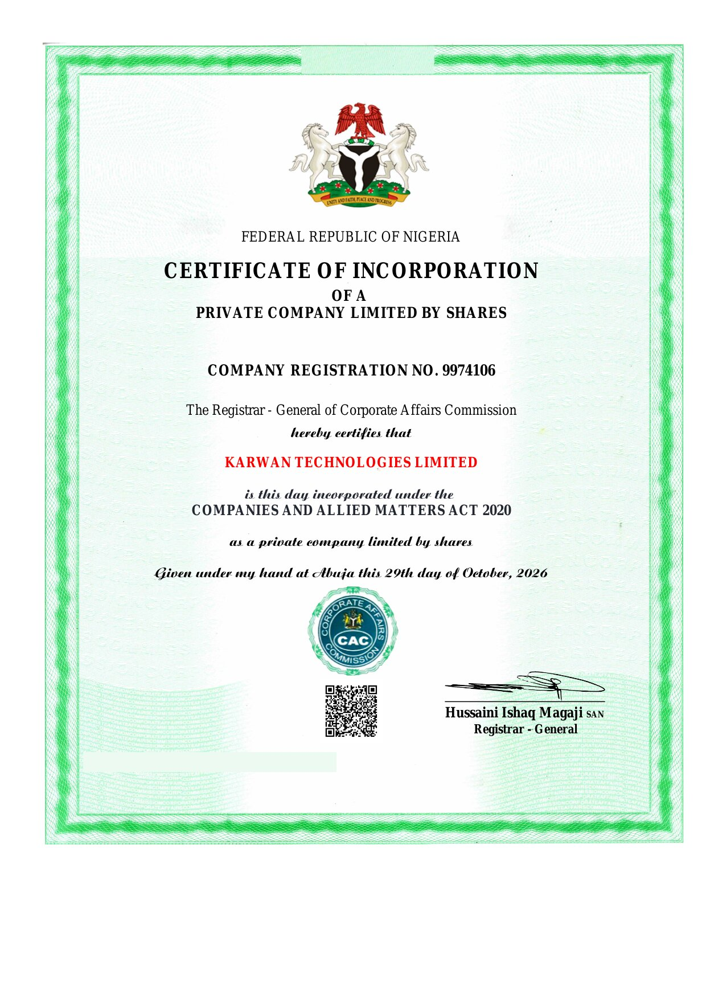

# Company registration, Nigeria

Karwan is built by **Karwan Technologies Limited**, a private company limited by shares, incorporated in Nigeria with the Corporate Affairs Commission (CAC).

| | |
| --- | --- |
| Registered name | Karwan Technologies Limited |
| Company registration number (RC) | 9974106 |
| Company type | Private company limited by shares |
| Incorporated under | Companies and Allied Matters Act 2020 |
| Date of incorporation | 29 October 2026 |
| Issued at | Abuja, by the Registrar-General of the Corporate Affairs Commission |

## Certificate of incorporation

The company's tax identification number is covered in this copy. The same image is linked as Company registration in the footer of [karwan.site](https://karwan.site).

## Check it yourself

The registration is public. Search for **RC 9974106** or **Karwan Technologies Limited** on the CAC public search at [search.cac.gov.ng](https://search.cac.gov.ng). The certificate also carries a CAC QR code that opens the same record.

## What registration covers

Incorporation makes Karwan Technologies Limited a legal company in Nigeria. It is not a licence to hold customer money, offer payment services or provide financial advice, and Karwan does not claim one. Deals on Karwan settle in USDC through escrow contracts on Arc; while Karwan runs on Arc Testnet, deals use test USDC with no real value.

## Contact

support@karwan.site
