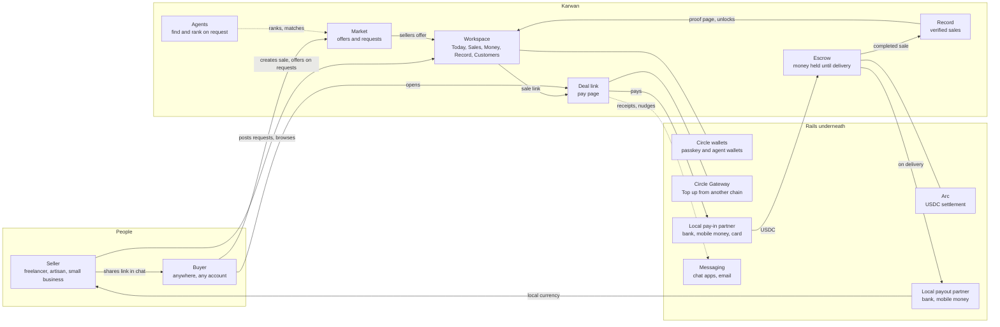
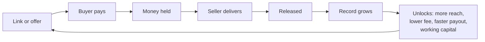

# 01 · Workspace

The workspace is where a seller runs their trade: today's orders, new sale links, money, their record and their customers. Buyers never need the workspace; they meet Karwan through a link or the market.

## Context

## The loop that makes it a product

The top of the loop (hold and release) is infrastructure nobody pays for directly. The bottom (record and unlocks) is why a seller keeps coming back.

## The first trade

A new account has a wallet, agent wallets and nothing else. Home shows **Your first trade** until the first deal settles. Each step ticks itself from what is true, never from a click:

1. Set up my Karwan, shown until the setup is saved ([view 19](19-simple-karwan.md#after-activation-the-agent-gets-to-know-you)).
2. Agent wallets active.
3. Add USDC (ticks when the balance is above zero).
4. Connect Telegram, where the agent works for them.
5. Connect the places you work, only for someone who picked "Build a record clients trust".
6. Start a deal: I want to buy, I want to sell, or I already have a buyer or seller. Someone who said they have clients is sent to a payment request first, everyone else to the market.
7. Finish it. Every finished deal builds the record.

Under the steps, the money flow in one line: you pay into escrow, they deliver, you release, both rate. The assistant reads the same checklist, so a person who starts in Telegram is told the same next step.

## Setting up the account

After agent wallets activate, Set up my Karwan (`/setup`) asks what the person wants Karwan to do and only the questions those answers need. The server reads the answers into the agents' settings (`POST /api/setup/preview`, then `POST /api/setup/save` on "Looks right"). The Telegram interview after the tag asks the same questions with buttons for the choices and ends with the same summary as a confirm card; the assistant's `set_up_my_agents` tool changes one answer at a time from any conversation. The whole flow is [view 19](19-simple-karwan.md).

## Status

| Part | Status | Where |
|---|---|---|
| Market with offers and requests | Live (testnet) | `frontend/features/listings`, `backend/src/routes/listings.ts`, `jobs.ts` |
| Escrow, release, disputes | Live | `contracts/`, `backend/src/agents/dealWatcher.ts` |
| Passkey accounts (mainnet) and agent wallets | Live | `frontend/features/modularWallet`, `backend/src/db/agentWallets.ts` |
| Direct offers on requests | Built | [03](03-direct-offers.md) |
| First-trade checklist on Home and in the assistant | Built 20 Oct 2026, not deployed | `frontend/features/home`, `backend/src/assistant` |
| Set up my Karwan on the website, in Telegram and from the assistant | Built 20 Oct 2026, not deployed | `frontend/features/setup`, `backend/src/routes/setup.ts`, `backend/src/agents/agentBrief.ts`, `backend/src/channels/interview.ts` |
| Workspace tabs (Today, Sales, Money, Record, Customers) | Planned | spec: seller workspace |
| Local pay-in and payout partners | Planned | chosen per country, see research log |
| Messaging receipts and nudges | Planned | |
| Record that unlocks money | Planned | [06](06-record.md) |
