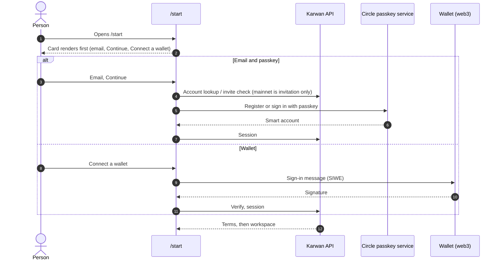
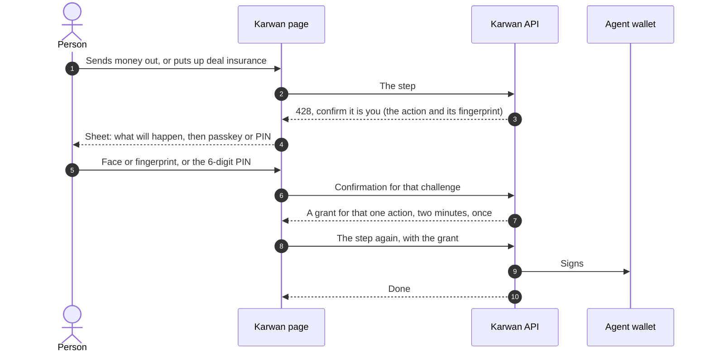
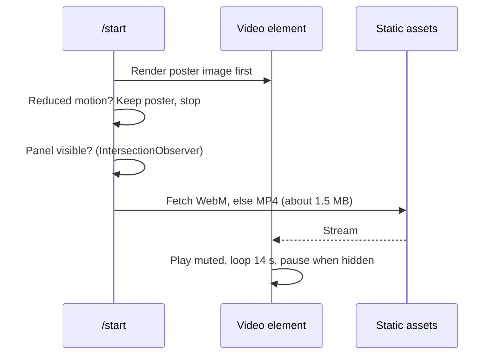

# 05 · Sign-in and motion

A person gets in with an email and a passkey, or a wallet. The sign-in page shows a short looping film of Karwan's own objects. The film never slows the sign-in down.

## Sign-in

## Confirming it is you

After sign-in, a person is asked to be present for three things only: setting up their record and their buying agent's limits, putting up deal insurance, and money leaving Karwan for an address that is not one of their own Karwan wallets. Every other step, paying into a deal, accepting, delivering and releasing, is signed by their agents without asking (view 27).

Notes: `backend/src/presence/` and `/api/confirm`. The PIN is stored only as a slow salted hash (scrypt) and locks for 15 minutes after five wrong tries; a passkey still works while it is locked. A sign-in passkey also confirms. The first PIN or passkey needs a code sent to the person's email, or a one-time link from their chat agent opened in the last 10 minutes. A forgotten PIN is reset by email code. A chat never asks for a PIN: the agent sends a one-time Karwan link and the person confirms on the page. An account that signs in with its own wallet confirms by signing the action text, with a one-time nonce, in that wallet. A grant fits one action, one amount and one recipient, and is spent once.

## Motion loading

## The film

14 seconds, seamless: deal cards drift in; two meet and fold into a capsule sealed with a lime line; the capsule opens and a coin settles on the record stack, which grows by one; everything drifts back. Four objects modelled once in 3D in code, one matte material, palette colours only. No AI imagery or stock 3D.

Approval gates: still frames, then a 6 to 8 second motion study, then the full loop.

## Status

| Part | Status |
|---|---|
| Email, passkey and wallet sign-in | Live |
| Confirming it is you, passkey or Karwan PIN | Built, not deployed |
| Redesigned sign-in layout | Planned (spec Part C) |
| Poster-first, visible-only film loading | Planned |
| 3D objects and film | Planned, gated |
