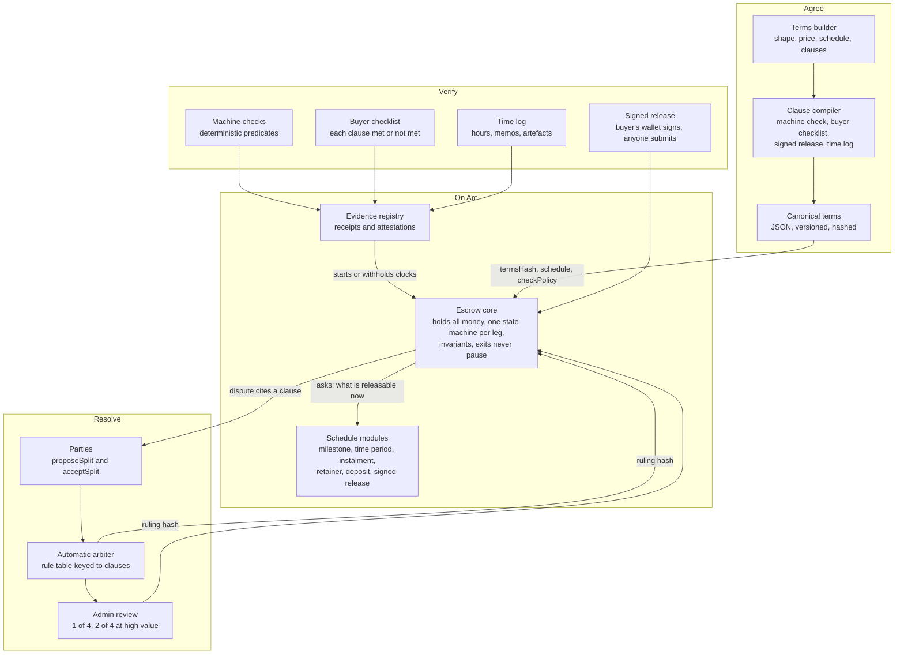
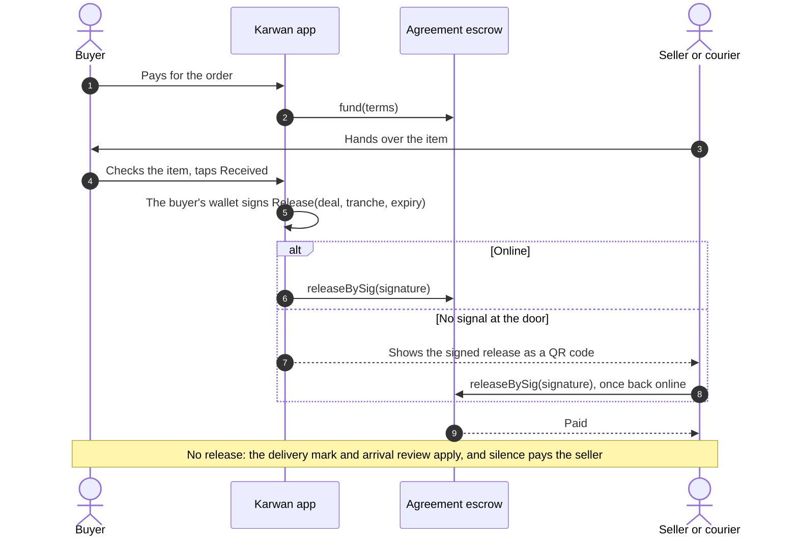
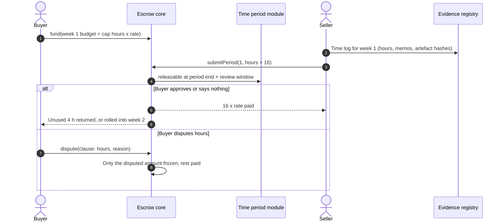

# 07 · Escrow: one engine for any deal

Every deal on Karwan, from a 3,000 naira phone case to a six-month software retainer, ends in the same place: money held by a contract, released only by the terms both sides agreed. This view designs that engine so it holds any kind of deal, lets the buyer verify each term by hand when no machine can, and gives an arbiter a clear rule for every dispute.

It extends the terms-driven design in [`docs/escrow-design.md`](../escrow-design.md) (the v3 `KarwanDealEscrow`). Everything that document fixes (terms hash consent, clocks that only move forward, one dispute per side per milestone, exits that never pause, owed credits, caps) stays. What this view adds: payment **schedules** beyond fixed milestones, **verification modes** per term, and a **dispute rule table** keyed to the terms.

## 1. The deals people actually make

Looked at from emerging markets first, where cash on delivery, "pay small small", mobile money and chat-based selling are normal.

| Shape | Example | How money should move | Today |
|---|---|---|---|
| Instant one-time | A logo file, a phone case | Paid now, held briefly, released on confirmation or a short timer | v3 single milestone |
| Fixed price, milestones | Website in three stages | Funded upfront, released stage by stage after review | v3, up to 5 milestones |
| Physical goods with delivery | Wig from Lagos to Abuja | Held until the buyer has the item; review starts on arrival | v3 `ON_ARRIVAL` |
| Pay on delivery, prepaid | Replaces cash on delivery | Held until the buyer taps "Received" at handover, which signs a release the app or the courier submits | Built, not deployed |
| Hourly or weekly time | Virtual assistant, 20 h a week at 8 USDC | Weekly budget held; hours submitted with a work log; buyer reviews; approved hours paid, unused returned or rolled | Planned |
| Retainer or subscription | Monthly social media management | One period funded at a time; paid at period end unless disputed; either side can end with notice | Planned |
| Instalments, lay-by | Fridge paid in four parts | Buyer pays equal parts into escrow; the seller delivers once the last part is in; a missed part ends the plan with the cancellation fee agreed upfront | Built, not deployed |
| Refundable deposit | Equipment rental, booking | Held and returned at the end unless the seller's claim holds | v3 `silenceOutcome = 1` |
| Business order, net terms | 200 T-shirts, Net 30 | Held; review lasts the net term; financing can advance the seller | v3 net preset, `KarwanPOFinancing` |

## 2. Architecture



### Why a core with schedule modules

**Superseded by [view 11](11-contracts.md).** Arc enforces the 24,576-byte contract limit, and research on real losses favoured keeping each family's money in its own contract. The suite now uses option C on one shared, audited settlement base, which removes the duplicated invariants listed against it below. The shapes, verification modes and dispute table in this view are unchanged and are assigned to families in view 11.

| Option | For | Against |
|---|---|---|
| A. Grow the v3 terms struct to cover every shape | One contract to audit | Bytecode limit, and every new shape touches the audited core |
| **B. Core holds money, schedule modules compute what is releasable (chosen)** | Money and invariants stay in one audited place; a new shape is a new module, audited alone; modules hold nothing | An interface to get right once; a module allowlist governed by the owner Safe with a timelock |
| C. A separate escrow per shape | Simple per contract | Invariants duplicated; money spread across contracts; harder to reason about in total |

Rules for modules: a module is a pure view contract. It returns, for a leg at a moment in time, how much the seller may claim, how much the buyer may take back, and which clock applies. It cannot hold, move or approve money. The core enforces conservation (`in == out`), final-state absorption and the recipient allowlist whatever a module says. Modules are immutable; a changed rule is a new module version, and a funded deal keeps the module it was funded with.

## 3. Terms are what everything is checked against

A term is a clause both sides agreed, stored in the canonical terms and bound into `termsHash` before any money moves. Each clause gets one verification mode when the terms are compiled:

| Mode | When | Who decides | Example clause |
|---|---|---|---|
| Machine check | The clause is testable from evidence | A deterministic predicate; a model may only advise | "Merged pull request to `main` with passing CI" |
| Buyer checklist | A person has to look | The buyer marks the clause met or not met, with a reason and photos | "Wig is 22 inch, body wave, black" |
| Signed release | Physical handover | The buyer taps "Received"; their wallet signs a release for that tranche, which the app submits, or the courier scans as a QR code where there is no signal. Nothing to guess, and no gas for the buyer. A signature stays good until its expiry, even if a dispute opens later, so the app signs with a short expiry | "Released by the buyer at handover" |
| Time log | Hourly work | Hours, memos and artefacts per period, reviewed by the buyer | "Up to 20 hours a week on bookkeeping" |
| Clock only | Nothing to test | The review window and silence rule | "Available for questions for 7 days" |

The buyer's review screen is the terms as a checklist. Releasing means every clause is met. Disputing means naming the clause that was not met and why. A dispute that cites no clause is refused by the app, so every dispute an arbiter sees is about a specific promise.

## 4. Sequences for the new shapes

### Pay on delivery, prepaid



### Hourly work, weekly



### Instalments, lay-by

```mermaid
sequenceDiagram
  autonumber
  actor B as Buyer
  participant ESC as Agreement escrow
  actor S as Seller

  B->>ESC: fund(terms): part 1 of 4, the rest counted against the caps now
  S->>ESC: accept(termsHash): item reserved
  B->>ESC: payPart: parts 2, 3 and 4, any time until someone ends a missed plan
  S->>ESC: markDelivered, only once every part is in
  ESC-->>S: Paid after review
  Note over B,S: A part missed past its grace: anyone ends the plan. The seller keeps the agreed fee, at most 20% and never more than was paid, if they accepted before the default; the buyer gets the rest; Karwan takes nothing. A last part paid late moves the delivery deadline by its lateness
```

## 5. Disputes an arbiter can decide

Every dispute cites a clause. The automatic arbiter reads the terms, the clocks and the evidence, and applies a table like this. Anything outside the table escalates to admin review.

| Situation | Evidence | Proposed ruling |
|---|---|---|
| Nothing delivered by deadline + grace | No delivery mark | Full refund to the buyer |
| Delivered on time, machine check passed, buyer cites no failed clause | Receipt for this revision | Seller paid |
| Machine check failed on the cited clause for this revision | Mismatch receipt | Buyer refunded for that leg |
| Buyer signed a release at handover | Signature on chain | Seller paid; the tranche is closed |
| Hours disputed, time log shows activity for the claimed hours | Log hashes, artefacts | Seller paid for logged hours with artefacts; the rest escalates |
| Buyer checklist: clause not met, with photos, seller does not respond in 48 h | Checklist, photos, silence | Refund or agreed partial |
| Both sides have evidence on a subjective clause | Conflicting | Escalate to admin review |

Rulings only ever split a leg's unreleased money between the two parties, carry a ruling hash, and take effect after the appeal window unless a side escalates. The meta-evidence for every dispute is the canonical terms, in the same spirit as the ERC-1497 evidence standard.

## 6. Emerging-market requirements

- **Local money in and out.** Buyers pay in naira, shillings or cedis through local partners; the escrow only ever holds USDC; each deal records the FX rate and fee at funding so a refund returns the same local amount where the partner allows, and states when it cannot.
- **Low data, chat first.** Every step has a short link and a plain message fit for a chat app or SMS; release at handover signs on the buyer's phone and needs no signal at the door.
- **Couriers without apps.** The seller can submit the buyer's signed release on the courier's behalf.
- **Small amounts.** Fees and clocks fit a 5 USDC sale as well as a 5,000 USDC order; the caps from the v3 design apply.
- **Cancellation on unreliable schedules.** Every shape states upfront what happens if the other side goes quiet.

## 7. Invariants added to the v3 set

| ID | Invariant |
|---|---|
| I18 | A schedule module never moves money; removing every module call leaves conservation intact |
| I19 | Per leg: paid to seller + returned to buyer + fees + owed == funded for that leg |
| I20 | A signed release pays at most its own tranche, once |
| I21 | A time-period leg never pays more than cap hours x rate for that period |
| I22 | An instalment deal never pays the seller before the last part is funded |
| I23 | A dispute freezes only the disputed leg's unreleased amount |
| I24 | A funded deal keeps its module version for life |

## 8. What exists and what comes

| Piece | Status | Where |
|---|---|---|
| Terms struct, hash consent, milestones, review, extensions, silence outcome, refundable deposit | Built (v3) | `contracts/src/KarwanDealEscrow.sol`, `KarwanDealTypes.sol` |
| Arrival review for goods | Built (v3) | `reviewStarts = 1` |
| Machine check with evidence receipts | Built (GitHub pilot) | `KarwanEvidenceRegistry.sol`, `backend/src/deals/deliveryEvidence.ts` |
| Automatic arbiter rules, appeal, admin review | Built (v3) | `backend/src/deals/arbiterV3.ts` |
| Live escrow for today's deals | Live (v2b) | `KarwanEscrow.sol` |
| Canonical terms JSON and clause compiler | Planned | |
| Buyer checklist review and clause-cited disputes | Planned | |
| Escrow families on a shared base (replaces the schedule module interface) | Base, hub and Agreement family built, not deployed | [View 11](11-contracts.md) |
| Signed release at handover (replaces the delivery code) | Built, not deployed | Agreement family |
| Disputes: arbiter proposal, 72-hour appeal, reviewer ruling within 5 days, fallback in the terms | Built, not deployed | Agreement family, shared dispute library |
| Up to 12 tranches, seller accept deadline, seller extension request | Built, not deployed | Agreement family |
| Hourly and weekly time | Planned | Time family |
| Instalments | Built, not deployed | Agreement family |
| Retainers | Planned | Time family |
| Streaming for trusted retainers | Later | Sablier Flow style, only after the period model proves out |
