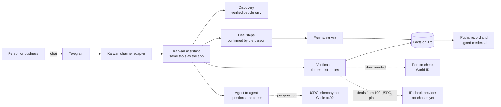
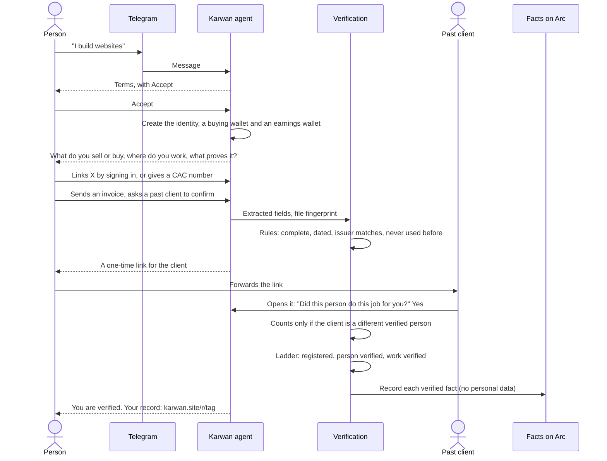
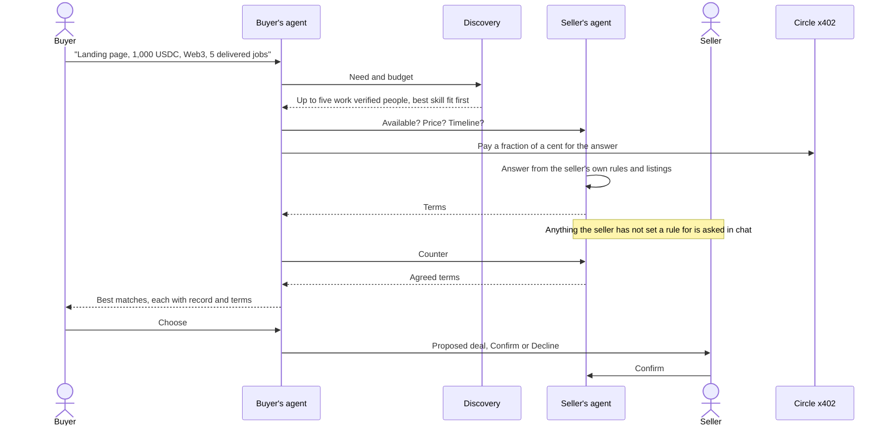
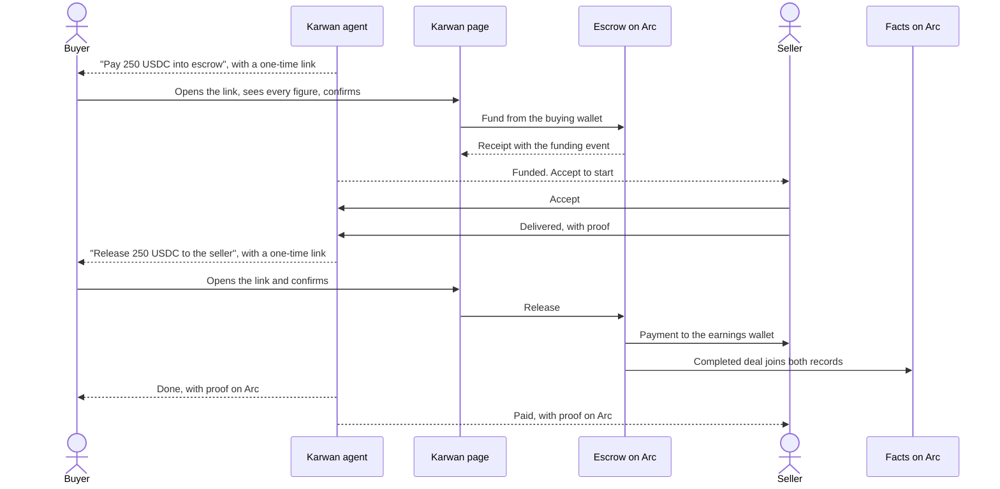
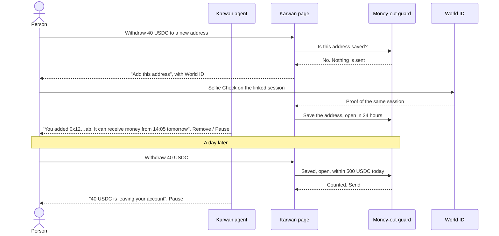
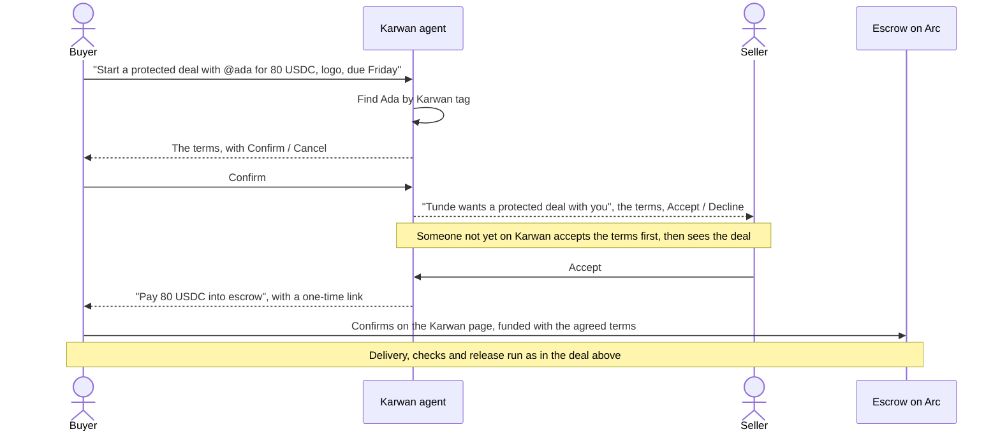
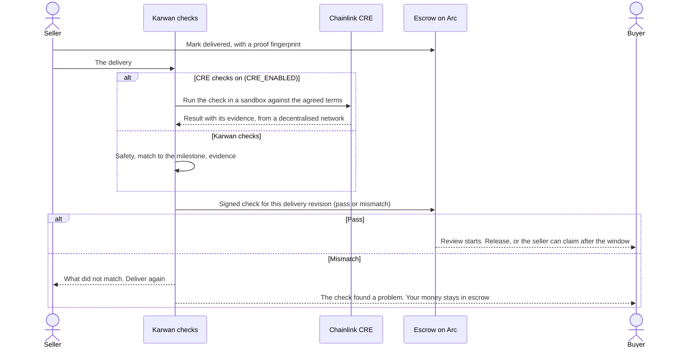

# 10 · Verified network: the Karwan agent in chat

Karwan lets your reputation travel with you, and lets your agent use that reputation to find, negotiate with, and transact with the right people.

This view puts that to work where people already talk: in a chat app, starting with Telegram. A person tells the Karwan agent what they sell or buy. The agent checks their work and their identity. Once they are verified, other people's agents can find them. The agents agree price, timeline and terms. The two people approve the deal and settle it in escrow on Arc, without opening the Karwan site. Every verified fact and every completed deal joins the person's record on Arc, where anyone can check it.

It builds on the unified reputation (view 08), the record (view 06), escrow (view 07) and the trust engine (view 09). Telegram is the first channel. A WhatsApp adapter is built and paused. Others follow on the same core.

## Architecture rules

These hold for every part of this view and for every channel added later.

1. **The record belongs to a person.** Wallets, phone numbers and linked accounts attach to one identity. A fact or a deal is written to that identity, never to an agent wallet acting for it, and the contract refuses any write that would.
2. **Facts on chain, scores off chain.** Arc holds what was verified, by whom, how strongly, when it expires, and a fingerprint of the evidence. It holds no score, no document and no personal data. Scores are computed from the facts by a published formula that can improve without rewriting anyone's record.
3. **Code decides, models read.** A language model may read a conversation or extract the fields of a document. It never decides that something is verified, never sets a weight and never computes a score. Every verdict comes from deterministic rules that are tested and published.
4. **Earned, not claimed.** Something a person says about themselves counts for nothing until it is checked. A past client's confirmation counts fully only when that client is a different, verified person. The same document cannot back two people.
5. **Verified before discoverable.** Agents only find people who reached work verified. Unverified people can still use their own account; nobody's agent is pointed at them.
6. **Agents do the legwork, people decide.** Agents search, ask and negotiate. Every payment, release, cancellation and agreement is a step the person confirms, with the consequence stated first.
7. **One core, thin channels.** Every channel runs the same assistant, the same tools and the same authorization checks as the Karwan app. A channel only translates messages and buttons. Adding a channel adds no new way to move money.
8. **Proven on chain, not assumed.** A money or record step is done only when the receipt shows the expected event and a fresh chain read agrees. "Submitted" is never "done".
9. **Contracts are immutable and earn their limits.** Exploit tests come before code, then fuzzing, invariants and static analysis. A contract that is not yet audited runs with caps written into it. A pause stops new deals and never an exit. Deploys are the owner's.
10. **Readable without Karwan.** Facts sit on Arc, and each person can export a signed credential that anyone can verify against Karwan's published key and the chain, with Karwan offline.
11. **Only what is needed, only with consent.** Karwan keeps what verification and matching need, tells the person why, encrypts documents, and deletes on request. Machines match on the details; other people never see them.
12. **Status is stated, never implied.** Every capability is marked live, built or planned. Beta limits are said wherever money is involved.

## Participants

## Registering and getting verified

**The ladder.** Each level is decided by rules, from facts that have not expired:

| Level | What it takes | What it opens |
|---|---|---|
| Registered | Accepted the terms, described their work | Their own account |
| Person verified | A person check (World ID; an ID check is planned for places World ID does not reach), plus one account they own (X) or a matching business registration | A public record |
| Work verified | Independent proof of work: a verified past client's confirmation (an invoice can back it, never alone), public work on GitHub, or a completed Karwan deal | Discoverable by agents |
| ID verified | A government ID check. Planned: no provider yet, so nobody holds this level | Deals of 100 USDC and above, closed until then |

## Finding a counterparty and agreeing terms

## Closing the deal: agreed in chat, paid on Karwan

Agreements, delivery and disputes are confirmed in chat. Every step that moves money opens a one-time Karwan link, valid once for ten minutes, and is confirmed on the page, where the person sees every figure first. No chat button moves money, and the chat adapter refuses a money step that reaches it. Money comes in from any wallet or chain, or a payment link. Funding from a bank or USSD is planned. Earnings are withdrawn under the rules in the next section.

## Money leaving an account Karwan holds

A chat account's wallets are signed by Karwan, and the chat channel is how the person signs in. A recycled phone number, a SIM swap or a borrowed phone would otherwise be enough to empty them. So money leaves such an account only after a check that only the same person can pass: the World ID session they linked with a Selfie Check at the person check.

- Money leaves only to an address added with the person's World ID. A new address can receive money 24 hours after it is added, and the chat says so at once with a Remove button.
- Up to 500 USDC leaves in any 24 hours, payments into escrow included, so a deal with an accomplice is not a way around it.
- After more than 60 quiet days, the next money step needs the World ID check again. A recycled number arrives exactly like this.
- Every payment out is announced in chat with a Pause button, and only the World ID check resumes payments.
- The guard runs in every route that moves money out of a Karwan-held wallet, never in a channel. A web account holds its own wallet, so the agent wallets Karwan signs for pay out only to it.

Someone who holds the person's unlocked phone and their World App can still add an address. The 24-hour wait, the notices and the daily limit are what bound the loss.

## A deal with someone you already know

Discovery is for finding new people. Many trades start between people who already know each other and want the money protected. A direct deal skips the search and the agents' negotiation: one person names the other and the terms, the other confirms, and the deal runs through the same escrow and the same delivery checks.

A direct deal needs both people to have accepted the terms. It does not need either to be discoverable, because nobody was found by an agent. The beta cap applies as on every deal, and deals of 100 USDC and above stay closed until an ID check exists.

## Delivery checks

The deal terms go to the escrow contract when it is funded, so every check is measured against the exact terms both people agreed, not against a later memory of them. When the seller marks a milestone delivered, Karwan's checks run before the buyer is asked to release:

- **Is the delivery safe to open.** A link flagged as unsafe is hidden from the buyer, and the seller is asked for a corrected one.
- **Does it match what was asked.** The delivery is compared with the milestone's words. The answer is covered, missing or unclear. It never grades quality, and the buyer still decides.
- **Does the evidence hold.** For software work, the repository evidence must match the agreed terms and the delivered revision.

The result is recorded on the escrow as a signed check for that exact delivery revision. A pass starts the buyer's review clock. An unsafe or mismatched delivery pauses the release, so the buyer never pays for the wrong thing by accident, and the seller can deliver again. If the check never answers, the buyer can review the delivery themselves. A check never moves money on its own. A check result goes stale when the terms or the delivery change, and the check runs again.

Chainlink CRE runs the same checks in a sandbox on a decentralised network, so a check result does not rest on Karwan alone. It is switched on with one setting, `CRE_ENABLED`, once the workflow is fully wired for deals. Until then Karwan's own checks run, and the record says which ran.

## What fails where

| Where | What can go wrong | What happens |
|---|---|---|
| Channel | A message is delivered twice | Each message is handled once |
| Channel | A Confirm button is pressed twice, or after the deal moved | One action at most; the second press is told it is done, or shown the current step |
| Channel | Someone has never started a chat with the bot | A bot cannot message them first, so the person gets a one-time link to forward |
| Verification | The same invoice from two accounts | The second is refused |
| Verification | A client says No | Stored as evidence against the claim; never shown to anyone else |
| Verification | A business registry lookup fails | A reviewer checks it, and the fact records that a person reviewed it |
| Verification | Two accounts send the same business registration | It backs the first approved account only; the second is refused and told why |
| Verification | A reviewer approves a registration in error | The reviewer withdraws it with a reason; the fact stops counting, the number is free again, and the person is told |
| Identity | One person tries a second account | The person check is unique per identity; the second is refused |
| Discovery | Few verified people fit | The agent says so, and never offers an unverified person |
| Agent to agent | The micropayment cannot settle | The question is still answered and logged as unpaid |
| Escrow | Deal above the beta cap, or of 100 USDC and above while no ID check exists | Refused before anything is signed, with the reason |
| Escrow | The transaction is submitted but the event is missing | Not treated as done; the agent says it is still confirming |
| Escrow | Paused | No new deals; every open deal can still finish |
| Delivery check | The check cannot run or has no result yet | Nothing moves. The agent says the check is pending, and the buyer can take over the review |
| Delivery check | CRE is on but unavailable | Karwan's own checks run, and the record says so |
| Direct deal | The named person is not on Karwan | They get an invitation; the deal waits until they accept the terms and the deal |
| Money out | Someone else gets into the person's chat | Money goes only to saved addresses; a new one waits 24 hours and the chat is told, with Remove and Pause |
| Money out | World ID is down | No address can be added and a returning account waits; saved addresses keep working inside the limit |
| Money out | Two payments at once | One at a time per account, so both cannot fit under the daily limit |
| Record | Karwan is offline | Facts on Arc and the signed credential still verify |

## Status

| Step | Status |
|---|---|
| Assistant with confirm steps for deals, sends and payment links | Live on testnet (in the app) |
| Escrow (view 07) | Live on testnet |
| Person check with World ID | Built, behind a flag |
| X sign-in linking | Built |
| Telegram channel adapter, money steps confirmed on Karwan from a one-time link | Built, not deployed |
| Money out of a Karwan-held account: saved addresses with World ID, 24-hour wait, 500 USDC a day, return check, Pause | Built, not deployed |
| WhatsApp channel adapter | Built, paused |
| Verification rules, ladder, evidence checks | Built, not deployed |
| Facts contract on Arc and signed credential | Built, not deployed |
| Discovery limited to verified people | Built, not deployed |
| Agent-to-agent questions paid with x402 | Planned |
| Direct deals with someone you already know (in the app) | Live on testnet |
| Direct deals created, accepted and funded from chat | Built, not deployed |
| Delivery checks: safety, match to the milestone, software evidence, signed result on the escrow | Built, testnet |
| Delivery checks run in Chainlink CRE behind `CRE_ENABLED` | Planned. Waiting on the workflow being fully wired for deals |
| Escrow on Arc mainnet for chat deals: beta, capped at 1,000 USDC per deal and 10,000 USDC in total, unaudited, replaced by the audited deployment at launch | Built, not deployed |
| ID check for deals from 100 USDC | Planned. Provider to be chosen |
| Funding from a bank or USSD | Planned. Provider to be chosen |
| X and other channels | Planned |

Contract and module notes: the channel adapter calls the same assistant turn as the app, and confirm buttons run the app's own routes and checks. The chat deal limits live in the funding routes, not in the adapter, so a browser session opened from a chat link meets the same limits. Facts are written to a facts contract that also receives completed deals from the escrow. The x402 payment uses a separate signing wallet per agent, because Circle Gateway accepts only plain signatures on payment authorisations.
