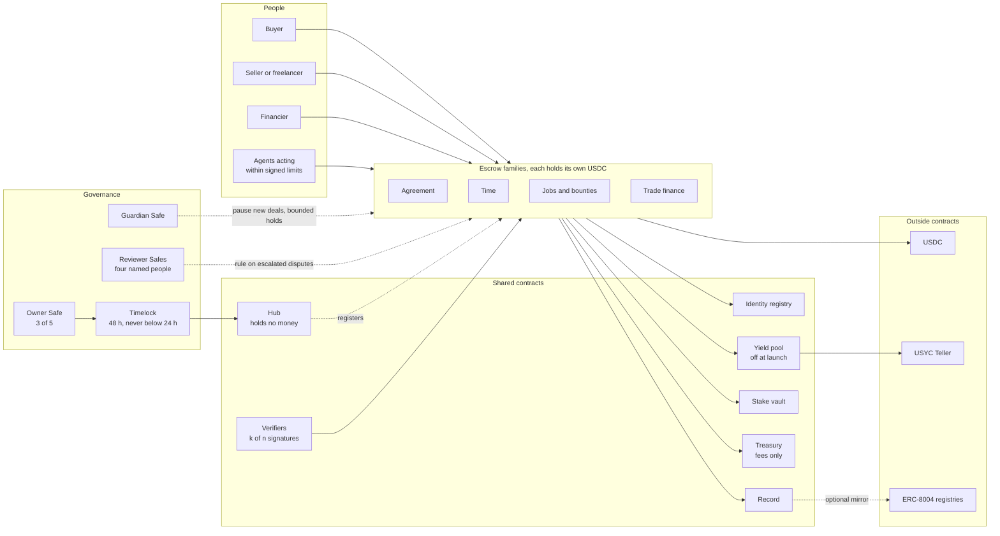
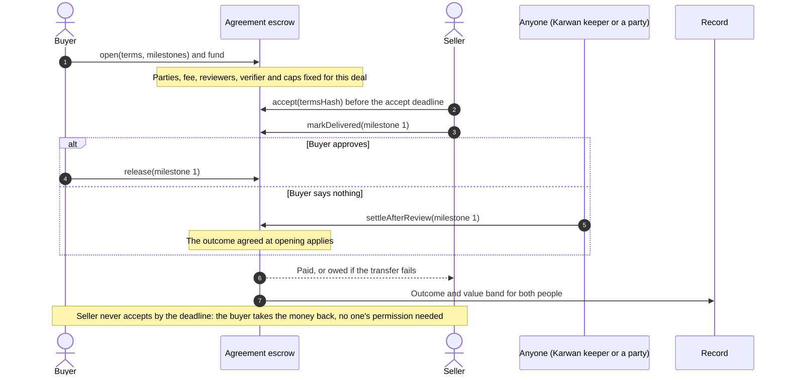
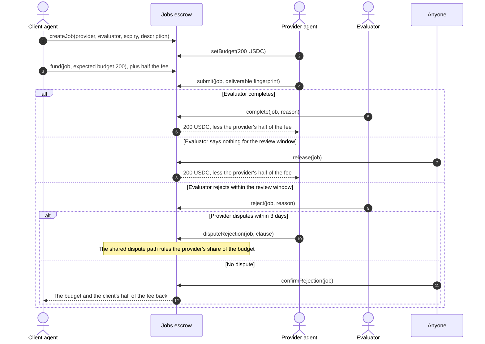
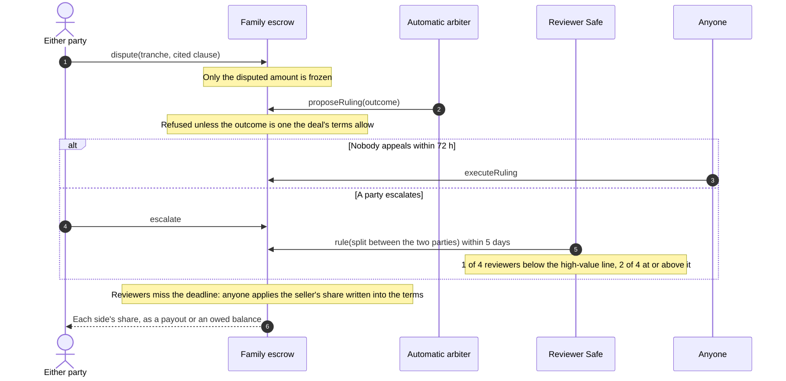
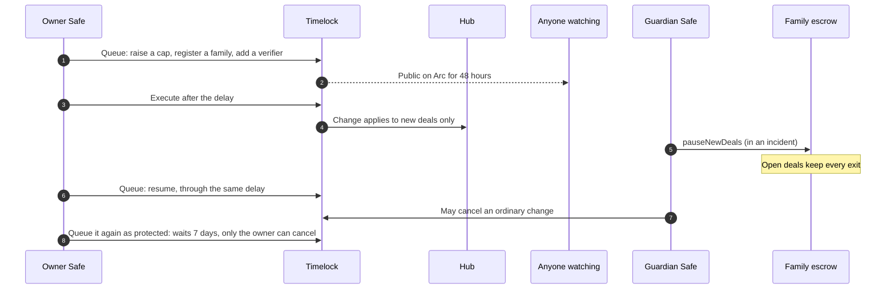

# 11 · Contracts: one suite on Arc, deployed once

Karwan's money rules live in contracts on Arc, not on Karwan's servers. This view designs the suite that holds every kind of deal, from a single logo file to an hourly retainer or a financed business order, and is deployed once. Nothing in it is ever replaced. A new kind of deal arrives as a new contract beside the others, and money, records and identities already on chain never move.

It replaces the "one core with schedule modules" choice in [view 07](07-escrow.md). The deal shapes, verification modes and dispute table in view 07 stay; this view decides which contract holds each one, what connects them, and what Karwan itself can and cannot do to the money. It applies architecture rule 9 from [view 10](10-verified-network.md): contracts are immutable and earn their limits, a pause stops new deals and never an exit, and admin power over deal money exists only through an escalated ruling.

## Rules for the suite

1. **Each family of deals has its own escrow, holding its own money.** A fault in one family cannot reach another family's balance. Arc enforces the 24,576-byte contract limit, so each family keeps its rules in fixed libraries and holds only its own deals' money.
2. **One shared base, audited once.** Every family escrow is built on the same settlement base, and the base decides who can ever be paid: a party recorded before any money left the deal, someone the payee signed the payout over to, or Karwan's fee within the maximum written into the contract (10%). No family, present or future, can widen that.
3. **Every payout is pull-safe.** Arc refuses transfers to blocked addresses. A payment that cannot be delivered becomes an owed balance that only its owner can withdraw, so one blocked party never freezes a deal or anyone else.
4. **An exit after expiry can never be blocked.** No pause, verifier, outside contract or admin key can stop a party from taking what the deal's terms give them once its clocks run out. A guardian hold can delay it, 7 days at a time and 30 days at most per deal.
5. **A deal keeps the rules it opened with.** Fee, caps, reviewers, verifier and yield eligibility are fixed for the life of the deal. A later change applies to new deals only. The one exception is the yield pool's Teller, set out under the yield pool below.
6. **No upgradeable code.** No proxies, no self-destruct. Shared logic sits in libraries that are linked once at deployment and can never change; their addresses and bytecode are published with the deployment. A changed rule is a new contract, and funded deals stay where they are.
7. **Parties act for themselves.** Every action a buyer, seller or financier can take is callable from their own wallet, with no Karwan server in the path. Every timeout can be triggered by anyone. Karwan runs a keeper as a convenience, not as a requirement.
8. **Contracts Karwan does not control are outside parties.** USDC, USYC and its teller, and the ERC-8004 registries on Arc can be upgraded by their owners. The suite reaches them through narrow interfaces, and nothing they return can block an exit. Deal money parked in the yield pool carries USYC's own risk: the pool's cushion and the treasury cover a shortfall, and until they do, the payouts that need the pool are owed.

## Participants



## The shared settlement base

Every family inherits it, and it is the part audited hardest.

| Guarantee | How it is enforced |
|---|---|
| Money leaves a deal only to its recorded parties, a signed assignee, or the fee | The fee recipient is stored when the deal opens. Parties are stored at opening, or added before any money leaves for deals whose winners are chosen later. Every payout checks against them |
| A payout to someone else needs the payee's signature | A typed signature from the payee (a wallet or a smart account) naming the deal, assignee, amount, nonce and expiry. Each nonce works once, in any order, and the payee can cancel one before it is used |
| Books always balance | For every family: USDC held plus money parked in yield equals open deal balances plus owed balances |
| Failed transfers never strand money | The amount moves to the payee's owed balance, withdrawable only by them |
| Exit after expiry cannot be blocked | The refund or claim path at expiry ignores pauses, hooks, verifiers and outside contracts; holds can only delay it, within their 30-day budget |
| Configuration is per deal | Fee, caps, reviewers, verifier and yield eligibility are copied into the deal when it opens |
| Only USDC moves, through its ERC-20 interface | No function accepts native value; amounts are 6-decimal tokens throughout, moved only by the base's library |
| Checks come from several independent checkers | A delivery check counts only when the deal's verifier contract holds signatures from enough of its fixed checkers. The first result for a delivery is final, so no checker can overturn another's; a seller who disagrees delivers again or disputes |
| Money promised at opening keeps its room | An instalment plan's whole price counts against the caps, and against an agent payer's signed limits as one payment, when the deal opens. Its later parts are accepted even while the family is paused or after the agent's binding expires; only a revoked family or a delisted asset refuses them |
| Bounded work per call | No call walks a list that users can grow; the worst case stays well under Arc's per-transaction gas cap |
| Payouts go to the recorded wallet | A payout or owed balance goes only to the wallet recorded in the deal, or to its signed assignee, so money frozen by USDC's blocklist cannot be routed elsewhere |

## The families

| Family | Covers | How money moves |
|---|---|---|
| Agreement | One-time and milestone deals, goods and mixed orders, net 30 to 90 terms, instalments, refundable deposits, pay on delivery | Up to 12 funded tranches under one delivery deadline. Each releases on the buyer's approval, the buyer's signed release at handover, or a review window ending with the outcome agreed at opening; the review starts at delivery, at the buyer's arrival confirmation, or at a passing check. A review started late never reopens a clock that has run out, and a guardian hold delays only the tranche it falls in. Instalment plans take equal parts, and the seller delivers once the last is in. A dispute freezes only the disputed tranche, and a ruling pays only that tranche. Both parties can sign any split. The seller can sign the payout over to a financier |
| Time | Hourly, daily and unit work, retainers | One employer and one worker. The employer funds each cycle's budget (the most hours times the rate, or the retainer), one cycle at a time or several ahead. The worker submits the units worked with a fingerprint of the work log, until a claim grace after the cycle ends, 2 days by default. The employer can approve at any time; once the grace ends and the claim is final, the employer has the review window, 5 days by default, to object to some units, and silence then pays the submitted units. An objection holds only the objected units for the dispute path; the rest is paid at once. Unused budget goes back, or carries forward when the terms say so. Either side ends the engagement with the notice the terms set, 0 to 4 cycles, and a cycle inside the notice runs only if the employer funds it; both sides together can end it at once. A new rate or hours apply to cycles not yet funded, once both sides sign. The per-deal cap counts what an engagement holds at once, and the engagement records one outcome when it closes, valued at what the worker was paid |
| Jobs and bounties | Agent-to-agent jobs, bounties, contests with one or more winners | Jobs follow ERC-8183, so outside agents use them through the standard interface: the client names a provider and an evaluator, the client or the provider sets the budget, the client funds exactly the budget it expects, and the evaluator completes or rejects the submitted work. On top of the standard, the evaluator's silence pays the provider once the review window ends, 5 days by default; a rejection of submitted work waits 3 days, in which the provider can take it to the shared dispute path, which can pay all, none or part; and submitted work never expires into a refund. A funded job nobody submitted for goes back at its expiry, and no hook can stop it, because hooks are not taken. Bounties and contests hold the prize; entrants submit a fingerprint of their work before the deadline, and the evaluator awards up to 8 places from the entries, with shares fixed when the bounty opens; after the deadline it may fill fewer places, and the shares of empty places go back. A bounty not awarded in time goes back to the client, whose record shows it was not awarded if anyone entered. The fee is split as in every family, and each escrow takes one asset, fixed at deployment |
| Trade finance | Purchase-order financing, invoice factoring | Holds no money. In one transaction the financier advances to the seller, the seller's signed assignment makes the Agreement escrow repay the financier first, up to the agreed amount, and the seller's signed stake, at least 10% of the advance, is reserved for the financier. The seller's assignment names Trade finance as the only contract that may submit it, so it never takes effect without the advance. Only an accepted, fully funded deal can be financed, and the repayment must fit what the deal still owes the seller. A default resolves on chain against the reserved stake, which the financier keeps reserved when the deal's horizon moves later |

A new family is a new contract on the same base, registered through the timelock. Kinds of deal that do not fit any family stay out until they get their own contract: per-second streaming, pooled lending with tranches and write-downs, contests decided by a vote, and letter-of-credit document workflows.

## How the families connect

- **The hub holds no money.** It lists which contracts are Karwan families, which assets and caps apply, and which verifiers exist. Registration lets a family write records and reserve stake. It never gives access to another family's balance. A family found faulty can be revoked: it loses those powers, opens nothing new, and its open deals still pay out.
- **Identity registry.** Wallets bind to one person by signature. A person can hand control to a new wallet, and their records follow. Deals and records are written to the person, never to an agent wallet acting for them. A person can also name one of their own wallets for recovery; it takes control after 7 days unless the person cancels.
- **Record.** Families write deal outcomes to the person: outcome codes and value bands, never exact amounts, never a score. A write for a wallet that is not bound to a person is refused, and a deal reaches a payee's record only once that payee accepted it.
- **Stake vault.** A registered family can reserve a person's stake only with a signature from one of that person's own wallets, never an agent's, naming the amount, the one beneficiary a slash can pay, and an expiry. Only the family that reserved can slash, never more than it reserved, and anyone frees a reservation once it expires or its family is revoked. Withdrawals wait 7 days, as long as an identity recovery, so a stolen wallet cannot take the stake out before its owner takes the identity back. Stake never goes into yield.
- **Treasury.** A dedicated Safe that receives fees and nothing else. It never holds deal money.
- **Yield pool.** The one place where money from several families sits together, so it gets the deepest review. There is one pool per asset, set once in the hub, because the pool is the one address Circle entitles for USYC. The timelock sets each family's share of eligible deal money, at most 90%, and each deal copies it when it opens; a deal that cannot run for 3 days stays out. Anyone moves a family's parked money toward that share, and when an eligible deal pays out, the escrow brings back what is parked beyond the new share at once, so the cash behind deals that take no yield stays in the escrow. The pool keeps a cash buffer, by default 10% of what is parked and at least 5,000 USDC; the timelock can raise it to 50%. Buying USYC costs a little more than selling it, so the pool subscribes only as much as its value above what is parked can pay for, by the Teller's own quotes, and undoes a subscription that leaves what is parked uncovered. A payout the escrow cannot cover from its own cash is taken from the pool; if the pool cannot pay yet, the payout is owed and paid when it can. Yield first builds a cushion, by default 0.5% of what is parked (the timelock can set 0.1% to 5%), and only value above it goes to the fee recipient. A fall in USYC's price can leave the pool short of what families parked until the treasury tops it up; until then the last payouts to need the pool wait as owed. The treasury seeds the pool once, about 0.05% of what it expects to be parked, which pays for the first subscriptions; yield pays for later ones. The Teller can change only while the pool holds no shares of real worth. That change reaches money live deals have already parked, so like every timelock change it waits 48 hours in public, and the guardian can cancel it or stop new subscriptions. A delisted asset parks nothing new and brings parked money back. Off at launch, until Circle entitles the pool.
- **Between families,** calls are typed and signed. Trade finance reaches the Agreement escrow only through the seller's signed assignment, and the stake vault only through the seller's signed reservation.

## A milestone deal, with nobody in the middle



## A week of hourly work

```mermaid
sequenceDiagram
  autonumber
  actor B as Buyer
  participant TM as Time escrow
  actor S as Freelancer
  participant K as Anyone

  B->>TM: open(terms): week 1 funded, 20 h x 8 USDC = 160, plus half the fee
  S->>TM: accept(terms hash), then submit(week 1, 16 h, log fingerprint)
  alt No objection within the window
    K->>TM: settle(week 1), once the claim grace and the review window end
    TM-->>S: 128 USDC, less the worker's half of the fee
    TM-->>B: 32 USDC unused and its fee share, returned or carried forward
  else Buyer objects to 4 hours
    B->>TM: object(week 1, 4 h, clause), after the claim grace
    TM-->>S: 96 USDC for the 12 h not objected to
    Note over TM: 32 USDC held for the dispute path, which rules the worker's share of it; the 32 USDC unused goes back when the dispute ends
  end
```

## An agent job

One agent hires another through the ERC-8183 interface. No step needs a Karwan server, and an evaluator who says nothing cannot hold up the provider's pay.



Where the Jobs family differs from ERC-8183:

- Hooks are not taken; a job created with one is refused.
- `claimRefund` refunds only a funded job nobody submitted for. Submitted work is completed, rejected or paid by silence.
- The evaluator rejects submitted work only within the review window, and the rejection takes effect after 3 days unless the provider disputes it; until then the job stays `Submitted`.
- A ruling ends the job `Completed` when it pays the provider anything, with `PaymentReleased` and `Refunded` for the two shares, and `Rejected` when it pays nothing.
- `submit` must come before the job's expiry, and the provider cannot be the evaluator.
- The client funds the budget plus half the fee; `JobFunded` reports the budget.
- `JobCompleted` and `JobRejected` always name the job's evaluator; the reason reads `silence` or `ruling` when the evaluator did not decide.
- Bounties are Karwan's own: `getJob` reports a bounty's prize as its budget, its entry deadline as its expiry, and no provider.
- Each escrow takes one asset, fixed at deployment.

## Financing a business order

```mermaid
sequenceDiagram
  autonumber
  actor Bu as Buyer
  participant AG as Agreement escrow
  actor S as Seller
  participant TF as Trade finance
  actor F as Financier
  participant SV as Stake vault

  Bu->>AG: Funds a Net 30 order
  S->>AG: Accepts the order
  S->>F: Asks for an advance; they agree the advance, the repayment and the stake
  S-->>F: Signs the payout over to the financier, up to the repayment, and a stake reservation for them
  F->>TF: Opens the line with the seller's two signatures
  TF->>AG: Records the assignment
  TF->>SV: Reserves the seller's stake, at least 10% of the advance
  TF-->>S: Advance, straight from the financier
  Bu->>AG: Releases after review (or the review window ends)
  AG-->>F: Repayment, paid first
  AG-->>S: The rest of the order
  Note over TF: Anyone settles the line once the deal ends
  TF->>SV: Repaid in full: releases the stake
  Note over TF,SV: Refunded or split short: the shortfall comes out of the stake to the financier, and the rest is recovered off chain under the signed agreement
```

## A dispute



## A change to the rules



## Who can do what

| Role | Can | Cannot |
|---|---|---|
| Buyer, seller, financier | Every action their deal's terms give them, from their own wallet | Act on someone else's deal |
| Anyone | Trigger timeouts, execute a ruling after its appeal window, rebalance yield | Choose an outcome |
| Agents | Put money into escrow for a person within the per-payment limit, total and expiry that person signed on chain | Exceed those limits; the person can revoke them at any time. The limits bound escrow funding, not what the agent's own wallet can send, and a refund does not restore them |
| Verifiers | Report a check result, signed by k of n independent checkers | Move money; a missing result, or a failed result reported after the silence longstop, never blocks the exit |
| Automatic arbiter | Propose a ruling from the outcomes the deal's terms allow | Rule outside them; any party can escalate |
| Reviewer Safes | Rule on an escalated dispute, only between the deal's parties, only on the disputed amount | Touch undisputed money or pay anyone else |
| Guardian Safe | Pause a family's new deals and any money an open deal has not already pledged; hold a deal 7 days at a time, 30 days at most; cancel an ordinary queued change | Move money, unpause, delay an exit beyond the hold budget, or cancel a change the owner queued as protected |
| Owner Safe through the timelock | Register, retire or revoke families; register verifiers and assets; change caps and fees for new deals. A retired family opens nothing new and still takes the money its open deals need, such as the next instalment | Change a live deal, move deal money, or skip the 48-hour delay |
| Deployer key | Nothing after deployment | |

The only other admin path: a deal stuck by a fault in its family can, 180 days after its last clock, be split by the senior reviewers between its own parties and nobody else, so no money is held forever.

## Accounts Karwan signs for

Chat accounts held by Karwan and AI agents act through wallets Karwan's servers sign for, because the person chose that. They act only inside limits the person signed on chain, and the terms say so plainly. Web accounts, with a connected wallet or a passkey, sign every deal action themselves. A passkey or smart wallet can sign once it is deployed on Arc.

## Arc details the code is built around

- One USDC balance with two views: the ERC-20 interface at 6 decimals and the native balance at 18. The suite uses only the ERC-20 interface and never accepts native value.
- Transfers to or from blocked addresses revert, which is why every payout can fall back to an owed balance.
- Randomness from the chain is always 0, so nothing depends on it.
- Block timestamps can repeat within a second; every window is measured in hours or days.
- Finality is immediate, so a receipt plus a fresh read is final.
- Tests run on Arc's own Foundry build against a copy of Arc testnet fixed at one block, where the blocked test address is real.

## How it is proven before money arrives

Every release passes, in order. The threat model behind these steps is [view 14](14-threat-model.md).

1. A written threat model and invariant list, mapped to the OWASP Smart Contract Top 10.
2. An exploit test written before each fix and each feature.
3. Two static analysers with no finding left unexplained.
4. Full branch coverage of every money path, and fuzzing at 10,000 runs or more per test.
5. One set of invariants run by three fuzzers, including at least 24 hours on the frozen release.
6. Mutation testing: deliberately broken copies of the code that the tests must catch.
7. Machine-checked proofs that the books balance and that principal can always be withdrawn.
8. Two full rehearsals on Arc testnet, including a drill that pauses a family and settles every open deal.

The suite launches on mainnet after step 8 with beta limits written into it: 1,000 USDC per deal and 10,000 USDC in total, per family and per currency. The limits rise only through the timelock, and only after an independent audit and a public audit contest. A bug bounty and a safe-harbour policy for people who rescue funds during an attack start at deployment.

## What fails where

| Where | What fails | What happens |
|---|---|---|
| Family escrow | A bug in one family | Only that family's balance is exposed; the guardian pauses its new deals; open deals keep every exit |
| Shared base | A bug in the base | Every family is exposed, which is why the base is the smallest part and is audited and proven first |
| Payout | The payee is blocked by USDC | The amount becomes their owed balance; nothing else stops |
| Verifier | Checkers disagree or go silent | No result; the deal follows its review window and dispute path |
| Arbiter | Proposes an outcome the terms do not allow | Refused by the contract |
| Reviewers | Miss the 5-day deadline | The fallback agreed in the terms applies |
| Karwan servers | Offline | Parties act from their own wallets or the explorer; anyone can trigger timeouts |
| Guardian | Safe compromised | Can pause new deals, place bounded holds and cancel ordinary changes; cannot move money or stop an exit. The owner replaces it with a protected change, which waits 7 days and the guardian cannot cancel |
| Owner Safe | Signers compromised | Changes wait 48 hours in public; all but one touch new deals only. A new Teller for the yield pool reaches money already parked, so the guardian cancels it or stops new subscriptions in that window; users and the guardian can react |
| USYC or its teller | Upgraded, paused or refuses | The pool keeps paying from its cash buffer and subscribes nothing new; a payout it cannot cover yet is owed and paid when it can, and no deal's state waits on it. A stopped pool brings its shares back to cash, half at a time if the Teller limits a redemption, and the Teller can then be replaced through the timelock |
| USDC blocklist | Blocks the yield pool | Parked money cannot move; payouts that need it are owed until the block lifts; money held in the escrows is unaffected |
| Trade finance | The deal ends without repaying the financier in full | The shortfall comes out of the seller's reserved stake to the financier; the rest is recovered off chain under the signed agreement. A financier who gave up the assignment, or replaced the line with a new one, cannot slash; a default is still recorded once the reservation has expired |
| Deployment | Wrong address or bytecode | The deploy script is reviewed, rehearsed on a fork, and the deployed bytecode is compared with the audited release before any deal opens |

## Suite invariants

| ID | Invariant |
|---|---|
| S1 | For every family: USDC held plus parked equals open deal balances plus owed balances |
| S2 | Money leaves a deal only to a party recorded before any money left, a signed assignee, or the fee within the maximum |
| S3 | No family can move another family's balance, including a hostile family registered by mistake |
| S4 | Every exit at expiry succeeds while paused, or with a failing verifier or outside contract, and no later than the hold budget allows |
| S5 | A live deal's fee, caps, reviewers, verifier and yield eligibility never change |
| S6 | A ruling never pays more than the disputed amount, and only to the deal's parties |
| S7 | A slash pays only the harmed party recorded by the deal, within the staker's signed limit |
| S8 | The yield pool owes each family exactly what it parked, pays out only to families and, above the cushion, to the fee recipient, and keeps no subscription that leaves what is parked uncovered |
| S9 | A record write for an unbound wallet is refused |
| S10 | The view 07 invariants I18 to I24 hold inside each family that offers the shape |

## Status

| Piece | Status |
|---|---|
| Escrow for today's deals (v2b) | Live on testnet |
| Terms-driven escrow (v3): terms hash, clocks, checks, disputes with appeal, splits, owed balances, caps | Built, not deployed. Its rules carry into the Agreement family |
| Stake vault | Built, not deployed: stake per person, reservations only by the staker's own signature, slashes only to the named beneficiary |
| Yield pool | Built, not deployed: one pool per asset, deal money parked by each family's share, payouts taken from it or owed, yield above a cushion to the fee recipient. Tested against Circle's USYC Teller on an Arc testnet fork |
| Shared settlement base and hub | Built, not deployed |
| Agreement family | Built, not deployed: tranches, review on delivery, arrival or a check, extensions, signed release at handover, instalments, deposits, deadlines, agreed splits, disputes with appeal and a fallback, and an optional seller stake for the buyer, slashed only by a ruling or the dispute fallback and kept reserved for as long as the deal can run |
| Trade finance family | Built, not deployed: purchase-order financing and factoring against Agreement deals |
| Time family | Built, not deployed: hourly, daily and unit work and retainers, cycle by cycle, with objections to some units, notice and signed amendments |
| Jobs and bounties family, ERC-8183 interface | Built, not deployed: ERC-8183 jobs where the evaluator's silence pays and a rejection of submitted work can be disputed, and bounties and contests paying up to 8 winners from the entries |
| Identity registry with succession and recovery | Built, not deployed |
| Record contract (one, replacing the reputation registry and the facts contract) | Built, not deployed |
| Verifiers with k of n signatures | Built, not deployed |
| Governance: timelock with a 24-hour floor and guardian cancel | Built, not deployed. The Safes are set up at deployment |
| ERC-8004 mirror of the record | Later |
| Yield on deal money | Built, off at launch until Circle entitles the pool to hold USYC |
| Reputation registry already on mainnet | Live, holds no deals and no records; stays as it is, with a public note pointing to the record contract |
| Business registry already on mainnet | Live; its approvals carry into the record contract as business facts |
| Assurance: the threat model, one property set per family run by Foundry, Medusa and Echidna, Halmos proofs of the settlement base's books, Slither and Aderyn with every finding explained except the CRE contracts' Aderyn findings, which the CRE build is triaging | Built, with every branch covered or explained, fuzz tests at 10,000 runs, every reentrancy guard proven, every event checked, and every mutant the campaign made killed by a test, refused by the compiler or explained in `contracts/test/suite/MUTATION_TRIAGE.md`. The 24-hour fuzz runs on the frozen release come next |
| Independent audit and audit contest | Planned, before the beta limits rise |

Contract notes: proposed names are `KarwanSettlementBase` (abstract), `KarwanHub`, `KarwanAgreementEscrow`, `KarwanTimeEscrow`, `KarwanJobEscrow`, `KarwanTradeFinance`, `KarwanIdentityRegistry`, `KarwanRecord`, `KarwanStakeVault`, `KarwanTimelock`, `KarwanCheckVerifier` and `KarwanYieldPool`, with the fixed libraries `SettlementLib`, `DisputeLib`, `AgreementLib`, `AgreementDisputeLib`, `AgreementDeliveryLib`, `AgreementTermsLib`, `TimeLib`, `TimeDisputeLib`, `JobLib`, `BountyLib` and `JobDisputeLib`. Every family's runtime code is measured against Arc's 24,576-byte limit in CI. All contracts are deployed at deterministic addresses from one reviewed script, and ownership goes to the timelock in the same run, so the deployer key holds nothing afterwards.
