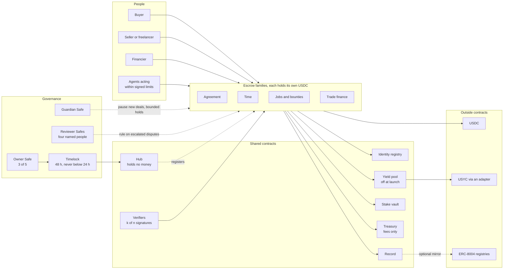
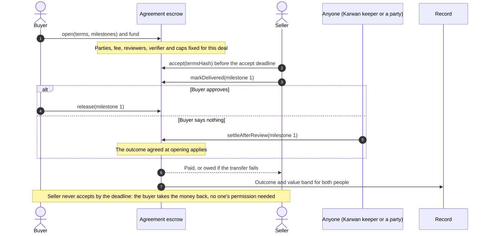
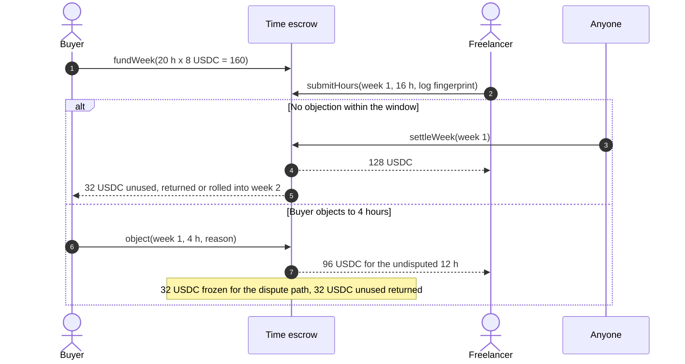
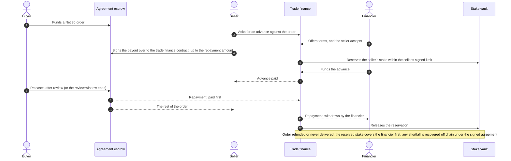
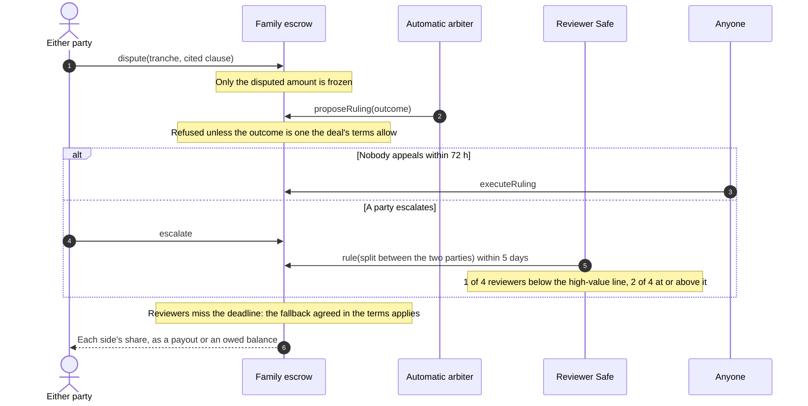
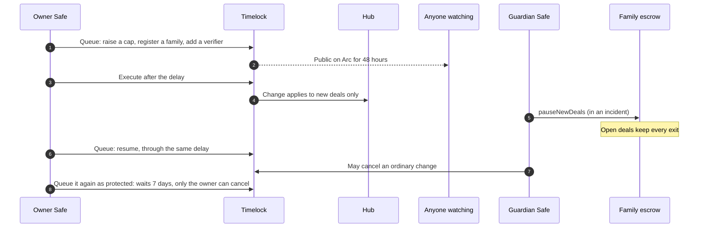

# 11 · Contracts: one suite on Arc, deployed once

Karwan's money rules live in contracts on Arc, not on Karwan's servers. This view designs the suite that holds every kind of deal, from a single logo file to an hourly retainer or a financed business order, and is deployed once. Nothing in it is ever replaced. A new kind of deal arrives as a new contract beside the others, and money, records and identities already on chain never move.

It replaces the "one core with schedule modules" choice in [view 07](07-escrow.md). The deal shapes, verification modes and dispute table in view 07 stay; this view decides which contract holds each one, what connects them, and what Karwan itself can and cannot do to the money. It applies architecture rule 9 from [view 10](10-verified-network.md): contracts are immutable and earn their limits, a pause stops new deals and never an exit, and admin power over deal money exists only through an escalated ruling.

## Rules for the suite

1. **Each family of deals has its own escrow, holding its own money.** A fault in one family cannot reach another family's balance. Arc enforces the 24,576-byte contract limit, so a single contract could not hold every kind of deal without code that runs another contract's code inside its own, a pattern the suite does not use.
2. **One shared base, audited once.** Every family escrow is built on the same settlement base, and the base decides who can ever be paid: a party recorded before any money left the deal, someone the payee signed the payout over to, or Karwan's fee within the maximum written into the contract (10%). No family, present or future, can widen that.
3. **Every payout is pull-safe.** Arc refuses transfers to blocked addresses. A payment that cannot be delivered becomes an owed balance that only its owner can withdraw, so one blocked party never freezes a deal or anyone else.
4. **An exit after expiry can never be blocked.** No pause, verifier, outside contract or admin key can stop a party from taking what the deal's terms give them once its clocks run out. A guardian hold can delay it, 7 days at a time and 30 days at most per deal.
5. **A deal keeps the rules it opened with.** Fee, caps, reviewers, verifier and yield eligibility are fixed for the life of the deal. A later change applies to new deals only.
6. **No upgrades.** No proxies, no code borrowed at run time, no self-destruct. A changed rule is a new contract, and funded deals stay where they are.
7. **Parties act for themselves.** Every action a buyer, seller or financier can take is callable from their own wallet, with no Karwan server in the path. Every timeout can be triggered by anyone. Karwan runs a keeper as a convenience, not as a requirement.
8. **Contracts Karwan does not control are outside parties.** USDC, USYC and its teller, and the ERC-8004 registries on Arc can be upgraded by their owners. The suite reaches them through narrow interfaces, and nothing they return can lose a deal's principal or block an exit.

## Participants

## The shared settlement base

Every family inherits it, and it is the part audited hardest.

| Guarantee | How it is enforced |
|---|---|
| Money leaves a deal only to its recorded parties, a signed assignee, or the fee | The fee recipient is stored when the deal opens. Parties are stored at opening, or added before any money leaves for deals whose winners are chosen later. Every payout checks against them |
| A payout to someone else needs the payee's signature | A typed signature from the payee (a wallet or a smart account) naming the deal, assignee, amount, nonce and expiry. Each nonce works once, in any order, and the payee can cancel one before it is used |
| Books always balance | For every family: USDC held plus money parked in yield equals open deal balances plus owed balances |
| Failed transfers never strand money | The amount moves to the payee's owed balance, withdrawable only by them |
| Exit after expiry cannot be blocked | The refund or claim path at expiry ignores pauses, hooks, verifiers and outside contracts; holds can only delay it, within their 30-day budget |
| Configuration is per deal | Fee, caps, reviewers, verifier and yield eligibility are copied into the deal when it opens |
| Only USDC moves, through its ERC-20 interface | No function accepts native value; amounts are 6-decimal USDC throughout |
| Bounded work per call | No call walks a list that users can grow; the worst case stays well under Arc's per-transaction gas cap |
| Payouts go to the recorded wallet | A payout or owed balance goes only to the wallet recorded in the deal, or to its signed assignee, so money frozen by USDC's blocklist cannot be routed elsewhere |

## The families

| Family | Covers | How money moves |
|---|---|---|
| Agreement | One-time and milestone deals, goods and mixed orders, net 30 to 90 terms, instalments, refundable deposits, pay on delivery | Up to 12 funded tranches. Each releases on the buyer's approval, a verifier's result, a delivery code, or a review window ending with the outcome agreed at opening. A dispute freezes only the disputed tranche. Both parties can sign any split. The seller can sign the payout over to a financier |
| Time | Hourly and weekly work, retainers | The buyer funds a weekly budget (hours times rate). The freelancer submits hours with a fingerprint of the work log. The buyer has a fixed window to object; silence pays. An objection freezes only the disputed hours, the rest is paid and the unused budget returns. A retainer is one funded period at a time |
| Jobs and bounties | Agent-to-agent jobs, bounties, contests with one or more winners | The ERC-8183 job flow (open, funded, submitted, completed or rejected, refund after expiry that no hook can stop), with payouts split across winners and the same dispute path as the other families. Outside agents can use it through the ERC-8183 interface |
| Trade finance | Purchase-order financing, invoice factoring | Holds the financier's advance and reserves the seller's stake. The buyer pays the Agreement escrow as usual; the seller's signed assignment pays the financier first, up to the agreed amount, and the seller the rest. A default resolves on chain against the reserved stake |

A new family is a new contract on the same base, registered through the timelock. Kinds of deal that do not fit any family stay out until they get their own contract: per-second streaming, pooled lending with tranches and write-downs, contests decided by a vote, and letter-of-credit document workflows.

## How the families connect

- **The hub holds no money.** It lists which contracts are Karwan families, which assets and caps apply, and which verifiers exist. Registration lets a family write records and reserve stake. It never gives access to another family's balance. A family found faulty can be revoked: it loses those powers, opens nothing new, and its open deals still pay out.
- **Identity registry.** Wallets bind to one person by signature. A person can hand control to a new wallet, and their records follow. Deals and records are written to the person, never to an agent wallet acting for them. A person can also name one of their own wallets for recovery; it takes control after 7 days unless the person cancels.
- **Record.** Families write deal outcomes to the person: outcome codes and value bands, never exact amounts, never a score. A write for a wallet that is not bound to a person is refused, and a deal reaches a payee's record only once that payee accepted it.
- **Stake vault.** A family can reserve a seller's or agent's stake only within the limit the staker signed. A slash pays only the party the deal records as harmed. Stake never goes into yield.
- **Treasury.** A dedicated Safe that receives fees and nothing else. It never holds deal money.
- **Yield pool.** The one place where money from several families can sit together, so it gets the deepest review. A family may park a capped share of eligible deals, anyone can pull principal back, and USYC sits behind an adapter because its owners can upgrade it. Off at launch.
- **Between families,** calls are typed and signed. Trade finance reaches the Agreement escrow only through the seller's signed assignment.

## A milestone deal, with nobody in the middle

## A week of hourly work

## Financing a business order

## A dispute

## A change to the rules

## Who can do what

| Role | Can | Cannot |
|---|---|---|
| Buyer, seller, financier | Every action their deal's terms give them, from their own wallet | Act on someone else's deal |
| Anyone | Trigger timeouts, execute a ruling after its appeal window, rebalance yield | Choose an outcome |
| Agents | Act for a person within the cap, expiry and scope that person signed on chain | Exceed those limits; the person can revoke them at any time |
| Verifiers | Report a check result, signed by k of n independent checkers | Move money; a missing result never blocks the exit at expiry |
| Automatic arbiter | Propose a ruling from the outcomes the deal's terms allow | Rule outside them; any party can escalate |
| Reviewer Safes | Rule on an escalated dispute, only between the deal's parties, only on the disputed amount | Touch undisputed money or pay anyone else |
| Guardian Safe | Pause new deals per family; hold a deal 7 days at a time, 30 days at most; cancel an ordinary queued change | Move money, unpause, delay an exit beyond the hold budget, or cancel a change the owner queued as protected |
| Owner Safe through the timelock | Register families, verifiers and assets; change caps and fees for new deals | Change a live deal, move deal money, or skip the 48-hour delay |
| Deployer key | Nothing after deployment | |

The only other admin path: a deal stuck by a fault in its family can, 180 days after its last clock, be split by the senior reviewers between its own parties and nobody else, so no money is held forever.

## Accounts Karwan signs for

Chat accounts held by Karwan and AI agents act through wallets Karwan's servers sign for, because the person chose that. They act only inside limits the person signed on chain, and the terms say so plainly. Web accounts, with a connected wallet or a passkey, sign every deal action themselves.

## Arc details the code is built around

- One USDC balance with two views: the ERC-20 interface at 6 decimals and the native balance at 18. The suite uses only the ERC-20 interface and never accepts native value.
- Transfers to or from blocked addresses revert, which is why every payout can fall back to an owed balance.
- Randomness from the chain is always 0, so nothing depends on it.
- Block timestamps can repeat within a second; every window is measured in hours or days.
- Finality is immediate, so a receipt plus a fresh read is final.
- Tests run on Arc's own Foundry build, which reproduces these rules, including a blocked test address.

## How it is proven before money arrives

Every release passes, in order:

1. A written threat model and invariant list, mapped to the OWASP Smart Contract Top 10.
2. An exploit test written before each fix and each feature.
3. Two static analysers with no finding left unexplained.
4. Full branch coverage of every money path, and fuzzing at 10,000 runs or more per test.
5. One set of invariants run by three fuzzers, including at least 24 hours on the frozen release.
6. Mutation testing: deliberately broken copies of the code that the tests must catch.
7. Machine-checked proofs that the books balance and that principal can always be withdrawn.
8. Two full rehearsals on Arc testnet, including a drill that pauses a family and settles every open deal.

The suite launches on mainnet after step 8 with beta limits written into it: 1,000 USDC per deal and 10,000 USDC in total, per family and per currency. The limits rise only through the timelock, and only after an independent audit and a public audit contest. A bug bounty and a safe-harbour policy for people who rescue funds during an attack start at deployment.

## What fails where

| Where | What fails | What happens |
|---|---|---|
| Family escrow | A bug in one family | Only that family's balance is exposed; the guardian pauses its new deals; open deals keep every exit |
| Shared base | A bug in the base | Every family is exposed, which is why the base is the smallest part and is audited and proven first |
| Payout | The payee is blocked by USDC | The amount becomes their owed balance; nothing else stops |
| Verifier | Checkers disagree or go silent | No result; the deal follows its review window and dispute path |
| Arbiter | Proposes an outcome the terms do not allow | Refused by the contract |
| Reviewers | Miss the 5-day deadline | The fallback agreed in the terms applies |
| Karwan servers | Offline | Parties act from their own wallets or the explorer; anyone can trigger timeouts |
| Guardian | Safe compromised | Can pause new deals, place bounded holds and cancel ordinary changes; cannot move money or stop an exit. The owner replaces it with a protected change, which waits 7 days and the guardian cannot cancel |
| Owner Safe | Signers compromised | Changes wait 48 hours in public and touch new deals only; users and the guardian can react |
| USYC or its teller | Upgraded, paused or refuses | Principal is pulled back; the adapter can be replaced through the timelock; no deal waits on it |
| Trade finance | Buyer never pays | The reserved stake covers the financier first; the rest is recovered off chain |
| Deployment | Wrong address or bytecode | The deploy script is reviewed, rehearsed on a fork, and the deployed bytecode is compared with the audited release before any deal opens |

## Suite invariants

| ID | Invariant |
|---|---|
| S1 | For every family: USDC held plus parked equals open deal balances plus owed balances |
| S2 | Money leaves a deal only to a party recorded before any money left, a signed assignee, or the fee within the maximum |
| S3 | No family can move another family's balance, including a hostile family registered by mistake |
| S4 | Every exit at expiry succeeds while paused, or with a failing verifier or outside contract, and no later than the hold budget allows |
| S5 | A live deal's fee, caps, reviewers, verifier and yield eligibility never change |
| S6 | A ruling never pays more than the disputed amount, and only to the deal's parties |
| S7 | A slash pays only the harmed party recorded by the deal, within the staker's signed limit |
| S8 | Principal in the yield pool can always be pulled back in full |
| S9 | A record write for an unbound wallet is refused |
| S10 | The view 07 invariants I18 to I24 hold inside each family that offers the shape |

## Status

| Piece | Status |
|---|---|
| Escrow for today's deals (v2b) | Live on testnet |
| Terms-driven escrow (v3): terms hash, clocks, checks, disputes with appeal, splits, owed balances, caps | Built, not deployed. Its rules carry into the Agreement family |
| Stake vault and yield pool (v3) | Built, not deployed. Reworked for signed limits and the adapter |
| Shared settlement base and hub | Built, not deployed |
| Agreement family | Planned, first |
| Trade finance family | Planned, first |
| Time family | Planned, second |
| Jobs and bounties family, ERC-8183 interface | Planned, third |
| Identity registry with succession and recovery | Built, not deployed |
| Record contract (one, replacing the reputation registry and the facts contract) | Built, not deployed |
| Verifiers with k of n signatures | Planned |
| Governance: timelock with a 24-hour floor and guardian cancel | Built, not deployed. The Safes are set up at deployment |
| ERC-8004 mirror of the record | Later |
| Yield on deal money | Built in v3, off at launch until the pool is eligible to hold USYC |
| Reputation registry already on mainnet | Live, holds no deals and no records; stays as it is, with a public note pointing to the record contract |
| Business registry already on mainnet | Live; its approvals carry into the record contract as business facts |
| Independent audit and audit contest | Planned, before the beta limits rise |

Contract notes: proposed names are `KarwanSettlementBase` (abstract), `KarwanHub`, `KarwanAgreementEscrow`, `KarwanTimeEscrow`, `KarwanJobEscrow`, `KarwanTradeFinance`, `KarwanIdentityRegistry`, `KarwanRecord`, `KarwanStakeVault`, `KarwanTimelock`, `KarwanYieldPool` and `KarwanUsycAdapter`. Every family's runtime code is measured against Arc's 24,576-byte limit in CI. All contracts are deployed at deterministic addresses from one reviewed script, and ownership goes to the timelock in the same run, so the deployer key holds nothing afterwards.
