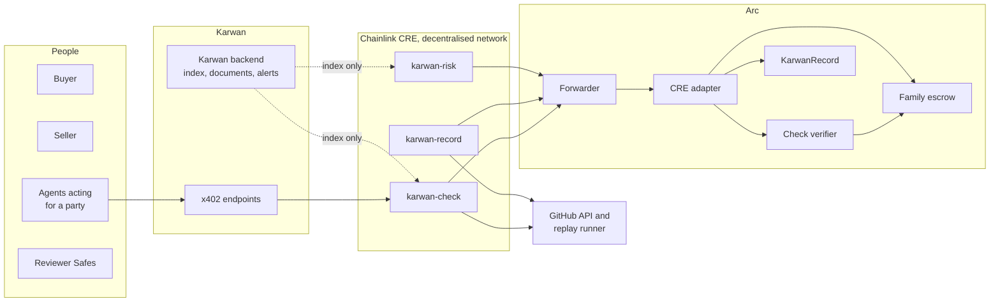
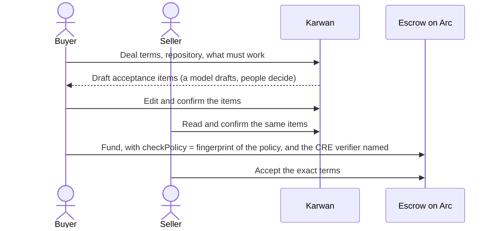
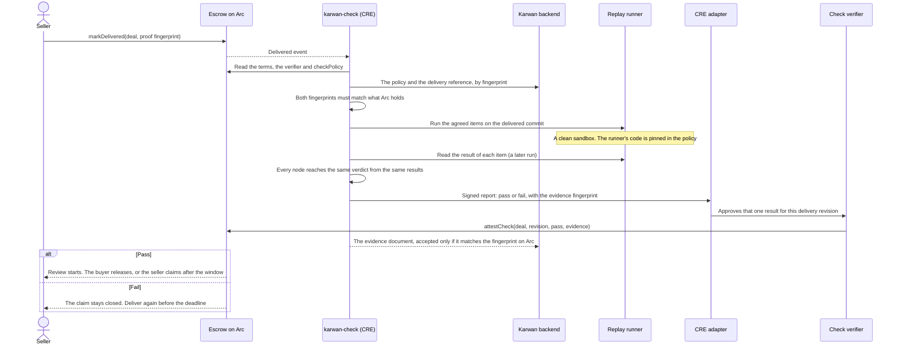
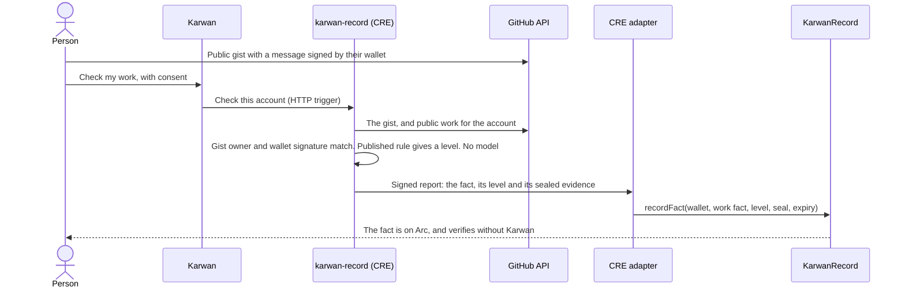

# 12 · Checks, record and risk on Chainlink CRE

Karwan's deals are decided by contracts on Arc, so the trust a buyer and a seller place in a deal is trust in code anyone can read, not in Karwan. Three jobs still need something to look outside the chain: checking that delivered work does what the deal agreed, writing facts about a person that come from outside sources, and making sure no deal sits stuck because nobody pressed a button the terms already allow. This view moves all three onto Chainlink's Runtime Environment (CRE). CRE runs a workflow on a decentralised network of nodes that must agree on the result and sign it. A contract on Arc accepts that signed result only from the workflow it was bound to. Facts and timeouts written this way never pass through Karwan. Check results do too once CRE decides deal checks; until then, and as a fallback when CRE has no answer, Karwan's own checks answer, and the record says which one did.

It extends the delivery checks in [view 10](10-verified-network.md) and the check verifiers in [view 11](11-contracts.md), and it follows the architecture rules in view 10. Rule 3 matters most here: code decides, models read. A model may help two people write down what "done" means when they set up a deal. It never decides whether the work meets it.

## Which deals it serves

The contract suite in [view 11](11-contracts.md) has a family of escrow per kind of deal. CRE serves each one differently.

| Family | Deals | Check of delivered work | Timeouts kept moving |
|---|---|---|---|
| Agreement | One-time work, milestones, goods, instalments, refundable deposits | Yes. A deal can name a check verifier at funding | Seller claims, buyer refunds, missed instalments, rulings, fallbacks |
| Time | Hourly, daily and unit work, retainers | No | Settling a cycle, closing, rulings, fallbacks |
| Jobs and bounties | Agent jobs and contests | No. The evaluator the parties name decides | Silent reviews, rejections, refunds, rulings, fallbacks |
| Trade finance | Financing against an Agreement deal | Through the Agreement deal it finances | Not yet |

## What changes for people

- **A seller** knows before the deal starts exactly which tests the work must pass, and can have an agent check a branch against them before delivering.
- **A buyer** gets a check that re-runs the agreed tests on the exact delivered commit, in a clean sandbox, with each result tied to the delivery it measured.
- **A reviewer** settling a dispute sees which agreed items passed and which failed, measured the same way for both sides.
- **Both people** keep deals moving if Karwan's servers stop: the timeouts the terms allow are triggered on CRE, and anyone can trigger them by hand.

The check measures whether the delivered work meets what was agreed. It does not measure whether the buyer likes it. That stays the buyer's call within the review window, and a dispute goes to people when the measurement cannot settle it.

## Participants

- **The adapter** is one contract with no owner after setup and no money. It accepts a report only from the Chainlink forwarder, only from the workflow bound to that kind of report, and only while the report is fresh. Each workflow can do one kind of thing:
  - **karwan-check** approves a check result;
  - **karwan-record** writes a fact of an allowed kind;
  - **karwan-risk** triggers a timeout the deal's terms already allow.
- **Karwan's backend** keeps an index of open deals and stores the documents behind each hash. The workflows do not take its word for content: every document they read is checked against a hash already on Arc, and every deal it lists is read again from Arc, so a wrong answer from Karwan stops a workflow instead of steering it. Karwan's own checker is a separate signer, covered under "A CRE outage never blocks a deal".

## Agreeing what done means

When a software deal is set up, the two people agree an acceptance policy:
- the repository and branch;
- the items the work must pass, each one a test or command;
- the replay runner that will run them;
- how many items must pass for a partial result, if the terms allow one.

A model may draft the items from the deal's words. Both people read and confirm them, and either can change them before funding. The policy's fingerprint goes into the deal terms on Arc as `checkPolicy`, and the full policy is covered by the agreement fingerprint. From then on the policy cannot change without a new deal.

## The delivery check, replayed

- **The verdict is pass only when every required item passes on the delivered commit**, in a run of the pinned runner. The evidence document lists each item's result, the commit, the run and the runner version, and its fingerprint is written on Arc with the result.
- **One CRE result per delivery.** The adapter accepts one CRE result for a delivery revision, and refuses a CRE result once Arc already holds a result for that revision. On Arc, a fail never overturns a pass. A pass after a fail does start the review, because the escrow lets a verifier correct a fail.
- **A new delivery is a new revision** and is checked again.
- **No result is not a fail.** If the check cannot run, nothing is reported. The deal's own clocks still end it: the buyer can review the delivery themselves, and the silence longstop in view 11 applies.

## A CRE outage never blocks a deal

CRE decides a deal's check only after one setting, `CRE_ENABLED`, is turned on. That happens once Chainlink's hosted network runs these workflows end to end. Until then, Karwan's automated checks decide, and CRE runs beside them. Its results are compared with Karwan's and are never written to the deal.

Once the setting is on, a deal names a verifier that accepts a result from either CRE or Karwan's checker. Karwan's service waits for CRE. If CRE has no result within an hour, for example because the network has an error, Karwan's automated checks answer instead, and the record says which one decided. A deal funded while the setting was on keeps that verifier, so turning the setting off later never strands it.

The hour is Karwan's rule, not the contract's. On Arc, that verifier accepts Karwan's checker at any time, so Karwan's checker could answer before CRE, or turn a CRE fail into a pass. Karwan's service does neither. Making the wait and the order a contract rule is open in the contract suite's review.

## Disputes read the same measurement

A dispute opened after a check is settled from the same evidence:

| Check result | Items passed | Automatic proposal |
|---|---|---|
| Pass | All | Full payment to the seller |
| Fail | At least the partial line written in the policy, and the terms allow a partial share | The partial share in the terms |
| Fail | Below the partial line | Full refund to the buyer |
| None, or the evidence cannot be read | Any | No proposal. The dispute goes to the reviewer Safes |

The automatic arbiter can only propose what the contract allows: a full refund, full payment, or the partial share written in the terms. Either party can appeal within 72 hours, and the reviewer Safes then rule with the evidence document in front of them.

## Facts from outside sources

Some facts about a person come from outside Karwan, for example public work on GitHub. karwan-record reads the source on the decentralised network, applies the published rule, and writes the fact to KarwanRecord through the adapter. The adapter is a registered issuer that can write only the fact kinds fixed when it was deployed, so a workflow can never write a deal outcome or a person check. Deal outcomes are written by the escrow itself at the end of every deal.

The person proves the GitHub account is theirs without relying on Karwan's word: they publish a public gist holding a message signed by their wallet. The workflow checks that the gist's owner is the account and that the signature is the wallet's.

## Keeping deals moving

karwan-risk runs every two minutes. It takes a page of open deals from Karwan's index, a different page each minute, reads each deal's state from Arc, and does two things:

- **Timeouts.** Where a deal's terms already allow an action that nobody has taken, it triggers it through the adapter. For an Agreement deal it looks for a seller's claim after the review window when the check has not failed, a buyer's refund after the deadline, an unappealed ruling, and the fallback after a missed ruling. For Time and Jobs deals it takes the timeouts Karwan's index suggests, from a fixed list. It retries an outcome the escrow failed to write to the record when the escrow logs one. Every call is first simulated on Arc from the adapter's address, and only calls that would succeed go into a report, four at most. The escrow pays only the people and amounts the terms name, whoever triggers it.
- **Alerts.** It tells Karwan, with a report signed by the network over the alert list itself, about:
  - a deadline close with no delivery;
  - a dispute with no proposal near its limit;
  - a payout that could not be delivered and is waiting as an owed balance.

  Karwan tells the people involved. Holding a deal stays with the guardian Safe, which is people.

## Agents paying for checks with x402

An agent acting for a party can pay a small USDC amount with x402 to:

- **Dry-run a branch.** It runs the agreed policy on a branch before delivering. The result comes back with a report the decentralised network signed over that exact result, which anyone can check against Chainlink's published node keys. Nothing is written on Arc, and the deal does not move.
- **Fetch the evidence behind a check result.** The document's fingerprint can be checked against the result the adapter holds on Arc, without asking Karwan.

The payment is taken by Karwan's x402 endpoint on Arc. The endpoint then starts the workflow with a signed request from a key the workflow trusts. Only a party's own agent may dry-run a deal's policy.

## What fails where

| Where | What can go wrong | What happens |
|---|---|---|
| Check | The decentralised network or GitHub is unavailable | CRE reports nothing. After an hour Karwan's automated checks answer, and the record says so. If neither answers, the buyer can review the delivery themselves, and the deal's clocks still end it |
| Check | CRE is not yet approved for deals | Karwan's automated checks decide. CRE runs beside them and its results are only compared |
| Check | Karwan serves a different policy or delivery reference | The fingerprint does not match Arc, and the workflow stops without a result |
| Check | Karwan stops serving the index | No new checks start. Deals end by their own clocks, and anyone can run the same workflow |
| Check | The agreed tests are flaky and two runs disagree | The first completed run counts. The evidence names the run, so a reviewer can see it |
| Check | The deal is in dispute when the result arrives | The result is approved but cannot be attested while the dispute is open. It can be submitted once the dispute ends, and only for the same delivery revision |
| Check | A second CRE result for the same delivery, or one after Arc already holds a result | Refused by the adapter |
| Adapter | A report delivery failed and someone retries it much later | Refused: reports older than an hour are not accepted |
| Adapter | A report claims to come from another workflow | Refused: the workflow id, owner and name must match the kind |
| Record | The escrow's outcome write failed | karwan-risk retries it. The record keeps one outcome per deal and party |
| Record | The gist is missing, too old, or signed by another wallet | No fact is written, and the person is told what to fix |
| Record | A revoke names a fact written for another wallet | Refused by the adapter |
| Risk | A timeout is not yet allowed | That call fails on its own; the others in the batch still run |
| x402 | The payment does not settle | The dry run does not start |
| x402 | The workflow is busy (one start every 30 seconds) | The request waits in a queue and the agent polls for the result |

## Status

| Step | Status |
|---|---|
| GitHub delivery check workflow on CRE, registered on the private registry | Built. Hosted runs blocked on a CRE enclave configuration issue raised with Chainlink |
| Check verifiers with k-of-n signers in the contract suite | Built, not deployed |
| CRE adapter: one contract for check results, facts and timeouts | Built, not deployed. Rehearsed on a fork of Arc Testnet through Chainlink's simulation forwarder: a check result started a deal's review, a timeout paid the seller, a fact reached the record |
| karwan-check: replay of agreed items on the delivered commit | Built. Its report path is rehearsed on the fork; a run of the workflow in Chainlink's simulator is next |
| CRE deciding deal checks (`CRE_ENABLED`), with Karwan's checks as the fallback | Off. Turned on once Chainlink's hosted network runs the workflows end to end |
| Acceptance policy fingerprinted on Arc | Built. The form where two people agree it is planned, with the suite's deal flow |
| Automatic dispute proposals from the check evidence | Built as a rule. Used once the suite's deal flow is wired |
| karwan-record: work facts from GitHub | Built. Its report path is rehearsed on the fork |
| karwan-risk: timeouts, outcome write retries and alerts | Built. Its report path is rehearsed on the fork; alerts reach Karwan's logs until the suite's deal flow names who to tell |
| x402 dry runs and evidence for agents | Built, not yet served |
| CRE on Arc mainnet | Not available. CRE supports Arc Testnet only |

Contract and module notes: the adapter's address must exist before any check verifier that lists it, because a verifier's signers are fixed when it is deployed. Verifiers and the adapter's issuer role are registered through the 48-hour timelock in view 11. A deal keeps the verifier it was funded with.
