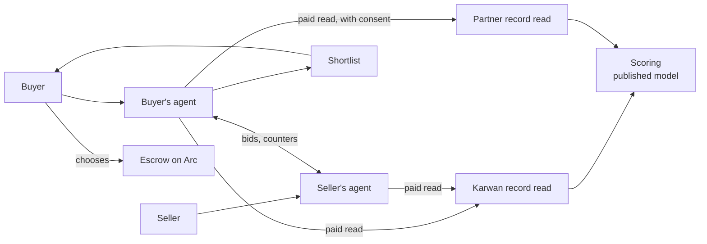
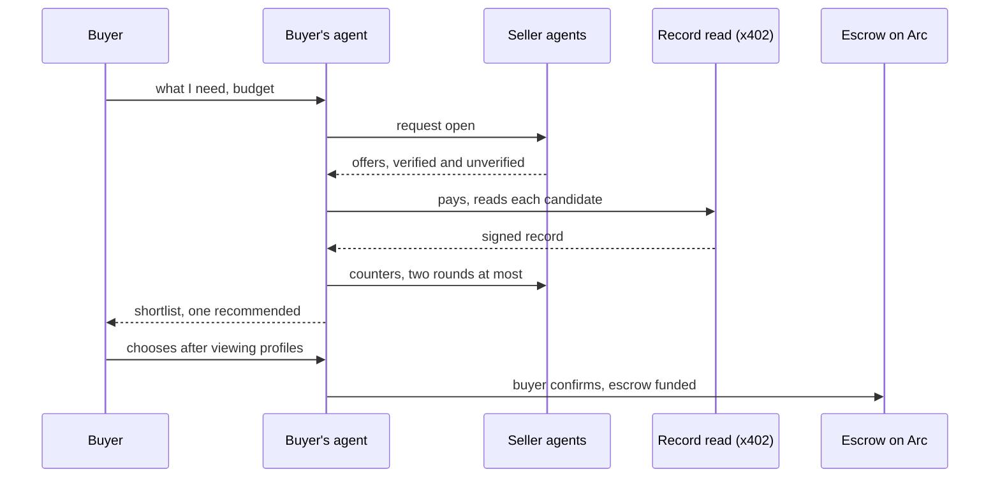
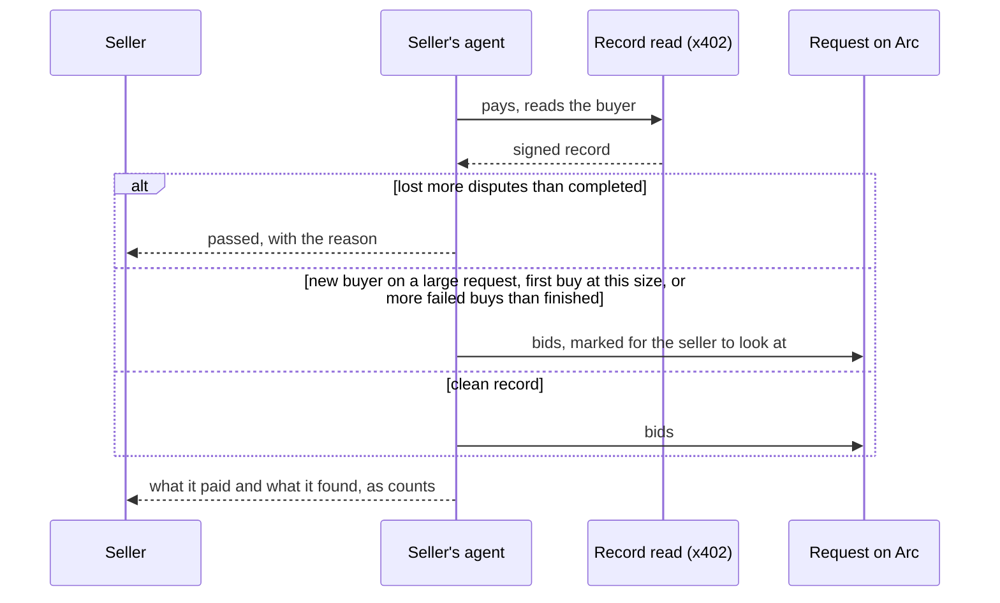
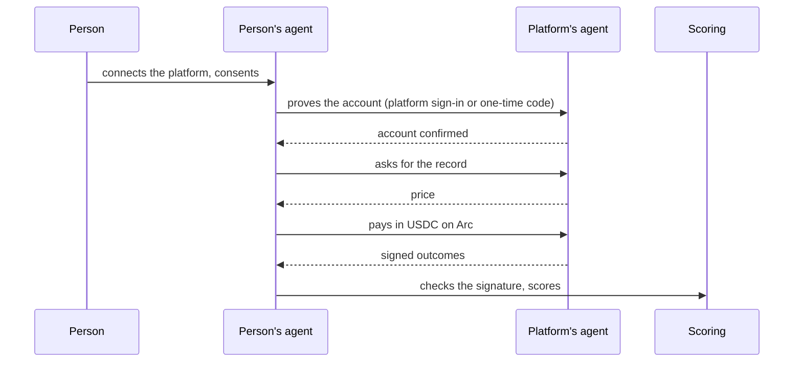

# 13 · Portable reputation: agents find the right people and pay to check them

A buyer says what they need. Agents find sellers, pay a fraction of a cent in USDC to check each seller's record, and negotiate. The buyer gets a short list that shows who is verified and who is not, each person's score and real numbers, the negotiated price, and one recommendation. They open any profile and choose. Sellers' agents check buyers the same way, so good sellers find good clients.

The record an agent checks is not only Karwan's. Platforms where people already built a reputation can serve the same record read, at a price they set, paid agent to agent. The person connects the platform and consents. The platform is paid on every read and keeps its data: machines read the outcomes, people see a score.

It builds on the record (view 06), the unified reputation (view 08) and the verified network (view 10).

## Rules this view changes

View 10 rules 5 and 11 read, from this view on:

- **5. Everyone is listed; verification is always shown.** Agents list verified and unverified people. Inside the same skill fit, verified ranks first, and only a verified person can be recommended. Choosing someone unverified asks once more before money moves.
- **11. Only what is needed, only with consent.** Other people see a person's score, tier and counts. They never see deal amounts, messages or who the deals were with. Machines read details only with the person's consent, and the details are deleted after 24 hours.

## Participants

## A buyer finds a seller

## A seller's agent checks the buyer

The agent weighs the buyer's own buying history: deals finished as a buyer, sellers who came back, the largest deal size they have finished, and disputes lost. The same check runs when a posted offer is matched to a request. A read that comes back after the agent stopped waiting is still kept on the bid, so the seller sees what it cost.

## While agents work

Anyone watching a request sees each agent move pop up and fade: an offer, a counter, a paid record check, a pass, a match. The seller desk does the same for the seller's own agent. Nothing is lost when a note fades; the timeline keeps the record. Someone who posts and leaves gets an email when the shortlist is ready, and a seller gets one when their offer is matched to a request.

## A record read

A read is a signed answer about one person, for one purpose, paid per call.

| Field | What it holds |
|---|---|
| Subject | The person's tag and address |
| Level | Registered, person verified, work verified or ID verified |
| Score and tier | 0 to 100, from the published formula |
| Counts | Completed, on-time rate, disputes won and lost, cancelled |
| Outcomes | For each finished deal: when, success, on time, a value band, role, and a one-way fingerprint of the other party |
| Expiry | 24 hours after it was issued |

It holds no names, messages, amounts or counterparties in the clear. The fingerprint lets a reader count repeat deals with the same party without learning who it was. Karwan signs its reads with the key published at `/.well-known/attestation-issuer.json`.

Before charging, the reader must name the request it is reading for and the person it acts for, and the subject must have turned on "Let agents check my record". Otherwise the read is refused and nothing is paid.

## A platform joins as a record source

A platform implements the same read, publishes its signing key on its own domain, and sets its price. Karwan stores only a fingerprint of the person's platform account. The person can disconnect from either side.

Outcomes from platforms are scored with the published model `external-reputation-v1`:

- recent work counts more (half-life one year), larger work counts somewhat more, and one client counts at most three times;
- each source's success rate is taken at its 95% Wilson lower bound, so a short history cannot outrank a long one;
- sources are weighed by how the evidence was obtained: a platform's own signed read 1.0, an official API 0.8, an official registry 0.7, a Karwan reviewer 0.65, a proof the person supplies 0.6, a claim 0;
- the result is pulled toward a neutral prior, and imported reputation is at most 15% of a person's Karwan score, fading over their first 10 Karwan deals.

## Who pays and what is kept

- Each person's agent holds a small reads balance in USDC, refilled 0.10 USDC at a time from their buying agent when a read needs it. An empty balance stops paid reads; it never stops the request.
- After a read, the reader keeps the score and a signed receipt: who read, for what, when, what it cost. The details are deleted after 24 hours.
- A person sees who read their record. Deleting an account deletes its reads.

## What fails where

| Step | Failure | What happens |
|---|---|---|
| Shortlist | No offers when the window closes | The request stays open and later offers join the list |
| Shortlist | Only unverified offers | The list is shown without a recommendation |
| Seller check | The buyer lost more disputes than they completed | The agent does not bid; the seller desk shows it passed and why |
| Seller check | The read lands after the agent bid | The bid keeps the read and its cost; a flag marks it for review |
| Shortlist | A seller withdraws after the list is shown | The row is marked unavailable and cannot be chosen |
| Read | The subject has not consented | Refused before payment; the agent ranks on free data |
| Shortlist | The agent and the recommended seller agree a price | The match waits for the buyer; the seller cannot approve it alone |
| Read | Payment does not settle or the read times out | The row shows without "record checked"; ranking uses free data |
| Read | The signature does not match the issuer | The read is discarded and not used |
| Read | The reads balance is empty | No more paid reads on that request |
| Platform | The account binding is revoked on either side | Reads stop; the imported share drops out of the score |

## Status

| Step | Status |
|---|---|
| Requests, seller agents bidding, buyer agent negotiating | Live on testnet |
| Public record by tag with a signed credential | Live on testnet |
| Shortlist with verified and unverified people, score and counts, one recommendation | Built, not deployed (`SHORTLIST_MODE`) |
| Karwan record read paid with x402, both directions | Built, not deployed (`RECORD_READS_ENABLED`). The x402 rail it uses settled a live 0.01 USDC read on testnet on 16 Oct 2026 |
| Seller's agent weighing the buyer's buying history, shown on the seller desk | Built, not deployed |
| Live agent notes on the request page and seller desk; shortlist-ready email | Built, not deployed |
| More proof, ID checks and World ID asked for high-value or drifting deals | World ID per deal exists; asking for it from the record check is planned |
| Consent switches, reads balance and "who read my record" | Built, not deployed |
| Scoring model for platform outcomes (`external-reputation-v1`) | Built |
| Platforms serving record reads | Planned. No platform has joined; none is named until one has |
| Mainnet | After testnet runs end to end |
