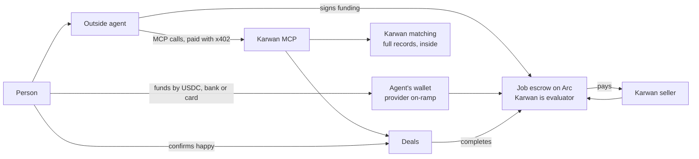
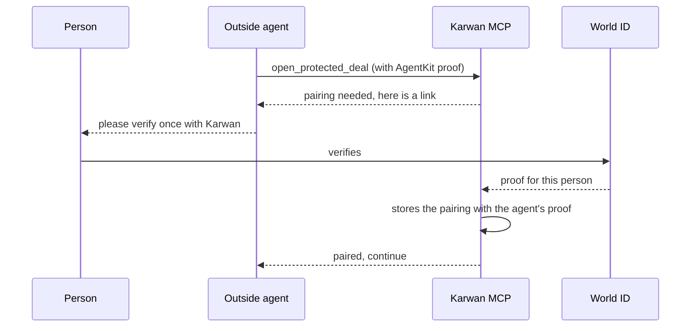
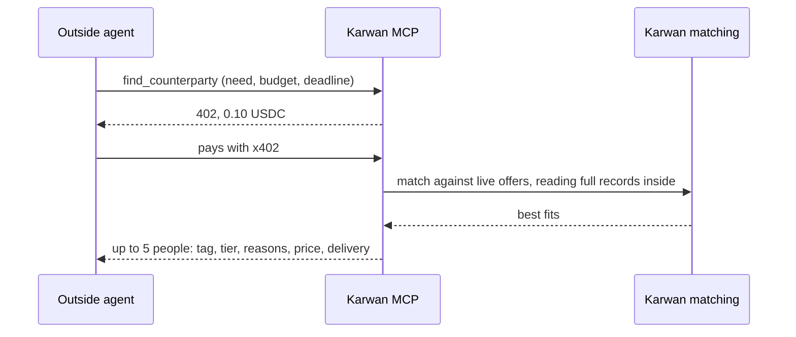
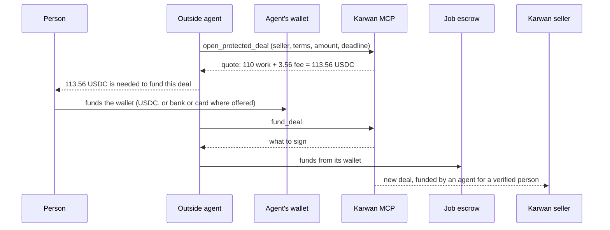
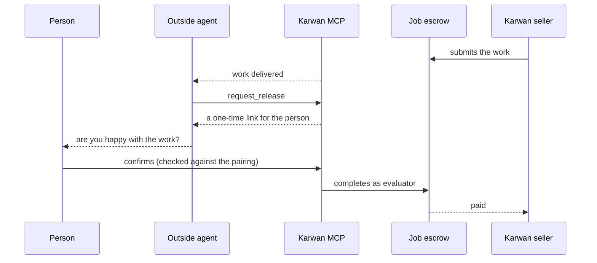
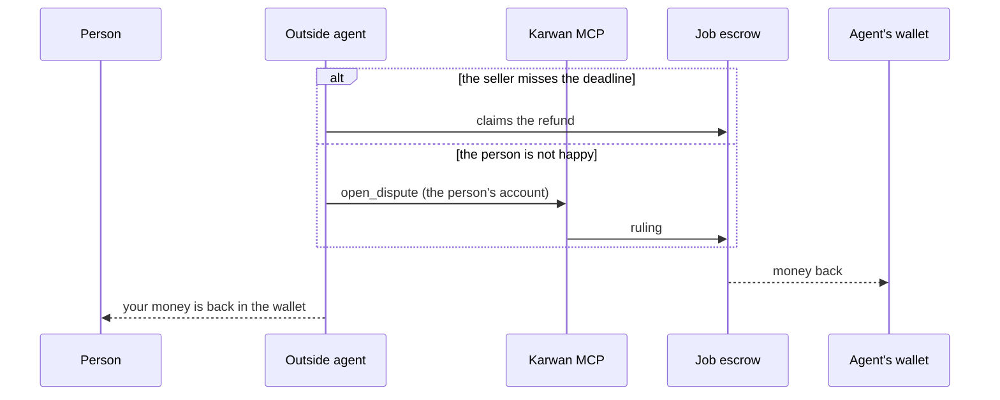

# 15 · Outside agents: find trusted people and secure a deal for a person

An agent that lives outside Karwan (Claude, ChatGPT, a company's own bot) works for one person. Through the Karwan MCP server it finds people it can trust, opens a protected deal, funds it from its own wallet, and follows it to the end. It pays Karwan per call in USDC with x402. It never sees anyone's record data: Karwan matches inside and answers with who fits and why. And it can never pay the seller on its own: only its person can say the work is done.

It builds on the record (view 06), portable reputation (view 13) and the escrow (view 07). The design behind it is the agentic market spec of 17 Oct 2026.

## Rules this view adds

- **Matching runs inside Karwan.** An outside agent gets people, tiers, reasons, prices and delivery times. It never receives a score, counts or outcomes (decision D23).
- **Reads from outside need the person's yes.** `check_person` returns the public view unless the person turned on "Let agents outside Karwan check my record".
- **One human behind every agent.** Each outside agent proves it acts for one real, unique person with World AgentKit, and the person pairs with Karwan once with World ID. Limits are per human.
- **Only the person releases.** Outside-agent deals use the job escrow with Karwan as evaluator, so the agent's wallet cannot pay the seller. Karwan completes the job only after the person confirms they are happy, or when the review window ends in silence, as on every Karwan deal.

## Participants

## Pair once

The first time an agent opens a deal for a person, the person verifies once with World ID through a Karwan link. World's agent proof and Karwan's World ID check give different values for the same human, so the pairing is what lets Karwan know the person confirming a release is the person behind the agent.

## Find people

When no live offer covers the need, the agent calls `post_request` instead. That posts a real request for the person, sellers' agents bid on it, and the agent follows it with `deal_status`. Posting makes the person a poster, so the agents of people on that request may read their record (view 13).

## Open and fund a protected deal

The quote is the only source of the amount the person is asked for, so the total never surprises them. Karwan runs no on-ramp of its own.

## Release

Before the review window ends the agent reminds its person. If the person neither confirms nor disputes by the end of the window, the job completes and the seller is paid, as on every Karwan deal; the seller's deal page says when that happens. The agent cannot answer the link and cannot complete the job.

## Refunds and disputes

## Who pays

| Call | Price | Paid by |
|---|---|---|
| `find_counterparty` | 0.10 USDC | the outside agent, with x402 |
| `check_person` | 0.01 USDC | the outside agent, with x402 |
| `open_protected_deal`, `fund_deal`, `deal_status`, `request_release`, `open_dispute`, `post_request` | free | the Karwan deal fee applies to the deal |

## What fails where

| Step | Failure | What happens |
|---|---|---|
| Open | The person has not paired yet | The agent gets a pairing link; nothing is opened until the person verifies |
| Any call | The AgentKit proof is missing or invalid | Refused before any payment |
| Any call | The person's per-human limit is reached | Refused with when it resets |
| Find | The x402 payment does not settle | No matches are returned and nothing is charged |
| Open | The seller turned off deals from outside agents | That seller is never offered; opening a deal with them is refused |
| Fund | The wallet holds less than the quote | `fund_deal` answers with the amount still needed |
| Release | The person never answers | Reminder before the window ends; the seller is paid at its end |
| Release | Someone other than the paired person answers the link | Refused; the job stays open |
| Check | The person has not allowed outside reads | The public view only: level, tier, reasons, attested deals |

## Status

| Step | Status |
|---|---|
| World AgentKit proof of a human behind an agent | Built (`backend/src/agentkit`) |
| Job escrow with an evaluator | Built in the contract suite, not deployed |
| Karwan MCP server and its tools | Planned |
| Pairing with World ID | Planned |
| Release confirmation link and evaluator completion | Planned |
| Seller switch for outside-agent deals | Planned |
| x402 payments | Built for record reads; nanopayments run on Arc Testnet only, so this view is testnet only until Circle supports a mainnet chain |
