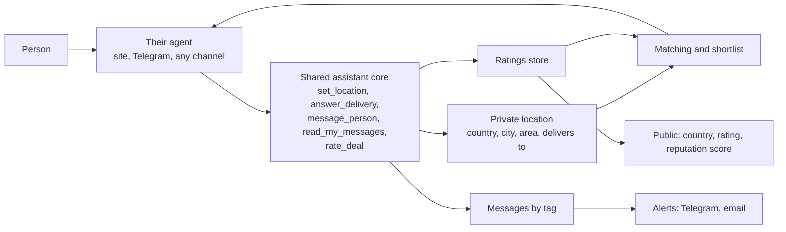
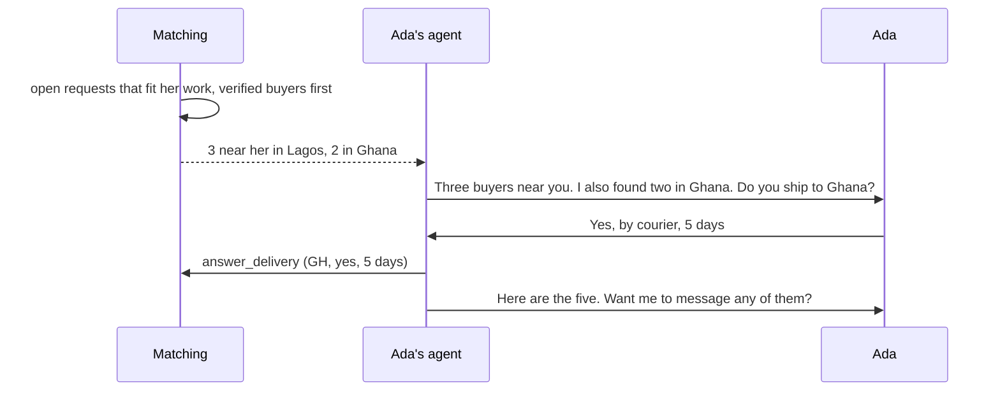
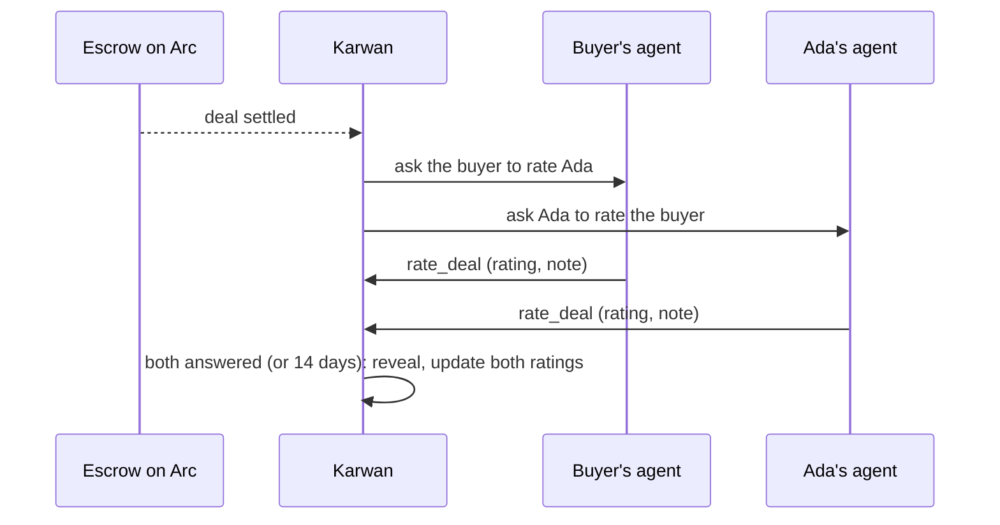

# 16 · Location, messages and ratings

In an open market there are many fashion designers, plumbers and suppliers. Agents find the right one fast when they know where people are and can deliver, and when they can weigh how past clients rated the work. People keep their privacy: almost everything a person tells their agent is used to match and score them, never shown to others. After a match, two people talk through their agents and agree before any money moves.

It builds on portable reputation (view 13), attested deals (view 08) and outside agents (view 15). Every step is an assistant tool on the shared core, so the website assistant, Telegram and every future channel do the same thing; a channel only translates.

## Rules this view adds

- **Location is for matching, not for showing.** A person tells their agent as much as they like: country, city, area. Only the country is public. City and area are never shown to anyone, in a record, a lookup, a shortlist or an outside agent's read.
- **The agent learns where you deliver by asking.** When it finds buyers in a new place it asks ("I found customers in Ghana. Do you ship to Ghana?") and remembers the answer.
- **Delivery details are shared by the people.** Addresses and delivery points are agreed in chat after a match, never published.
- **The agent says what it can check.** For each thing a person tells it, it says whether it can verify it and the steps to take. Physical goods cannot be checked by an agent; trust there comes from the record, ratings and escrow.
- **Message by tag, through the agent.** "Send @ada a message: I can deal on these terms." It lands in Ada's Karwan chat with an alert on Telegram and by email. Ada answers with her agent's help. Money moves only after they agree and the buyer funds escrow.
- **Two public numbers, kept apart.**
  - **Rating** comes only from ratings and feedback after completed Karwan deals.
  - **Reputation score** can also take in work done elsewhere, calculated with care, and shows lines like "Completed 400 jobs on Upwork" only when the person chooses to share them and that platform has joined as a partner.
- **Ratings only from a settled deal**, one per side, blind until both answer or 14 days pass. Disputes keep their outcome. Nothing is hidden for being negative.

## Participants



## Telling the agent where you are

```mermaid
sequenceDiagram
  participant P as Ada
  participant A as Ada's agent
  participant K as Karwan
  P->>A: I'm a fashion designer in Yaba, Lagos
  A->>K: set_location (NG, Lagos, Yaba)
  K-->>A: saved; country public, city and area private
  A->>P: Saved. Only "Nigeria" shows. To check it I need your CAC number or an ID check.
```

## Finding buyers, near and far



The buyers' agents see "a verified designer in Nigeria who ships to Ghana", never her city or area.

## Talking before a deal

```mermaid
sequenceDiagram
  participant B as Buyer
  participant BA as Buyer's agent
  participant K as Karwan
  participant A as Ada's agent
  participant P as Ada
  B->>BA: Send @ada a message: two outfits, 150 USDC, by the 30th
  BA->>K: message_person (@ada, text)
  K-->>P: alert on Telegram and email
  P->>A: Tell him yes if he covers delivery to Accra
  A->>K: message_person (@buyer, reply)
  K-->>B: alert
  B->>BA: Agreed. Start the deal
  BA->>K: start_protected_deal; the buyer funds escrow on a one-time page
```

## After a deal settles



## What fails where

| Step | Failure | What happens |
|---|---|---|
| Location | No country given | Shows in "anywhere" searches only, never in local ones |
| Location | Country differs from a checked CAC or ID | Country stays self-stated and is marked so |
| Location | Someone asks an agent where a person lives | Refused; only the country is ever said |
| Delivery | The person never answers "do you ship there?" | Not offered for that place; asked again only after 30 days |
| Messages | Message to a tag that does not exist | "No one on Karwan has that tag" |
| Messages | Many unanswered messages to people who never replied | After five unanswered first messages in a day, that sender cannot write to anyone new for a day |
| Messages | A message holds a phone number or a payment link before a deal | Delivered with a warning to keep payment in escrow |
| Messages | Three messages in a row with no answer | The sender waits for a reply |
| Messages | Sender has no Karwan tag, or the link scanner flags a link | Not sent, with the reason |
| Ratings | Someone rates a deal they were not part of | Refused |
| Ratings | One side never rates | The other side's rating shows after 14 days |

## Status

| Step | Status |
|---|---|
| Private location and country on the public record | Built (testnet, not live) |
| Matching near and far; asking where people deliver | Built (testnet, not live) |
| Message a person by tag through the agent | Built (testnet, not live): message_person, read_my_messages, /messages/[tag], alerts on Telegram and by email |
| Ratings after settled deals, kept apart from the reputation score | Built (testnet, not live): rate_deal, my_ratings_to_give, the ask after settlement with one reminder and the reveal, the rating on the record, lookups and the shortlist, the card on the deal page |
| Reputation from partner platforms, shared by choice | Planned (no partner has joined) |
| Region matching for business partners | Built (sector and region boost in the buyer agent) |
