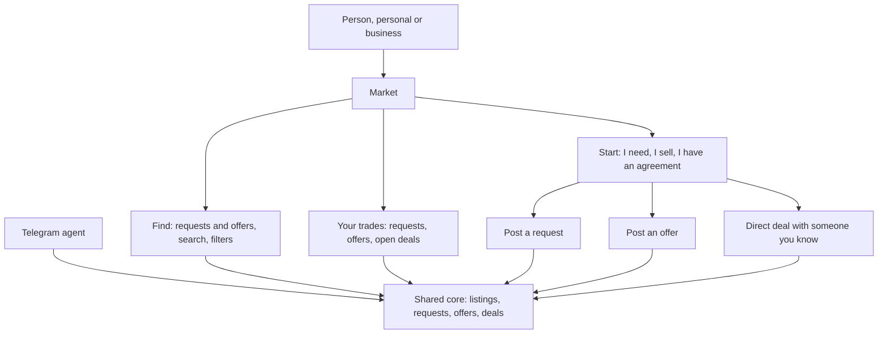

# 17 · One market, one entry

Track T1, roadmap item T1.1 ([view 00](00-direction.md)). Karwan has one open market. Whether a person trades for themselves or for a business changes what they see in it, not where they go.

## Before this change (to 18 Oct)

Five ways in, split by account type:

| Place | What it is | Who reaches it |
|---|---|---|
| `/market` (and `/listings`) | Browse offers | The Market tab of a personal account |
| `/partners` | Browse business profiles | The Market tab of a business account |
| `/p2p` | Your trades: start something, your requests, offers and open deals | The Trades tab of a personal account |
| `/b2b` | Your trades for a business | The Trades tab of a business account |
| `/buyer`, `/seller`, `/supply` | Post a request, post an offer (personal), post an offer (business) | Links from the two hubs |

A person has to know which lane they are in before they can find anything, and a business never sees the personal market, or the reverse. `/partners` and `/supply` are parked ([view 00](00-direction.md#what-waits-for-now)), which leaves a business account with no market at all.

## The one market

- **One place.** `/market` holds three parts: **Find** (every open request and offer, with search and filters), **Your trades** (your requests, offers and open deals) and **Start** (I need something, I sell something, I already have an agreement).
- **Account type is a lens, not a lane.** A business workspace sees the same market with business details shown: company name and verification, minimum order, delivery terms, and a "Businesses" filter. A personal workspace sees the same listings. Business offers carry a "Business" label for everyone.
- **One way to post.** "I sell" opens the offer form; a business workspace sees the business fields in it (what was `/supply`). "I need" opens the request form; a business sees the business request fields (what `BusinessTradeDesk` shows today).
- **Navigation:** Home, Market, Activity, Profile. The Trades tab goes; its contents are "Your trades" inside the market.
- **The choice at the entry.** The first time someone opens the market without a business workspace, it asks once, in plain words: "Do you trade for yourself or for a business?" A business answer starts the existing business setup; "for myself" goes straight in. It can be changed in the profile.

## In chat

The Telegram agent already works on one core: finding, posting a request or an offer and starting a direct deal are the same tools for everyone. Two changes keep it in step:

- Links the agent sends (open the market, your trades, post an offer) point to `/market` and its parts.
- The guide entry for the market describes one market, so the agent never mentions personal and business lanes.

## Old links

Every old place redirects, so links in emails, chats and bookmarks keep working:

| Old | New |
|---|---|
| `/p2p`, `/b2b` | `/market` → Your trades |
| `/p2p/requests`, `/p2p/offers` | `/market` → Your trades, filtered |
| `/listings` | `/market` → Find |
| `/partners` | `/market` → Find, Businesses filter |
| `/supply` | The offer form, business fields |
| `/buyer`, `/seller` | Stay as the request and offer forms, reached from Start |

## What fails where

| Case | What the person sees |
|---|---|
| A business account opens an old `/partners` or `/supply` link | The market or the offer form, with business fields |
| Someone not signed in opens the market | Find works; Your trades and Start ask them to sign in |
| A person with both workspaces | The workspace switcher stays where it is; the market follows the active workspace |
| A business filter with no results | "No business offers yet", with a way to post a request instead |
| The agent links to a place that moved | The redirect table above |

## Status

| Step | Status |
|---|---|
| Find, Your trades and Start in one `/market` | Built, not deployed |
| Business details as a lens on the same listings, "Business" label, Businesses filter | Built, not deployed (every account sees personal and business cards) |
| One offer form and one request form with business fields | Built, not deployed (`/buyer` and `/seller` serve every account; `/supply` and `BusinessTradeDesk` removed) |
| Navigation without the Trades tab | Built, not deployed |
| The one-time "for yourself or for a business" question | Built, not deployed (saved as the `tradesAs` setting, changeable in Settings; business setup returns to the market) |
| Redirects from the old places | Built, not deployed (307, `frontend/shared/utils/marketRedirects.mjs`) |
| Agent links and the guide entry | Built, not deployed |

Notes: the routes live in `frontend/shared/utils/routes.ts`, `frontend/shared/components/WorkspaceBottomNav.tsx` and `TopNav.tsx`; the workspace comes from `useWorkspaceContext`. No contract, chain or money path changes, so this does not wait on the contract suite.
