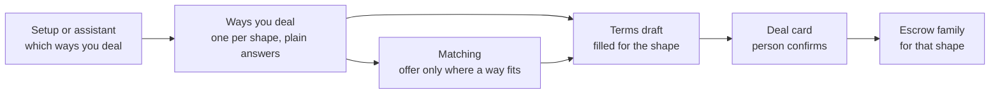

# 26 · Agents for every kind of deal

Tracks T1 (find and agree) and T2, roadmap item T2.2 (choose the kind of deal), which depends on T2.1 (the escrow families deployed). Approved by the owner 23 Oct 2026 as recommended (live shapes first, two groups for buying and selling, a buyer may propose a shape) and built the same day for the four live shapes. What is built is in the status table.

## What is hard today

Read from the code on 23 Oct 2026.

The agents know one kind of deal: a service with a price range, delivery days and a payment split. The settings page (`/profile`, Selling agent and Buying agent) and the setup answers (view 19) both stop there.

The escrow covers eleven shapes ([view 07](07-escrow.md), table 1), held by three contract families ([view 11](11-contracts.md)):

| Shape | Example | Contract today |
|---|---|---|
| One-time | A logo file | Live (v3) |
| Milestones | A website in three stages | Live (v3) |
| Goods with delivery | A wig from Lagos to Abuja | Live (v3, review starts on arrival) |
| Refundable deposit | Equipment rental | Live (v3) |
| Pay on delivery | Replaces cash on delivery | Agreement family, built, not deployed |
| Instalments | A fridge in four parts | Agreement family, built, not deployed |
| Business order, net terms | 200 T-shirts, Net 30 | Agreement family with trade finance, built, not deployed |
| Hourly or weekly | A virtual assistant, 20 hours a week | Time family, built, not deployed |
| Retainer | Monthly social media | Time family, built, not deployed |
| Agent-to-agent job | An agent hires another | Jobs family, built, not deployed |
| Bounty or contest | Best logo, three places | Jobs family on Arc Testnet; contests built 29 Oct 2026, not deployed (view 40) |

So a tailor who sells goods, a virtual assistant paid by the week and a supplier on Net 30 all meet the same service form. Their agent cannot offer the way they actually trade, and a buyer's agent cannot ask for it.

## The idea

An agent works from **the ways you deal**: a short list, each one a shape from the table above with its own few plain questions. Setup asks which ways apply. The assistant adds or changes one in conversation. The agent uses them for two jobs:

1. **To match faster.** A seller's agent offers only on requests that fit one of their ways. A buyer's agent asks for the shape it needs ("weekly, 20 hours"), not only a budget.
2. **To draft the terms.** When two agents agree, the deal card arrives filled in for that shape: schedule, review time, delivery, deposit. The person reads it and confirms. Nothing moves without that confirmation.

## The questions per shape

Each shape asks only what its contract needs. Answers are words and numbers, never contract terms.

| Shape | Seller is asked | Buyer is asked |
|---|---|---|
| One-time | What you do, usual price, how fast | Most you pay, how soon you need it |
| Milestones | Usual stages and how the price splits | Most you pay, how you like to pay (all at the end, by stage) |
| Goods with delivery | What you sell, price per item or for the order, where you ship, how long it takes to arrive | Where it comes to, how long you can wait |
| Refundable deposit | What you rent, deposit and period | Most deposit you will hold |
| Pay on delivery | Where you hand over in person | Where you can receive |
| Instalments | What can be paid in parts, how many parts | Most per part |
| Business order, net terms | What you supply, order sizes, net days you accept | What you order, net days you need |
| Hourly or weekly | Rate, hours a week you can give | Rate you pay, hours a week you need |
| Retainer | Monthly price, notice period | Monthly budget |
| Agent-to-agent job | What your agent does for other agents, price per job | What you let your agent hire out, most per job |
| Bounty or contest | (buyer only) | Prize, places, deadline |

## Rules this view adds

- **Only live shapes are offered.** A shape appears in setup, settings and the assistant only once its contract is deployed on that network. Today that is the four v3 shapes. The rest switch on with T2.1, one family at a time, with no change to the questions.
- **The service form becomes one way among several.** Existing settings carry over as the person's One-time or Milestones way. No one loses an answer.
- **The agent never invents a shape.** If no way fits a request, the agent says so and offers to add one. It does not stretch a service way to cover goods.
- **Same tool everywhere.** Setting a way is one assistant tool (`set_way_i_deal`) on the shared core, used by the website, Telegram and every channel (rule 13).
- **Money still needs the person.** A drafted deal is a card to confirm, never a payment.

## Screens

- **Profile, Your agents:** one row per way ("Goods with delivery · Lagos to anywhere in Nigeria · 3 to 5 days"), each with Edit, and Add a way. Rows align to one grid: label left, value right, long answers under their label.
- **Setup:** after "What do you want Karwan to do?", one question, "How do you usually deal?", with the live shapes as buttons, then only that shape's questions.
- **Assistant:** "I also sell on instalments" adds the way through the confirm card.

## Decisions for the owner

1. Ship the four live shapes now (one-time, milestones, goods, deposit) and add the rest as each family deploys? (Recommended: yes. Showing undeployed shapes would claim what is not live.)
2. Keep Buying agent and Selling agent as two groups, each with its ways, or one list labelled buy or sell? (Recommended: two groups, as today.)
3. Should a buyer's agent be allowed to propose a shape the seller has not listed? (Recommended: yes, as a request the seller accepts or declines.)

## Status

| Part | State | Where |
|---|---|---|
| Ways you deal: shapes, rules, older settings kept in step | Built 23 Oct | `backend/src/agents/ways.ts`, `profile.agentWays` |
| Save route and assistant tool | Built 23 Oct | `POST /api/setup/ways`, `set_way_i_deal`, confirm card `save_ways` on web and chat |
| Profile rows and editor | Built 23 Oct | Profile, Your agents; `/profile/ways` |
| Setup question "How do clients usually pay you?" | Built 23 Oct, web and Telegram | `paid` answer; starts the first selling way |
| Matching by shape; another shape goes to the owner | Built 23 Oct, for accounts that saved ways | `sellerForRequest` in the selling agent |
| Edit profile form and ways agree | Built 23 Oct | `reconcileWays` on profile save |
| Lowest and usual price on each selling way, no highest (view 41, phase 2) | Built 29 Oct | `priceUsual` beside `priceMin`; `upgradeWays` on read and `scripts/backfill-way-prices.ts` once; editor, setup and form copy in five languages |
| A goods way priced per item, compared per item against a request that names a count (view 41, phase 3) | Built 29 Oct | `perItem` on the goods way; `llm/quantity.ts` reads the request; `orderSize` in `agents/limits.ts` |
| Terms draft per shape | Partly: view 24 drafts one-time, milestones and goods from conversation | Not yet read from ways |
| A buying agent asking for a shape | Not built: requests carry goods or work, not milestones or deposit | Needs the request form to ask |
| Shapes beyond v3 | Wait for T2.1 | Added to `LIVE_SHAPES` as each family deploys |
