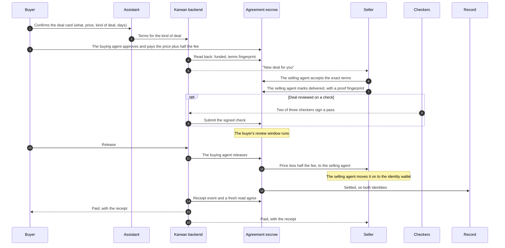
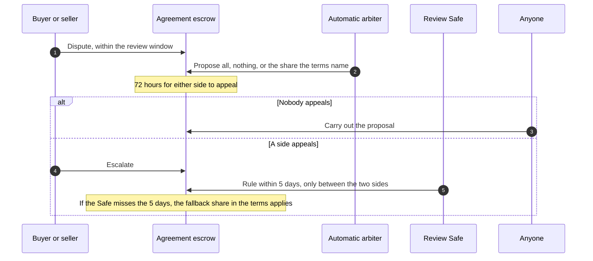

# 27 · Deals on the escrow family

Track T2, protected deals, roadmap item T2.1 (the family deployed and used), which roadmap item T1.2 (choose the kind of deal) depends on. Track T4, trade finance, roadmap item T4.2. The escrow family from [view 11](11-contracts.md) is on Arc Testnet, owned by its timelock, but Karwan's app still opens every deal on its current escrow. This view moves new deals onto the family, so each kind of deal a person picks in [view 26](26-agents-for-every-deal.md) lands in its own contract, the record counts it, and getting paid early ([view 18](18-trade-finance.md)) works on the same deals.

## What is wrong today

- Every new deal on testnet opens on the current escrow, not on the family, so none of the family's rules from view 11 reach it: k of n checks, the appeal window before an automatic ruling takes effect, the timelock over every setting, and an outcome written to a person's identity.
- The backend already has a path for terms-driven deals (fund with the full terms, accept the same terms, an automatic arbiter with a fixed table), built for a contract that was never deployed. It is switched off.
- Getting paid early on the deal page runs on the current escrow's factoring.
- The family's record counts a deal only for a wallet that belongs to a registered identity. No Karwan account has one yet.

## The idea in one line

New deals open on the family and deals already open finish where they started. Every step is one shared core function that the website and Telegram both call, and a step is done only when the chain says so.

## Participants

| Who | Does what |
|---|---|
| Buyer and seller | Agree, pay, deliver, release, dispute, from the website or a chat channel |
| Assistant and agents | Draft the terms from the conversation and the person's ways of dealing, and show one card per money step |
| Karwan backend | Prepares each step, submits signed steps, watches the chain, writes the deal row and tells both sides |
| Identity registry | One identity per person; wallets and agents attach to it |
| Agreement escrow | Holds one-time, milestone, goods and deposit deals |
| Checkers | Sign a delivery check; two of three are needed |
| Automatic arbiter | Karwan's fixed dispute table, code only, proposes within the outcomes the terms allow |
| Review Safes | People who rule on an escalated dispute: one of four under 5,000 USDC, two of four at or above |
| Trade finance | A financier's advance against a funded deal, repaid first when it settles |
| Record | The outcome of every deal, written to both people's identities |

## Who signs (owner, 24 Oct 2026)

- **The sign-in wallet is the identity wallet.** A person's record and facts attach to it, and it is where their money ends up. A web3 account's sign-in wallet is the person's own and they hold its keys; an email or passkey account's is a wallet Karwan holds for them.
- **Two agents run every deal, end to end.** The buying agent and the selling agent are wallets Karwan's servers sign for. They pay, accept, deliver, release and dispute, so a deal keeps moving while the person is away. Both are attached to the person's identity, so every deal they run counts on that person's record.
- **The buying agent pays only inside limits the person set once:** an amount per payment, a total and an expiry, enforced by the contract. The person can revoke them at any time.
- **A person is asked to be present only where it matters:** setting up their record and the buying agent's limits, putting up deal insurance, and moving money out of Karwan. Then the agent acts only after the person confirms with a passkey, their face or fingerprint, or a PIN. That check is made by Karwan's servers, not by the contract.
- **Deal insurance is agreed to once.** Putting it up is the seller's consent for it to protect their buyers and back financiers' advances on their deals. After that the selling agent signs what each deal or advance needs, with no further question; taking an advance is one tap on the financier's offer.
- **A seller's earnings** land with the selling agent and move on to the identity wallet.

## The first deal: one identity

```mermaid
sequenceDiagram
  autonumber
  participant P as Person
  participant A as Assistant
  participant K as Karwan backend
  participant ID as Identity registry

  P->>A: First money step (pay), or agreeing to a deal's terms as the seller
  A->>K: Prepare the step
  K->>ID: Does this wallet belong to an identity?
  ID-->>K: No
  K->>K: An agent wallet never used yet makes one harmless call first, so it can sign
  A-->>P: One card: "Set up your Karwan record", with the buying agent's limits
  P->>K: Confirms with a passkey, face or fingerprint, or a PIN
  P->>ID: The identity wallet registers (web3: the person signs; others: Karwan signs)
  P->>ID: The identity wallet attaches the buying agent, with its limits
  P->>ID: The identity wallet attaches the selling agent
  K->>ID: Read back the identity and both agents
  A-->>P: Continue with the money step
```

Notes: `KarwanIdentityRegistry.register` and `bind`. The buying agent is bound as an agent with limits; the selling agent is bound as one of the person's wallets, because the contracts let only a person's wallet stake (deal insurance, in the app) or back an advance. Each binding carries the agent wallet's own signature. A deal can be funded without an identity, but its outcome then counts on nobody's record, so the core asks first.

## A deal from agreement to payout



How each kind of deal from view 26 maps onto the terms:

| Kind of deal | Terms |
|---|---|
| One-time | One payment, review starts at delivery |
| Milestones | Two to five payments in the app (the contract holds up to twelve), each reviewed on its own |
| Goods | Review starts when the buyer confirms arrival, or by itself after a longstop, with the tracking number as the proof |
| Deposit | A refundable deposit: if the buyer says nothing, the money goes back to the buyer |

Notes: `KarwanAgreementEscrow.fund`, `accept`, `markDelivered`, `release`; `KarwanCheckVerifier.report`. The fee is 1%, half from each side, and the beta caps are 1,005 USDC per deal and 10,000 USDC in total per family, so the largest deal is 1,000 USDC.

## A dispute



Notes: `dispute`, `proposeRuling`, `escalate`, `rule`, `executeRuling`. The arbiter's table is the one the owner approved on 25 September for the terms-driven escrow; no model output feeds a ruling.

## Getting paid early

A seller with a funded deal can take an advance from a financier, as view 18 sets out. On the family the advance is against an Agreement deal: the seller taps the offer, the selling agent signs the payout assignment and reserves part of the seller's deal insurance behind it, the escrow repays the financier first when the deal settles, and the seller receives the rest. The deal page and Telegram call the same core functions.

## Moving over

- **Per network, testnet first.** Once switched on, every new deal opens on the family. A deal keeps the escrow it opened on, so deals already open finish on the current escrow and no money moves between contracts.
- **Mainnet waits** for the audit steps in view 11.
- **The settings are on chain.** The automatic arbiter, the three checkers and the issuer named in the first settings are Karwan's testnet keys, kept in its servers' secret store. Mainnet gets its own keys, set through the timelock.

## What fails where

| Where | What fails | What happens |
|---|---|---|
| First money step | The wallet has no identity | The core asks the person to set up their record first; nothing is paid until it exists |
| A seller agrees to a deal's terms | The seller has no record yet | They set it up first, then agree; the buyer pays as usual. A deal paid in before the seller has a record still runs, but does not count on the seller's record, because the escrow notes each side's record when the money goes in |
| A matched request | The seller has no record yet | Their selling agent does not offer on new requests and tells them once to set up their record |
| Record setup | An agent wallet has never been used | It makes one harmless call first, because a wallet provider cannot sign for a wallet that is not yet on chain |
| Paying | Over the per-deal cap, the family paused, or not enough USDC | Refused before anything is signed, with the reason and the limit in words |
| Any transaction | A wallet provider reports done but the call reverted inside | The step is done only when the receipt shows the expected event and a fresh read agrees; otherwise it is flagged and retried from the chain state |
| Accepting | The seller sees terms that differ from the ones paid for | The escrow refuses: acceptance is for the exact terms fingerprint |
| A check | Fewer than two checkers sign | No check is recorded; the review starts anyway at the longstop the terms set |
| A dispute | The arbiter does not propose | After 5 days either side escalates to the review Safe |
| A ruling | The review Safe misses its 5 days | The fallback share in the terms applies |
| A settings change | Queued while deals are open | It reaches new deals only; open deals keep the rules they opened with |

## Checks before code (rule 14)

Before any code, and logged in `docs/arc-circle-checks.md`:

- Circle developer-controlled wallets: contract execution for register, bind, approve, fund, accept and deliver, and typed-data signing for the release, against the installed SDK and a read-only call.
- Circle smart accounts: whether the buying agent's signature verifies on chain for the identity binding (ERC-1271).
- Arc: the deployed suite read back with the check script, and the event signatures the watcher listens for.

## What it does not do

- Move a deal or its money from the current escrow.
- Put the Time and Jobs families in the app. Each follows when a kind of deal people ask for needs it.
- Go to mainnet.
- Run delivery checks through Chainlink CRE; that is roadmap item T2.2.

## Decided by the owner, 23 Oct 2026

1. **A person registers at their first money step**, so people who only browse never pay for it.
2. **Chat account limits:** up to 1,005 USDC per payment, 10,000 USDC in total and a one-year expiry, all shown on the card before the person confirms.
3. **Switch-over:** all new testnet deals move to the family at once; the current escrow keeps only the deals already open on it.
4. **Checkers:** Karwan runs the three checker keys on testnet; outside checkers join later through the timelock.

## Decided by the owner, 24 Oct 2026

5. **A seller sets up their record before their first deal is paid in:** when they agree to a deal's terms, and before their selling agent offers on a request. The escrow notes each side's record when the money goes in, so this is how every deal a seller takes counts on their record. A deal paid in before the seller has a record stays possible as a fallback; it runs normally but does not count on the seller's record.
6. **Network fees for wallets Karwan holds** (identity wallets and agents, including an agent's first transaction) are paid through a Circle gas policy, on testnet and on mainnet, so those people never hold gas. People who sign in with their own wallet pay their own small fee in that wallet. The copy says so only once the mainnet policy is set up.
7. **No payment goes to a seller just because review time ran out**, since a buyer may simply be away. When review ends with the buyer silent, the seller gets a one-tap prompt to raise it; if they have not within 24 hours, their selling agent raises it and tells them. Karwan's arbiter then proposes paying the seller, and the buyer has 72 hours to answer with a reason, which sends the case to a person on the review team (5 days, then the deal's fallback share). With no answer, the proposal is carried out and the seller is paid for that payment, a milestone or the final one. On testnet this is how Karwan runs the deals; the contract still allows a claim after review, which Karwan never sends. The mainnet contract release writes the rule into the contract, before its external audit.

## Status

| Part | Status |
|---|---|
| Escrow family on Arc Testnet | Deployed 23 Oct 2026, owned by the timelock; the first settings can be executed from 24 Oct |
| Every role used once on testnet (fact, two-of-three check, arbiter proposal) | Built and proven on an Arc fork; runs on testnet after the first settings |
| App opens new deals on the family | Planned |
| Confirmation by passkey or Karwan PIN for setup, deal insurance and money out | Built, not deployed (view 05) |
| One identity per person, set up at the first money step | Planned |
| Automatic arbiter on the family | Planned; the table is built for the terms-driven escrow and switched off |
| Getting paid early on the family | Planned (T4.2) |
| Time and Jobs families in the app | Later |
| Mainnet | After the audit steps in view 11 |
