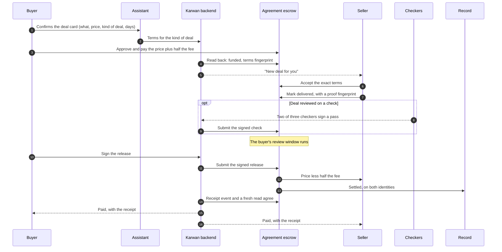
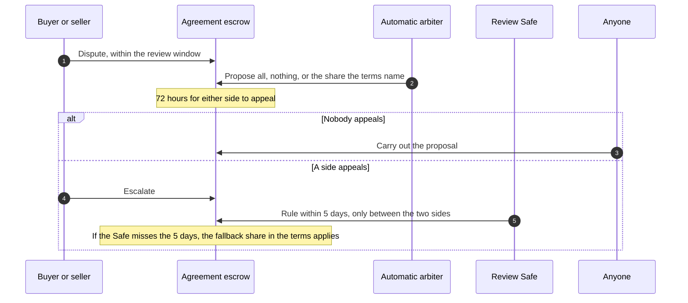

# 27 · Deals on the escrow family

Track T2, protected deals, roadmap item T2.1 (the family deployed and used), which roadmap item T1.2 (choose the kind of deal) depends on. Track T4, trade finance, roadmap item T4.2. The escrow family from [view 11](11-contracts.md) is on Arc Testnet, owned by its timelock, but Karwan's app still opens every deal on its current escrow. This view moves new deals onto the family, so each kind of deal a person picks in [view 26](26-agents-for-every-deal.md) lands in its own contract, the record counts it, and getting paid early ([view 18](18-trade-finance.md)) works on the same deals.

## What is wrong today

- Every new deal on testnet opens on the current escrow, not on the family, so none of the family's rules from view 11 reach it: k of n checks, the appeal window before an automatic ruling takes effect, the timelock over every setting, and an outcome written to a person's identity.
- The backend already has a path for terms-driven deals (fund with the full terms, accept the same terms, an automatic arbiter with a fixed table), built for a contract that was never deployed. It is switched off.
- Getting paid early on the deal page runs on the current escrow's factoring.
- The family's record counts a deal only for a wallet that belongs to a registered identity. No Karwan account has one yet.

## The idea in one line

New deals open on the family and deals already open finish where they started. Every step is one shared core function that the website and Telegram both call, and a step is done only when the chain says so.

## Participants

| Who | Does what |
|---|---|
| Buyer and seller | Agree, pay, deliver, release, dispute, from the website or a chat channel |
| Assistant and agents | Draft the terms from the conversation and the person's ways of dealing, and show one card per money step |
| Karwan backend | Prepares each step, submits signed steps, watches the chain, writes the deal row and tells both sides |
| Identity registry | One identity per person; wallets and agents attach to it |
| Agreement escrow | Holds one-time, milestone, goods and deposit deals |
| Checkers | Sign a delivery check; two of three are needed |
| Automatic arbiter | Karwan's fixed dispute table, code only, proposes within the outcomes the terms allow |
| Review Safes | People who rule on an escalated dispute: one of four under 5,000 USDC, two of four at or above |
| Trade finance | A financier's advance against a funded deal, repaid first when it settles |
| Record | The outcome of every deal, written to both people's identities |

## Who signs

- **Website accounts** with a connected wallet or a passkey sign every money step themselves, as view 11 sets out.
- **Chat accounts** are signed for by Karwan's servers with the account's own wallets, only inside limits the person signed once on chain: an amount per payment, a total and an expiry. The person can revoke them at any time.
- **Release is a signature.** The buyer signs the release and Karwan submits it, so a buyer can pay out without holding gas.

## The first deal: one identity

```mermaid
sequenceDiagram
  autonumber
  participant P as Person
  participant A as Assistant
  participant K as Karwan backend
  participant ID as Identity registry

  P->>A: First money step (pay, or accept a deal)
  A->>K: Prepare the step
  K->>ID: Does this wallet belong to an identity?
  ID-->>K: No
  A-->>P: One card: "Set up your Karwan record", a few cents
  P->>ID: Register (website: own wallet; chat: Karwan signs with the identity wallet)
  Note over K,ID: Chat accounts also attach the buying wallet as an agent with the limits the person confirmed
  K->>ID: Read back the identity
  A-->>P: Continue with the money step
```

Notes: `KarwanIdentityRegistry.register` and `bind` (agent limits signed by the agent wallet). A deal can be funded without an identity, but its outcome then counts on nobody's record, so the core asks first.

## A deal from agreement to payout



How each kind of deal from view 26 maps onto the terms:

| Kind of deal | Terms |
|---|---|
| One-time | One payment, review starts at delivery |
| Milestones | Two to five payments in the app (the contract holds up to twelve), each reviewed on its own |
| Goods | Review starts when the buyer confirms arrival, or by itself after a longstop, with the tracking number as the proof |
| Deposit | A refundable deposit: if the buyer says nothing, the money goes back to the buyer |

Notes: `KarwanAgreementEscrow.fund`, `accept`, `markDelivered`, `releaseBySig`; `KarwanCheckVerifier.report`. The fee is 1%, half from each side, and the beta caps are 1,005 USDC per deal and 10,000 USDC in total per family, so the largest deal is 1,000 USDC.

## A dispute



Notes: `dispute`, `proposeRuling`, `escalate`, `rule`, `executeRuling`. The arbiter's table is the one the owner approved on 25 September for the terms-driven escrow; no model output feeds a ruling.

## Getting paid early

A seller with a funded deal can take an advance from a financier, as view 18 sets out. On the family the advance is against an Agreement deal, the escrow repays the financier first when the deal settles, and the seller receives the rest. The deal page and Telegram call the same core functions.

## Moving over

- **Per network, testnet first.** Once switched on, every new deal opens on the family. A deal keeps the escrow it opened on, so deals already open finish on the current escrow and no money moves between contracts.
- **Mainnet waits** for the audit steps in view 11.
- **The settings are on chain.** The automatic arbiter and the checkers are test keys today; Karwan's own wallets replace them through the timelock, in public for the full delay, before the app goes live.

## What fails where

| Where | What fails | What happens |
|---|---|---|
| First money step | The wallet has no identity | The core asks the person to set up their record first; nothing is paid until it exists |
| Paying | Over the per-deal cap, the family paused, or not enough USDC | Refused before anything is signed, with the reason and the limit in words |
| Any transaction | A wallet provider reports done but the call reverted inside | The step is done only when the receipt shows the expected event and a fresh read agrees; otherwise it is flagged and retried from the chain state |
| Accepting | The seller sees terms that differ from the ones paid for | The escrow refuses: acceptance is for the exact terms fingerprint |
| A check | Fewer than two checkers sign | No check is recorded; the review starts anyway at the longstop the terms set |
| A dispute | The arbiter does not propose | After 5 days either side escalates to the review Safe |
| A ruling | The review Safe misses its 5 days | The fallback share in the terms applies |
| A settings change | Queued while deals are open | It reaches new deals only; open deals keep the rules they opened with |

## Checks before code (rule 14)

Before any code, and logged in `docs/arc-circle-checks.md`:

- Circle developer-controlled wallets: contract execution for register, bind, approve, fund, accept and deliver, and typed-data signing for the release, against the installed SDK and a read-only call.
- Circle modular wallets (passkey): whether approve and pay go in one batch, and whether the smart account's signature verifies for the signed release.
- Arc: the deployed suite read back with the check script, and the event signatures the watcher listens for.

## What it does not do

- Move a deal or its money from the current escrow.
- Put the Time and Jobs families in the app. Each follows when a kind of deal people ask for needs it.
- Go to mainnet.
- Run delivery checks through Chainlink CRE; that is roadmap item T2.2.

## Questions for the owner

1. **When does a person register?** Recommended: at their first money step, so people who only browse never pay for it.
2. **Chat account limits.** Recommended: per payment up to the beta cap (1,005 USDC), a 10,000 USDC total and a one-year expiry, all shown on the card before the person confirms.
3. **Switch-over.** Recommended: all new testnet deals move at once, with the current escrow kept for deals already open.
4. **Checkers.** Recommended for testnet: Karwan runs the three checker keys; outside checkers join through the timelock later.

## Status

| Part | Status |
|---|---|
| Escrow family on Arc Testnet | Deployed 23 Oct 2026, owned by the timelock; the first settings can be executed from 24 Oct |
| Every role used once on testnet (fact, two-of-three check, arbiter proposal) | Built and proven on an Arc fork; runs on testnet after the first settings |
| App opens new deals on the family | Planned |
| One identity per person, set up at the first money step | Planned |
| Signed release | Planned |
| Automatic arbiter on the family | Planned; the table is built for the terms-driven escrow and switched off |
| Getting paid early on the family | Planned (T4.2) |
| Time and Jobs families in the app | Later |
| Mainnet | After the audit steps in view 11 |
