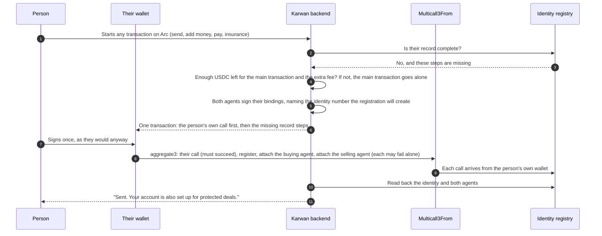
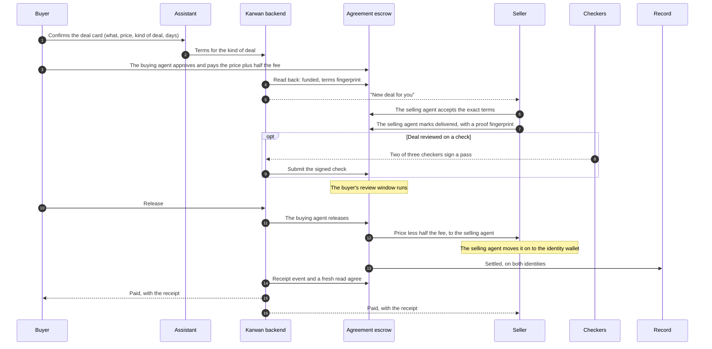
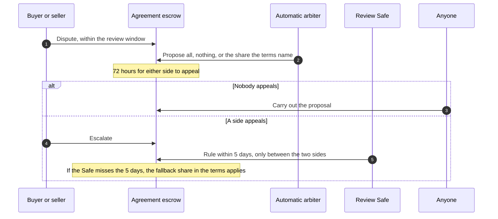

# 27 · Deals on the escrow family

Track T2, protected deals, roadmap item T2.1 (the family deployed and used), which roadmap item T1.2 (choose the kind of deal) depends on. Track T4, trade finance, roadmap item T4.2. The escrow family from [view 11](11-contracts.md) is on Arc Testnet, owned by its timelock, but Karwan's app still opens every deal on its current escrow. This view moves new deals onto the family, so each kind of deal a person picks in [view 26](26-agents-for-every-deal.md) lands in its own contract, the record counts it, and getting paid early ([view 18](18-trade-finance.md)) works on the same deals.

## What is wrong today

- Every new deal on testnet opens on the current escrow, not on the family, so none of the family's rules from view 11 reach it: k of n checks, the appeal window before an automatic ruling takes effect, the timelock over every setting, and an outcome written to a person's identity.
- The backend already has a path for terms-driven deals (fund with the full terms, accept the same terms, an automatic arbiter with a fixed table), built for a contract that was never deployed. It is switched off.
- Getting paid early on the deal page runs on the current escrow's factoring.
- The family's record counts a deal only for a wallet that belongs to a registered identity. No Karwan account has one yet.

## The idea in one line

New deals open on the family and deals already open finish where they started. Every step is one shared core function that the website and Telegram both call, and a step is done only when the chain says so.

## Participants

| Who | Does what |
|---|---|
| Buyer and seller | Agree, pay, deliver, release, dispute, from the website or a chat channel |
| Assistant and agents | Draft the terms from the conversation and the person's ways of dealing, and show one card per money step |
| Karwan backend | Prepares each step, submits signed steps, watches the chain, writes the deal row and tells both sides |
| Identity registry | One identity per person; wallets and agents attach to it |
| Agreement escrow | Holds one-time, milestone, goods and deposit deals |
| Checkers | Sign a delivery check; two of three are needed |
| Automatic arbiter | Karwan's fixed dispute table, code only, proposes within the outcomes the terms allow |
| Review Safes | People who rule on an escalated dispute: one of four under 5,000 USDC, two of four at or above |
| Trade finance | A financier's advance against a funded deal, repaid first when it settles |
| Record | The outcome of every deal, written to both people's identities |

## Who signs (owner, 24 Oct 2026)

- **The sign-in wallet is the identity wallet.** A person's record and facts attach to it, and it is where their money ends up. A web3 account's sign-in wallet is the person's own and they hold its keys; an email or passkey account's is a wallet Karwan holds for them.
- **Two agents run every deal, end to end.** The buying agent and the selling agent are wallets Karwan's servers sign for. They pay, accept, deliver, release and dispute, so a deal keeps moving while the person is away. Both are attached to the person's identity, so every deal they run counts on that person's record.
- **The buying agent pays only inside limits the person set once:** an amount per payment, a total and an expiry, enforced by the contract. The person can revoke them at any time.
- **A person is asked to be present only where it matters:** setting up their record and the buying agent's limits on mainnet when Karwan holds their wallets (people with their own wallet sign it along with their next transaction, see below), putting up deal insurance, and moving money out of Karwan. Then the agent acts only after the person confirms with a passkey, their face or fingerprint, or a PIN. That check is made by Karwan's servers, not by the contract.
- **Deal insurance is agreed to once.** Putting it up is the seller's consent for it to protect their buyers and back financiers' advances on their deals. After that the selling agent signs what each deal or advance needs, with no further question; taking an advance is one tap on the financier's offer.
- **A seller's earnings** land with the selling agent and move on to the identity wallet.

## The record: set up on the way, never in the way

A person's record is their identity on Arc with their two agents attached to it. Deals count on it, the buying agent's limits live in it, and the selling agent can put up deal insurance and back advances because of it. Nobody is ever stopped to set it up, and nobody needs to know what it is.

**Wallets Karwan holds** (email, passkey and Telegram accounts). Karwan sets the record up itself the moment it is first needed, with no step from the person (decision 9).

```mermaid
sequenceDiagram
  autonumber
  participant P as Person
  participant K as Karwan backend
  participant ID as Identity registry

  P->>K: Anything that needs the record: an offer, agreeing to terms, paying
  K->>ID: Does this wallet belong to an identity?
  ID-->>K: No
  K->>K: An agent wallet never used yet makes one harmless call first, so it can sign
  K->>ID: Karwan signs: register, attach the buying agent with its limits, attach the selling agent
  K->>ID: Read back the identity and both agents
  K-->>P: Carries on with what they asked; nothing to confirm
```

**Wallets people hold themselves** (web3 accounts, owner, 27 Oct 2026). Setting up the record costs a small network fee, paid from their wallet, so it is never a step of its own. It rides along with the next transaction they sign on Arc for any reason: adding money to their agents, paying into a deal, sending USDC, putting up or taking out deal insurance, claiming yield, a step a financier signs, or a wallet card from the assistant.



How it behaves:

- **The person's own transaction always comes first and decides the outcome.** It is the one call in the batch that must succeed. The record steps after it may each fail on their own without undoing it, so adding the record can never make a send, a payment or a top up fail.
- **Only when the money is there.** The record steps are added only if the wallet keeps enough USDC after the main transaction to pay the extra fee with room to spare. They are never added to a transaction that sends the whole balance. Otherwise the main transaction goes alone and the record waits for the next one.
- **Only what is missing.** A record that is half set up (registered, one agent not attached, or a buying agent past its year) gets only the missing steps. A complete record adds nothing.
- **Said after, never asked before.** The confirmation sheet shows the person's own action, as it does today. Once the chain shows the record complete, the app says so in one line under the result: "Your account is also set up for protected deals." If the record steps did not land, nothing is said and the next transaction tries again.
- **Never blocked.** No payment, agreement, offer or send waits for the record. Until it exists, the person's deals run normally and count on the record of whoever has one; the escrow notes each side's record when the money goes in, so a deal paid in before the person's record exists does not count on it later.
- **Only on Arc.** A transaction signed on another chain (bringing money in from Ethereum or Solana, say) cannot carry Arc calls; the next one they sign on Arc does. Sending money out of Arc runs through App Kit's own calls and is added once those can be batched.
- **Smart-contract wallets** (a Safe, a smart account) cannot use `Multicall3From`. Where the wallet supports sending several calls at once (`wallet_sendCalls`), the record steps go in that bundle the same way; otherwise the main transaction goes alone.

Notes: `KarwanIdentityRegistry.register` and `bind`. The buying agent is bound as an agent with limits; the selling agent is bound as one of the person's wallets, because the contracts let only a person's wallet stake (deal insurance, in the app) or back an advance. Each binding carries the agent wallet's own signature. `Multicall3From` (`0x522fAf9A91c41c443c66765030741e4AaCe147D0`, predeployed on Arc Testnet and mainnet) runs each call through Arc's `CallFrom` precompile, so the registry and USDC see the person's wallet as the sender, and the person stays the controller of their identity. Because a binding names the identity number before it exists, Karwan reads the registry's count and the agents sign for the next number; if another registration lands first, the bindings fail alone and the next transaction attaches them with the right number. A binding only ever attaches to the sender's own identity, so a wrong number can never attach an agent to someone else.

## A deal from agreement to payout



How each kind of deal from view 26 maps onto the terms:

| Kind of deal | Terms |
|---|---|
| One-time | One payment, review starts at delivery |
| Milestones | Two to five payments in the app (the contract holds up to twelve), each delivered and reviewed on its own: paying one clears the delivery on chain, so the next can be released only after the seller delivers it |
| Goods | Review starts when the buyer confirms arrival, or by itself after a longstop, with the tracking number as the proof |
| Deposit | A refundable deposit: if the buyer says nothing, the money goes back to the buyer |

Notes: `KarwanAgreementEscrow.fund`, `accept`, `markDelivered`, `release`; `KarwanCheckVerifier.report`. The fee is 1%, half from each side, and the beta caps are 1,005 USDC per deal and 10,000 USDC in total per family, so the largest deal is 1,000 USDC.

## A dispute



Notes: `dispute`, `proposeRuling`, `escalate`, `rule`, `executeRuling`. The arbiter's table is the one the owner approved on 25 September for the terms-driven escrow; no model output feeds a ruling.

## Getting paid early

A seller with a funded deal can take an advance from a financier, as view 18 sets out. On the family the advance is against an Agreement deal: the seller taps the offer, the selling agent signs the payout assignment and reserves part of the seller's deal insurance behind it, the escrow repays the financier first when the deal settles, and the seller receives the rest. The deal page and Telegram call the same core functions.

## Moving over

- **Per network, testnet first.** Once switched on, every new deal opens on the family. A deal keeps the escrow it opened on, so deals already open finish on the current escrow and no money moves between contracts.
- **Mainnet waits** for the audit steps in view 11.
- **The settings are on chain.** The automatic arbiter, the three checkers and the issuer named in the first settings are Karwan's testnet keys, kept in its servers' secret store. Mainnet gets its own keys, set through the timelock.

## What fails where

| Where | What fails | What happens |
|---|---|---|
| First money step | The wallet has no identity | Nothing waits. A wallet Karwan holds is set up on the spot; an own wallet's record rides along with its next Arc transaction. A deal paid in before a side has a record runs normally but does not count on that side's record |
| A seller agrees to a deal's terms | The seller has no record yet | They agree as usual and the buyer pays as usual. A wallet Karwan holds is set up first, with no step. An own wallet is not stopped: the deal runs, but does not count on the seller's record, because the escrow notes each side's record when the money goes in |
| A matched request | The seller has no record yet | Their selling agent offers as usual. A wallet Karwan holds is set up before the offer, with no step; an own wallet's deals count once its record exists |
| Record setup | An agent wallet has never been used | It makes one harmless call first, because a wallet provider cannot sign for a wallet that is not yet on chain |
| Record setup, own wallet | Someone else registers between Karwan preparing the batch and the person signing it | The person's own call and the registration go through; the bindings name the wrong identity number and fail alone. The next transaction attaches them with the right number |
| Record setup, own wallet | The wallet is a smart-contract wallet (a Safe, a smart account) | `Multicall3From` takes only ordinary wallets. If the wallet can send several calls at once (`wallet_sendCalls`), the steps go in that bundle; otherwise the main transaction goes alone |
| Record setup, own wallet | Not enough USDC for the extra fee, or the transaction sends the whole balance | The main transaction goes alone; the record waits for the next one |
| Record setup, own wallet | A record step fails inside the batch | The person's own call still stands. Nothing is said, and the next transaction holds only what is still missing |
| Record setup, own wallet | The record was half set up before (registered, an agent not attached, or the buying agent expired) | The batch holds only the missing steps; nothing already on chain is sent again |
| Paying | An own wallet's buying agent is past its year or over its total, which the registry would refuse | Karwan's buying agent takes itself off the record (the registry lets a wallet leave on its own), the payment goes on with no agent limit on chain for that deal, and the agent is attached again with the person's next transaction. A wallet Karwan holds is renewed on the spot instead |
| Paying | The buyer has no record yet | The payment goes ahead; it is never refused for a missing record. A wallet Karwan holds is set up first, with no step; an own wallet's deal does not count on the buyer's record |
| Paying | Over the per-deal cap, the family paused, or not enough USDC | Refused before anything is signed, with the reason and the limit in words |
| Any transaction | A wallet provider reports done but the call reverted inside | The step is done only when the receipt shows the expected event and a fresh read agrees; otherwise it is flagged and retried from the chain state |
| Accepting | The seller sees terms that differ from the ones paid for | The escrow refuses: acceptance is for the exact terms fingerprint |
| Accepting | The selling agent's accept fails | The money stays in the escrow and the buyer is protected. The watcher retries the accept every 30 minutes; the buyer can take the money back at any time; once the escrow stops taking an accept (three days after funding) the watcher returns it to the buyer |
| A check | Fewer than two checkers sign | No check is recorded; the review starts anyway at the longstop the terms set |
| A dispute | The arbiter does not propose | After 5 days either side escalates to the review Safe |
| A ruling | The review Safe misses its 5 days | The fallback share in the terms applies |
| The delivery date | Passes with nothing delivered | Both sides are told; after the grace the buyer is refunded, unless a request for more time waits on the buyer, which holds the refund until they answer |
| A settings change | Queued while deals are open | It reaches new deals only; open deals keep the rules they opened with |

## Checks before code (rule 14)

Before any code, and logged in `docs/arc-circle-checks.md`:

- Circle developer-controlled wallets: contract execution for register, bind, approve, fund, accept and deliver, and typed-data signing for the release, against the installed SDK and a read-only call.
- Circle smart accounts: whether the buying agent's signature verifies on chain for the identity binding (ERC-1271).
- Arc: the deployed suite read back with the check script, and the event signatures the watcher listens for.
- Arc, `Multicall3From` for record setup (27 Oct 2026): the docs page on batched transactions, and a read-only call on testnet showing the registry sees the person's wallet, not the batch contract, with the identity number Karwan predicts. Still to prove: a full batch with real agent signatures by `eth_call`, then one real setup from a browser wallet.

## What it does not do

- Move a deal or its money from the current escrow.
- Put the Time and Jobs families in the app. Each follows when a kind of deal people ask for needs it.
- Go to mainnet.
- Run delivery checks through Chainlink CRE; that is roadmap item T2.2.

## Decided by the owner, 23 Oct 2026

1. **A person registers at their first money step**, so people who only browse never pay for it. (Amended 27 Oct 2026 by decision 10: nothing waits for it, and an own wallet's record rides along with its next Arc transaction.)
2. **Chat account limits:** up to 1,005 USDC per payment, 10,000 USDC in total and a one-year expiry, all shown on the card before the person confirms.
3. **Switch-over:** all new testnet deals move to the family at once; the current escrow keeps only the deals already open on it.
4. **Checkers:** Karwan runs the three checker keys on testnet; outside checkers join later through the timelock.

## Decided by the owner, 24 Oct 2026

5. **A seller sets up their record before their first deal is paid in:** when they agree to a deal's terms, and before their selling agent offers on a request. The escrow notes each side's record when the money goes in, so this is how every deal a seller takes counts on their record. A deal paid in before the seller has a record stays possible as a fallback; it runs normally but does not count on the seller's record. (Amended 27 Oct 2026 by decision 10: a wallet Karwan holds is still set up first, with no step; an own wallet is never stopped.)
6. **Network fees for wallets Karwan holds** (identity wallets and agents, including an agent's first transaction) are paid through a Circle gas policy, on testnet and on mainnet, so those people never hold gas. People who sign in with their own wallet pay their own small fee in that wallet. The copy says so only once the mainnet policy is set up.
7. **Review, then pay** (replaced on 25 Oct 2026; the 24 Oct version had the seller ask and the buyer answer within 72 hours). The buyer has the review time the deal set, at most 30 days, the most the escrow takes. They can release, ask once for more time, or raise a problem. Karwan reminds them a day before review ends. When it ends with no release and no problem raised, the payment goes to the seller: the contract allows the claim then, and Karwan sends it. The 72 hours apply inside a dispute: once either side raises a problem, each has 72 hours to give their side, and a side that stays silent loses. No contract change is needed.

## Decided by the owner, 26 Oct 2026

8. **The delivery date.** Karwan reminds the seller a day before the delivery date, or halfway when the whole delivery time is under two days. When the date passes with nothing delivered, both sides are told: the seller has one more day (the grace the contract sets) to deliver, then the buyer's money goes back to them. The seller can ask for more time before the date, and once more after it while the grace runs. A request for more time that the buyer has not answered holds the refund: the money stays in the deal until the buyer approves or declines, and Karwan reminds the buyer up to three times, a day apart. A decline sends the refund on; an approval counts the extra days from the later of the old date and the moment of approval. No contract change is needed: the escrow takes a later deadline at any time before the money is taken back.

9. **Records on testnet are set up by Karwan.** Where Karwan holds a person's wallets, it signs their record setup itself the moment a record is first needed (their selling agent is about to offer, they agree to terms, they pay in), with no step from them; an expired buying agent is renewed the same way. A one-time run sets up every existing testnet account Karwan holds (`scripts/backfill-records`). People with their own wallet still sign theirs. Mainnet keeps the passkey or PIN confirmation.

## Decided by the owner, 27 Oct 2026

10. **The record is set up on the way, never in the way.** People with their own wallet never take a step for it: the missing record steps ride along with the next transaction they sign on Arc, whatever it is, through Arc's `Multicall3From`, only when their USDC covers the extra fee, and the app says so after. They stay the controller of their identity. No payment, agreement, offer or send ever waits for a record, for any account. This replaces the asks in decisions 1 and 5: a deal paid in before a side has a record runs normally and does not count on that side's record.

**What existing testnet accounts need:**

- Accounts whose wallets Karwan holds: nothing. The backfill run (`scripts/backfill-records --execute`) finishes the ones still half done; anyone it misses is set up the moment a record is first needed.
- Accounts with their own wallet and a complete record: nothing.
- Accounts with their own wallet and no record, or a half-done one: nothing. Their next Arc transaction carries the missing steps, and the app tells them after.
- An expired buying agent, for either kind of account: renewed the same way, with no step.

11. **One quiet line on the receipt** (owner, 27 Oct 2026). Someone with their own wallet who only receives money may never sign an Arc transaction, so their record would never be set up. After a settled deal that did not count on their record, the receipt shows one line, "Count your next deals on your record", with a button that signs the missing record steps alone, in one transaction. It is optional, never blocks anything, and shows at most once a month.

## Status

| Part | Status |
|---|---|
| Escrow family on Arc Testnet | Deployed 23 Oct 2026, owned by the timelock; the first settings can be executed from 24 Oct |
| Every role used once on testnet (fact, two-of-three check, arbiter proposal) | Built and proven on an Arc fork; runs on testnet after the first settings |
| App opens new deals on the family | Planned |
| Confirmation by passkey or Karwan PIN for setup, deal insurance and money out | Built, not deployed (view 05) |
| One identity per person, set up at the first money step | Built for wallets Karwan holds (set up by Karwan on testnet) and for own wallets as separate transactions |
| Own wallet: record steps ride along with the next Arc transaction; nothing waits for a record; the receipt line | Agreed 27 Oct 2026; spec written, plan next |
| Automatic arbiter on the family | Planned; the table is built for the terms-driven escrow and switched off |
| Getting paid early on the family | Planned (T4.2) |
| Time and Jobs families in the app | Later |
| Mainnet | After the audit steps in view 11 |
