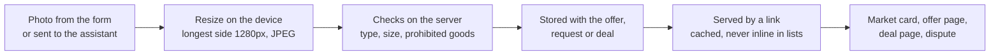

# 28 · Photos on offers and deals

Track T1 (find and agree), roadmap item T1.5, with T2 (protected deals) for the deal record later. Approved by the owner 24 Oct 2026 as recommended: photos on offers first, four per offer, text rules now and photos reviewed when reported. Built the same day for offers. Milestone 1 (demo day, 3 Nov) does not depend on it.

## What is hard today

Read from the code on 23 Oct 2026.

- An offer (`backend/src/db/listings.ts`) is a title, a description of up to 500 characters and a price. A request and a direct deal carry text only.
- A buyer of goods (a wig, a phone, a bag of rice) decides on words alone. A seller of goods cannot show the item, its condition or its label.
- Karwan already handles pictures in three places, none of them on a listing:
  - the profile photo, kept as a data URL on the profile and served at `/api/profile/photo/:address` (`backend/src/profile/photo.ts`);
  - a file added to the assistant (`/api/assistant/attach`), read once and never kept;
  - deal chat images in `ChatPanel`.

## The idea

A seller adds up to four photos to an offer, and a buyer up to four to a request or a direct deal ("this is the model I want"). The photos show on the market card, the offer page and the deal page. They are part of what both sides agreed, so a dispute can point at them.

It works the same everywhere, agentic first:

- **Website:** an "Add photos" row on the offer, request and deal forms.
- **Assistant (web, Telegram, WhatsApp):** a photo sent while the assistant is drafting an offer or deal is attached to that draft. The confirm card shows the photos before anything is posted or sent.
- **Market:** the first photo leads the card for goods offers; services keep the text card.

## How it is built

1. **Storage.** Photos are resized on the device to at most 1280px and saved as files under `data/listing-photos/` (the offer keeps only their type, size and date). The data backup already covers that folder. Each photo is served from its own link, versioned by date and cached for a year, so lists never carry images. If volume grows, the files can move to an S3 bucket in the account later without changing any page.
2. **Checks.** The server reads each photo's first bytes to confirm it is JPEG, PNG or WebP, whatever the file claims, caps it at 1.5 MB and the offer at four. The offer's words go through the prohibited-trades rule (`backend/src/policy/prohibited.ts`) as before. A refused photo says why, in one line. A report reaches the team's feedback inbox with the photos attached, and the team can clear an offer's photos.
3. **Privacy.** Offer photos are public, like the offer. Photos on a request with a named seller, or on a direct deal, are seen only by the two parties (`partyScope.ts`), the same as the deal itself. Location data in the file is stripped on the device before upload.
4. **Assistant tool.** `propose_post_offer` adds the photos the person sent in the last hour and shows their number on the card; `propose_post_request` and `start_protected_deal` follow with requests and deals. The guide (`platformGuide.ts`) and the canon (`photos-on-offers`) describe it in the same batch.

## Decisions (owner, 24 Oct 2026)

1. Offers first. Requests and direct deals follow on the same core.
2. The prohibited-trades rule checks the offer's words; photos are reviewed when someone reports them. No vision model yet.
3. Four photos per offer.

## How a photo from a chat app is told apart from an invoice

A photo sent to the agent was already read as an invoice for the person's own
work. A photo is now kept for the next offer only when its caption says so
("for my offer", "selling this"); any other photo is read as an invoice, as
before. On the website the person picks "For an offer" or "Read as an
invoice" after choosing the photo. Held photos last an hour, four at most.

## Status

| Part | State |
|---|---|
| This view | Approved 24 Oct 2026 |
| Photo checks, storage and links (`backend/src/listings/photos.ts`) | Built, tested |
| Offer routes: photos on create and edit, photo link, report, team clear (`backend/src/routes/listings.ts`) | Built, tested |
| Assistant: held photos from the web and chat apps, offer card adds them | Built, tested |
| Web: photos on the offer form, market card and offer page; report sheet; photo choice in assistant mode | Built |
| Requests and direct deals | Not started |
| Editing photos on an existing offer from its page | Not started (the route accepts it) |
