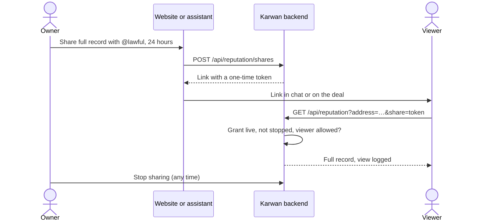

# 29 · Share your full passport

Track T3 (reputation that travels), roadmap item T3.1 (who sees what). Approved by the owner 24 Oct 2026 and built the same day. Milestone 1 (demo day, 3 Nov) does not depend on it.

## What is hard today

Read from the code on 24 Oct 2026.

- The passport is sealed (`SEALED_RECORDS`). `GET /api/reputation` returns the full record only when the signed-in wallet is the subject (`isOwnerView`, `backend/src/routes/reputation.ts`). Everyone else gets the public passport: name, tag, tier and up to three reasons (`loadPublicPassport`).
- An agent acting for someone with a live request or deal can read the full record for that one deal, logged and deleted after 24 hours (T3.1, owner 18 Oct). A person cannot.
- So a counterparty who asks "show me your record before I pay" gets a tier and two lines. The owner has no way to show more, even when they want to.

## The idea

The owner chooses to show their full record to one person, for a short time. Nothing becomes public, and the owner can stop it at any moment.

- **Website:** on their own passport, the owner taps "Share full record". They name the person (a Karwan tag) or take a link. The link shows the full passport they see themselves, under a line saying "Shared by @kingizie until 25 Oct, 14:00".
- **Assistant (web, Telegram, WhatsApp):** "show @lawful my full record for a week". The assistant asks who and how long when the person has not said, makes the link and says who can open it and until when. Sharing moves no money, so it needs no confirm card, the same as sending a message.
- **Stopping:** the owner's passport lists the live shares, each with "Stop sharing". A stopped or expired link falls back to the sealed public passport.

## How it is built

1. **Grant.** A new table `passport_shares` records the subject, the viewer (a wallet, or none for "anyone with the link"), a token hash, the creation time, the expiry, the stop time and the views. Only the token's hash is stored. The link carries the token itself, 32 random bytes.
2. **Read.** `GET /api/reputation`, `GET /api/vault/positions` and `GET /api/sme/profile/:address` take `share`. A live grant for this subject returns what the owner sees, plus who shared it and until when. If the grant names a viewer, that person must be signed in. Each passport read counts as one view on the grant. Nothing else changes, so the public passport stays sealed (`backend/src/sealed/passportShares.ts`).
3. **Page.** `PassportGate` shows the full passport when the share is valid: the same page the owner sees, with the shared-by line at the top and the owner's own wording ("Your deals so far…") in the third person. The viewer gets no share panel and no download of attested deals. An ended share shows the sealed passport with one line saying so.
4. **Assistant tools.** `share_my_passport`, `my_passport_shares` and `stop_passport_share` on the shared core (`backend/src/assistant/passportShareTools.ts`), so the website assistant and every chat channel can do it. The guide (`platformGuide.ts`) and the canon (`passport-sharing`) describe them in the same batch.
5. **Limits.** At most five live shares per person. A share lasts 24 hours or 7 days. The token is 32 random bytes and only its hash is stored.

## Decisions (owner, 24 Oct 2026)

1. **Who can open it:** both. The owner names one person, who must be signed in, or makes a link anyone can open.
2. **How long:** the owner picks 24 hours or 7 days each time.
3. **What it shows:** everything the owner sees, amounts and the money held as a reserve included.

## Status

| Part | State |
|---|---|
| This view | Approved 24 Oct 2026 |
| Shares table (migration 47), rules and routes | Built, tested |
| Assistant tools, guide, canon | Built, tested |
| Website: share panel on your own passport, full view for the person it was shared with, ended share notice | Built, e2e tested |
