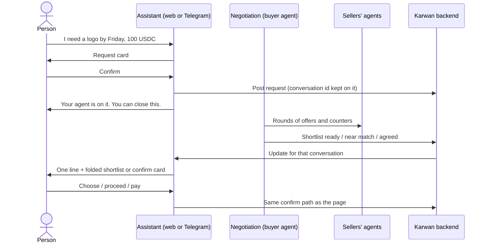

# 30 · The negotiation, run from the assistant

Track T1 (find and agree), building on roadmap item T1.4 (the shortlist); it becomes item T1.6 once approved. T6 (channels) carries it to Telegram. Approved by the owner 24 Oct 2026 as recommended and built the same day. Milestone 1 (demo day, 3 Nov) does not depend on it, but it is the moment the demo shows.

## What is hard today

Read from the code on 24 Oct 2026.

- A request is posted from the assistant (`propose_post_request`), and then the person has to go to the request page to follow it: offers arriving, the agent negotiating in rounds, the shortlist, a near match. The assistant only learns what happened when asked (`whats_pending`, `list_offers_on_request`).
- When a seller accepts a direct deal, the pay card appears in the conversation that made the deal, but only when that conversation is next opened (`conversationPayCards.ts`). Nothing tells the person while the conversation is open, and nothing is said for a decline, a reply or a request's offers.
- The request page showed a near match (198 USDC against a 100 USDC budget) while the agent was still negotiating and a 90 USDC offer sat on the shortlist. Fixed on 24 Oct: a near match is neither raised nor shown while an offer within budget is live or shortlisted (`agents/nearMiss.ts`, `GET /api/jobs/:id/near-miss`).
- The shortlist opened in full above everything else. Fixed on 24 Oct: it arrives folded into one row and opens on request.

## The idea

The person says what they need once, in the assistant, on the website or Telegram, and can then leave. The assistant follows the negotiation for them and speaks up only when something needs them or something landed. The request page stays one tap away for anyone who wants to watch the rounds.

- **Posting:** after the request card is confirmed, the assistant says: "Your agent is on it. You can close this; I'll message you here and on Telegram when there is something to decide." The page link sits under it.
- **Updates in the same conversation:** each update is one plain line with its card, written into the conversation that started the request or deal, live while it is open, and saved so it is there when it is opened later. Telegram gets the same line through the notifier.
- **Deciding in place:** the shortlist arrives as a folded card in the conversation ("5 offers, from 90 USDC · Show"); choosing, proceeding on a near match, paying into escrow and accepting delivery are the same confirm cards the page uses.
- **Overnight:** "You can sleep. When your agent agrees a deal within your budget, you'll wake up to it here, ready for one tap to lock the money" (wording depends on decision 1).

## How it is built

1. **Linking.** A request or deal made in a conversation keeps that conversation's reference (direct deals already do: `sourceContext.reference`). Requests get the same field.
2. **Updates.** A small conversation-updates service subscribes to the bus for the events that need the person: `request.shortlist` (ready, or a changed recommendation), `negotiation.near-miss` (only when nothing within budget is live), `deal.seller-approved`, `deal.declined`, a reply by tag, `deal.funded`, `deal.delivered`. Each becomes one saved assistant turn in the linked conversation, with the card the page would show. Duplicates are folded: a new shortlist replaces the previous card, it does not stack.
3. **Live.** The open conversation hears its updates over the existing live-events stream (`subscribeLiveEvents`), filtered to the owner as today (`sse owner projection`).
4. **Tools.** The shortlist card and the near-match card become assistant cards on the shared core, so Telegram shows the same thing with buttons. No new way to move money: paying stays the confirm card.
5. **Guide and canon** describe it in the same batch.

## Decisions (owner, 24 Oct 2026)

1. **Agree for me** is opt-in when posting. The agent agrees only with the seller it recommends, within budget. Choosing locks the money, so the agreed deal waits for the person's one tap; the agent never moves money on its own.
2. **Milestones only:** the agent is on it, offers in, shortlist ready, a near match when nothing fits, agreed, money locked, delivered, done. Never each round of counters.
3. **Where:** the conversation that posted the request, plus Telegram when linked.

## As built

- The request card remembers its conversation and the Agree for me choice until the request is posted (`assistant/requestLinks.ts`); the request keeps both (`conversationId`, `agreeForMe` on the brief).
- One live turn per request, built on every read and never stored, so the newest state replaces the old one (`assistant/requestUpdates.ts`, `requestUpdatesLive.ts`); `GET /api/assistant/conversations/:id/live` serves them and the open page reads them every 20 seconds.
- An agreed deal sends one Telegram line per seller (`assistant/agreedForYou.ts`); the other milestones already reach Telegram through the notifier.

## Status

| Part | State |
|---|---|
| Near match never shown while an in-budget offer exists | Built 24 Oct, tested |
| Shortlist folded until opened | Built 24 Oct |
| This view | Proposed 24 Oct 2026 |
| Linking, live updates in the conversation, Agree for me, Telegram line | Built 24 Oct, tested |
