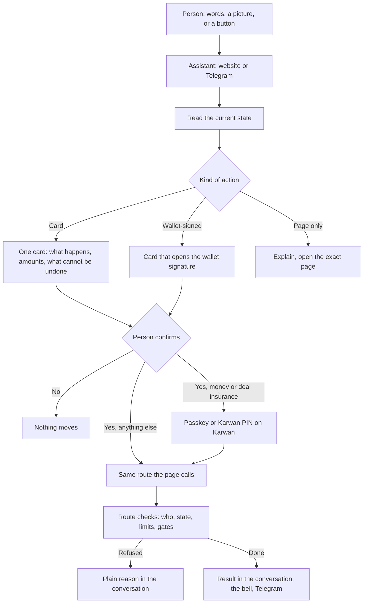

# 31 · The assistant does everything a person can

Track T6 (channels), extending roadmap item T6.2 (website assistant parity) from "every Telegram tool on the website" to "every action in Karwan, on every channel", as roadmap item T6.5. Approved by the owner 24 Oct 2026 as recommended. It reaches into T4 (getting paid early), T5 (money and deal insurance) and T2 (deal steps), and changes none of their rules: the assistant calls the same routes the pages call. Owner asked 24 Oct 2026: "the assistant should be able to do anything for users, from funding to deal creation to financing to staking. Anything at all."

## What is hard today

Read from the code on 24 Oct 2026.

- The app has about 200 actions a person can take (every request that changes something in `frontend/core/api.ts`, admin left out). The assistant can run about 45 of them as confirm cards (`assistant/actions.ts`, `assistant/dealActions.ts`, `channels/executor.ts`) or as direct tools (payment links, passport shares, ratings, messages, memory).
- **Getting paid early:** the assistant can only read (`get_my_financing`). Asking for early payment, taking or turning down a financier's offer, pulling the request back, and everything a financier does happen only on `/financier` and the deal page.
- **Getting paid early is also closed on new deals.** Testnet opens every new deal on the escrow family (`SUITE_ENABLED=true`), and the factoring and purchase-order routes refuse those deals (`FINANCING_NOT_ON_V3`, `deals/dealEscrowOps.ts onOwnIdEscrow`). Financing on the family is roadmap T4.2, plan 3 of view 27, not built. Until it lands, only deals on the earlier escrow can be financed, from the page or from the assistant.
- **Deal insurance (staking):** the assistant can put money up (`propose_stake`) and collect earnings (`propose_claim_yield`). Taking it out (a 7-day wait), cancelling a take-out, and collecting once the wait ends are page-only (`POST /api/vault/request-withdraw`, `/cancel-withdraw`, `/claim`). The cards still say "stake", which T5.1 retires for "deal insurance".
- **Deal steps** the pages have and the assistant lacks: goods arrived, taking over a delivery check, countering or editing terms before acceptance, taking back an unaccepted deal, the delay appeal and its answer, "still reviewing", claiming after the review window, adding protection, a near match (go ahead or pass), making and withdrawing an offer on someone's request, editing an offer, accepting a business order.
- **Money:** paying someone's payment link from your balance, the testnet faucet, retrying or cancelling a stuck money move, rechecking a cross-chain move, pausing payouts and removing a saved address.
- **Account:** editing the profile and photo, settings (language, theme, alerts), adding and verifying an email, the newsletter, unlinking Telegram, published deals on or off, outside record reads, business workspace and registration, feedback.
- **Nothing keeps it complete.** The guide test checks that every tool the guide names exists; nothing fails when a page gains an action the assistant cannot do.

## The idea

Whatever a person can do in Karwan, they can ask for in words, on the website or Telegram. The assistant reads where things stand, prepares one card that says exactly what will happen, and runs the same route the page runs when the person confirms. Nothing gets a second, weaker path.

A few steps need the person's own device, face or wallet: signing in, a passkey, setting the Karwan PIN, account recovery, a World ID or Selfie Check, adding a payout address, deleting the account. For those the assistant explains, then opens the exact page with the step ready. It never asks for a code, PIN or secret in the chat.

## Three kinds of action

| Kind | What happens | Website | Telegram |
|---|---|---|---|
| **Card** (most actions) | Read the current state, build one card with every consequence, confirm, run the page's route | Card in the conversation; money leaving Karwan and deal insurance also ask for the passkey or Karwan PIN in the confirm sheet | Card with buttons; a card that moves money opens a one-time Karwan page instead |
| **Wallet-signed** (accounts that sign with their own wallet) | Same card; the wallet signs | The card opens the wallet's signature, as the `*_web3` cards do today | One-time Karwan page, where the wallet is |
| **Page only** (by design) | The assistant explains, then links to the step | Opens the page | Sends the one-time link |

## The rule that keeps it true

A test reads every action a person can take in `frontend/core/api.ts` and fails unless each one is either an assistant action (an intent with a route in both runners, or a tool) or on a short page-only list with its reason. A new page feature cannot ship without its assistant action, or a written reason why it stays on the page. This is the T6.2 drift test, widened.

## The actions to add

**A. Deal insurance (T5)**
- Take it out: shows the amount, the 7-day wait, the date it is ready, and any part held against an open deal, which cannot leave until that deal settles.
- Cancel a take-out that is waiting.
- Collect once the wait has ended.
- Plain words on every card ("deal insurance", "earnings"), never stake, vault or yield.

**B. Getting paid early (T4)**
- Seller: ask for early payment on a deal (how much is still to come, the least they would take); see offers ranked as the page ranks them (the financier's reputation, then price, the best marked Recommended); take one; turn one down; pull the request back. Purchase-order financing requests the same way.
- Financier: see the open requests they may fund; make an offer, where the card says how much the wallet must hold first and refuses before anything moves if it does not; follow the deals they financed (a read).
- Until financing reaches the escrow family (T4.2), a new deal is answered plainly: "Getting paid early is not open on this deal yet." When it lands, the same cards run on the family deals with no change to the conversation.

**C. Deal steps (T2)**
Goods arrived; take over a delivery check that never answers; counter or edit terms before acceptance; take back a deal the seller has not accepted; the delay appeal and its answer; still reviewing; claim a milestone after the review window; add protection; a near match (go ahead or pass); make or withdraw an offer on someone's request; edit an offer; accept a business order.

**D. Money (T5)**
Pay someone's payment link from your balance; the testnet faucet; retry or cancel a stuck money move; recheck a cross-chain move; pause payouts; remove a saved payout address.

**E. Account (foundation)**
Edit the profile; set the photo from a picture sent in the chat; settings (language, theme, alerts); add and verify an email; the newsletter; unlink Telegram; published deals on or off, and remove them; outside record reads on or off; business workspace and registration, with evidence sent as a picture; send feedback.

**Page only, with the reason**
| Action | Why it stays on the page |
|---|---|
| Sign in, sign up, passkey, Karwan PIN, recovery | The secret or the device is the point; a chat must never carry it |
| World ID and Selfie Check | Needs the person's camera and the World app |
| Adding a payout address | Bound to World ID by design (money-out rules) |
| Deleting the account | Irreversible; the 7-day wait starts on the page after reading what is lost |
| Waitlist, the research survey, admin | Not account actions |
| Older-escrow steps (`/api/legacy/*`) | Kept on the deal page until the last older deal finishes |

## Where each piece lives

For every new action, in the same batch:
1. The card builder in `backend/src/assistant/` beside its neighbours (money cards in `actions.ts`, deal cards in `dealActions.ts`, new modules for financing and account).
2. The tool the model calls, registered in `assistant/agent.ts`, reading the current state before it proposes.
3. The route in both runners: `channels/executor.ts` (Telegram) and `frontend/shared/assistant/AssistantThread.tsx` (website), with the line said when it is done.
4. The guide entry (`platformGuide.ts`) and the canon, with what it does and what it refuses.
5. Tests: the card builder's refusals, the runner calls the page's route with the page's body, and the coverage test above.

## Decisions for the owner

1. **Getting paid early before the escrow family supports it.** Build the cards now on today's routes (they finance deals on the earlier escrow and say plainly that new deals wait), or wait for T4.2 plan 3? Recommended: build now; the cards stay the same when plan 3 lands.
2. **The financier's side in the assistant.** Recommended: yes, with the offer card refusing before anything moves when the wallet does not hold the advance.
3. **Deleting the account.** Recommended: page only.
4. **Order.** Recommended: A, B, C, D, E, with the coverage test landing with A so every later phase is measured against it.

## Status

Approved 24 Oct 2026 with the four decisions as recommended. Built: phase 0 (the coverage test, `backend/src/assistant/coverage.ts`), phase A (deal insurance: take out, cancel the wait, collect) and phase B (getting paid early: the seller asks, reads ranked offers, takes or turns one down, stops asking; a financier lists requests, makes an offer, applies; both write in their financing conversation). Purchase-order financing stays planned while it is switched off on testnet. Collecting insurance, taking an offer and making one open a one-time Karwan page from Telegram. Phase C (deal steps) built 25 Oct 2026: change or counter a deal before money is in, take a deal back, goods arrived, review a delivery yourself, more review time, claim a payment, the delay appeal and its answer, a seller's own offer on a request (make, withdraw, take), a near match (go ahead, pass, bring back), edit an offer, stop an agent bid, confirm goods received on the trade record (Karwan-held wallets; own wallets sign on the deal page), and writing in a deal's chat. From Telegram, claiming a payment, taking a deal back, taking a seller's offer and going ahead at a near-match price open the one-time Karwan page. Sorted as page or internal with a reason: the World ID skips, the complimentary report, joining from an invite link, the protection preview (a read) and the unused agent-job release. Market research moves to phase E with research credit. Phase D (money) built 25 Oct 2026: pay a payment link from the balance (Karwan-held wallets; a passkey or PIN on the website, the link page from Telegram), test USDC on Arc and on other test networks, find a stuck money move and check it again, carry it on, retry or cancel it, check a deal payment that did not confirm, pause money out and remove a saved payout address, and put money into deal insurance from a person's own wallet (the card opens the wallet). Kept on the page with a reason: the payment link's own addresses for a payer without an account, and pooling for other networks (one-wallet rule). Phase E (account) built 25 Oct 2026: settings (language, theme, sounds, alerts, public passport, publishing deals and history, how Karwan reaches you), profile name, bio and skills, X handle, removing a contact email, the newsletter, unlinking Telegram, memory on or off, withdrawing published deals, outside record reads, feedback, setting up and renaming agents, research credit (from Telegram, the agent funds page), and the business workspace (add, rename, what it trades, the company card). Kept on the page with a reason: the profile photo (cropped on the device; the server has no image tools, so a chat picture cannot become the photo, a change from the plan), adding an email (its code), linking Telegram (the bot's one-time link), business registration and legal details (a document, reviewed). The market scout has no screen and is listed as unused. Only purchase-order financing remains planned, until it is switched on (T4.2); the coverage allowance is 3.
