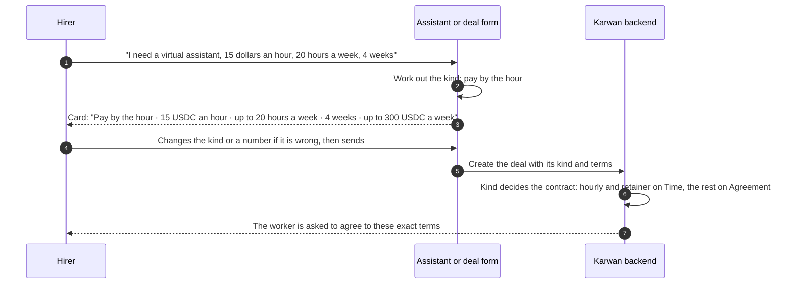
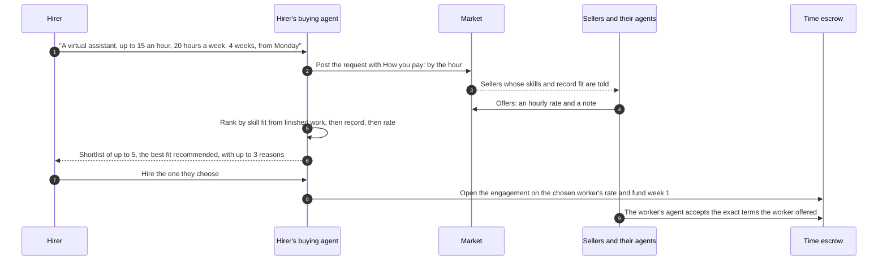

# 32 · The kind of deal, and paying by the hour

Track T1, find and agree, roadmap item T1.2 (choose the kind of deal). Track T2, protected deals, roadmap item T2.1 (the escrow family deployed and used): this view puts the Time family from [view 11](11-contracts.md) in the app, next to the Agreement family that [view 27](27-deals-on-the-escrow-family.md) already uses. The kinds come from [view 26](26-agents-for-every-deal.md).

## What is wrong today

- The kind of deal is guessed from side details: goods only for business accounts behind a flag, milestones when the terms have more than one part, one-time otherwise. A person selling their own laptop cannot open a goods deal at all, though Karwan is an open market. A refundable deposit cannot be chosen either, though the contract holds it.
- Nothing refuses a deal shaped to cheat: the trust engine (view 09) asks for more checks, but a brand-new account can still take a large payment with no way to prove delivery.
- A freelancer paid by the hour has no way in. Every deal is a fixed price, so the hirer has to guess a total and the worker carries the risk of the hours running over.
- The Time escrow is deployed and configured on Arc Testnet but nothing in the app calls it.

## The idea in one line

Anyone can open any kind of deal, from a freelancer's logo to a used phone snapped and listed like on Jiji: Karwan works out the kind from what the two people say, names it on the deal card in plain words, refuses the few shapes that only serve a cheat, and opens the rest on the contract that holds that kind; a hirer who pays by the hour sets a rate, the most hours a week and how many weeks, and pays one week at a time.

## Participants

| Who | Does what |
|---|---|
| Hirer and worker | Agree a fixed price or an hourly rate, from the website or a chat channel |
| Assistant and agents | Work out the kind from the conversation and the person's ways of dealing (view 26), draft the terms and show one card per money step |
| Deal form | The same detection for people who fill the form; a "How you pay" choice the hirer can change before sending |
| Karwan backend | One core function per step for both kinds; picks the contract from the deal's kind; watches the chain and tells both sides |
| Agreement escrow | One-time, milestones, goods with delivery, refundable deposit, and checked deals (view 27) |
| Time escrow | Hourly and retainer work: weekly budgets, hours logged, approved or objected to |
| Record | The outcome of every deal and engagement, written to both people's identities |

## Which contract holds which kind

| Kind, in the app's words | How Karwan recognises it | Contract |
|---|---|---|
| One-time | One price, one delivery | Agreement |
| Milestones | The terms list stages with shares | Agreement |
| Goods with delivery | Something is shipped (a carrier, a tracking number, an address) or handed over in person; open to every account, a person or a business | Agreement, review starts on arrival or handover |
| Refundable deposit | A rental or a deposit returned at the end | Agreement, silence returns the deposit |
| Checked | A delivery check is asked for | Agreement with two of three checkers |
| Pay by the hour | A rate per hour, hours a week | Time, billed by the minute |
| Monthly retainer | A price per month | Time, one unit per cycle |
| Agent job, bounty | (later) | Jobs family, not in this view |

## Open to everyone, with limits that stop bad deals

Every kind is open to every account. The trust engine (view 09) keeps asking for more checks where a deal is riskier; this view adds a short list of deals Karwan refuses, because their shape takes away the buyer's protection, and a list it holds for a person instead of refusing, because the signal can be innocent (a cheap price can be a real bargain). A refusal says why in words and what would make the deal possible. The numbers are proposals for the owner (decision 6).

| Rule | Applies to | What happens |
|---|---|---|
| A seller with no settled deal and no verified identity takes more than 100 USDC | Every kind | Not allowed until they verify (World ID) or settle a smaller deal first |
| Goods with no way to show delivery: no tracking number and no in-person handover | Goods over 50 USDC | Not allowed; the card asks for one of the two |
| Money paid to the seller before anything is delivered | Every kind, seller with fewer than 3 settled deals | Not allowed; the first payment waits for a delivery |
| Pay by the hour funded more than one week ahead | Worker with no settled engagement | Not allowed; one week at a time |
| A seller who lost 2 or more disputes takes a deal without deal insurance covering half of it | Every kind | Not allowed (view 09's step-up, now enforced) |
| A goods price far below what the same item sells for on Karwan | Goods, seller with no settled deal | Held: a person on the review team looks before the buyer can pay; never declined by code alone |
| Asking to be paid outside Karwan, in the deal chat | Every kind | Held: the message is flagged and both sides are warned |
| Account under 7 days old opening 5 or more deals in a day | Every kind | Step-up, as view 09 already does |

## Choosing the kind



Notes: the kind is stored on the deal as a field, not guessed again later. The form shows "How you pay: fixed price or by the hour" with the detected choice selected; the assistant asks only when it cannot tell.

## A week of hourly work

```mermaid
sequenceDiagram
  autonumber
  participant H as Hirer's buying agent
  participant K as Karwan backend
  participant T as Time escrow
  participant W as Worker's selling agent

  H->>T: Open the engagement and fund week 1 (rate x most hours, plus the hirer's half of the fee)
  W->>T: Accept the exact terms
  Note over W,T: The worker works through the week
  W->>T: Log the hours for week 1 (by the minute, up to the most hours)
  K-->>H: "12 h 30 m logged for week 1. Approve, or say which hours are wrong"
  H->>T: Approve the hours, or object to some of them
  T->>W: Approved hours are paid; unused budget goes back to the hirer
  H->>T: Fund week 2, before it starts (Karwan reminds the hirer)
  W->>W: Earnings move on to the worker's identity wallet, as in view 27
```

Notes: `KarwanTimeEscrow.open`, `accept`, `submit`, `approve`, `object`, `settle`, `fundCycle`, `giveNotice`, `close`. Objected hours go to Karwan's dispute table and the review team as on the Agreement escrow. Either side can end the engagement with one week's notice.

## Posting hourly work, and finding the best fit

A hirer can name a worker they already know, or post the work to the market and let their agent find the best fit. Nobody proves they can do the work with files they upload: the hirer's agent judges each person by what they have actually done on Karwan. That means:

- the skills their finished deals and engagements show;
- the checks Karwan ran on those skills;
- delivered on time, disputes lost and ratings.

This is the same shortlist every request already uses: skill fit first, verified above unverified inside a fit, and reputation only as the tie-break.



Notes:

- **What an offer shows for any request, fixed price or hourly.** It never shows the score, counts, amounts, or who the deals were with (UI law rule 3).
  - The seller's name and tag.
  - Verified or not, in words.
  - Their tier.
  - Their rating, as "4.8 from 23 deals", or "New" under three ratings.
  - Up to three reasons, such as "Best fit", "Verified" and "On time".
- **When a worker counts as finished.** A finished engagement writes its outcome to both people's records. Hourly work a person has done well therefore counts the next time an agent looks for them.
- **New workers.** A new worker can still be hired. They are funded one week at a time, which caps the hirer's risk at one week's budget.
- **Who sends offers on the demo.** On testnet for 3 November, sellers offer an hourly rate by hand or through their assistant. Sellers' agents offering an hourly rate on their own comes after the pricing change to the ways of dealing (view 26).

## What fails where

| Where | What fails | What happens |
|---|---|---|
| Creating | The kind is unclear | The assistant asks one question ("Fixed price, or by the hour?"); the form keeps the choice the hirer picked |
| Creating | A week's budget is over the per-deal cap | Refused before anything is signed, with the most hours the cap allows at that rate |
| A new week | The hirer has not funded it | No hours can be logged for it; both sides are told and the engagement ends after the notice week if it stays unfunded |
| Logging hours | More than the week's most hours | Refused, with the most that can be logged |
| Logging hours | Too late after the week ended | Refused; the hours are lost for that week, and the worker is reminded before the deadline |
| Review | The hirer objects to some hours | Those hours go to the dispute table; the rest are paid |
| Review | The hirer says nothing | Reminded a day before; the hours are paid when review ends |

## Checks before code (rule 14)

Logged in `docs/arc-circle-checks.md` before any code: the deployed Time escrow read back (`getEngagement`, `termsHashOf`, `dealIdFor` against the backend's hashing), the hub's caps and fee for the Time family, the event signatures the watcher listens for, and Circle contract execution for `open`, `accept`, `submit`, `approve`, `fundCycle`.

## What it does not do

- The Jobs family (agent-to-agent jobs, bounties).
- Changing an engagement's terms mid-way (the contract allows amendments; the app does not offer them yet).
- Daily or per-item rates; pay by the hour and monthly retainers come first.
- Move any deal between contracts.

## Decisions for the owner

1. **Hours the hirer does not answer** (decided 25 Oct 2026, the same rule as every deal): the hirer reviews within the review time, can ask once for more time or object to hours, and unanswered hours are paid when review ends. Objected hours go to a dispute where each side has 72 hours to give their side.
2. **A week is the cycle** for pay by the hour, a month for a retainer (decided 29 Oct 2026; a month is 30 days, the contract's longest cycle is 31).
3. **Review time for hours:** 3 days after the week's logging window, which is 2 days (decided 29 Oct 2026, the same for a retainer).
4. **Notice to end:** one week for hourly, one month for a retainer (decided 29 Oct 2026: one cycle of notice for both).
5. **Unused budget** goes back to the hirer after each week, rather than carrying forward (decided 29 Oct 2026).
6. **The limits in "Open to everyone":** 100 USDC for a new unverified seller, 50 USDC for goods with no tracking or handover, 3 settled deals before any money is paid ahead of delivery, and "far below" meaning under half the usual price of the same item on Karwan.
7. **Selling in person** (a phone handed over at a meeting point): the buyer confirms the handover in the app, or the seller enters a code the buyer shows them, and the review time starts then.

## Status

| Part | Status |
|---|---|
| Time escrow on Arc Testnet | Deployed 23 Oct 2026, configured 24 Oct (caps and fee set by the first settings) |
| Kind worked out and stored on the deal | Planned |
| Goods open to every account, shipped or handed over in person | Planned |
| Deals refused or held by the rules in "Open to everyone" | Planned |
| "How you pay" on the deal form, fixed price or by the hour | Planned |
| Hourly work posted to the market, best fit found by the hirer's agent | Building, from 29 Oct 2026 (sellers offer by hand or in chat; agents offering on their own comes later) |
| Hourly and retainer engagements on the Time escrow | Building, from 29 Oct 2026: both kinds, the timings in decisions 2 to 5, and a worker with no finished engagement funded one week at a time (after that, up to 4 weeks ahead) |
| Agent jobs and bounties (Jobs family) | Later |
