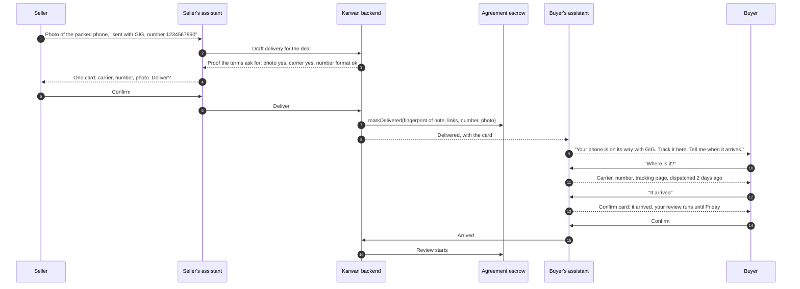
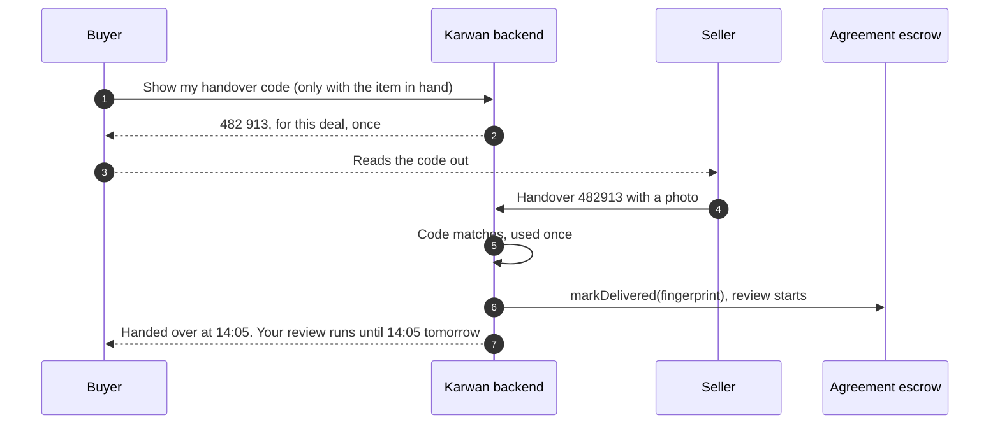

# 33 · Delivery proof for every kind of deal, and the buyer's delivery view

Track T2, protected deals, roadmap item T2.2 (delivery checks), with T1.2 (choose the kind of deal): each kind of deal in [view 32](32-kind-of-deal-and-hourly-work.md) asks for the proof that fits it, and the buyer sees every delivery in one place. It builds on the delivery rules of [view 27](27-deals-on-the-escrow-family.md), the photo pipeline of [view 28](28-photos-on-listings.md) and the checks in [view 21](21-flagged-delivery-review.md). Approved by the owner, 26 Oct 2026.

## What is wrong today

Read from the code on 26 Oct 2026.

- A delivery is one of two shapes. A service gives a link whose host has to resolve; goods give a carrier and a tracking number. A used phone handed over at a bus park, a repair done at the buyer's shop or a rental returned at the end have no proof that fits.
- The carrier list is DHL, FedEx, UPS, Maersk, MSC, CMA CGM, Hapag-Lloyd and Other. The couriers most people in the Middle East, Africa and South Asia use for local delivery are not on it, so every local delivery falls to Other and a typed-in link.
- The deal page tells the buyer "the seller marked it delivered" and shows a See delivery button only when the proof is a bare link. A note with a link inside it shows nothing to open. The carrier, tracking number, dispatch date, arrival, the delivery of each milestone, attached documents and the check result are all recorded, and none of them is shown to the buyer.
- No photo can go with a delivery, though offers already take photos.
- The delivery fingerprint written on chain covers the seller's note only, not the tracking number.

## The idea in one line

The terms say what proof the delivery will carry, chosen from the kind of deal before any money moves; the seller delivers it from the deal page or by sending it to their assistant on any channel; the buyer opens one Delivery card that shows what was delivered, where the goods are and what Karwan checked, and confirms or raises a problem from there.

## Participants

| Who | Does what |
|---|---|
| Seller | Delivers the proof the terms name: a link, photos, a tracking number, a handover code, hours |
| Buyer | Opens the Delivery card, tracks the shipment, gives the handover code, confirms arrival, releases or raises a problem |
| Assistant (website, Telegram, every channel) | Takes the proof as a message or a photo, shows one card, delivers on confirm; answers "where is my order" and "what did they deliver" from the same card |
| Karwan backend | Holds the rules per kind, checks the proof, keeps every delivery per milestone, writes the delivery fingerprint, tells both sides |
| Agreement escrow | Records the delivery fingerprint (`markDelivered`), starts the review on delivery or on arrival as the terms say |
| Time escrow | Hours logged and approved per week (view 32) |
| Carriers | Their public tracking pages; status reads from a carrier or an aggregator later, candidates only |

## Proof by kind of deal

| Kind | The seller gives | Karwan checks | The buyer does | The review starts |
|---|---|---|---|---|
| Digital work, one time (design, writing, code, video) | A link to the work, a short note, up to four screenshots | The link opens; the work is compared with the request (advisory, never moves money); a code repository is checked when the terms name one | Opens the work from the card | At delivery |
| Milestones | The same proof for each milestone, each one its own delivery | As above, per milestone | Sees "Milestone 2 of 3 delivered" and the history of the ones before | At each milestone's delivery |
| Goods by carrier, local or abroad | Carrier, tracking number, a photo of the packed item with its label | The tracking number fits the carrier's format and its tracking page opens | Taps Track shipment, then Confirm it arrived | On arrival, or at the latest date the terms set |
| Goods handed over in person, or by a rider | A handover: the buyer shows a six-digit code, the seller enters it, with a photo of the item | The code matches the deal, once | Shows the code only when they have the item in hand | At the handover |
| Service done in person (repair, tutoring, an event) | A completion note with before and after photos; a handover code when the buyer is there | The photos and the note are on the record | Confirms it was done, or raises a problem | At delivery, or at the handover |
| Refundable deposit or rental | Condition photos at the start and at the return; the return marked with the handover code | The code at the return | Returns the item and shows the code | Silence returns the deposit (view 32) |
| Pay by the hour | Hours with a note each, and a link where there is one | The hours fit the weekly limit | Approves the week or objects | Weekly, on the Time escrow |
| Trade goods across borders | Bill of lading or air waybill number, commercial invoice, certificate of origin | The documents are fingerprinted on chain, the shipping line's tracking page opens | Tracks the container; confirms arrival or adds the proof of delivery | On arrival or on the proof of delivery |

A handover code is the buyer's word that they hold the item, given at the moment they hold it. It replaces the arrival tap for local trade, where most deals end with two people and a phone, and it works without the seller ever seeing the buyer's account.

## What Karwan checks, and what it does not

- It checks that a proof is specific, on the record and reachable: the link opens, the tracking number fits the carrier, the code matches, the documents are fingerprinted.
- It does not inspect goods or the quality of work. The comparison with the request is advice for the buyer and a flag for the seller; it never moves money and never fails a delivery on its own (escrow design, invariants I14 to I17).
- Arrival comes from the buyer, the handover code or a proof of delivery, never from the seller's word alone.
- The delivery fingerprint on chain covers the whole delivery: the note, every link, the tracking number and each photo's fingerprint. A dispute can then show that what the buyer saw is what was delivered.

## The buyer's Delivery card

One card on the deal page, in this order, and the same answer from the assistant:

1. **What was delivered**: every link found in the seller's note as its own button, the note, the photos, the documents.
2. **Where it is** (goods): carrier, tracking number with copy, Track shipment, dispatched on, arrived on or Confirm it arrived, or Show handover code.
3. **What Karwan checked**: link opens, matches the request (yes, partly, no, with the reason), tracking number valid. A check still running says so.
4. **History**: each milestone's delivery with its date, and any correction the seller sent.
5. **What you can do now**: Release, Confirm it arrived, or Something is wrong, from the deal's own next step.

The seller sees the same card, without the buyer's actions, plus Update delivery while a correction is allowed.

## The agent flow

Local handover, in person:

## What fails where

| Where | What fails | What happens |
|---|---|---|
| Delivering | The proof the terms name is missing | Refused with what is missing in words, before anything is written on chain |
| A link | It does not open | Refused for a dead host, as today; a link behind a login is accepted with a note asking the seller to share it |
| A tracking number | Wrong format for the carrier | Refused with the carrier's name, as today |
| A carrier | Not on the list | Other, with a tracking page that has to open, as today |
| A handover code | Wrong, or tried five times | Refused, and the code is locked for 15 minutes; the buyer can show a new code |
| A handover code | The buyer shares it before having the item | Their choice, shown to them in words when they open the code: show it only with the item in hand |
| A shipment | Never arrives | The buyer raises a problem; at the latest date the terms set, the review starts so the deal cannot hang |
| The comparison with the request | Unavailable | The delivery stands; the buyer reviews it themselves (view 21) |
| Photos | Too large, or not an image | Resized on the device, refused on the server, as offer photos are (view 28) |

## Checks before code (rule 14)

- No new contract call. `markDelivered(proofHash)` and the review start on arrival are the calls already checked for view 27. The fingerprint changes from the note alone to the whole delivery record, worked out off chain.
- Photos reuse the view 28 pipeline and its checks.
- Carrier status reads are candidates only. No provider is called before its current docs, terms and a read-only test are recorded the way `docs/arc-circle-checks.md` records Arc and Circle.

## Decided by the owner, 26 Oct 2026

Approved as recommended:

1. **A photo for shipped and handed-over goods** is required above 50 USDC and optional below.
2. **The handover code ends the wait for arrival, not the review.** The review window still runs after the code, so a buyer who finds a fault an hour later can raise it.
3. **Local carriers first, as tracking links only**, no status reads yet: GIG Logistics, Kwik and NIPOST (Nigeria), Aramex and Emirates Post (UAE), Delhivery and India Post (India), Bosta (Egypt).
4. **Files delivered directly and carrier status reads come after the launch.** Links and photos first.

## Build order

1. **The Delivery card from what is already recorded.** Links found inside the note, the shipment, arrival, each milestone's delivery, the documents and the check result, on the page and from the assistant. No new data. It fixes the page that showed only "marked it delivered".
2. **Proof by kind.** The proof each kind asks for in the terms, photos on delivery, the handover code, the local carriers list, the deposit return, and the fingerprint over the whole delivery.
3. **Hours** with the Time escrow (view 32).
4. **Carrier status reads**, once a provider is chosen.

## As built, 26 Oct 2026

- Rules: `deals/deliveryProofRules.ts` (what a delivery needs from the kind of deal, the photo line, the fingerprint); `deals/handoverCode.ts` (six digits, a keyed hash that never leaves the server, five tries then 15 minutes locked, used once).
- Routes: `POST /api/deals/direct/:jobId/handover-code` (buyer only, goods, started, not handed over); `/delivered` takes `handoverCode`, `photos` and `heldPhotos`; `GET /api/deals/direct/:jobId/delivery-photos/:revision/:n` serves photos to the two sides only, never a held delivery's photos to the buyer. A right code marks the delivery and starts the review on the escrow with the buyer agent's `startReview`, the call It arrived already makes.
- Views: the delivery history and the buyer's review are projected per viewer on the deal and the deal list (`deals/deliveryHistoryView.ts`); the handover hash is stripped from every deal response and from the financier desk.
- Assistant: `propose_mark_delivered` takes the carrier and tracking number or the handover code and adds photos sent in chat with a caption like "delivered"; `show_handover_code` gives the buyer their code; `get_deal_status` carries the delivery.
- Deposit return and hours wait for those kinds of deal (view 32).

## Status

| Step | State |
|---|---|
| Link that has to open, for services | Live |
| Carrier and tracking number, for goods | Live |
| Buyer confirms arrival | Live |
| Comparison with the request, buyer's own review when it stalls | Live |
| Delivery card with every recorded detail, on the page and from the assistant; delivery history shown per viewer on the deal and the deal list | Built 26 Oct, tested |
| Proof by kind: photos on delivery (required for goods above 50 USDC), the buyer's handover code, the launch-market couriers as tracking links, the same rules in the assistant and in the deal terms | Built 26 Oct, tested |
| Fingerprint over the whole delivery (note, tracking, photos, handover) written with `markDelivered` | Built 26 Oct, tested |
| Hours on the Time escrow | Planned (view 32) |
| Carrier status reads | Planned, candidates only |
