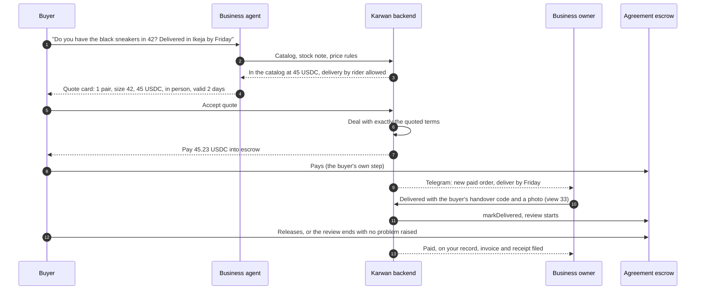

# 34 · Business tools for local and cross-border trade

Proposed tracks: T1, find and agree (quotes, the business page, the business agent), and T4, trade finance (payment terms, documents, getting paid early), with T5 (books) and T6 (the agent in chat). New items for the roadmap's Waiting list until the owner ranks them. Draft for the owner, 26 Oct 2026.

Everything here sits behind the business account switch (`BUSINESS_ACCOUNTS_OPEN`, backend and website) and an approved business (`/business/verification`, reviewed by the team). While the switch is off, business shows "Coming soon" as it does today and none of this is reachable.

## Who it is for

Read from how small businesses in the launch markets sell today.

| Who | How they sell now | What goes wrong |
|---|---|---|
| A fashion or phone seller in Lagos | Instagram and WhatsApp, payment by bank transfer, delivery by a rider or GIG | Buyers fear paying first and sellers fear sending first; orders live in chat threads; no proof when a parcel "never arrived" |
| An electronics trader in Dubai selling to importers in Nairobi and Lagos | Quotes in USD by message or PDF, wire transfer, freight forwarders | Long payment terms tie up cash; documents go back and forth by email; no record the next buyer can trust |
| A design or software studio in Mumbai with clients abroad | Proposals, milestones, invoices by email, international transfers | Clients pay late or dispute the last milestone; each new client starts from zero trust |

What they all need: one link that shows they are real and takes a protected order, quotes that turn into paid orders without retyping, one place that says what to do today, their customers in one list, records an accountant or a bank accepts, and an agent that handles the routine messages while they work.

## What already exists

Read from the code on 26 Oct 2026.

- Business registration with team review (`routes/business.ts`), a business workspace with opening hours (`routes/workspaces.ts`), the business profile and SME details (`routes/sme.ts`).
- Offers with photos (view 28), the shared market (view 17), pay links (`features/payLink`), direct deals with Incoterms and payment terms (`DirectDeal.incoterms`, `paymentTerms`).
- Trade documents fingerprinted on chain (`routes/trade.ts` `anchor`), proof-of-delivery acceptance, early payment through factoring and purchase-order financing (view 18).
- Delivery proof by kind and the Delivery card (view 33), the credit passport and passport sharing (view 29), the assistant on the website and Telegram (views 30, 31).

None of these are joined up for a business: there is no business page, no quote, no list of what to do today, no customer list and no statement.

## The idea in one line

A verified business gets a page and an order link to share anywhere, sends quotes that become protected, paid orders in one tap, runs its day from one order desk on the website or in Telegram, keeps its customers and books in one place, and lets its own Karwan agent answer buyers and send quotes within the limits the owner sets.

## Participants

| Who | Does what |
|---|---|
| Business owner | Sets up the page and catalog, sets prices and quote limits, approves anything outside them, moves money |
| Staff (later) | Quote, chat and deliver; see the books; never move money |
| Buyer | Opens the page or a quote, orders, pays into escrow, confirms delivery, rates |
| The business's agent | Answers buyers on Telegram and the website from the catalog, drafts quotes within limits, sends order links, chases delivery details, reminds buyers to confirm arrival |
| Karwan backend | Quotes, orders, desk, customers, statements, all as tools on the shared assistant core |
| Agreement escrow | Holds the money for every order, as for every deal (view 27) |
| Financiers | Pay the business early on accepted orders (view 18) |

## The tools

| Tool | What the business does | What the buyer sees | Built on |
|---|---|---|---|
| **Business page and order link** | Shares `karwan.site/b/<tag>` in an Instagram bio or WhatsApp status | The verified name, the record (deals settled, on time, disputes), the catalog with photos, Order and Ask buttons | Profile, offers, passport |
| **Quotes** | Sends items, quantities, unit prices, delivery (courier, in person or Incoterm), payment terms and a valid-until date, as a link or from the agent | One page with the total and the protection; Accept opens the deal with exactly these terms | Direct deals, agreement digest, pay links |
| **Order desk** | Sees every order by what it needs now: answer, waiting for payment, to send, on its way, buyer reviewing, paid, problem; a morning summary on Telegram | Nothing new | Deal view, Delivery card, notifier |
| **Customers** | Everyone they traded with: total, last order, their record, notes, Send a quote, Reorder link | A reorder link with the last order filled in | Deal history, people you traded with |
| **The business agent** | Turns it on with limits: lowest price per item, largest order without approval, hours | Answers in Telegram or on the page at any hour, a quote card to accept, an order that is protected | Seller agent, negotiation (view 30), assistant core |
| **Cross-border pack** | On a goods order across borders, picks the Incoterm; Karwan lists the documents it needs (commercial invoice, packing list, bill of lading or air waybill, certificate of origin) and fingerprints each one | The documents on the Delivery card, the shipping line's tracking | Trade anchors, carriers, view 33 |
| **Getting paid** | Offers payment on order or 30, 60 or 90 days with the money held in escrow; asks for early payment on any accepted order | Pays now or on the terms agreed | Payment terms, factoring, purchase-order financing |
| **Books** | A monthly statement (sales, fees, refunds, payouts), invoices and receipts with the business name and tax number, a CSV for the accountant, a statement link for a bank | Invoice and receipt for each order | Money movements, receipts, passport share |
| **Team (later)** | Adds staff with a role: sales, operations, finance | Talks to whoever answers | Business workspace |

## The flow, from a chat to a paid order

A quote outside the owner's limits (a lower price, a bigger order, other terms) goes to the owner as one card before the buyer sees it.

## Agentic first

Every tool is an assistant tool on the shared core, so the website assistant and Telegram do the same things:

- Owner: "send Amaka a quote for 20 bags of rice at 15 each, delivered Friday", "what do I need to do today", "who are my best customers", "send me last month's statement", "turn my agent on until 9pm, lowest 40 for the sneakers".
- Buyer: "order the black sneakers in 42", "accept the quote", "where is my order".
- The page's own routes do the work, with one card for anything that moves money or commits the business (view 31).

## What fails where

| Where | What fails | What happens |
|---|---|---|
| A quote | Expired, or the business changed the price | Accept is refused with the new price; the buyer asks for a new quote |
| A quote | Over the per-deal limit on testnet | Refused before the buyer pays, with the limit in words |
| The agent | A buyer asks below the lowest price or over the order limit | The agent says it will check, and the owner gets one card; nothing is promised |
| The agent | The owner set it off, or outside its hours | The agent says when the business will answer, and the owner sees the message |
| The order desk | A payment is still confirming | Shown as waiting for payment, never as paid |
| Cross-border | A required document is missing at delivery | The delivery is still recorded; the buyer sees which document is missing, and early payment waits for it |
| Books | A payout is still on its way | The statement shows it as in progress, with its receipt when it lands |
| Team | A staff member tries to move money | Refused; money steps are the owner's |

## Checks before code (rule 14)

- No new contract call. Orders are direct deals on the Agreement escrow (view 27); documents use the anchor call already in `routes/trade.ts`; early payment is view 18.
- Statements read the money movement records and receipts already kept; no new provider.
- If the books add a bank or tax-tool export later, that provider's docs and terms are checked and recorded first.

## Open for the owner

1. **Order of the build.** Recommended: first the business page and order link, the order desk and customers (no new money flow, quickest value); then quotes into orders with invoices; then the business agent in Telegram; then the cross-border pack and books; team seats last.
2. **Tax on invoices.** Recommended: invoices show the business's tax number and any tax line the business adds; Karwan does not work out tax.
3. **The business page is public**, so it can be shared like a shop link. Recommended yes, with the owner choosing what shows.
4. **How far the agent may go alone.** Recommended: it quotes only from the catalog, never below the lowest price the owner set, and up to an order size the owner sets; anything else goes to the owner.
5. **Some tools for personal sellers too.** Recommended later: the order link and customers help a person selling their own phone as well.

## Status

| Part | State |
|---|---|
| Business registration and review, business workspace | Built, behind the business switch |
| Offers with photos, pay links, Incoterms and payment terms on deals | Built |
| Trade documents fingerprinted on chain, proof-of-delivery acceptance | Built |
| Early payment: factoring, purchase-order financing | Built (view 18) |
| Delivery proof by kind, the Delivery card | Built 26 Oct (view 33) |
| Business page and order link, quotes, order desk, customers, business agent, cross-border pack, books, team | Planned |
