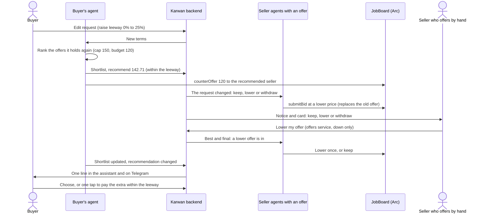

# 35 · Offers that move: a request that changes, and sellers who answer it

Track T1 (find and agree). It builds on [view 03](03-direct-offers.md) (offers on a request), the shortlist (roadmap item T1.4) and [view 30](30-negotiation-in-the-assistant.md) (the negotiation in the assistant), and becomes roadmap item T1.7 once approved. Draft, 27 Oct 2026, written after a tester reported "editing the order changes nothing, agents are supposed to actively re-bid".

## What is hard today

Read from the code and the testnet logs on 27 Oct 2026. The request was "Backend engineer", budget 120 USDC, three offers, the lowest 142.71 USDC. The buyer raised the price leeway; nothing moved for eight hours and the page kept saying "Reviewing offers".

- **The buyer agent never looks again.** An edit saves the new leeway on the buyer agent (`patchTrackedJobContext` in `agents/buyer.ts`), but nothing ranks the offers it already holds against it.
- **Sellers who offered never hear of the change.** After an edit the request goes back only to sellers who have not offered (`rescanRequest` in `agents/seller.ts` skips any seller with a standing offer, `activeBids`). Here every other seller passed: no skill overlap, low confidence, or out of budget.
- **The leeway does not count on the shortlist.** The shortlist recommends only offers at or under the budget (`pickRecommended` in `agents/shortlist.ts` is given `budgetUsdc`). A buyer who allows +25% still gets no recommendation at 142.71 on a 120 budget.
- **Every seller is told the buyer's limit.** The seller agent's view of the request carries the buyer's leeway (`negotiationMaxIncreasePct` on the seller's `JobContext`), and its opening price is aimed into it (`sellerOpeningBid` in `agents/sellerPricing.ts`: headroom is the larger of the leeway and demand, and the opening price is never below the budget). In a real market the most a buyer will pay is private. Here every seller sees it and prices up to it, which is why the offers sat above 120.
- **Offers stand still.** Once made, an offer changes only when the buyer's agent counters that one seller. A lower offer arriving never moves the others.

## The idea

A request behaves like a real market. The most the buyer will pay stays private, offers move when the request changes or a better offer lands, and the buyer's agent always works from the newest terms. The person sees the moves that matter and decides only what is theirs to decide.

1. **The buyer's agent looks again after every change.** An edit to the wording, the leeway or Trusted match makes the buyer's agent rank the offers it holds again at once, publish the shortlist, and counter the new recommendation when it changed and no counter is in flight.
2. **Recommend within the leeway, agree within the budget.** The shortlist may recommend an offer up to the budget plus the leeway, and the agent counters it toward the budget. Agree for me still agrees only within the budget (view 30, decision 1). Between the budget and the leeway the agent asks, with one card that shows the extra.
3. **Sellers who offered get a turn.** When the request changes, every seller with a standing offer has one turn: keep it, lower it, or withdraw it. An agent's lower offer is sent again with `submitBid`; the JobBoard contract keeps one offer per seller and the new one replaces the old, so no contract change is needed. The contract has no withdraw, so an agent withdraws the way a seller stops their agent today: the buyer's agent drops the offer and the chain record is left unused. A seller who offers by hand (view 03) lowers by replacing their offer, and withdraws with the withdraw that exists.
4. **One best and final round.** When the shortlist is first ready, and after each change to the request, sellers whose offer is not the lowest on the shortlist are told once: "A lower offer is in." They never see the other price. Each seller's agent decides within its own floor. Then the list settles until the next change.
5. **The buyer's limit stays private.** Seller agents see the budget, never the leeway. Their opening price comes from their own price, the market and demand, and may be under the budget, so a cheaper seller can win.
6. **Offers only move down.** A seller can lower or withdraw an offer while the request is open, at most three times per request, and never raise it except by answering the buyer's counter. This stops a seller from creeping up once it learns it is the only one left.
7. **What people see.** The request page's timeline says each move in a line ("Ada lowered her offer to 118 USDC", "Tunde withdrew"). The assistant speaks only when the recommendation changes or a decision is needed (view 30, decision 2: milestones only). A seller who makes their own offers, not through their agent, gets one notice in the bell, the assistant and Telegram: "The buyer changed this request. Keep, lower or withdraw your offer", with a card.

## How it is built

1. **Look again on an edit.** A new `rejudgeOffers(jobId)` in `agents/buyer.ts`, called by the edit route (`POST /api/jobs/:jobId/edit`) after `patchTrackedJobContext`. It reruns `rankBidEntries` and `publishShortlist` with a counter allowed when the recommendation changed and nothing is agreed, funded or mid-counter.
2. **The cap on the shortlist.** `publishShortlist` passes `computeBuyerEffectiveCap` to `pickRecommended`; the "within budget" reason keeps meaning the budget. Agree for me (`assistant/agreedForYou.ts`) is unchanged. The in-between case reuses the near-match card ("Approving pays over your original budget").
3. **Seller turns.** A new `reviseOffer(jobId, seller, reason)` in `agents/seller.ts`, run for sellers with a standing offer by `offerAgain` after an edit and by the best and final invite. A new pure `sellerRevision` in `agents/sellerPricing.ts` returns keep, a lower price, or withdraw: never above the standing price, never below the seller's own floor. A lower price is sent with `submitBid`. A withdrawal takes the path `propose_stop_agent_bid` uses today: the buyer's agent drops the offer from its pool, and the offer on chain is never accepted. Each revision emits `bid.revised` on the bus, counted per seller per request.
4. **Best and final.** One invite per seller per round (`request.best-and-final`), only to sellers not lowest on the shortlist; the invite carries no prices.
5. **The leeway leaves the seller side.** `handleJobPosted` stops putting `negotiationMaxIncreasePct` on the seller's `JobContext`. `sellerOpeningBid` and the counter answers (`seller.ts` lines that read the leeway) use demand headroom and the market instead, and the opening floor becomes the larger of the seller's minimum and the market, no longer the buyer's budget.
6. **Sellers who offer by hand.** The notice goes through the notifier and the bell. Their offers live in the offers service (`routes/offers.ts`), which can make and withdraw an offer but not change one; a new `POST /api/jobs/:jobId/offers/:offerId/lower` replaces the price, down only. A new assistant tool `propose_lower_offer` shows the card on the website and Telegram (one assistant everywhere), beside the existing `propose_withdraw_offer`; the request page gets the same buttons.
7. **Timeline and live.** `bid.revised` and withdrawals become timeline lines on the request page. Events follow the owner projection rule (`sse owner projection`): sellers never see each other's prices, the buyer sees every move.
8. **Arc check first.** Before code, `docs/arc-circle-checks.md` records the read-only check: a second `submitBid` from the same seller on the deployed JobBoard on Arc Testnet replaces the first (`bids[jobId][seller]` is overwritten), with the source and date.
9. **Guide, canon and docs** in the same batch: the market and sell entries in `assistant/platformGuide.ts`, the canon page on negotiation, and view 30's "As built".

## What is tested

- An edit that raises the leeway puts a recommendation on the shortlist and counters it (buyer agent unit test, then an e2e on the request page).
- The shortlist never recommends above the cap, and Agree for me never agrees above the budget.
- A seller revision is never above the standing price or below the seller's floor; a fourth revision is refused.
- The seller's view of a request carries no leeway (a privacy test on the seller `JobContext`).
- A best and final invite carries no prices and reaches only sellers not lowest.
- A seller who offers by hand gets the notice and can lower from the assistant and the page.

## Decided by the owner, 27 Oct 2026

All five below as recommended, and three more:

6. **The paid market check stays honest.** When the market read says the budget is well under what the work goes for, the agent does not haggle sellers toward it. It tells the buyer that sellers ask about the market price and none has taken it at the budget, with the choice to allow more or post again at a higher budget. Nobody is pushed below their own floor.
7. **Every fitting request reaches the seller.** A request that fits a seller's skills or offers but sits outside the price or time range they set is never dropped silently: the seller hears about it by email, Telegram and in the app, once, with the budget and a choice to make an offer or skip. This is why setup has to capture what each person sells and buys, in plain words (view 26): the agent can only haggle well with what it knows.
8. **It must not look programmed.** Offers move on the market's own clock, each seller decides from its own floor, the market and the competition, so some lower, some keep and some withdraw, and nothing announces a round.

Post it and sleep: the agents do the haggling inside each person's limits, and both sides wake up to a deal or an honest "not at this price".

## The five questions put to the owner

1. **Recommend within the leeway, agree only within the budget.** Recommended: yes. The leeway is what the buyer allowed the agent to discuss; spending past the budget still takes their tap.
2. **One best and final round** when the shortlist is first ready and after each change. Recommended: yes. More rounds feel like spam to sellers and slow the buyer.
3. **Hide the leeway from sellers.** Recommended: yes. It is the buyer's private limit.
4. **Let seller agents open below the budget.** Recommended: yes, so a cheaper seller can win. Today no agent offers under the budget.
5. **Down only, at most three revisions per request.** Recommended: yes.

## Status

| Part | State |
|---|---|
| This view | Approved by the owner 27 Oct 2026, with decisions 6 to 8 |
| Spec, plan | Written 27 Oct 2026 |
| Arc check | Done 27 Oct 2026 on a fork of the deployed JobBoard: a second offer replaces the first, an offer above the budget is accepted. The deployed build is older than the source and its job id is read from `JobPosted` |
| Code | Built 27 Oct 2026, not deployed: the buyer's agent looks again after an edit, takes a lower offer and drops a withdrawn one (also after a restart); the shortlist recommends within the leeway; sellers never see the leeway and may open below the budget; seller agents keep, lower or withdraw after a change and in one best and final round; the honest note when the budget is far under market; every fitting request outside a seller's range reaches them; sellers who offer by hand lower from the request page or the assistant and hear about changes |
| On testnet | Not yet seen: raise a request's leeway with an offer above budget and watch the recommendation and counter; a seller agent lowering after a change |

## As built

- Found while building: the buyer's agent ignored a second offer from the same seller (`handleBidSubmitted` returned on any repeat), and a seller who stopped their agent stayed in the buyer's pool and could still be countered. Both fixed (`agents/offerRevision.ts`, `dropWithdrawnSeller`).
- The honest note does not wait for the offer window, which only opens on a first offer: when the market read finds the buyer's limit under 60% of a grounded fair price, the agent looks again two seller sweeps later (`agents/underMarket.ts`).
- The seller's prompts no longer tell the LLM that an agent never bids below the buyer's budget (`llm/prompts.ts`).
- The newer request page (search v2) now shows the market note too; before, only the older page did.
