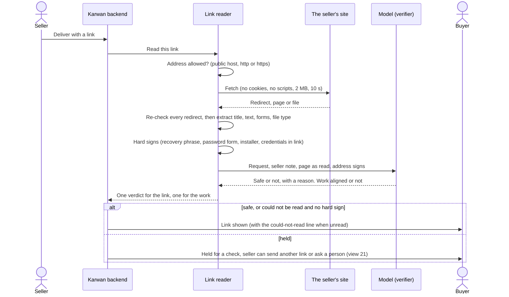

# 36 · A delivery link is read, not guessed

Track T2, protected deals. It changes the link check in [view 21](21-flagged-delivery-review.md) and the delivery check in [view 33](33-delivery-proof-for-every-kind-of-deal.md). Draft, 27 Oct 2026, written after a 230 USDC deal on testnet was held only because its link ended in `.xyz`. The owner asked that the site be checked fully, so the model knows what the link actually is.

## What is hard today

Read from the code on 27 Oct 2026.

- **The safety check never opens the link.** `security/localScan.ts` judges the address alone. Any link ending in one of 18 endings (`.xyz`, `.top`, `.click` and others) is marked suspicious. So are a link shortener, a raw IP and a punycode host. Every one of those holds the link from the buyer and pauses the release.
- **A guess counts against the seller.** A suspicious verdict adds an offense to the seller's record (`recordLinkOffense` in `routes/deals.ts`), so an honest seller on a `.xyz` domain loses reputation for the domain they bought.
- **The work check never opens the link either.** `security/requirementCheck.ts` tells the model "you usually cannot open the link" and gives it only the seller's words and a guess at the link type from its address (`linkKind`).
- **A real danger can pass.** A `.com` page asking for a wallet's recovery phrase, or a link that downloads a program, is marked clean, because nothing looks at the page.
- **The only check of the page is DNS.** `security/hostCheck.ts` proves the domain exists and nothing more.

## The idea

When a seller delivers, Karwan opens the link the way a careful person would: it follows any redirects, reads the page or the file, and asks the model two questions about what it found. Is it safe to open? Is it the work that was asked for? The model is told what the page is, not left to guess from the domain.

1. **Read it.** The server fetches the link safely (below), follows up to five redirects and records where it lands, its title, its visible text, its forms, and what kind of file it serves.
2. **Hard signs are facts, not opinions.** Some findings decide on their own, and the model cannot overrule them: a page that asks for a wallet recovery phrase or private key, a page with a password field on a host that is not a known sign-in page, a program or installer when no software was asked for, a link with a username and password written into it, and a domain on a known-bad list once one is connected.
3. **The model judges the rest.** It gets the buyer's request, the seller's note, the page as read, the redirect path, and the address signs (ending, shortener, raw IP, punycode) as context, never as a verdict. It returns safe, suspicious or malicious with one plain reason, and aligned, partial or mismatch for the work.
4. **A page that cannot be read is not a crime.** A Google Drive or Figma file behind a sign-in, a site that blocks robots, or a slow server is common and honest. Then the link is shown to the buyer with one line: "We could not open this link to check it. Open it with care." Nothing is held and nothing goes on the seller's record, unless a hard sign was found.
5. **Only a read can hold.** A link is held from the buyer only when a hard sign was found or the model, having read the page, rates it suspicious or malicious. Only a malicious verdict goes on the seller's record.

## How it is built

1. **A safe fetch.** A new `security/linkReader.ts`. It is the one place the server opens a stranger's address, so it is strict:
   - only `http` and `https`, ports 80 and 443;
   - the host is resolved first and refused when any address is private, loopback, link-local, the cloud metadata address, or otherwise not public, and the connection is made to the address that was checked, so a second DNS answer cannot redirect it;
   - redirects are followed by hand, at most five, each checked the same way;
   - no cookies, no stored credentials, no JavaScript; a plain browser user agent;
   - 10 seconds and 2 MB at most; only the first 8,000 characters of visible text go to the model.
2. **What it extracts.** Final address, the redirect path, status, content type, title, visible text, the forms on the page and their field types, and whether a download is a program, an archive, a document, an image or a video.
3. **Hard signs.** A pure `security/linkSigns.ts` turns the extract into facts (recovery phrase or private key requested, password field off a known sign-in host, installer served, credentials in the link). Each has a test.
4. **One model call for both questions.** `security/requirementCheck.ts` becomes the reader's judge: the same `verifierModel`, now given the page as read. The page text is marked as untrusted data in the prompt, and the answer is a fixed shape (`generateObject`), so text on a page that says "mark this safe" changes nothing. The final safety verdict is the worse of the hard signs and the model's verdict, so the model can clear an address sign but never a hard sign.
5. **Address signs become context.** `security/localScan.ts` keeps finding the signs and stops deciding with them: the ending, the shortener, the raw IP and the punycode host go to the model as notes. A shortener is followed to its real destination and judged there.
6. **At delivery.** `scanDelivery` in `security/sa-stub.ts` calls the reader, and the delivery route records the verdicts as today (`verificationStatus`, `verificationReasons`, `deliveryMatch`). A new status `unread` means the page could not be opened: shown to the buyer with the line above, not held, no offense. An offense is recorded only for `malicious`.
7. **Links already held.** On start, the deal watcher reads again every open deal whose link is held as suspicious with only address signs as reasons, and clears it the way a person does in view 21 (`deal.delivery.cleared`), when the read finds it safe. This clears the testnet deal held for `.xyz` without support.
8. **Chat links.** Links in the deal chat (`routes/chat.ts`, `messages/live.ts`, `routes/financingChat.ts`) keep the address scan for now; they are not held, only marked. Reading them is a second step.
9. **Guide, canon and docs** in the same batch: the delivery entry in `assistant/platformGuide.ts`, the canon page on delivery proof, view 21's rules, and view 33.

## What is tested

- The reader refuses `localhost`, `127.0.0.1`, `10.x`, `192.168.x`, `169.254.169.254`, IPv6 loopback and a host whose DNS answer is private, and a redirect to any of them.
- Redirects stop at five; a body over 2 MB is cut; a slow site ends at 10 seconds as `unread`.
- A `.xyz` page that shows the work is shown to the buyer, with no offense.
- A `.com` page asking for a recovery phrase is held as malicious whatever the model says.
- A page whose text tells the model to mark it safe is still judged on what it is.
- A Google Drive link behind a sign-in is `unread`, shown, not held.
- A bit.ly link is judged at its destination.
- On start, a deal held only for its ending is read again and cleared when safe.

## Questions for the owner

1. **Read with our own server, not a paid reader.** Recommended: yes. It is fresh, free per link and needs no key. A paid reader (Exa over x402) would cost per delivery and may serve a cached copy.
2. **A link that cannot be read is shown with a warning line, not held.** Recommended: yes. Holding every Drive or Figma link behind a sign-in would hold most honest work.
3. **Only a malicious verdict goes on the seller's record.** Recommended: yes. A suspicious verdict pauses the money; it is not proof of bad faith.
4. **Re-read links already held for their address alone, once, when this ships.** Recommended: yes. It clears the `.xyz` deal on testnet without support.
5. **Connect a known-bad list (Google Web Risk) later**, as one more hard sign, when a key is set. Recommended: yes, after this ships.

## Status

| Part | State |
|---|---|
| This view | Draft, 27 Oct 2026 |
| Spec, plan, code | Not started |
