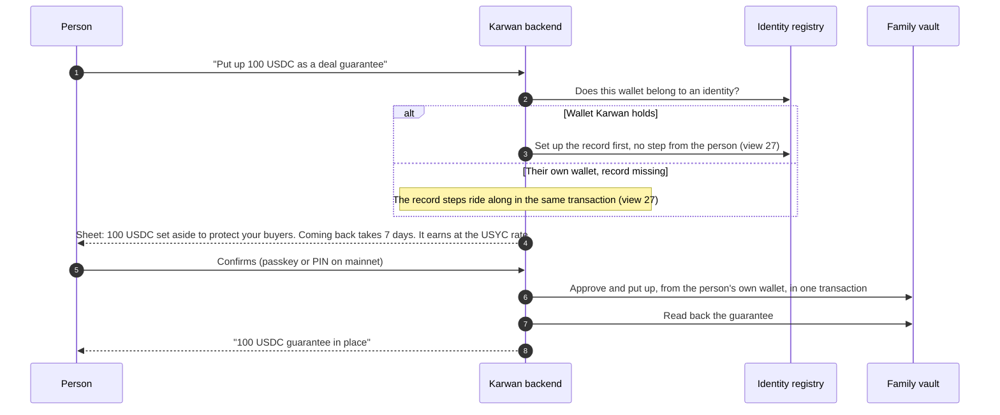
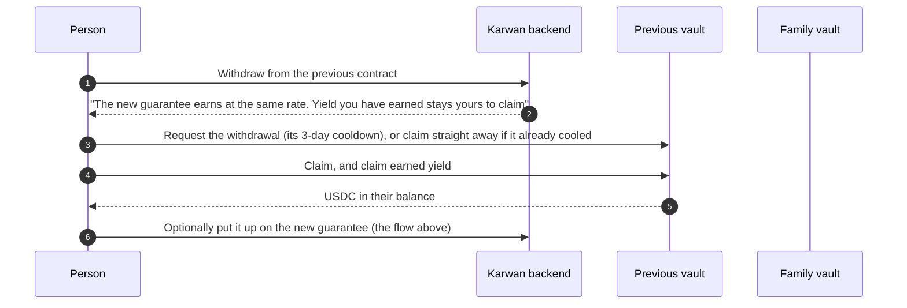
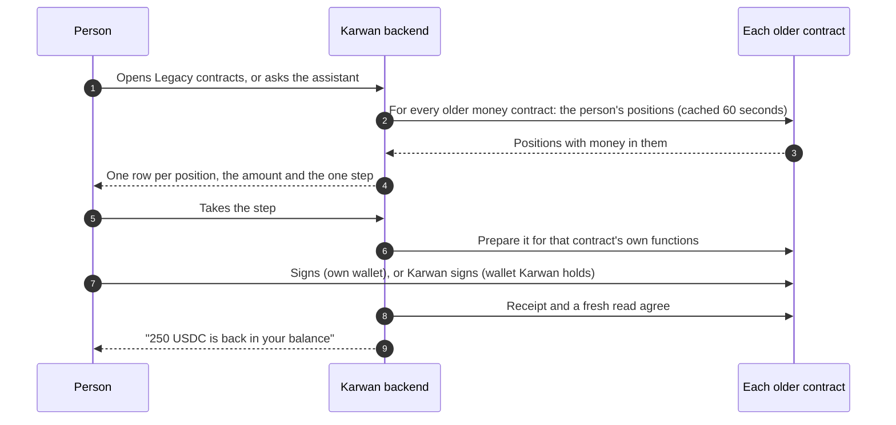

# 37 · Deal guarantee, and getting money back from every older contract

Track T5, money like a bank account, roadmap item T5.1 (plain words for money): "staking" becomes **Deal guarantee** everywhere a person reads it, and the guarantee moves onto the family's vault from [view 11](11-contracts.md). Track T2, protected deals, roadmap item T2.1 (the family deployed and used): the vault is the last family member the deal and financing flows need before [view 18](18-trade-finance.md) can hold a seller's guarantee behind an advance. The foundation, recovery: the legacy page from [view 27](27-deals-on-the-escrow-family.md) grows from one list of deals into the place where a person gets back money from any older Karwan contract. The owner took `/legacy` off the parked list on 28 Oct 2026 for this.

## What is wrong today

Read from the code and from Arc Testnet on 28 Oct 2026.

- **The words.** The page a person opens from their profile says "Stake", "Earn reputation" and "KarwanVault". The roadmap promised plain words (T5.1); the owner chose "Deal guarantee" on 28 Oct 2026.
- **The wrong vault.** Every guarantee goes into the vault from before the family. The family's vault, which only lets a deal or an advance hold a guarantee with the person's own signature, holds nothing and nothing in the app calls it. Until it does, getting paid early on the family cannot hold the seller's guarantee for the financier.
- **Money the app cannot reach.** Older Karwan contracts still hold USDC. The legacy page covers two of them, and only while a 30-day window is open. The window has closed, so today it shows only the deals from before the new escrow.

| Older contract | USDC it holds (28 Oct 2026) | In the app today |
|---|---|---|
| Vault from before the family (current guarantee) | 8,857.5 | `/stake` |
| Older vault, the one before it | 628 | `/legacy`, window closed |
| Three earlier vaults | 57, 250 and 20 | Nowhere |
| Older escrow | 198.85 | `/legacy`, window closed |
| Three earlier escrows | 20.70, 13.10 and 31.02 | Nowhere |
| Previous escrow (v2), purchase-order financing, invoice registries | 0 | Previous escrow deals listed on `/legacy` |

Not all of it is people's money: some is fees owed to the treasury or test money seeded by the team. The page reads each person's own position, so it shows only what is theirs.

- **No way in.** A person who knows they had money on an older contract has no row in their profile that leads to it.

## The idea in one line

A person puts up a **Deal guarantee** on the family's vault and sees it as money set aside to protect their buyers and back an advance, with the date it can come back; everything they still hold on an older Karwan contract is listed on one page, **Legacy contracts**, each with the one step that gets it back, for as long as the contract holds it.

## Participants

| Who | Does what |
|---|---|
| Person | Puts up a guarantee, takes it out, gets money back from an older contract, from the website or a chat channel |
| Assistant | The same steps as tools: put up, take out, cancel taking out, collect, and "what do I still have on older contracts?" |
| Karwan backend | Reads every older contract for the person's positions, prepares each step, watches the chain, writes the movement and tells the person |
| Identity registry | One identity per person; a guarantee belongs to the identity, not to a wallet |
| Family vault | Holds guarantees. A deal or an advance holds part of one only with the person's signature, for one named beneficiary, until a date |
| Yield distributor | Pays each guarantee the day's USYC rate, funded by Karwan; the person claims it |
| Older vaults and escrows | Unchanged contracts that keep paying out what they owe |

## Putting up a guarantee



Notes: `KarwanStakeVault.stake(usdc, amount)` from a wallet bound to the identity (an agent cannot put up a guarantee). An own wallet signs the approval and `stake` together through `Multicall3From`, with any missing record steps after them; a wallet Karwan holds sends them as one Circle contract execution batch.

## Taking it out

```mermaid
sequenceDiagram
  autonumber
  participant P as Person
  participant K as Karwan backend
  participant V as Family vault

  P->>K: Take out 60 USDC
  K->>V: How much is free? (the guarantee less what deals and advances hold, less what is already coming back)
  K-->>P: "60 USDC back on 4 Nov. Deals keep 40 USDC until they finish"
  P->>V: Request the withdrawal
  Note over V: 7 days. A new request restarts the clock for everything coming back
  K-->>P: "Your 60 USDC is ready"
  P->>V: Collect
  K->>V: Read back; the movement shows in Activity
```

Notes: `requestWithdraw`, `cancelWithdraw`, `withdraw`, `freeOf`. The 7 days match an identity recovery, so a stolen wallet cannot take a guarantee out before its owner takes the identity back. Karwan reminds the person when the money is ready; collecting is never automatic.

## Yield on a guarantee

A guarantee earns at the USYC rate, the way stakes on the previous vault do today. Once a day Karwan reads every guarantee on the family vault, applies the USYC price move since the last run, and credits each person in the yield distributor. The person claims it from the guarantee page or by asking the assistant. A guarantee that is coming back still earns until it is collected; the part a deal or an advance holds earns too.

Notes: `scripts/yield-distribute.ts` reads `stakeOf(identity, usdc).active` for every identity that has a `Staked` event on the family vault, pays the identity's own wallet, and calls `KarwanYieldDistributor.bulkCredit` from the operator's USDC. The real USYC sits in Treasury v4, one of the two addresses the USYC Teller lets through. On mainnet `KarwanYieldPool` replaces this route.

## Moving from the previous vault

The previous vault keeps working as it is; nothing moves without the person. The guarantee page shows one quiet line under the guarantee: **"You have 250 USDC on the previous contract. Withdraw"**, which opens the previous vault's row on the legacy page.



## The legacy page

One page, **Legacy contracts**, reached from Profile, Other. It lists only what the person still has, grouped by what it is, never by contract name.

| Group | What the person sees | The one step |
|---|---|---|
| Deals from before the new escrow | The other side, the amount, where it stands | Open the deal page; every action works on the escrow it started on (built) |
| Older deals | A deal on an earlier escrow with money still in it | Take back or release, whichever the contract allows that side |
| Guarantees on older contracts | The amount, coming back or ready, yield earned | Request, collect, claim yield |
| Financing from before | An advance or a purchase-order line still open | Repay or collect, whichever the contract allows |



Notes: the list of older contracts lives in one place on the server, generated from the deploy ledger (`deployLedger.ts`): every superseded settlement, staking and financing contract on the network, each with the reader and the steps of its own version. A new family member that replaces a contract adds its predecessor there and nowhere else, so the page, the assistant and Telegram stay the same. The page reads the person's identity wallet, their buying and selling agents and their earnings wallet, because older contracts paid into all four.

## What fails where

| Where | What fails | What happens |
|---|---|---|
| Putting up | No record yet | Never a separate step: a wallet Karwan holds is set up first; an own wallet's record steps ride in the same transaction. A guarantee belongs to an identity, so here the record steps go first and must succeed, unlike view 27's ride-along where they may fail alone. If they fail, nothing is put up and the sheet says why |
| Putting up | Not enough USDC, or over what the beta allows | Refused before anything is signed, with the amount in words |
| Taking out | Part of the guarantee is held by a deal or an advance | Only the free part can come back; the sheet names when the rest is free |
| Taking out | A second request before the first is ready | Allowed; the sheet says the 7 days restart for everything coming back |
| Collecting | Asked before the 7 days end | Refused with the date |
| A held guarantee | The deal or advance ends | The hold lifts when it settles; if the family forgets, anyone can lift it once its date passes (`releaseStale`), and Karwan's watcher does |
| Older contract | Its version has no way for a person to take money out | Shown as "Held by Karwan, contact support" and flagged to the team, never hidden |
| Older contract | The money belongs to the treasury or the team, not to a person | Not on the page; listed for the team in the admin console |
| Any step | A wallet provider reports done but the call reverted inside | Done only when the receipt shows the expected event and a fresh read agrees (rule 8) |

## Checks before code (rule 14)

Logged in `docs/arc-circle-checks.md` before any code: the family vault read back (`hub`, `COOLDOWN`, `freeOf` for an identity with no stake, the hub's asset list including USDC); a `Multicall3From` `eth_call` of approve then `stake` from a test wallet with an identity; Circle contract execution for the same two calls from a wallet Karwan holds; and, for every older contract on the page, its version's ABI matched against the deployed bytecode and one read of a known position.

## What it does not do

- Move anyone's money between contracts. Every step is the person's own.
- Put guarantees into USYC. The family vault has no yield route and no owner, and the USYC Teller lets through only Karwan's two entitled addresses, so the money stays in USDC in the vault; the yield is paid beside it (below).
- Change the reputation formula. The guarantee keeps counting toward reputation as the staking did; the reader adds the family vault, keyed by identity, next to the previous vault until it is empty.
- Hold a guarantee behind a deal or an advance. That is the trade finance build ([view 18](18-trade-finance.md)) and the deal rules in [view 32](32-kind-of-deal-and-hourly-work.md).
- Go to mainnet.

## Decided by the owner, 28 Oct 2026

The view was agreed with decision 3 changed: guarantees earn at the USYC rate.

1. **The recovery window goes.** Older contracts stay on the legacy page for as long as they hold a person's money. The window only ever hid money people could still take out.
2. **New guarantees go only to the family vault** from the day this ships. The previous vault takes no new money from the app; everything already there keeps working from the legacy page and the one line on the guarantee page.
3. **Yield at the USYC rate** (changed by the owner, 28 Oct 2026). A guarantee on the family vault earns what stakes earn today: the daily USYC price move applied to the guarantee, paid by Karwan through the yield distributor and claimed from the guarantee page. The money itself stays in USDC in the vault. The words say "earns at the USYC rate, paid by Karwan on testnet", never that the guarantee is invested in USYC. Yield already earned on the previous vault stays claimable from the legacy page.
4. **Reputation.** A guarantee on the family vault counts the same as a stake did. Time on the previous vault does not carry over: the family vault's own time starts when the guarantee goes in.
5. **The words.** "Deal guarantee" for the thing, "Put up", "Take out" and "Collect" for the steps, "Legacy contracts" for the page. "Stake", "vault", "staking" and "insurance" leave every screen, the assistant and Telegram, in all five languages; the roadmap's "deal insurance" becomes "Deal guarantee" too.

## Status

| Part | Status |
|---|---|
| Family vault on Arc Testnet | Deployed 23 Oct 2026, owned by the timelock; holds nothing |
| Deal guarantee on the family vault: put up, take out, collect, from the website and the assistant | Built 29 Oct 2026, not deployed. Proven on an Arc fork at block 69,587,069: put up 100 USDC, take out, collecting early refused, collected exactly 100 USDC after the 7 days (`scripts/ops/arc-fork.sh e2e guarantee`) |
| Yield at the USYC rate on a guarantee, paid by Karwan through the yield distributor | Built 29 Oct 2026, not deployed; the first testnet run is a dry run |
| "Deal guarantee" in every screen, the assistant and Telegram, five languages | Built 29 Oct 2026; `shared/i18n/plainMoneyWords.test.ts` fails on stake, vault or insurance in any language |
| Withdraw from the previous contract, from the guarantee page | Built 29 Oct 2026, not deployed |
| Deals from before the new escrow on the legacy page | Built, committed 28 Oct 2026 |
| Every older money contract on the legacy page, no window | Built 29 Oct 2026, not deployed; read from the deploy ledger |
| Legacy contracts row in Profile, Other | Built 29 Oct 2026, not deployed |
| Older contracts table for the team, on /admin/diagnostics: each contract's USDC, what open deals and positions hold for people, the part with no working step, and what is left over | Built 30 Oct 2026, not deployed |
| Mainnet | After the audit steps in view 11 |
