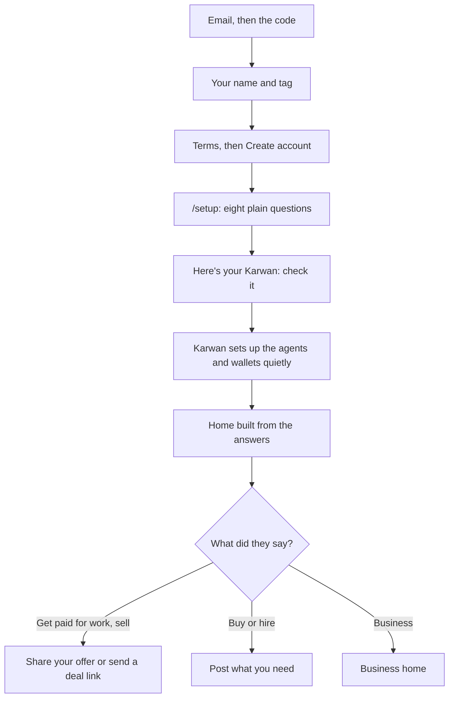

# 38 · One clear path, from sign-up to the first deal

Track T1, find and agree, roadmap item T1.1 (one market, one entry), and the Milestone 1 rule "no crypto words in the path" from [view 00](00-direction.md). It also touches T5.1 (plain words for money) and finishes what [view 19](19-simple-karwan.md) started. The owner asked on 29 Oct 2026 for a consumer-grade pass: "some parts still feel off", from onboarding to everyday use. Draft for the owner to agree.

## How this was found

On 29 Oct 2026 we walked testnet.karwan.site on a 375px phone screen and a 1440px desktop. One run used an established account (@lawful). The other was a brand-new account signed up with a fresh email (@spencerkiddo), followed from the first screen after the code to the start of a first deal. Then the customer code was read for the patterns behind what we saw. Admin pages were left out. Nothing here comes from memory.

## What is wrong today

### A new person meets three setups before the real one

The real onboarding exists. `/setup` asks eight plain questions, and it is the best screen in the app: one question per screen, examples to tap, a summary that says "Nothing is saved until you say it looks right". A new person reaches it last.

What happens after sign-up:

1. Sign-up says "Step 3 of 3" and asks Personal or Business. Business is shown and greyed out as "Coming soon", so the last question has one real answer. The tab title says "Sign in" the whole time.
2. Home opens with a banner, "Step 2 of 2: Activate your agent wallets", and below it a checklist, "Your first trade, 0 of 6". Two step counters on one screen, neither matching the 3 of 3 before.
3. "Activate agent wallets" opens a page called Agent funds that says "Your agents are not set up yet" and a second button, Set up.
4. Set up opens a sheet in uppercase labels (AGENT SETUP, BUYER AGENT NAME (OPTIONAL)) that explains escrow and appeals and asks a stranger to name two agents.
5. After activating, the same sheet shows two wallet addresses (0xf0cc…c09b) and three buttons: Set up my Karwan, Done, Save names.
6. Only "Set up my Karwan" leads to `/setup`.

Inside `/setup`:
- The counter says "1 of 4", then "1 of 8" after the first answer.
- After Next, the old question stays for about a second, then the screen goes blank before the next one appears.
- The floating Help button covers Next on question 3.
- The five choice cards on question 1 have no names a screen reader can announce.
- A toast, "0.5 USDC arrived in your selling agent", covers the progress bar on question 8.
- Prices are asked in USDC ("About 100 USDC, a week"). A designer in Lagos thinks in naira.
- The summary leaves out the one thing typed by hand, what the person does.
- The answer to "Do you have clients already, or should Karwan find them?" says it "decides what Home puts first". Home looked the same afterwards.
- The summary says "Your agent offers your work", but no offer was posted. The market showed "Your offers 0".

Then the market asks again, "Do you trade for yourself or for a business?"

In the code there are two onboarding flows. `app/onboarding/page.tsx` (1,905 lines) is still linked from `PostJobForm`, `OfferPanel` and `RoleToggle`. `/setup` (`features/setup/SetupFlow.tsx`) is the one from view 19.

### The first deal starts on the wrong side

The new account said "Get paid safely for my work". It chose Start a trade, then "I already have an agreement". That opened `/buyer?mode=direct`, titled "Buy", saying "I have a seller", with a "Buying agent 0.00 USDC, Top up" card. Home showed a balance of 20.50 USDC at the same time. A freelancer who wants to be paid lands on the page for paying someone, next to a second balance that is empty.

### Two or three balances

- Home: "USDC balance 20.50".
- Profile: "USDC balance 1,382.97" and, under it, "Agents 985.55 USDC" (on @lawful).
- Agent funds: "Buying agent 0.00", "Selling agent 0.50", each with Top up and Withdraw, plus "Research credit, Add 1.5 USDC".
- The deal composer: "Buying agent 0.00 USDC, Top up".

The one-wallet rule says one wallet, one balance. People see up to four numbers and buttons to move money between them.

### Every screen is a different shape

- **Navigation differs by device.** Phone: Home, Discover, Activity, Profile. Desktop sidebar: Home, Discover, Finance, Activity. Profile is a tab on the phone and absent from the desktop sidebar; Finance is the reverse.
- **One place, three names.** The tab says Discover, the page title says Market, the heading says "Find the next trade."
- **Top-level tabs have a Back link.** Home, Market, Activity, Profile and Add money each open with "Back", and a "Page tour" pill sits above it.
- **The tour opens for people who know the app.** @lawful, with dozens of settled deals, got "Step 1 of 3" on Home, with copy about invitations and mainnet.
- **The floating Help button** covers cards and buttons on phone screens (Add money, setup, the deal composer).
- **The bottom nav lights the wrong tab.** A deal opened from Home lights Discover.

### Words a trader would not use

On the main path a person reads: USDC balance, agent wallets, Buying agent, Selling agent, escrow, Paytag, wallet address, Yield claimed, Staked, Tier Established, Research credit, and network names like "Top up · Unichain Sepolia" and "Solana Devnet" in Activity. The market shows "Deals from before the new escrow: 31", which is migration talk the UI law forbids. Activity shows "Staked · Needs attention" twice with nothing to tap.

View 37 already renames staking to Deal guarantee. The rest has no plan yet.

### Activity reads like a log

- A deal payment and a deposit of the same amount appear a minute apart ("Deal payment +59.55" at 10:44, "Deposit +59.55" at 10:46). It reads as money counted twice.
- "Public activity" sits as the first button on a private statement.
- Seven test-network top-ups at the same minute each get a row.

### The landing page hides its own headline

On a phone the headline and its paragraph fade in from near-invisible; for a moment the first screen is a dark picture. The figures disagree with each other: "Deals funded in escrow 219" and "Of 211 deals made on Karwan".

### What the code shows

Counted in customer screens (`app`, `features`, `shared`, admin left out) on 29 Oct 2026:

| What | Count | What it means |
|---|---|---|
| Corner radii in use | 12 (`rounded-lg`, `-xl`, `-2xl`, `-md`, and 10, 12, 14, 16, 18, 20, 22, 24px) | Cards, buttons and sheets never quite match |
| Button and field heights | 7 (`h-9` to `h-14`, plus 44, 45, 50, 52, 56px) | Rows of buttons sit at different heights |
| Raw colour values | 69 in customer screens | Colours drift from the theme, worst in `ReceiptCard`, `DirectDealDetail`, `MarketAdvisoryBanner` |
| Browser `title` tooltips | 178 | The UI law bans them |
| Native `<select>` | 6 | The UI law bans them |
| Dialog building blocks | 4 (`ConfirmDialog`, `ConfirmModal`, `ConfirmSheetShell`, `Dialog`) | Confirmations look and behave differently |
| Gates before a screen | 6 (`AccountGate`, `ActivationGate`, `AuthGuard`, `SignInGate`, `SiweGate`, `ActivationModal`) | Each adds its own interruption |
| Customer routes | 69 pages | `/bridge`, `/deposit`, `/cashout`, `/send`, `/buyer`, `/seller`, `/market`, `/jobs`, `/listings`, `/request` overlap |

Text size is fine: no customer screen goes under 13px.

### What already works

The deal page (view 01, the trust spine) is the model for everything else. It shows who, how much, a five-step line, what was delivered, what Karwan checked, and what happens next. The `/setup` questions, the Start a trade sheet (I need something, I sell something, I already have an agreement) and the Home balance card are close to right. They need to come first, not be rebuilt.

## The idea in one line

One path for a new person: sign up, answer the questions in `/setup`, land on a Home built from those answers, and start a first deal on the right side, with one balance and the words a trader already uses.

## The rules for this pass

1. **One balance.** People see one number. Agent wallets, research credit and the guarantee are how Karwan runs underneath, not places to put money. Money a person put up as a guarantee shows as "Held as a deal guarantee", inside the same balance.
2. **One question once.** Personal or business is asked once, at sign-up, and only when both answers work. Setup answers shape Home, the market and the deal composer.
3. **Each screen has one job and one primary button.** No screen offers three ways forward.
4. **Plain words first, proof behind a tap.** Money is "your balance" in the person's currency when local currency lands (T5.4). Until then the amount says USDC and nothing else does. Network names, wallet addresses, yield and agent wallets live behind "Proof" or in Settings.
5. **The same shape everywhere.** Three corner radii, three control heights, one confirm sheet, one set of tokens, and the same four tabs on every device.
6. **Help never covers what you need to tap.** It moves above the bottom nav and hides while a form or sheet is open.
7. **Tours are for first visits.** A page tour opens once, for a new account, and never on top of a task.

## The new shape

### Sign-up and setup

- Sign-up drops the Personal or Business step while Business is "Coming soon". When business accounts open, setup's answer "Run my business deals" picks it.
- `/setup` starts straight after Create account. Agent activation runs on its own after "Looks right", with no names, no addresses and no second sheet. People can rename agents in Settings later.
- The counter is fixed at the real number of questions for the answers given, and never jumps.
- Transitions show the next question at once; motion only slides it, never blanks it.
- The summary includes what the person does, and "Your agent offers your work" posts a real offer from the answers, or the line changes to "Post your first offer" with a button.
- `app/onboarding` is retired; its three links point to `/setup`.

### Navigation

Four tabs, the same on phone and desktop: **Home, Market, Activity, Profile**. Finance (getting paid early) moves into Home for sellers with a funded deal and into Profile for financiers. Top-level tabs lose the Back link. Page tour moves into the Help menu.

### Home

- One balance card: the amount, then Add, Send, Request and Withdraw.
- Below it, one block chosen by setup:
  - "I have clients": Send a deal link, Request a payment.
  - "Find clients for me": the requests that match the offer, newest first.
  - "Buy or hire": Post what you need.
- The first-trade checklist shows only steps the person still has to do (adding money, connecting Telegram, a first deal). Activating agents is not a step anyone sees.
- The test-funds banner stays on testnet only, under the block above.
- Updates stay as rotating ads and sit lower on the page.

### Market

- One name: Market, in the tab, the title and the heading.
- "Deals from before the new escrow" leaves the market. It belongs on the legacy page in Profile (view 37).
- "Your trades" moves to Activity, so the market opens on search.
- Filters collapse to one row while there are fewer than 20 results.
- "I already have an agreement" asks one thing first: "Are you paying, or getting paid?" A seller gets the seller composer. The agent balance card leaves the composer.

### Money and Profile

- Profile shows one balance and no Agents row. Agent funds leaves the main path. If an agent needs money to bid, Karwan moves it from the balance on confirmation, as the assistant already does.
- "Add USDC" becomes "Add money"; `/bridge` stays as the address, the page title changes.
- "Account recovery: Soon" leaves the list until it works.
- "Wallets" and "Agent workspace" move under Settings, as "Connected wallets" and "Your agents".

### Activity

- One row per money event a person would recognise: "Paid by Tunde for Logo design", "Added from another network", "Sent to @ada".
- A deal payment and the deposit it caused merge into one row.
- Rows that need something carry the button ("Needs attention" says what, and offers it).
- Network names go into the receipt's Proof section.
- Same-minute top-ups from the test faucet collapse into one row.

### The visual system

- **Radii:** 12px (fields, small buttons, chips), 20px (cards and sheets), full (pills and avatars).
- **Heights:** 44px (secondary), 52px (primary, as on the premium board of 22 Oct), 56px (bottom nav items).
- **One confirm sheet** (`ConfirmSheetShell`); `ConfirmDialog`, `ConfirmModal` and centred dialogs go.
- **Tokens only.** Raw colour values move into tokens. `title` tooltips become text or `Hint`. Native selects become the existing picker.
- **Gates** fold into one `AccountGate` that knows the order: signed in, terms, setup.

## The order of work

Each step is shipped and checked on testnet before the next. Each one ends with the guide (`platformGuide.ts`), the canon and the e2e tests updated in the same batch.

1. **The new-person path.** Setup straight after sign-up; agents activated quietly; the onboarding page retired; the counter, blank-screen, Help overlap and accessibility fixes in `/setup`; the summary and first offer; Home built from the answers; the composer asks paying or getting paid.
2. **One balance.** Profile and the composer lose agent balances; agent funding moves behind confirmation; Agent funds leaves the main path.
3. **One shape.** Four tabs everywhere; Back links and tours off top-level tabs; Help placement; the market's name, legacy row and filters.
4. **Plain words.** Activity rows, the merge of deal payment and deposit, network names behind Proof, "Add money", and the landing headline and its figures.
5. **The visual system.** Radii, heights, one confirm sheet, tokens, tooltips and selects, one gate.

Steps 1 and 2 change what a person can do and where Karwan moves money on their behalf, so they get a spec and a plan before code. Steps 3 to 5 are presentation and can follow this view directly.

## What it does not do

- It does not bring local currency. Plain amounts in naira wait for T5.4; this pass removes every crypto word except the currency itself.
- It does not change the deal page, which already meets the bar.
- It does not change the assistant or Telegram, which already run on plain words. They pick up the new names through the guide.
- It does not open business accounts.

## Decisions for the owner

1. **Personal or Business at sign-up.** Recommended: drop the step until business accounts open, and let setup decide later.
2. **Agent balances.** Recommended: no agent balance anywhere on the main path. Karwan moves money to an agent only when a bid or deal needs it, with the person's confirmation.
3. **Navigation.** Recommended: Home, Market, Activity, Profile on every device, with getting paid early inside Home and Profile.
4. **Order.** Recommended: steps 1 to 5 as listed, starting with the new-person path.

## Status

Draft, 29 Oct 2026. Found on testnet with @lawful and a new account, @spencerkiddo. Nothing built.
