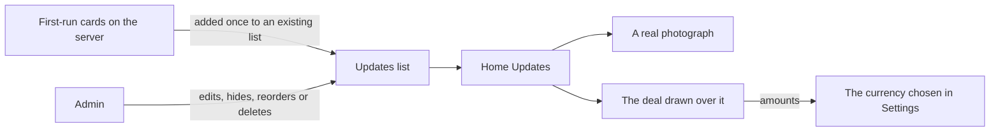
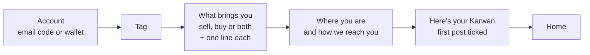

# 39 · From /start to Home, with the agent beside you

Track T1, find and agree, roadmap item T1.1 (one market, one entry), and step 1 and step 5 of [view 38](38-one-clear-path.md). The owner reviewed drawn samples on 29 Oct 2026 and asked for them to be built as drawn, with three additions: a privacy notice, a short agent nudge on every step so nobody is lost, and the rule that what a person tells their agent sets up their workspace and profile by itself. Personal details are asked only once, at identity checks on mainnet, and only what the partner running the check needs.

## What a new person does

Everything happens on `/start`. There is no second page called setup.

Since 19 Nov 2026 the questions in step 3 are replaced by [Set up in two minutes](#set-up-in-two-minutes-19-nov-2026). The steps below are the first version, kept for the record.

1. **Account.** Email and a code, or a wallet. Nothing else is asked.
2. **Tag.** They pick the Karwan tag clients find and pay them by. The account is created here.
3. **About you.** The agent asks what they want Karwan to do, then only the questions those goals need:
   - selling work or goods: what they do and their usual price, on one screen. The agent reads it back as a price range and delivery time before they move on;
   - buying, a business, or a record: one line each, as today;
   - then whether they have clients and how to reach them, on one screen.
4. **Here's your Karwan.** One summary: tag, clients, what the agent may do, how we reach them, and the first offer or request the agent wrote from their words, with "Post it on the market now" ticked. "Looks right, take me home" saves everything and, when ticked, the assistant posts it. They land on Home.

A three-part bar (Account, Tag, About you) stays at the top the whole way. Each screen carries one line from the agent saying what the answer is used for. How clients pay and what the agent may do on its own are not asked: they start as "all at once" (or "I send goods" for sellers of goods) and "make offers within my price, ask before any deal", and both can be changed on the summary or later under Profile. Where the person is gets asked later, on the profile, when it is needed for matching.

## What the answers set up

Unchanged from [view 19](19-simple-karwan.md): `POST /api/setup/save` turns the answers into the agent settings, the public profile (work, price range, delivery time, ways to pay) and what Home shows first. The person never types a name, an address or an ID number to use Karwan on testnet. On mainnet the identity check asks for what the licensed partner requires, at the moment a feature needs it, and that data goes to the partner under the privacy notice.

## Home

The balance is the top line of the page, not a card: the amount, the active trade count, and Add money, Send, Request and Withdraw beside it. Under it, three cards side by side (stacked on a phone):

- **The next step from setup** (Find work, Get paid, Post what you need), as today.
- **Your first trade**: a ring with the steps done, the next step as a button (Add USDC, Tell your agent), and "See all steps", which opens the full list in a side drawer (bottom sheet on a phone). Steps that hold a choice, Connect Telegram and Start a deal, open the drawer. It goes away after the first settled deal, as today.
- **Ask Aman**: a box and three suggestions. What is sent, typed or a suggestion, opens assistant mode with it already sent as a new conversation, and switching Aman on off there comes back to Home (changed 13 Nov 2026, view 80; from 6 Nov to 13 Nov it opened the Help panel).

The three cards share one look: a soft accent light from the top, a mark beside the title (the first trade card has its progress ring there), and neutral pill buttons.

"Trade now" is gone: the first card already leads to the market. Updates move on by themselves every 6 seconds and stop while the pointer or keyboard focus is on them, or when the person has asked for reduced motion. There is no pause button.

### Ways to deal in Updates (18 Nov 2026)

After the three cards Updates already had (Built on Arc, Paid in USDC, Most requested this week), eight more show the ways to deal on Karwan: every offer in the open, trading with someone you know, contests, hiring by the hour or monthly, an agent finding the match, standing orders, payment links, and payment when it arrives.

- **A real photograph each.** Licensed photographs Karwan already holds, from markets and workplaces in Nigeria and elsewhere, never generated pictures. The credits sit beside the files.
- **The deal is the app's own.** Over each photo a small Karwan card shows that kind of deal at one moment, such as an offer marked Chosen or money held, then released. It never names or quotes the person in the photo.
- **Amounts in your currency.** Every amount on those cards follows "Show amounts in" from Settings, the same as every other price on Karwan.
- **Gentle motion.** The photo drifts slowly and the deal settles in line by line. With reduced motion both rest still.
- **Added once.** A list that already exists gets the eight cards once, after its own. One an admin deletes stays deleted.

## Smaller fixes in the same batch

- Putting up a deal guarantee shows the balance it comes from, a "Use all" button and what is left after. The title reads "Put up a deal guarantee" until an amount is typed.
- Legacy contracts shows five rows at a time with Previous and Next for older deals and for guarantees, and its Back link lines up with the heading. The "Done" line becomes a notice at the top of the list.

## Test USDC on Home

On testnet the full-width "Get free test USDC" strip is gone. A drop sits in the top corner of Home, opposite the greeting. Hovering or focusing it shows the same words with Claim; on a phone a tap opens the card. Claim opens the wallets page with the faucet, as the strip did. There, Get USDC sends 20 test USDC straight to the wallet; when the day's few claims are used up, it copies the address and opens Circle's faucet instead. New accounts get no test USDC at sign-up, so the claims go to people who ask. On mainnet nothing shows there.

## Privacy notice

A new public page, `/privacy`, linked from sign-up, the terms, the footer and the assistant guide. It says in plain words what Karwan keeps, why, who processes it for us, how long, what goes on chain and cannot be removed, the identity data partners collect on mainnet, and how to get a copy or delete an account. Section 8 of the terms points to it. It is written for the Nigeria Data Protection Act 2023 first and needs a legal review before mainnet.

## The assistant and Telegram

The guide learns the new path ("sign-up is on /start: account, tag, a few questions") and the privacy page. The Telegram interview asks the same questions in the same order, with buttons for the choices, and starts how clients pay and how much the agent does alone from the same defaults. It adds one last question, where you are, because a chat has no Profile page to add it later and a goods seller ships from there.

## Set up in two minutes (19 Nov 2026)

Built 19 Nov 2026, not deployed. The owner chose this shape on 19 Nov 2026: anyone is set up in two minutes or less, the questions match the open market and how escrow works, and every check a deal needs is asked when that deal needs it, not at sign-up.

### Why it changes

The first version grew to nine screens for someone who picked several goals. Three of its words were wrong for Karwan:

- "All at once, paid when the work is done" reads as paying after the work. On Karwan the buyer's money is held before the work starts and released when they approve it.
- "How much should your agent do on its own?" still offers three modes that [view 87](87-your-agent-on-autopilot.md) replaced with one switch for each thing the agent may do.
- Five goals split one market into five paths. Buying is one line, and nobody is told how requests, offers and held money fit together.

### The steps

1. **Account.** Unchanged.
2. **Tag.** Unchanged.
3. **What brings you to Karwan.** Three choices: Sell (work or goods), Buy or hire, Both. Under the choice, one line in their own words: "What you sell and your usual price", or "What you need and your budget", or both lines for Both. The agent reads the line back as a price range and delivery time, as today.
4. **Where you are, and how we reach you.** One screen, mostly taps (below).
5. **Here's your Karwan.** The summary, with the first offer or request the agent wrote, shown as the card others will see on the market, and "Post it on the market now" ticked. It carries one line on how money works: "When you agree a deal, the buyer's money is held until the work is approved, then it goes to the seller."

That is four screens after the account, two typed lines and about five taps. The target is that most people finish in under two minutes, measured from opening `/start` to saving, and that figure is watched after launch.

### Where you are, and how we reach you

This screen is there for matching. Whatever the person gives is used by their agent to find people who need their work, or who sell what they need, in their own area first.

- **Country** is one chip, already set from the device's language and time zone and changed with one tap. No location lookup by address.
- **City** is a short search with suggestions for that country, Nigeria's cities first. One tap picks it. "Use my location" sits beside it as a quieter choice for someone who works in person; the point is kept privately, as in [view 16](16-feedback-and-location.md).
- One line from the agent says what it is for: "Only your country is shown. Your city helps me find people near you."
- **Reach** is two tiles, Telegram and Email, either or both. Email is filled in from an email sign-up; a wallet sign-up types it. Choosing Telegram shows "Connect in Telegram", which can be done now or later from Home.
- When the market already has people asking for what this person sells in their city, the screen says so with a real count, such as "8 people in Lagos asked for logo design this month". It is never shown with a made-up or zero count.

City and area stay private, as always: only the country is public, in a record, a lookup, a shortlist or an outside agent's read.

### What is no longer asked, and when it comes

| What | When it comes now |
|---|---|
| How you get paid | At the offer: one payment, in stages or on delivery, chosen for that deal |
| What the agent may do alone | Starts with Make offers on and the rest off. At the first match the agent asks whether it may agree prices inside the person's range next time |
| Whether you have clients | Not asked. Home shows both, payment requests for your own clients and matches from the market |
| Business name | From Profile, or when the first business deal needs it |
| Other places you work or sell | After the first settled deal, or when the agent needs more proof of a record |
| Where you ship goods to | Your own country to start; the agent asks when a buyer elsewhere wants your goods |
| Person check (World ID) | At the first deal, as today |
| ID check | At deals of 100 USDC and above, once a provider is chosen; until then those deals stay closed ([view 10](10-verified-network.md)) |
| Proof of skill or work | When the agent finds a deal that asks for more than the person's record shows, it asks for proof before matching them |

The last row reaches every contract family and is written as its own view, so this one only promises that nothing like it is asked at sign-up.

### How it looks

The screens follow Karwan's design system and are drawn in Figma before any code. The direction:

- **Product.** A market where your agent finds the deal and the money is held until the work is approved, for people who sell and buy in Nigeria first.
- **Character.** Steady, plain-spoken, a little warm.
- **World.** A bank counter: forms that are short, figures that are exact, nothing that sells itself.
- **Moments.** Two. The first post on the summary, drawn as the real market card with the person's own words and price. The real count of people asking nearby on the location screen, when there is one.
- **Signature.** The agent's one line under each screen, saying what the answer is used for.

Quiet chrome around those moments: one accent for the main button and the selected chip or tile, large tap targets, sentence case, no icons that add nothing, no gradients, glows, emoji or looping motion. Each screen has one main button, Next, and Back as a quiet link. The three-part bar stays.

### Telegram

The interview asks the same things in the same order, with buttons for the choices: sell, buy or both; the one line; country, city and reach. It keeps no extra question at the end, because where you are is now part of the setup everywhere.

### As built

- **Use my location** asks the phone only when tapped, rough and recent (8 seconds at most). Karwan's server answers with the nearest town within 50 km from its own town list, built from GeoNames (towns of 15,000 people or more, CC BY 4.0, credited on /privacy). No map service sees a position. The point is kept rounded to about a kilometre. The site's Permissions-Policy allows location for Karwan's own pages only (`geolocation=(self)`); camera and microphone stay off.
- The nearby card counts requests **open now** in the city, so it reads "8 people in Lagos are asking for logo design" rather than "this month": requests carry no posted date to count by. The asks listed come from the whole country, with what was asked and the budget only.
- The country chip is the country picked under the tag; with none, the phone's time zone, then its language, then Nigeria.
- Setup still saves one payment as the way the agent starts from, so it has a selling way to offer with; each deal can use another.
- How long setup took is kept on the account, so the two-minute target can be checked.
- In Telegram, where you are comes second, because there it sets the currency amounts are read in. Share my location is Telegram's own button; WhatsApp asks for the city in words.

### What could go wrong

| Case | What happens |
|---|---|
| The one line has no price | The agent asks for it once on the same screen; the person can skip, and the agent starts with no price and asks at the first match |
| Country guessed wrong | One tap changes it; the guess never comes from an address lookup |
| City not in the suggestions | What they type is kept as said |
| "Use my location" refused | Nothing changes; the city they chose stays |
| No email on a wallet sign-up and Telegram not connected | They can still finish; Home shows "How should we reach you?" until one is set |
| An old account set up with the first version | Kept as it is. Its "how clients pay" and "what the agent may do" answers become the per-deal default and the switches of view 87 |

## Status

Built, not deployed. Samples: the design canvas from 29 Oct 2026.

Set up in two minutes (19 Nov 2026): built, not deployed.
