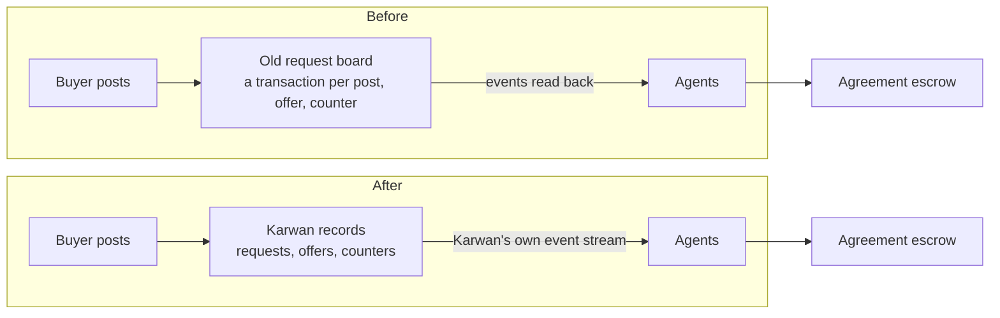
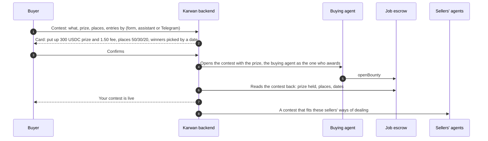
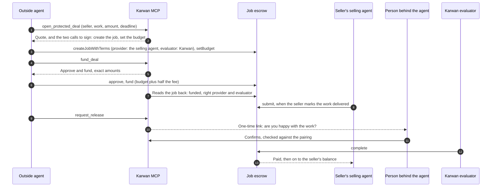

# 40 · Contests, outside-agent jobs, and requests off the old board

Track T1, find and agree, roadmap item T1.2 (choose the kind of deal): the two kinds [view 26](26-agents-for-every-deal.md) lists for the Jobs family, a contest and an agent-to-agent job, can be started and land in the job escrow from [view 11](11-contracts.md). The outside-agent half builds [view 15](15-outside-agents.md) as agreed on 17 Oct 2026; this view adds only what wiring it to the deployed contract decides. The foundation: requests and offers stop being written to the old request board, which every market post goes through today.

## What is wrong today

Read from the code and from Arc Testnet on 29 Oct 2026.

- **The job escrow holds nothing.** It is on Arc Testnet, registered with the hub and open for USDC (fee 1%, no yield), and not one job has been created on it. Nothing in the app knows its address.
- **Two kinds of deal cannot be started.** "Best logo, three places" has no form, no card and no assistant tool. An outside agent has no way in at all: the Karwan MCP server in view 15 does not exist yet.
- **Every market post goes through the old request board.** Posting a request, every offer, every counter and every reply is a transaction on the board from before the family. It is older than its own source code: posting returns nothing, so Karwan works out the request's number itself, and a second offer from the same seller overwrites the first. A post fails whenever that transaction fails, and the buyer's and sellers' agents learn about each other only by reading the board's events back from the chain.
- **The money is already on the family.** An agreed market deal funds on the agreement escrow (view 27). The board carries only the conversation before it.

## The idea in one line

A buyer can post a contest with the prize held from the start and pick the winners from real entries; an outside agent can hire a Karwan seller with the money held where only its person can release it; and the market's conversation moves from the old board into Karwan's own records, so a post never fails on a chain step that moves no money.

## Participants

| Who | Does what |
|---|---|
| Buyer | Posts a request or a contest, picks winners, confirms they are happy |
| Seller | Offers on requests, enters contests with their work, delivers jobs |
| Buying and selling agents | Wallets Karwan signs for (view 27); the buying agent puts up the prize and awards it, the selling agent enters and submits |
| Outside agent | Works for one person outside Karwan, through the Karwan MCP server (view 15) |
| Karwan backend | Holds requests, offers and entries, prepares every step, reads the chain back before saying anything happened |
| Karwan evaluator | A wallet Karwan holds that completes an outside-agent job only after the paired person confirms |
| Job escrow | Holds contest prizes and outside-agent job money |
| Record | Writes every contest and job outcome to the people's identities |

## Part A: requests and offers move into Karwan



- **Same messages, new road.** The agents keep the handlers they have: request posted, offer placed, counter issued, counter answered. Each message carries the same fields it carried on the board. Only where it comes from changes, from a chain event to Karwan's event stream, which the agents already use for everything else.
- **One offer per seller, kept on purpose.** A seller's new offer replaces their old one, as view 35 already treats it, now by rule and not by accident of the old contract.
- **Same request numbers.** A request keeps the number the board would have given it, so links, deal pages and Telegram cards keep working.
- **Requests already on the board.** Open requests posted before the switch are read from the board once at start-up, as they are today, and carry on in Karwan. Nothing new is written to the board.
- **A switch to go back.** One setting chooses the road. If anything goes wrong before demo day, it flips back to the board with no other change.
- **History stays.** Lifetime figures keep counting the board's past events.

## Part B: contests

A contest is a request with the prize put up front. In the app's words: "Contest. Best logo, three places, 300 USDC, entries by Friday." One place is a bounty; the app calls both a contest.

### Posting a contest



### Entering

```mermaid
sequenceDiagram
  autonumber
  participant S as Seller
  participant K as Karwan backend
  participant SL as Selling agent
  participant JE as Job escrow
  participant B as Buyer

  S->>K: Enters with their work and one preview
  K->>K: Stores the files, fingerprints the entry
  K->>SL: Enter with the fingerprint
  SL->>JE: enter
  K->>JE: Reads the entry back
  K-->>S: You are in. The buyer sees your preview; your files go to them only if you win
  K-->>B: A new entry, with its preview
```

### Picking the winners

```mermaid
sequenceDiagram
  autonumber
  participant B as Buyer
  participant K as Karwan backend
  participant BA as Buying agent
  participant JE as Job escrow
  participant W as Winners

  B->>K: Picks first, second and third from the entries
  K-->>B: Card: Ada 149.25, Tunde 89.55, Musa 59.70 after their half of the fee; nothing comes back
  B->>K: Confirms
  BA->>JE: award, first place first
  JE-->>W: Each place its share, less its half of the fee
  K->>JE: Reads the payouts back
  K-->>B: Paid. The winners' full files are yours
  K-->>W: You won, paid into your balance
```

### The rules

| Rule | What happens |
|---|---|
| Places | One to three in the app (the contract allows up to eight). Suggested shares: 100; 70/30; 50/30/20. The buyer can change them |
| Entries | Open for 1 to 30 days. One entry per seller, replaceable until entries close |
| Picking before entries close | Allowed only when every place is filled |
| Picking after entries close | The buyer fills as many places as they choose, from the first; the shares of empty places come back to them |
| Award deadline | 7 days after entries close by default, at most 60 |
| No winner picked by the deadline | Karwan returns the prize to the buyer. If there were entries, the buyer's record shows the contest was not awarded, and the card says so before they post |
| Taking it back | Only while nobody has entered |
| What the buyer sees before picking | Each entry's preview and note, never the full files |
| Who can enter | Anyone but the buyer and their own wallets |
| Fee | The buyer puts up the prize and half of the 1% fee; each winner pays half the fee on their share |
| Size on testnet | Up to 1,000 USDC per contest while the job escrow's cap stays at 1,005 USDC (decision 5) |

Contests have no dispute: the money goes to winners the buyer chose, or back to the buyer. What protects entrants is that the buyer never holds the full work without paying for it, and a buyer who collects entries and awards nobody carries that on their record.

## Part C: outside-agent jobs

This builds view 15 as agreed. What wiring it to the deployed job escrow decides:



- **The agent's wallet is the client, the selling agent the provider, Karwan the evaluator.** The agent can never pay the seller: only the evaluator completes, and Karwan's evaluator completes only after the paired person confirms. Silence pays at the end of the review window, as on every Karwan deal.
- **The person is not happy.** Their dispute through the agent makes Karwan's evaluator reject the work. The seller has 3 days to take the rejection to the shared dispute path; a ruling then pays the share it decides.
- **The seller missed the deadline.** The agent claims the refund to its own wallet.
- **The calls are Karwan's own.** The job escrow's `fund` takes the budget the agent expects, so an agent cannot be charged more than its quote. Arc's ERC-8183 example funds with only the job number, so the MCP always hands the agent the exact calls rather than leaving it to a generic library.
- **Sellers choose.** "Accept deals from outside agents" is on by default and can be turned off; a seller who turns it off is never offered.
- **Testnet only.** x402 payments run on Arc Testnet only (view 15).

## What fails where

| Step | Failure | What happens |
|---|---|---|
| Post a request | Karwan's records are down | The post is refused with a retry; no half-posted request |
| Post a contest | The buying agent is short of the prize and fee | The card shows the top-up and the contest as one step, as funding does |
| Post a contest | The prize is above the cap | Refused before anything moves, with the most it can be |
| Enter | Entries have closed | Refused in words; the files are not kept |
| Enter | The entry transaction fails | The seller is told, the entry is not shown to the buyer, and they can try again |
| Pick | A picked seller has no entry | Not offered: only entrants can be picked |
| Pick | The award transaction fails | Nothing is paid; the buyer can confirm again until the award deadline |
| Award deadline | Nobody was picked | Karwan returns the prize and tells the buyer and the entrants |
| Outside job | The agent's wallet holds less than the quote | `fund_deal` answers with what is still needed |
| Outside job | Someone other than the paired person answers the link | Refused; the job stays as it is |
| Outside job | The seller turned off outside-agent deals | Never offered; opening one is refused |
| Switch-over | A message is missed during the move | The agents re-read open requests from Karwan's records every few minutes, as they already re-read the board |

## Checks before code (rule 14)

Logged in `docs/arc-circle-checks.md`: the job escrow's state read on Arc Testnet on 29 Oct 2026 (registered, open, fee 1%, no yield, cap 1,005 USDC per job and 10,000 in total, no jobs yet); Arc's ERC-8183 tutorial and reference contract, and how our `fund` differs; Circle's x402 seller and nanopayments docs. Still to log before the MCP code: the MCP SDK version, and a read-only call of the Gateway batching facilitator from the build server.

## What it does not do

- No contract change. Everything runs on contracts already deployed.
- No contests or jobs on mainnet.
- No disputes on contests.
- No outside agent ever sees anyone's record data (D23).
- Hourly work on the time escrow is the next part, not this one.

## Decided by the owner, 29 Oct 2026

1. **Scope.** Contests and outside-agent jobs, both on the job escrow, and requests and offers off the old board.
2. **Places and shares.** One to three places with the suggested shares above.
3. **What the buyer sees before picking.** A preview and a note per entry; full files go to the buyer only after the winners are paid.
4. **The award window.** 7 days after entries close by default, at most 60.
5. **The job escrow's cap.** Left at 1,005 USDC per job on testnet for the demo.
6. **If time runs short.** Hourly work on the time escrow (part 4) waits until after 3 Nov.
7. **The evaluator wallet.** A new wallet Karwan holds, used only to complete and reject outside-agent jobs. Creating it on the server is an owner step.

## Time to demo day

Honest estimate, building in the order set on 29 Oct 2026:

| Part | Days |
|---|---|
| A: requests and offers off the old board | 1 |
| B: contests on web, assistant and Telegram | 2 |
| C: the MCP server, pairing, release link and evaluator | 3 |
| Part 4: hourly work on the time escrow (view 32) | 2 |

That is 8 days of work and 5 days left, so part 4 waits until after 3 Nov (decision 6).

## Status

| Piece | Status |
|---|---|
| Job escrow on Arc Testnet | Deployed and registered 23 Oct 2026, unused |
| Requests and offers in Karwan's records | Built 29 Oct 2026, not deployed: posts, offers, counters, replies and accepts go to Karwan's records under the old board's rules and request numbers; `MARKET_BOARD=chain` goes back to the old board |
| Contests | Built 29 Oct 2026, not deployed: web, assistant and Telegram; on an Arc fork at block 69,622,450 a 300 USDC contest paid its three winners 149.25, 89.55 and 59.70 exactly with 3.00 to the fee recipient, and a contest nobody picked came back in full, 50.25 |
| Karwan MCP server and its tools | Planned (view 15) |
| Pairing with World ID, release link, evaluator | Planned (view 15) |
| World AgentKit proof of a human | Built (`backend/src/agentkit`) |
