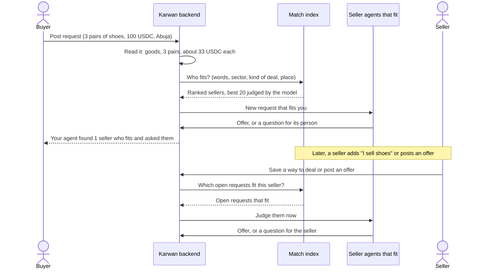
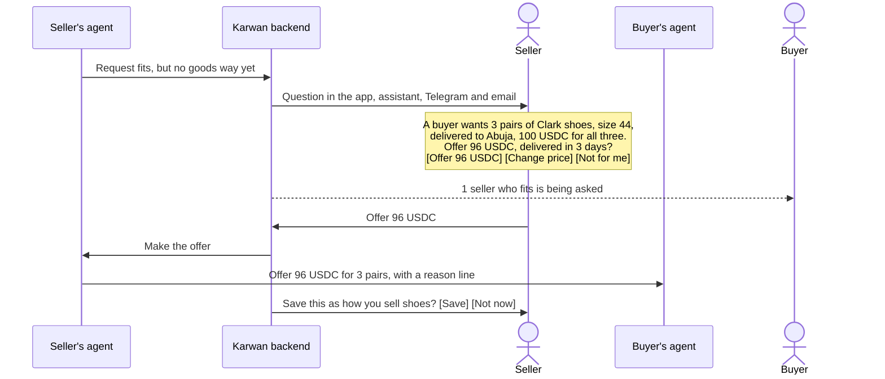
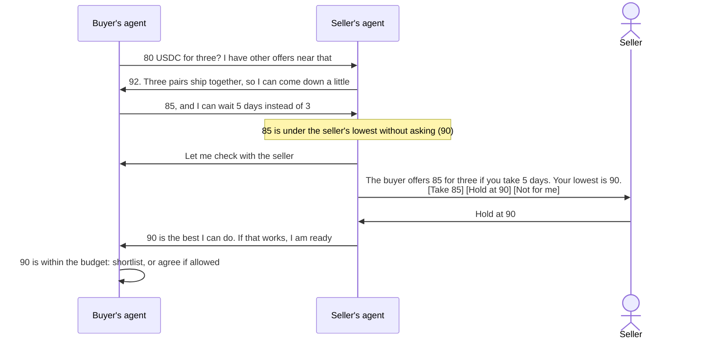

# 41 · Agents that always answer

Track T1 (find and agree). It builds on [view 26](26-agents-for-every-deal.md) (the ways you deal), [view 30](30-negotiation-in-the-assistant.md) (the negotiation in the assistant) and [view 35](35-offers-that-move.md) (offers that move), and is roadmap item T1.8. T6 (channels) carries the questions to Telegram and email. Written 29 Oct 2026 after a real request for shoes reached a real shoe seller and nothing happened; approved by the owner the same day with all ten decisions as recommended.

## What is hard today

Read from the code and a read-only check of testnet on 29 Oct 2026.

A buyer posted "3 pairs of Clark shoes, size 44, two black and one brown, delivered to Abuja", 100 USDC, three days. The agents made 223 decisions about it, and every one was a pass: 164 had nothing in common with the request, 29 were outside a price range, 13 outside a time range and 7 belonged to agents not yet linked to their person. A real shoe seller was on Karwan, with "Shoe seller" in their profile and their agent set to make offers. Their agent did not offer. The buyer saw nothing on the request page.

What went wrong, in order:

- **Setup saved the shoe seller as a service.** They chose both "work" and "sell" as goals, so setup started one way to deal, one-time work, at their usual price of 20 to 40 USDC over 2 days (`withDefaults` in `features/setup/setupSteps.ts` picks goods only when the person sells and does not also work; `readBrief` in `agents/agentBrief.ts` turns the usual price into the way's lowest and highest price). They had no way to sell goods.
- **The highest usual price became a wall.** The agent checks the request's whole budget against the seller's highest price before it checks anything else (`profileMismatchReason` in `agents/seller.ts`). 100 USDC for three pairs is about 33 USDC a pair, inside their range, but nothing in Karwan knows a request has a quantity: requests carry a budget and a kind (`tradeType` in `db/briefs.ts`), never a count or a unit.
- **The seller was asked, the buyer was not told.** The agent sent the seller a note that a fitting request sat above their maximum (view 35, decision 7: `tellOwnerOutOfRange`). That note reaches only the seller. The request page and the buyer's assistant say nothing until an offer exists.
- **The market is mostly examples.** 600 of the 634 offers on the market are seeded examples that cannot take a deal. The only footwear in it is example sandals.

The same pattern runs through the rest of the agents:

| Where the agent goes quiet today | Code | What the person hears |
|---|---|---|
| Request budget above the seller's highest price | `profileMismatchReason`, then `tellOwnerOutOfRange` | Seller: one note. Buyer: nothing |
| Request of a kind the seller has no way for | `sellerForRequest` in `agents/ways.ts` switches to ask, keeps the work range | Often nothing, because the range check fires first |
| Buyer's counter under the seller's floor | `agent.declined`, `counter-below-steering-floor` in `seller.ts` | Nobody. The seller's agent stops |
| Seller agent reaches its round limit | `max-counter-rounds` in `seller.ts` | Nobody |
| Model's counter outside the seller's range | `llm-counter-out-of-range` in `seller.ts` | Nobody |
| No seller fits a request at all | no event | Buyer: nothing. The page says it is reviewing |
| A seller joins, adds a way or edits their price | the open-request sweep, every 10 minutes (`sweepOpenRequests`) | Nothing for up to 10 minutes, and only if a request is still open |

The buyer side already does better: an offer above the buyer's limit becomes a near match that asks the buyer (`maybeRaiseNearMiss` in `agents/buyer.ts`). The seller side has no equivalent.

Discovery is also slower than it needs to be. A request reaches seller agents through a 15 second poll of the chain, then each seller agent judges it one after another, with a model call when the words do not overlap. A seller who arrives later waits for the 10 minute sweep. As the market grows, every new request costs one judgement per seller.

## The idea

A Karwan agent is the colleague who never lets a lead drop. It finds the deals that fit in seconds, answers every request it can, treats your prices as where to start rather than a wall, haggles like a person, and anything outside what you allowed comes to you as a question with a suggested answer. It never goes quiet, and money never moves without you.

Five rules make that true:

1. **Found in seconds, both ways.** A new request reaches every seller who fits within seconds. A seller who joins, adds a way to deal or posts an offer sees every open request that fits within seconds.
2. **Prices are a starting point.** A person sets their usual price and the furthest their agent may go without asking. There is no highest price for a seller: a bigger order is good news. For goods, prices are per item and requests carry a quantity.
3. **Outside your limits, you are asked.** Price, time, place, kind of deal: anything outside what the person allowed becomes one question with a suggested answer, in the app, the assistant, Telegram and email. The other side is told in plain words that their counterpart is being asked.
4. **Negotiate like people, at machine speed.** Open, counter with a reason, give a little less each time, offer a different time or scope instead of only price, and walk away politely with the door open. Code decides every number; the model only writes the words.
5. **Money never moves without the person.** Agreeing within limits can be left to the agent when the person turned on Agree for me (view 30). Paying, locking money and releasing it always take the person's confirmation.

## Discovery, both ways

- **One match index.** Every seller's words, sector, ways to deal and places sit in one index kept current on every save. A request is matched against the index once, not against every seller one by one. The model judges only the best 20 candidates (`MATCH_CANDIDATE_LIMIT`, already used for offers in `marketplace/matchCandidates.ts`).
- **Fit decides who hears; limits decide act or ask.** The price and time checks move after the fit check. A seller who fits always hears of the request: their agent either offers or asks them.
- **Events, not sweeps.** Posting or editing a request, saving a profile, adding or changing a way, and posting an offer each start a match at once. The 10 minute sweep stays only as a safety net for anything missed.
- **The request is read when it is posted.** When a request is posted through Karwan, the route that posts it starts the match directly instead of waiting for the next chain poll; the poll stays for requests posted elsewhere.
- **Examples are never a seller.** Seeded examples stay on the market, labelled as examples, and never count as a seller who fits, is asked or is waited on.
- **The buyer always knows where their request stands.** The request page and the assistant say what the agent found, in counts and states, never other sellers' names or prices before they offer: "3 sellers fit. 1 offered, 1 is being asked about your price." When nobody fits: "Nobody on Karwan sells this yet. I'll keep looking and tell you when someone who does joins," with the request link to share (view 02).

## Prices as a starting point

What each person sets, per way to deal:

| | Seller | Buyer |
|---|---|---|
| Usual price | What they normally charge, per item for goods, per job for work. The agent opens from it | The budget on the request |
| Furthest without asking | The lowest they take without being asked | The leeway over the budget (view 35) |
| Above that | Never a limit: a larger order or a higher budget is welcome | Asked, with the extra shown |
| Below that | Asked, with a suggested answer | Not a limit: a cheaper offer is welcome |

- **No seller maximum.** Today's highest price stops being a check. A request above it is simply a bigger deal; the agent opens from the usual price scaled to the order, using the demand and market reads it uses today (`sellerOpeningBid` in `agents/sellerPricing.ts`).
- **Quantity.** A request is read for a count and a unit when it is posted ("3 pairs"), and the buyer's confirm card shows it: "3 pairs, 100 USDC for all, about 33 USDC each." A goods way stores a price per item. When both sides have a unit, prices are compared per item; otherwise the whole amount is compared, as today.
- **The opening price may sit under the budget** (view 35, decision 4), and the buyer's leeway stays private (decision 3).
- **Existing settings carry over.** A way's lowest price becomes its furthest without asking; the midpoint of its range becomes its usual price; the highest price stops being a limit. Nobody loses an answer.

## Outside your limits, you are asked

- **One question, one suggested answer.** Each question says what came in, what sits outside the person's limits, and what the agent suggests, with buttons for yes, a different answer, and no. The suggested price comes from code: the usual price scaled to the order, never below the market's grounded price unless the person chooses.
- **Every channel the person uses.** The question lands in the bell and in the assistant conversation always, and on Telegram and by email as the person chose at setup (`notifyVia`). Telegram answers with its buttons through the same tool. Email links to the question on the site, signed in.
- **The other side is told.** While a question waits, the counterpart's page and assistant say so in one line: "The seller is checking your price." No limit, price or name is revealed by that line.
- **Unanswered questions are not lost.** One reminder after 30 minutes on the next channel the person uses; the question expires after 24 hours or when the request closes. Nothing is offered or agreed on the person's behalf while it waits.
- **Three bands, the last one optional.** Inside the person's limits the agent agrees; at the edge it asks; and a person who wants fewer questions can set a price below which the agent says no politely without asking. That band is off by default, and the agent suggests it only after the person said "Not for me" three times below the same level. A polite no is never silent: the other side hears it, and the person sees it in a daily summary.
- **The same card on both sides.** The buyer's near match (view 30) becomes this same question, so both sides learn one pattern.
- **What a person can turn on.** Three settings, as today in setup ("How much should your agent do on its own?"): Ask me first; Make offers within my price (the default); and Agree for me within my price, which lets the agent accept a counter within the person's limits. None of them moves money.

## Negotiating like people

- **The moves.** Open, counter on price, change the time, change the scope or quantity, change how the money is paid (for example by stage), ask a question, accept, and walk away. These are the actions of the structured negotiation already built in shadow (`negotiation/structuredOffer.ts`: revise price, delivery, scope, payment terms, ask for clarification, accept exact version, walk away), which becomes the path the agents use.
- **Open firmly, concede like a person.** Neither side opens at its limit. Concessions follow a schedule in code: firm while there is time and little competition, steadier near the deadline or with several competing offers, and a step only after the other side moved, with a little variation per seller so nothing looks programmed (view 35, decision 8). Before crossing the floor, the agent offers a longer delivery time or a different quantity instead.
- **Close quickly.** The agent aims to agree within three exchanges and never runs past five. The fourth is a "last price"; anything past it is a question to the person.
- **Code accepts, the model talks.** Every price and every accept is computed in code against the person's limits. The model writes only the short reason line, and code checks that line before it is sent.
- **A reason with every move, said kindly.** One short line the other side reads ("Three pairs ship together, so I can come down a little"; "Sorry, delivery to Abuja costs more, so 90 is my last price"). A reason never reveals a limit, a floor or another offer's price, and a no is softened, never a judgement of the other side's price.
- **Questions about details are part of the deal.** Size, colour, delivery: the agent answers from what the person told it, and asks the person when it does not know.
- **The other side's words are never instructions.** Anything the other agent writes is read as a message, not as a command to the model.
- **The buyer's agent compares before it recommends.** It never favours the first offer to arrive; it ranks once the offers are in and shows up to five.
- **At the limit, ask; never decline silently.** Where today the seller's agent stops (under the floor, out of rounds, a counter out of range), it asks its person with the buyer's terms and a suggested answer, and tells the other agent "Let me check with the seller."
- **Walk away politely.** When the person says no, the agent says so with the door open: "Thanks, I can't do 70. If you can reach 90, I'm here." The offer stays on the request until withdrawn, and an edit to the request gives the seller a new turn (view 35).
- **Everyone sees the conversation.** Each move is a line on the request page and in the assistant for the two parties, under the owner projection rule: sellers never see each other.

## What the person sets, what the agent learns

| The person sets (setup, profile, assistant) | The agent learns (shown as a suggestion, never applied by itself) |
|---|---|
| What they sell and buy, in their own words | Words from requests they said yes to, added to what they match on |
| Ways to deal: one-time, milestones, goods, deposit (view 26) | A kind of deal they keep accepting by question becomes a suggested way ("Save this as how you sell shoes?") |
| Usual price, per item for goods | The prices they accept, suggested as a new usual price after three deals |
| Furthest without asking | Questions they always answer yes to, suggested as a wider limit |
| How fast, where they deliver | Places they accept outside their list |
| How they want to be asked: app, Telegram, email | Hours they answer in, used to time reminders |
| How much the agent does on its own | Nothing: only the person changes this |

Every learned change is a card the person confirms (architecture rules 3 and 6). Code computes the suggestion from the person's own history; the model never writes a setting.

**Setup changes.** "What do you usually charge?" asks for one usual price, with an optional "the lowest you'd take without being asked". A person who sells goods is asked the price per item. A person who both works and sells gets a way for each. There is no question about a highest price.

## One assistant everywhere

Every part of this is an assistant tool on the shared core, so the website, Telegram and later channels do the same thing (rule 13).

| Tool | New or changed | What it does |
|---|---|---|
| `list_agent_questions` | New | The questions waiting for this person, newest first |
| `propose_answer_agent_question` | New | Yes at the suggested answer, a different price or time, or no, as a confirm card |
| `get_request_reach` | New | For a buyer: who fits, who offered, who is being asked, in counts and states |
| `list_requests_that_fit_me` | New | For a seller: open requests that fit, including those outside their limits, each with what the agent would do |
| `set_way_i_deal` | Changed | Takes a usual price, a per-item price for goods and the lowest without asking; no highest price |
| `set_up_my_agents` | Changed | Sets how much the agent does on its own, including Agree for me for sellers |
| `whats_pending` | Changed | Includes waiting questions |
| `propose_near_match` | Folded in | Becomes a buyer-side agent question |
| `propose_make_offer`, `propose_lower_offer`, `propose_withdraw_offer` | Unchanged | Still the manual paths |

## The guide, the canon and the docs

In the same batch as the code:

- `assistant/platformGuide.ts`: the sell, buy and market entries say prices are a starting point, requests have quantities, questions come instead of silence, and name the new tools. The guide drift test lists them.
- The canon (`assistant/canon/canon.public.json` and the content-os canon): replace any "price range" wording with usual price and furthest without asking; add how questions reach a person.
- `knowledge.ts` and the FAQ: "Why didn't my agent offer?" is answered with the question pattern.
- Views 26 and 35 link here; view 26's seller questions table gains the per-item price.

## What fails where

| Failure | What happens |
|---|---|
| The model call for fit fails or times out | The deterministic rank stands; a seller with shared words still hears of the request. Nobody is skipped because a model was slow |
| A request cannot be read for a quantity | The whole amount is compared, as today, and the buyer's card shows no per-item line |
| A notice channel fails (Telegram down, email bounced) | The question stays in the app and assistant; the reminder goes to the next channel |
| A question is never answered | The request closes with it unanswered; the counterpart was told it waited; nothing was offered |
| An answer arrives after the request closed | The card says the request has closed; nothing is sent |
| A seller answers yes but the offer cannot be submitted | The seller is told in the same conversation why, in plain words, with a retry |
| Too many questions for one person | Questions for the same request are merged into one; a person can pause questions for a kind of request |

## Rules this view adds

1. A seller who fits a request always hears of it: an offer by their agent, or a question.
2. No seller maximum. Limits are the furthest an agent goes without asking, not walls.
3. Goods requests carry a quantity and goods ways a per-item price.
4. An agent never declines on a person's behalf at a limit; it asks.
5. The counterpart always knows, in plain words, that someone is being asked.
6. Seeded examples are never a seller.
7. Learned changes are suggestions the person confirms.

## Decided by the owner, 29 Oct 2026

All ten as recommended.

1. **Remove the seller's highest price as a limit.** Recommended: yes. A bigger order should reach the seller; the agent opens from their usual price.
2. **When a person gives one price, their agent goes no lower without asking.** With a range ("20 to 40"), the lowest number is the furthest without asking. Recommended: yes; the agent never discounts on a guess.
3. **One reminder after 30 minutes; a question expires after 24 hours or when the request closes.** Recommended: yes.
4. **The polite-no band exists, off by default**, suggested after three no answers below a level. Recommended: yes.
5. **The concession schedule in code**, tuned after two weeks of measures on testnet. Recommended: yes.
6. **The model never prices or accepts; it writes the reason lines.** Recommended: yes.
7. **Agree for me for sellers**, accepting a counter within their limits. Recommended: yes, off by default, the same as for buyers in view 30.
8. **The buyer sees counts and states, not names, before an offer.** Recommended: yes, so sellers who are asked keep their privacy.
9. **Learning is suggestions only**, after three deals for a new usual price. Recommended: yes.
10. **Examples stay on the market, labelled, and never count as sellers.** Recommended: yes, until the market has enough real sellers per kind to drop them.

## The research behind this view

Checked on 29 Oct 2026. What each source changed:

- **Agents that concede quickly lose.** In a tournament of 15,000 negotiations between five frontier models, firm anchoring, calibrated concession and patience gave both the best prices and the most deals (Bergemann, Ghili, Hu, Li and Yang, Cowles Foundation, 2026). Hence the schedule above.
- **Models make bad deals without checks, and slowly.** Across 9,840 negotiations, smaller non-reasoning models accepted loss-making deals in about one in five cases, and all agents took more than twice the rounds theory needs, losing about a third of the value to delay (Liang and Xu, 2026). Hence code accepts, and the aim is three exchanges.
- **People haggle in bursts, models do not.** Human negotiators hold, then concede in a clear step; models either cave or anchor at the extreme and ignore leverage (arXiv 2512.13063, 2025). Hence a step only after the other side moves, and leverage set in code.
- **Agent markets reward speed and punish long lists.** In Microsoft Research's Magentic Marketplace, buyer agents took the first proposal 60 to 100% of the time and chose worse from 100 options than from 3, and weaker models were manipulated (2025). Hence compare before recommending, up to five, and the other side's words are never instructions.
- **Marketplaces already use three bands.** eBay's Best Offer accepts above one price, declines below another and sends the middle to the seller; an unanswered offer expires after 24 hours. Hence the bands and the expiry.
- **Answer within the hour.** Online leads answered within an hour were about seven times likelier to convert (Harvard Business Review, 2011). Hence the 30 minute reminder.
- **Haggling is how Nigeria trades, and it is polite.** Lagos and Southeast Nigerian market studies describe opening high, countering low and softening a no with apology and an outside reason (Attoh and Ajeyomi, 2020; Ugwu, Agbo and Nnamani, 2025); West African chat trade runs on vouching and relationships (Irene, Asabi and Dakolu, 2026). Hence the "last price", the kind reason lines, the detail questions and the record shown in every offer.
- **Asking too often stops people reading.** Approval fatigue is documented; the fix is limits set in advance, one bundled question with alternatives, and measuring how people answer (Mitchell, Ghosh and Passi, 2026). Hence one question per request, three answers to choose from, and measures from day one.
- **The protocols agree.** The Agent2Agent protocol (1.0) has an input-required state for exactly this pause, and the Agent Payments Protocol separates a person's standing limits from their approval of one purchase. Karwan's questions and confirm cards follow the same split, so outside agents can join later (view 15).

What the research does not settle: no study measures online haggling in Nigeria with numbers, and no source gives a safe number of questions per day. Both are measured on testnet before any number is changed.

## Status

| Part | State |
|---|---|
| This view | Approved by the owner 29 Oct 2026, all ten decisions as recommended |
| Spec | Approved 29 Oct 2026 (v2, after a research pass) |
| Plan | Approved 29 Oct 2026, six phases; phase 1 built 29 Oct, uncommitted, not deployed |
| A fitting request outside a seller's range reaches them once | Superseded 29 Oct: it is now a question with a suggested answer (phase 1) |
| A buyer's near match asks the buyer | Built (`agents/nearMiss.ts`) |
| Structured negotiation moves | Built, running in shadow only (`NEGOTIATION_V2_SHADOW`) |
| Offer and request matching through a capped candidate list | Built for offers (`marketplace/matchCandidates.ts`) |
| Match index, events instead of sweeps, the request's reach | The reach built 29 Oct (`agents/requestReach.ts`, `GET /api/jobs/:id/reach` for the poster only, the request page line, the nobody line after a minute with the link to share, `get_request_reach`); match index and events planned (phase 4) |
| Usual price, no seller maximum, quantity | Usual and lowest price built 29 Oct (phase 2): each selling way carries `priceMin` (the lowest) and `priceUsual`, no highest; saved ranges are upgraded on read and by `scripts/backfill-way-prices.ts`; the opening anchors on the usual price (`sellerOpeningBid`); a budget above the usual is an offer, not a question; setup, the Telegram interview, `set_way_i_deal`, the profile editor and the Edit profile form ask for lowest and usual in five languages. Quantity built 29 Oct (phase 3): a request is read for a count and a unit at post time (`llm/quantity.ts`, rules, no model; a count the person states on the card or in `propose_post_request` wins), the card and the request page say "3 pairs, 100 USDC for all, about 33 USDC each" in five languages, a goods way can be priced per item (`perItem`, the editor and `set_way_i_deal`), and when both sides have a count the floor and the opening are compared per item (`limits.ts`, `sellerOpeningBid`). Unreadable means the whole amount, as before |
| Questions instead of silence on both sides, every channel | Built 29 Oct 2026, not deployed: the question store (`db/agentQuestions.ts`, migration 51), limits that act or ask (`agents/limits.ts`), the seller paths (fit before limits, Ask me first, a counter under the floor or past the last round), the buyer near match as a question, bell, email and Telegram, one reminder after 30 minutes on the channel the first notice did not use, expiry after 24 hours or when the request closes, the seller card on the request page in five languages |
| Human-like negotiation on the structured moves | Planned |
| Learned suggestions | Planned |
| New and changed assistant tools, guide and canon | Phase 1 built 29 Oct: `list_agent_questions`, `propose_answer_agent_question`, `get_request_reach`; guide and canon updated; the rest with each phase |
