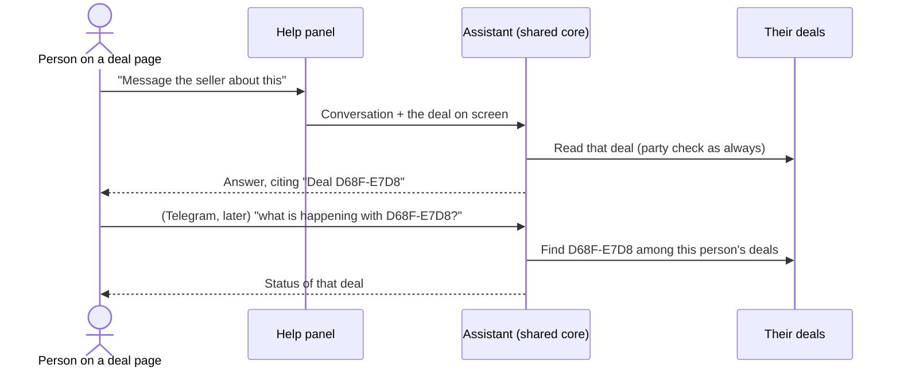

# 42 · A deal reference people can read out

Track T2 (protected deals). It serves the paused-payment path of [view 21](21-flagged-delivery-review.md) and the "ask a person" handoff, and leans on [view 31](31-assistant-does-everything.md) (the assistant does everything a person can). No roadmap row of its own: it is the support aid every open deal needs. Written and approved by the owner on 30 Oct 2026, after the Help panel asked a buyer for "the deal ID, a long string starting with 0x" while that buyer was looking at the deal.

## What is hard today

- A deal's only id is its 66-character `0x` job id. It shows in the address bar and nowhere on the page, and nobody can read it to a person.
- The Help panel sends the conversation and nothing else, so the assistant does not know which deal is on screen and asks for it.
- Every deal tool takes the full id. A shortened id (`0xd68fe7d8`, which the confirm cards already print) finds nothing.
- Payment references (`KRW-XXXX-XXXX-XXXX`) exist, but one per money movement, not one per deal.

## The idea

Every deal has a short reference, for example `D68F-E7D8`: the first eight characters of its id, in capitals, in two groups. It is shown on the deal page with a copy button. The assistant, on the website and in Telegram, accepts it anywhere a deal id is asked for, and the Help panel tells the assistant which deal is open, so "this deal" just works.

## Decisions

1. **Made from the id, not stored.** Nothing to migrate, and every old deal has one already. The reference is `D68F-E7D8` for job id `0xd68fe7d8…`.
2. **Found only among the person's own deals.** A reference is resolved against the deals the signed-in person is a party to, so it reveals nothing about anyone else's deal. Two of their deals sharing a reference (about one chance in four billion per pair) gets a question naming both, never a guess.
3. **Every way of writing it works.** `D68F-E7D8`, `d68fe7d8`, `#D68F-E7D8`, `0xd68fe7d8` and the full id all find the same deal.
4. **The page on screen is context, not authority.** The Help panel sends the id of the deal page it is on. The assistant treats it as "the deal the person is looking at"; every tool still checks the person is a party.
5. **Support gets the deal without asking.** "Ask a person" from a deal page passes that deal to the support conversation.
6. **Distinct from payment references.** Deal references are two groups of four letters and numbers with no prefix; payment references start with `KRW-`. Neither is ever shown as the other.

## Where it lives

| Piece | Code |
|---|---|
| Make and read a reference | `backend/src/deals/reference.ts`, `frontend/features/deals/dealReference.ts` |
| Tools accept it | `withDealReferences` in `backend/src/assistant/dealReferences.ts`, applied once to every assistant tool |
| The deal on screen | `viewingDeal` on `POST /api/assistant/chat` (`assistant/chatBody.ts`), from `AssistantWidget` |
| Shown and copied | `DealHero` on the deal page |

## Not yet

The team's support screen shows the deal attached to a conversation, but has no search by reference. A reference written into a support chat that started elsewhere is looked up by hand until that search exists.
