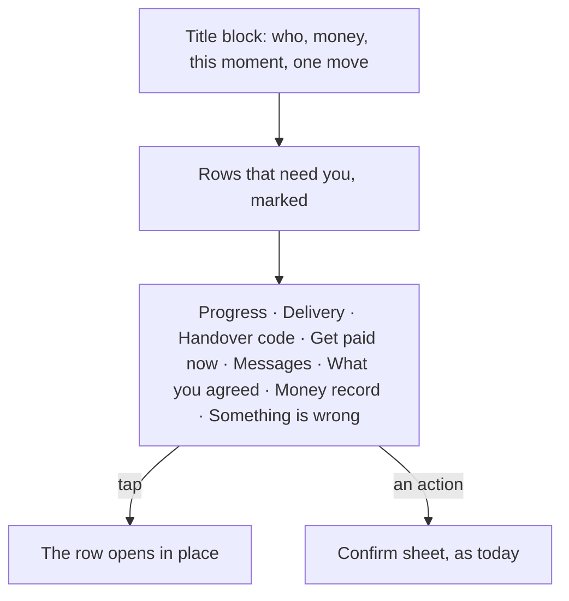

# 43 · A calm deal page

Track T2 (protected deals), with two fixes for T4 (trade finance). It reworks the deal page from [view 38](38-one-clear-path.md) and uses the deal reference from [view 42](42-deal-reference.md). Approved by the owner on 30 Oct 2026 from a mockup, after comparing the deal page with the financier position page: "deal page should be calm like this and anything is clicked and looked in instead of having cards around".

## What is hard today

- The deal page has two columns of cards on desktop: the title card with the money on the left; progress, delivery, a handover code, the latest activity and a menu card on the right. A newcomer reads six boxes to learn one thing.
- Cards with their own borders and padding leave white space around every fact.
- A paused payment, a dispute and a waiting handover code sit wherever their card sits, not where the eye starts.

## The idea

One column. The title block comes first and sits flat on the page: who the deal is with, the deal reference, where the money is, the amount as the largest line, one sentence for this moment, and the one move (or a quiet line when the move is the other side's). Everything else is a hairline row with a one-line summary that opens in place.

## Decisions

1. **A row shows only once it means something.** No delivery row before a delivery, no money record before money moves, Get paid now only for the seller of a business order on the escrow family, Something is wrong only when a step is possible.
2. **One order for everyone**, so a person learns the page once: progress, delivery, handover code, get paid now, messages, what you agreed, money record, something is wrong.
3. **What needs the person rises to the top, marked**: a delivery the check paused, a handover code the buyer must give, unread messages. A dispute stays open under the title block until it ends.
4. **Rows open in place, actions open the confirm sheet.** Reading never stacks one sheet on another.
5. **Same words as the assistant.** Each row is a subject the assistant already answers on the website and in Telegram (get_deal_status, the deal chat, the problem steps).

## Finance fixes in the same batch

- **The financier hears when a seller takes their offer.** A financier who pays from their own wallet now gets an alert (bell, email, Telegram) with the amount and the 24-hour deadline, as `factoring.awaiting_financier`. Before, nothing fired until money moved.
- **The position page knows every state.** Pay the seller, Repaid and Closed read as they are instead of Pending, and the seller and financier show by name, not address.

## Where it lives

| Piece | Code |
|---|---|
| Which rows, in what order | `dealLayers` in `frontend/features/deals/workspace/dealLayers.ts` |
| Title block and rows | `DealHero` in `frontend/features/deals/workspace/DealHero.tsx` |
| Financier alert | `factoring.awaiting_financier` in `backend/src/routes/factoring.ts` and `emails/dealNotifier.ts` |
| Position page states | `frontend/app/financier/factoring/[offerId]/page.tsx`, `FinancingPositionWorkspace` |
