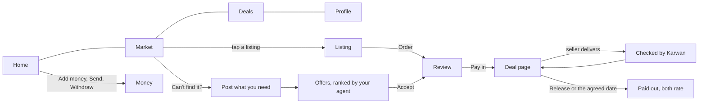

# 44 · One product flow

Foundation, serving T1.2 (choose the kind of deal) and T2 (protected deals). It applies the calm deal page from [view 43](43-calm-deal-page.md) to every screen and every kind of deal in the escrow family from [view 27](27-deals-on-the-escrow-family.md). Approved by the owner on 31 Oct 2026 after playing a clickable prototype of a full deal: "Simple enough", "this resonates so well", "this is beautiful and more simplified".

## What is hard today

- The same deal shows in six places, each in its own order: Home, Market, Profile open deals, Activity, the buyer desk and the seller desk. None of them puts what needs the person first.
- The market reads like an internal desk ("Find the next trade", count tiles, "Tier Cold", "USDC asking") instead of an open market a buyer recognises.
- Some entries lead to features that are off on the network, and several pages exist in two versions picked by build switches.
- Internal words reach the screen: "Legacy contracts", "bids", raw addresses.

## The idea

Karwan looks and works like one open market where every deal is protected. People find something, agree, pay in, the seller delivers, Karwan's agents check the delivery against what was agreed, the buyer releases (or the money is released on the agreed date), and both sides rate each other. Every kind of deal follows the same page, only the names of its steps change. Nobody needs to understand crypto: amounts are in USDC and the only address anyone sees is their own, when adding money from a wallet.

## Decisions

1. **Four places.** Phone: Home, Market, Deals, Profile in the bottom bar. Desktop adds Money and Messages to the side rail. Money opens from the balance on Home on phones.
2. **One home per thing.** Deals live in Deals, in one order: needs you, then active, then finished, paginated. Home shows the top of that list. Nothing else lists deals.
3. **The market is a market.** Search ("What do you need?"), a Buy and Sell switch, categories, and listing cards with a photo, the price in USDC, the seller's name, the rating in words ("4.8 from 23 deals"), the delivery time and a Protected mark. Sell shows what buyers need, with "Fits what you sell". "Can't find it? Post what you need" is always one tap away.
4. **One deal page for every kind.** Title block (who, the reference, what, the amount as the largest line, where the money is), the steps of that kind, this moment in one sentence with the date anything happens on its own, one move, then rows that open in place.
5. **Money is released on the agreed dates.** If the buyer does not act, the seller is paid when the review time ends; the page says so in one line (owner, 31 Oct 2026).
6. **Karwan's agents check the work.** Every delivered step shows a "Checked by Karwan" card: what was compared and the result. Both sides see it (owner, 31 Oct 2026).
7. **Every money move opens the confirm sheet**: a bottom sheet on phones, a card at the side on desktop, only as tall as what it asks.
8. **Same words as the assistant.** Every action on these screens is an assistant tool on the shared core, so the website assistant and Telegram can do it too, and the guide uses the same words.

## The kinds of deal

| Kind | Contract family | Steps on the page |
|---|---|---|
| One payment | Agreement | Agreed, Paid in, Delivered, Paid out |
| In stages | Agreement | A stage list; each stage is paid in, delivered and paid out |
| Goods, shipped | Agreement (review starts on arrival) | Agreed, Paid in, On the way, Arrived, Paid out |
| Goods, in person | Agreement (handover code) | Agreed, Paid in, Handed over, Paid out |
| Pay on delivery | Agreement (signed release at handover) | Agreed, Paid in, At your door, Paid out |
| In parts | Agreement (instalments; seller delivers after the last part) | A parts list with dates |
| Rent with a deposit | Agreement (refundable deposit) | Agreed, Deposit in, In use, Returned |
| By the hour or week | Time | Each week: Paid in, Hours sent, Paid out |
| Monthly | Time | Each month: Paid in, Work sent, Paid out |
| Contest | Jobs and bounties | Prize in, Entries, Winners, Paid out |
| Business order, pay later | Agreement, net 30 to 90 | Agreed, Delivered, Paid in, Paid out |
| Get paid early | Trade finance | A row on the seller's deal page |

## Where it lives

| Piece | Where |
|---|---|
| The approved screens | Figma file "Karwan product flow redesign", pages Prototype, Every kind of deal, Platform, Desktop |
| Deal page, title block and steps | `frontend/features/deals/workspace/` (view 43) |
| Market | `frontend/features/market/` |
| Deals list order | one ordering helper used by Deals and Home |
| Navigation | `frontend/shared/components/TopNav.tsx`, `WorkspaceBottomNav.tsx` |
| Assistant words | `backend/src/assistant/platformGuide.ts` |

## Status

| Part | State |
|---|---|
| Screens designed and approved | Done, 31 Oct 2026 |
| Spec | Approved, 31 Oct 2026 |
| Batch 1: dead ends and words (`GET /api/features`, hourly hidden while off, switched-off pages are a 404, not-found leads to your trades, Earlier deals, offer, Deposit) | Built, 31 Oct 2026 |
| Batch 2: navigation and one Deals list (`/deals` ordered needs you, active, finished; phone bar Home, Market, Deals, Profile; desktop rail Home, Market, Deals with a count, Money, Messages, the person at the foot; Home shows the top of Deals; the assistant can open Deals) | Built, 31 Oct 2026 |
| Batch 3: the market (Buy and Sell, one search, categories, photo cards with the seller, rating and delivery, a marked sample photo when an offer has none, Sell shows what buyers need with "Fits what you sell", the listing page with Order; `GET /api/listings` carries category and seller, `GET /api/listings/fits`) | Built, 31 Oct 2026 |
| Batch 4: the order flow (Order opens Review your order at `/order/<id>`, signing in first and coming back; Delivery, then Price, Karwan fee and You pay from `GET /api/listings/:id/quote`; Add money shows your own address and updates by itself; Pay confirms in a sheet; an order that is the listing as it stands is accepted at once by the seller's agent, so it is paid in straight away; a goods offer takes one order at a time, so a second order waits for the seller; the assistant orders with `order_listing`) | Built, 31 Oct 2026 |
| Batch 5: the deal page for every kind (the steps for one payment, stages, goods shipped and handed over, with the money paid out and held on a deal in stages; whose move it is, one sentence and what happens on its own; a Checked by Karwan card on each delivery, with Ask for changes when it does not match; the move in a bar on phones; release and claim confirm with their facts; a finished deal shows Done, rating and receipt, and the seller what was paid and the rating received (`GET /api/deals/:id/rating` carries it); hourly work and contests show their own steps) | Built, 31 Oct 2026 |
| Batch 6: request and offers (the newer request page for everyone, with its reference, Up to and Needed by; offers ranked and led by "Best fit, picked by your agent" with up to three reasons; Accept confirms with its facts; posting says "Nothing is paid until you accept an offer"; every new deal starts with "How do you want to pay?", showing only what runs) | Built, 31 Oct 2026 |
| Batch 7: money (the newer money page for everyone: the balance, "held in your deals", Add money, Send and Withdraw, the agents under one row, deal references in recent money; Home shows the held line too; Withdraw starts with how much and where before the existing out flow; the deal guarantee as a money page with no score; earlier deals in plain words and no addresses) | Built, 31 Oct 2026 |
| Batch 8: profile and problems (Profile shows Your record with your own counts or New on Karwan, Share your record, Your offers, How your agent sells, and What others see at `/r/<tag>`; the public record shows the name, tag, verified mark, tier, rating in words, up to three reasons and what they sell, never a score or counts; the open-deals panel left Profile; Something is wrong gives the buyer after a delivery three choices, It needs changes, It is not what we agreed and, for goods not arrived, Nothing arrived; buttons say Open a problem; an open problem shows its steps, the money held by Karwan until it is decided, and to the buyer while the seller is silent that Karwan returns the money after a check. D13 as built differs from the spec: the silent-seller rule proposes the refund and a Karwan reviewer confirms it, so it is not automatic) | Built, 31 Oct 2026 |
| Batch 9, part A: desktop and removals that lose nothing (on a wide screen a deal that needs you shows its move on its row, Home adds a Telegram card until Telegram is linked, and every confirm opens at the end side, since 1 Nov 2026 as a card only as tall as what it asks; the old money page, the old request page, the buyer desk's request list, the old open-deals panels and unused dialogs are gone, and old `?money=v1` and `?search=v1` links open the current pages) | Built, 31 Oct 2026 |
| Profile and money tidy, 1 Nov (Profile says each thing once: one Record card holds the four numbers, What others see, Earlier deals and Share your record; Selling holds Your offers and How your agent sells; Edit profile is the button beside the name; Request a payment and Open deals leave Profile. Money is one balance on Arc: a Gateway balance line when a wallet account has one, no list of other networks anywhere, amounts in USDC with local currency marked Soon; Home, Profile and the assistant count no money on other networks. On time now reads the percent the record sends, not a hundred times it) | Built and checked, not committed |
| Batch 9, part B: the last moves only the old deal page made, then that page goes (the deal page answers every proposal, saying how much moves; in a dispute either side proposes Refund the buyer or Pay the seller; the seller asks a buyer sitting on a release to release it and the buyer answers with a reason; a payout that needs another look is checked again before anything new moves; a deal on an older contract says it finishes in Earlier deals; the old deal page, its switch and what only it used are gone, and old links open the deal page there is now) | Built, 1 Nov 2026 |
