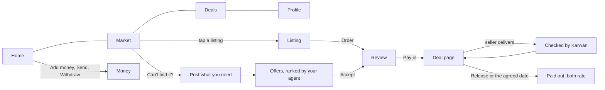

# 44 · One product flow

Foundation, serving T1.2 (choose the kind of deal) and T2 (protected deals). It applies the calm deal page from [view 43](43-calm-deal-page.md) to every screen and every kind of deal in the escrow family from [view 27](27-deals-on-the-escrow-family.md). Approved by the owner on 31 Oct 2026 after playing a clickable prototype of a full deal: "Simple enough", "this resonates so well", "this is beautiful and more simplified".

## What is hard today

- The same deal shows in six places, each in its own order: Home, Market, Profile open deals, Activity, the buyer desk and the seller desk. None of them puts what needs the person first.
- The market reads like an internal desk ("Find the next trade", count tiles, "Tier Cold", "USDC asking") instead of an open market a buyer recognises.
- Some entries lead to features that are off on the network, and several pages exist in two versions picked by build switches.
- Internal words reach the screen: "Legacy contracts", "bids", raw addresses.

## The idea

Karwan looks and works like one open market where every deal is protected. People find something, agree, pay in, the seller delivers, Karwan's agents check the delivery against what was agreed, the buyer releases (or the money is released on the agreed date), and both sides rate each other. Every kind of deal follows the same page, only the names of its steps change. Nobody needs to understand crypto: amounts are in USDC and the only address anyone sees is their own, when adding money from a wallet.

## Decisions

1. **Four places.** Phone: Home, Market, Deals, Profile in the bottom bar. Desktop adds Money and Messages to the side rail. Money opens from the balance on Home on phones.
2. **One home per thing.** Deals live in Deals, in one order: needs you, then active, then finished, paginated. Home shows the top of that list. Nothing else lists deals.
3. **The market is a market.** Search ("What do you need?"), a Buy and Sell switch, categories, and listing cards with a photo, the price in USDC, the seller's name, the rating in words ("4.8 from 23 deals"), the delivery time and a Protected mark. Sell shows what buyers need, with "Fits what you sell". "Can't find it? Post what you need" is always one tap away.
4. **One deal page for every kind.** Title block (who, the reference, what, the amount as the largest line, where the money is), the steps of that kind, this moment in one sentence with the date anything happens on its own, one move, then rows that open in place.
5. **Money is released on the agreed dates.** If the buyer does not act, the seller is paid when the review time ends; the page says so in one line (owner, 31 Oct 2026).
6. **Karwan's agents check the work.** Every delivered step shows a "Checked by Karwan" card: what was compared and the result. Both sides see it (owner, 31 Oct 2026).
7. **Every money move opens the confirm sheet**: a bottom sheet on phones, a side drawer on desktop.
8. **Same words as the assistant.** Every action on these screens is an assistant tool on the shared core, so the website assistant and Telegram can do it too, and the guide uses the same words.

## The kinds of deal

| Kind | Contract family | Steps on the page |
|---|---|---|
| One payment | Agreement | Agreed, Paid in, Delivered, Paid out |
| In stages | Agreement | A stage list; each stage is paid in, delivered and paid out |
| Goods, shipped | Agreement (review starts on arrival) | Agreed, Paid in, On the way, Arrived, Paid out |
| Goods, in person | Agreement (handover code) | Agreed, Paid in, Handed over, Paid out |
| Pay on delivery | Agreement (signed release at handover) | Agreed, Paid in, At your door, Paid out |
| In parts | Agreement (instalments; seller delivers after the last part) | A parts list with dates |
| Rent with a deposit | Agreement (refundable deposit) | Agreed, Deposit in, In use, Returned |
| By the hour or week | Time | Each week: Paid in, Hours sent, Paid out |
| Monthly | Time | Each month: Paid in, Work sent, Paid out |
| Contest | Jobs and bounties | Prize in, Entries, Winners, Paid out |
| Business order, pay later | Agreement, net 30 to 90 | Agreed, Delivered, Paid in, Paid out |
| Get paid early | Trade finance | A row on the seller's deal page |

## Where it lives

| Piece | Where |
|---|---|
| The approved screens | Figma file "Karwan product flow redesign", pages Prototype, Every kind of deal, Platform, Desktop |
| Deal page, title block and steps | `frontend/features/deals/workspace/` (view 43) |
| Market | `frontend/features/market/` |
| Deals list order | one ordering helper used by Deals and Home |
| Navigation | `frontend/shared/components/TopNav.tsx`, `WorkspaceBottomNav.tsx` |
| Assistant words | `backend/src/assistant/platformGuide.ts` |

## Status

| Part | State |
|---|---|
| Screens designed and approved | Done, 31 Oct 2026 |
| Spec | Written, waiting for the owner |
| Build | Not started |
