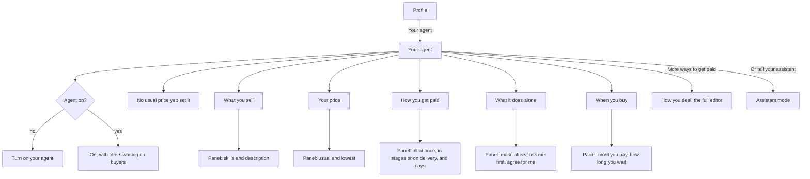

# 45 · Your agent, set up on one page

T1 (find and agree), serving T1.1 (one market) and the seller side of [view 41](41-agents-that-always-answer.md). Approved by the owner on 1 Nov 2026 from a sketch: "Yes, build it".

## What is hard today

- Setting up an agent is spread over five places. Profile's "Agent workspace" (`/profile/setup`) mixes the record's sources, an "Agents On" row with its meaning behind an info mark, a "Change about me" link back into the setup questions, and the selling and buying groups.
- Each group edits somewhere else: the selling group's Edit opens Edit profile, each "way" row opens How you deal (`/profile/ways`), and "Change about me" opens `/setup?edit=1`.
- The words are the escrow's, not the seller's: ways, one-time, milestones, refundable deposit, monthly retainer, with up to eight fields each.
- The price, the setting that matters most, sits inside those forms. On 1 Nov 2026, 102 of 121 sellers had never given a usual price, and their agents offered far above the budget (view 41, decision 14).

## The idea

One page, "Your agent", answers five plain questions. Each row shows the current answer and a Change button that opens a panel on the same page. Nothing else lives there.

## Decisions

1. **One page, five rows.** What you sell, Your price, How you get paid, What it does alone, When you buy. Selling rows show only for a seller, the buying row only for a buyer.
2. **The state first.** At the top: whether the agent is on and how many of its offers are waiting on buyers. An agent that is not on shows one button, Turn on your agent.
3. **The price is called out.** Until the person gives a usual price, a notice says their agent offers at the buyer's budget, with Set price.
4. **Plain choices for getting paid.** All at once, in stages, on delivery. By the hour, monthly and refundable deposit stay in the full editor, one link away as More ways to get paid.
5. **Changes open in place.** Each panel saves through the call its old page used (`POST /api/profile`, `POST /api/setup/ways`), plus `POST /api/setup/agent-mode` for what the agent does alone. A price saved here is the person's own (view 41, decision 14).
6. **Nothing is lost.** The record's sources move to their own page from the Record card on Profile. Agent funds stay under Money. Edit profile keeps the name and photo. The setup questions stay reachable from the assistant.
7. **The same in every channel.** Every change here is already an assistant tool: `set_way_i_deal`, `set_up_my_agents` (one answer at a time, including what the agent does alone) and `edit_profile`.

## Where it lives

| Part | Code |
|---|---|
| The page | `frontend/features/agent/YourAgent.tsx`, shown by `app/profile/page.tsx` for `/profile/setup` |
| Panels and their rules | `frontend/features/agent/agentPanels.tsx`, `frontend/features/agent/yourAgentModel.ts` |
| Words, five languages | `frontend/shared/i18n/messages/yourAgent.ts` |
| What the agent does alone | `backend/src/routes/setup.ts` `POST /agent-mode` |
| Record sources | `frontend/app/profile/sources/page.tsx` |
| Assistant words | `backend/src/assistant/platformGuide.ts` |

## Status

| Part | State |
|---|---|
| Sketch approved | Done, 1 Nov 2026 |
| Page, panels, five languages, guide and canon | Built 1 Nov 2026, not deployed |
