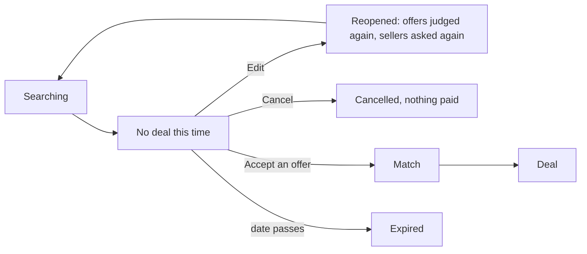

# 46 · Offers you can read

T1 (find and agree), extending roadmap T1 item 7 ([view 35, offers that move](35-offers-that-move.md)). Found by the owner on testnet request REQ-FAB0-6C1A on 1 Nov 2026: "I cannot edit or cancel the deal, plus the display is kinda hectic to understand." Approved by the owner the same day.

## What is hard today

- When the buyer's agent cannot agree a price, the request says "No deal this time" and locks. Edit and Cancel disappear, the backend refuses a cancel ("pending match"), and yet the request is open until its date with offers on it. The buyer has no way forward and no way out.
- Each offer is a block of seven lines: name, tag, level and tier, rating, best fit, reasons, what marks it apart, the offer, the days, the record check, then two buttons. With eleven offers the page is a wall.

## Decisions

1. **Edit and Cancel stay until a deal starts or the date passes.** "No deal this time" is a state, not an end. Cancel closes the request (nothing was paid). Saving an edit after no deal reopens the request: the agent judges the offers it holds again under the new terms and asks the sellers again, the same path as an edit during the search (view 35).
2. **One line per offer.** Photo, name, price, and the agent's rank: rows sit in the agent's order (#1, #2, ...) and the first offer the buyer can choose inside the request reads "Agent's pick".
3. **Tap for the rest.** A row opens a sheet with everything else: level and tier, rating, delivery, why the agent ranked it, the deals record, why it cannot be chosen yet, View profile, and Accept when the offer can be taken.
4. **One line above the list.** The note says the agent ranked the offers and the buyer chooses; the record-check cost and "none verified" stay as one quiet line each when they apply.

## Where it lives

| Layer | Change |
|---|---|
| `backend/src/agents/buyer.ts` | `cancelBriefByBuyer` cancels after no deal (refuses only a live match); `reopenAfterEdit` clears the no-deal marker and reopens the search |
| `backend/src/routes/jobs.ts` | the edit route reopens a request that ended without a deal |
| `frontend/features/search/requestView.ts` | `declined` keeps Edit and Cancel for the buyer |
| `frontend/features/jobs/components/BriefSections.tsx` | Edit and Cancel no longer hide on no deal |
| `frontend/features/jobs/components/Shortlist.tsx` | one line per offer, details sheet |
| assistant | `cancel_request` and `edit_request` work the same after no deal; guide entry updated |
