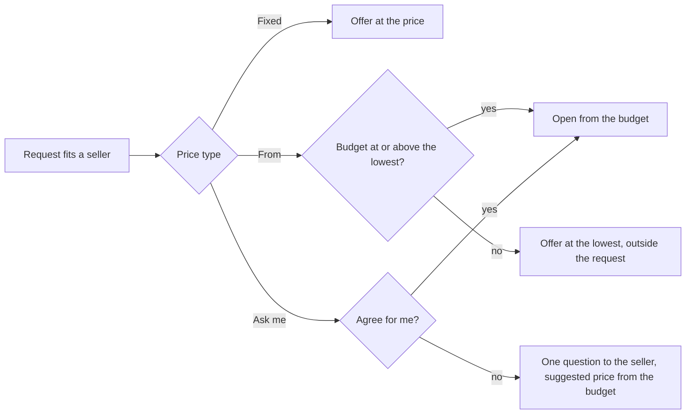

# 47 · Prices that vary

T1 (find and agree), extending [view 41](41-agents-that-always-answer.md) decision 14 (only a usual price the person gave sets the opening). Raised by the owner on 2 Nov 2026 from a record page that showed "Tailoring services 30 USDC": "tailoring services have no fixed price, same with so many services. How do we solve issues like these so agents do not miss entry for people because of their range?" Decisions approved by the owner the same day.

## What is already true

- A seller whose work fits a request always offers, judged on fit, never filtered out by price (view 41, decisions 11 to 13).
- A listing above the buyer's budget still offers at its lowest, marked outside the request.
- A selling way keeps a lowest price and a usual price; with no usual price the person gave, the agent opens from the buyer's budget, never under the lowest (decision 14, live on testnet since `e748f8f`).

So price no longer keeps a seller out of a request. What is wrong is how a price is asked for and shown: a listing has one asking price, so work that is priced per job reads as a fixed price, and a seller who cannot name any number has to guess one.

## Decisions

1. **Three price types** for every listing and selling way: **Fixed** (one price), **From** (the lowest the seller takes, the final price agreed per job) and **Ask me** (no number).
2. **How each shows.** Fixed: "30 USDC". From: "From 30 USDC". Ask me: "Price on request". Same words on the market, the record, the listing page, the shortlist and in the assistant.
3. **How the agent opens.** On a request that bargains, [view 73](73-agents-that-bargain.md) decisions 1, 2 and 5 replace this. Fixed: at that price. From: from the buyer's budget, never under the lowest; a budget under the lowest gets an offer at the lowest, marked outside the request (as today). Ask me: one question to the seller for each request that fits, with a suggested price from the buyer's budget and the market price, through the view 41 question; with Agree for me it opens from the budget without asking.
4. **Nothing is lost.** Existing listings are Fixed. Existing ways with a usual price the person gave are Fixed when lowest equals usual, otherwise From with that usual kept for the opening; guessed usual prices become From.

## Where it lives

| Layer | Change |
|---|---|
| `backend/src/db/listings.ts` | `priceKind: 'fixed' \| 'from' \| 'ask'`, `askingPriceUsdc` optional for `ask`; floor and match code read it |
| `backend/src/agents/ways.ts` | the same `priceKind` on sell ways; `upgradeWays` maps old ways (decision 4) |
| `backend/src/agents/limits.ts`, `sellerPricing.ts`, `seller.ts` | opening per type; `ask` raises the view 41 question |
| `backend/src/routes/listings.ts` | the listing match offers per type |
| assistant | the listing, setup and way tools take the price type; guide and canon say the three types |
| frontend | price type choice in the offer form and setup; one formatter for the three labels used by market, record, listing, shortlist |
