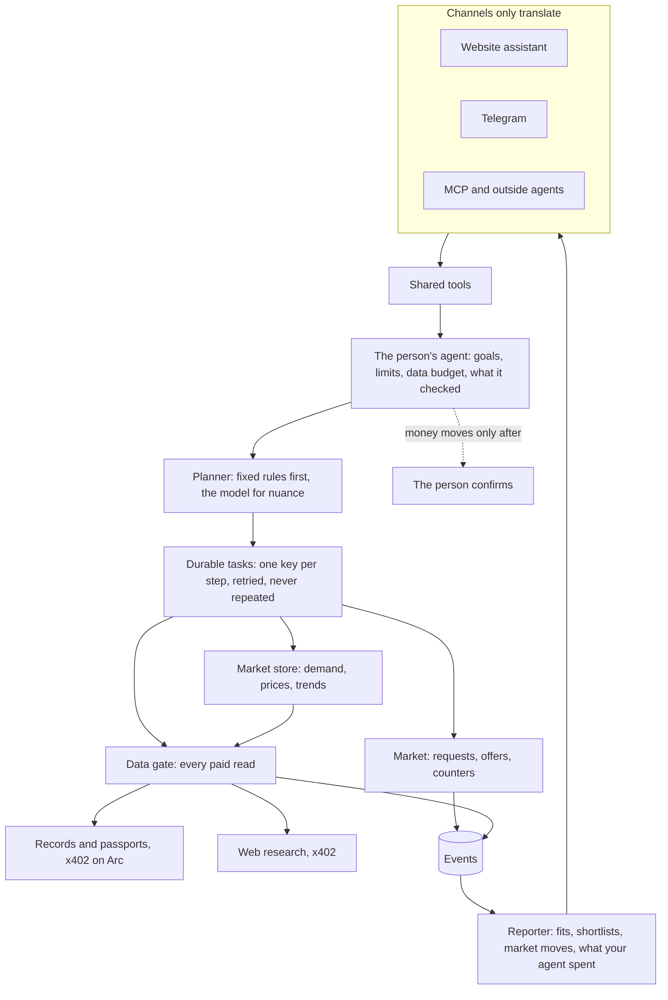
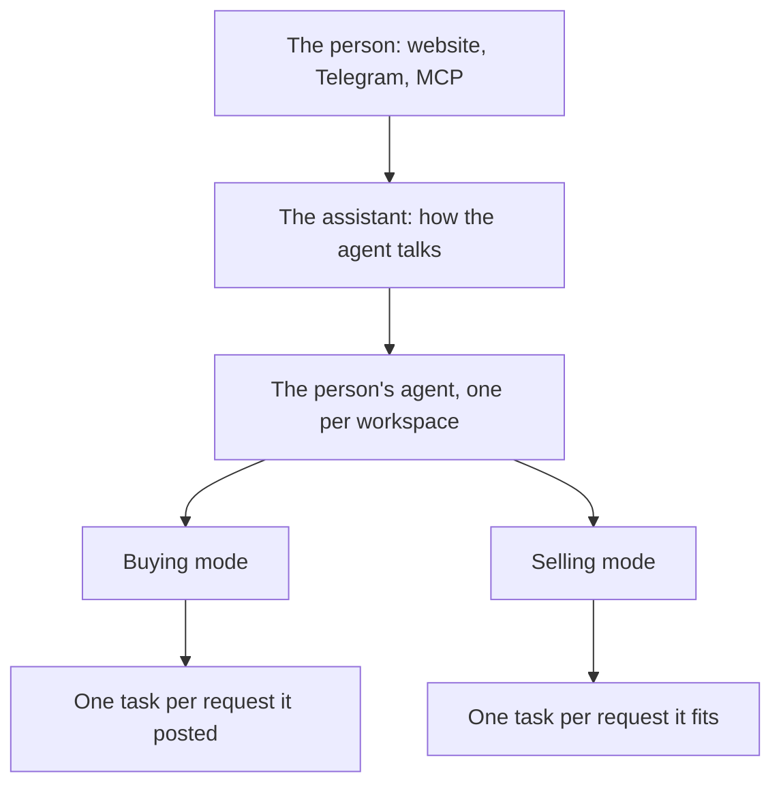
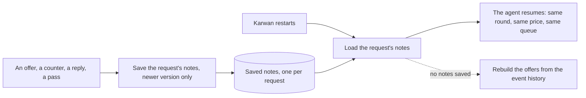

# 48 · One agent per person

T1 (find and agree), with T3 (paid record reads) and T6 (one assistant everywhere). It builds on [view 41](41-agents-that-always-answer.md) (agents that always answer), [view 45](45-your-agent.md) (your agent, set up on one page) and [view 13](13-portable-reputation.md) (paid record reads). Raised by the owner on 3 Nov 2026 after a seller was shortlisted twice: "this is where the product stands out and it must be accurate and unique. We have to fix the loop and re-arrange the architecture to fit proper agentic engineering." Decisions 1 to 7 approved by the owner the same day.

## What is hard today

- **Three brains, no plan.** A buyer agent runs per request, a seller agent judges each request, and the assistant reads what both did. None of them belongs to a person, so "find me customers", "keep me updated" and "what is moving in my market" have nowhere to run.
- **One person can appear twice.** An agent is identified by an address string, and strings were compared in different casings. On 31 Oct one seller was shortlisted twice on the same request (fixed 3 Nov; the class of bug remains).
- **Paid reads are paid again.** A seller's agent re-paid to read the same buyer on the same request six times in two days. Reads and web research keep separate receipts, so a person cannot see what their agent spent.
- **Work restarts from memory.** Requests, offers and research are held in process memory and rebuilt on every restart. The durable task runner that would fix this runs only beside the real loop, checking it.
- **Trending is silent.** It counts only Karwan's own posts, with fixed thresholds that testnet volume never reaches.
- **Agents left unlinked lose work.** A fifth of all skipped requests in the two weeks to 3 Nov were sellers whose agent was not linked to their account.
- **The assistant cannot direct the agent.** It cannot ask for research, a wider search, or a watch on a market.

## The idea

Each person has one agent per workspace, which both buys and sells, and the assistant is its voice. It holds their goals, limits and a small budget for data, remembers what it has already checked, and does its work as durable tasks. Every paid read goes through one gate. One market store answers demand, prices and trends. One reporter tells the person what matters, in every channel. Every capability is an assistant tool.

## Decisions

1. **One row per person per workspace.** The shortlist, the sealed seller block and every list of people count a person once in each workspace. A person's personal and business workspaces are separate rows; two agents of the same workspace are one row, with the better offer.
2. **The person's agent pays for its data.** A Karwan record read costs 0.005 USDC (owner, 3 Nov 2026). Outside research is paid by the person's agent through Circle's agent stack: the agent sizes the search to what the person asked, tells them the exact cost before it runs, and asks them to add money when its balance is short. A result another agent already paid for is served from the cache to cut the cost. The research credit goes, since the agent pays for its own data. The platform no longer fronts it. On Arc Testnet, where agents hold test USDC and Circle's services marketplace sells only on mainnet chains, Karwan sells the research as a paid read on Arc and pays the outside provider itself; on mainnet the person's agent pays marketplace sellers directly (owner, 3 Nov 2026).
3. **Karwan first, outside second.** Demand, prices and trends come from Karwan's own requests, offers and settled deals. Paid web research is a second signal, always labelled as from the web, and never changes a verdict on its own.
4. **No offer or deal waits for a link it does not need.** Approved as "link agents at setup"; on reading the code, the link that blocked sellers (the vault binding) is read only by the older escrows. Deals on the escrow family record each side through their Karwan record, which Karwan sets up on the way and nothing waits for. So the vault link is checked only for a deal that pays in on an older escrow, and a family deal never waits for it.
5. **The durable runtime becomes the runtime.** The task runner that runs beside the loop today is promoted one step at a time, starting with the shortlist, which it already checks (owner, 3 Nov 2026).
6. **One gate for paid reads.** A read for the same reader, subject and request is paid once in that request's life, unless the subject's record changed since. Every read (record, passport, research) writes one receipt and one "your agent paid" event.
7. **One agent, three roles.** Buying and selling are two modes of the same agent, sharing one memory, one set of goals and one data budget. The assistant is how that agent talks to the person, on the website, in Telegram or through MCP; it is not a separate brain. What the person asks for in a conversation ("find me customers", "watch tomato prices") becomes a goal on their agent. What stays separate: the buying and selling wallets behind the one balance; each request as its own task, so many deals run at once and one failing never stalls the others; the selling mode never offers on a request the buying mode posted; and no money moves until the person confirms.

8. **The agent's notes on a request are kept.** Everything the buying mode knows about a request it is working is written to the database as it changes and read back when Karwan restarts: the offers in, each seller's counter rounds and last prices, the sellers it already tried, the order it will try the rest, sellers who withdrew, lower offers waiting on a counter, and a near match waiting on the person. The event history stays the record of what happened; the saved notes are where the agent picks up, so a restart never sends a seller a second first round or forgets a price. One server works a request at a time; a lease per request comes before a second server shares the work.

## The parts

| Part | Job | Where it lives |
|---|---|---|
| Identity | One checksummed address type for agents and accounts; every map keys on it | `backend/src/identity/agentId.ts` (new), used by the market board, buyer, seller and shortlist |
| The person's agent | Goals ("find buyers for X", "tell me when Y is cheaper"), limits from view 45, the data budget, what it checked | `backend/src/agents/personAgent.ts` (new), stored per workspace |
| Durable tasks | Judge a request, read a record, research, counter, report; each with a key, a lease and retries | `backend/src/agents/durableTaskRunner.ts`, promoted from beside the loop |
| Saved notes | One versioned record per request with everything the buying mode knows about it; written on each change, read on restart | `buyer_runtime_snapshots_v2`, promoted from the shadow that writes it today; near matches move from a file to the same database |
| Data gate | `acquire(subject, kind, purpose, ref, payer)`: consent, reuse, budget, pay, verify, receipt | `backend/src/x402/dataGate.ts` (new); `paidRecordRead`, `paidCreditPassport` and `researchMarket` move behind it |
| Market store | Demand by category and place, price bands from settled deals and verified web quotes, week-on-week change scaled to volume | `backend/src/intelligence/` (new); `trendScout` and the Home trending card read it |
| Reporter | Turns events into the few messages a person needs; the same words in every channel | `backend/src/agents/reporter.ts` (new), on the existing in-app, email and Telegram rails |
| Tools | `research_market`, `watch_market`, `find_customers`, beside `search_market` and `get_market_trends` | `backend/src/assistant/agent.ts`, `platformGuide.ts`, canon |

## Rules this view adds

1. An address enters once, checksummed, through the identity type. Raw address strings are never map keys.
2. A person is one row per workspace wherever people are listed.
3. A paid read for the same reader, subject and request is paid once per request unless the record changed.
4. Every paid read leaves one receipt and one event; the person can always see what their agent spent and why.
5. Web signals are labelled and never decide alone; Karwan's own data leads.
6. Every capability is a tool first; a screen is optional.
7. Agents never move money. The person confirms (unchanged).

## What fails where

| Failure | What the person sees |
|---|---|
| Data budget empty | The agent works on free data and says once that research is paused, with Add to budget |
| A paid read fails or is slow | The free record is used; nothing is paid twice on retry, because the task key is the same |
| Web research fails | No web signal; demand and prices from Karwan only |
| The service restarts mid-step | The task resumes from its last checkpoint and the agent from its saved notes: the same round, the same last price, the same queue; no offer is made twice and no read is paid twice |
| An agent is not linked | A deal on the escrow family goes ahead; only a deal on an older escrow asks the seller to link first |

## Order of work

| Step | What | Depends on |
|---|---|---|
| 1 | Data gate with reuse; the seller side first | Arc and Circle checks recorded in `docs/arc-circle-checks.md` |
| 2 | Hold only older-escrow deals for the vault link | none |
| 3 | Identity type; one row per person per workspace | none |
| 4 | Market store; one trend source, Karwan first | step 1 for the web signal |
| 5 | Tools: `research_market`, `watch_market`, `find_customers` | steps 1 and 4 |
| 6 | The person's agent record and the reporter | steps 1 to 5 |
| 7 | Durable tasks drive the loop, step by step | decision 5 |
| 8 | The agent's notes on a request are saved and read back on restart | step 7, decision 8 |
