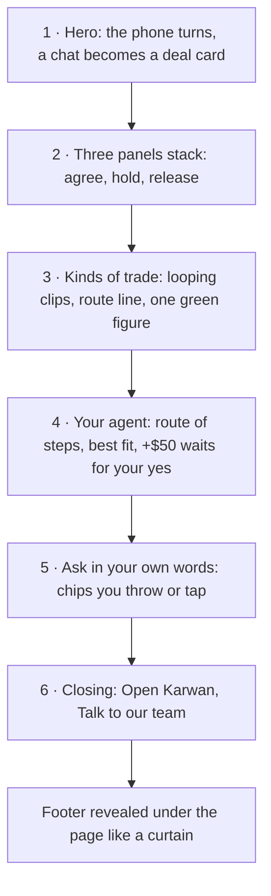
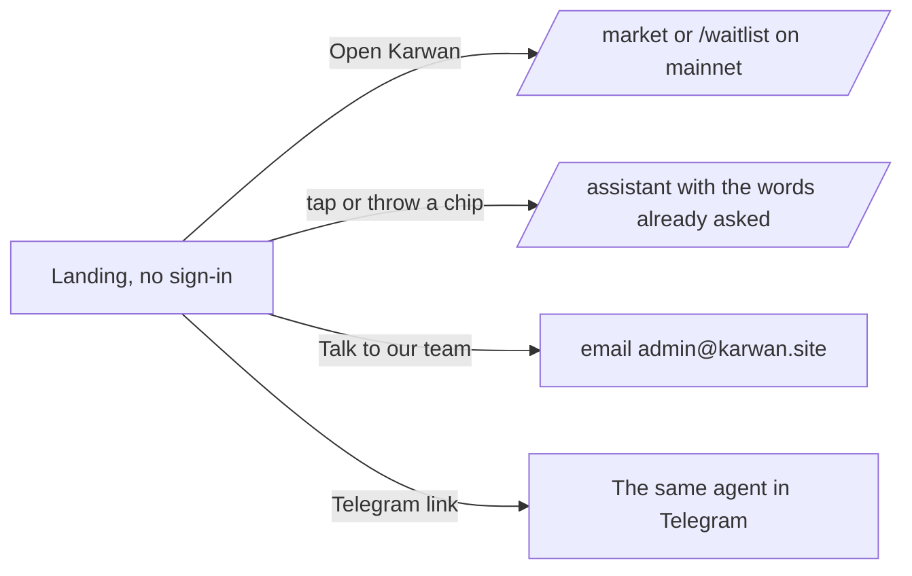

# 49 · The landing tells the whole story

Foundation, under the new look ([view 48](48-one-agent-per-person.md) era, plan batch 9j). The landing is the advert people see before they sign in. It does not change how deals, money or agents work; it shows them. Drawn and approved by the owner in Figma between 2 and 4 Nov 2026.

## The idea

Black ground with a soft glow. Karwan green carries the information. Each scroll meets something different, and together the scenes describe the whole product: agree in a chat, hold the money, real kinds of trade, the agent, what you can ask, and a way in.

## How the page connects to the product

- The landing never signs anyone in and opens no live event stream. Everything that needs an account happens on the page it leads to.
- A chip carries its words to the assistant the same way the ask box on Home does. The assistant asks for sign-in if it needs it.
- On mainnet, before deals open, the main button leads to the waitlist instead of the market.

## Rules the page keeps

- **Kinds of trade, never customers.** The clips are licensed stock footage. A tile names a kind of trade and an example amount; it never names a person, quotes one or says they use Karwan. Real traders replace a tile only when they agree to share their story.
- **Only true claims.** Every line about the agent matches what it does today: it works inside your limits, waits for your approval above them, keeps a weekly data budget with a report, and lets you see and delete what it remembers.
- **Motion that can be turned off.** With reduced motion, no clip plays and every scene shows its final state. Clips play muted and only while on screen.
- **Five languages.** Every word is in English, French, Arabic, Hindi and Swahili, and Arabic reads right to left.
- **Light on a phone.** Phones get smaller clips, and the chips are tapped instead of thrown.
