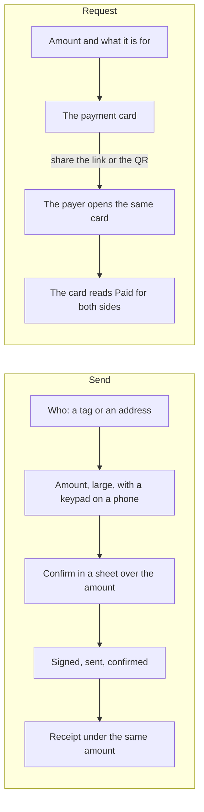
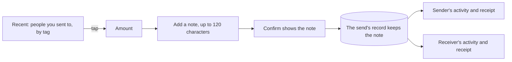

# 50 · Money that feels like money

Track T5 (money). Sending money and asking for it are the reasons people come back to Karwan between deals. This view changes how those moments look and move. It does not change how money moves, what is checked before it moves, or who can see what. Drawn and approved by the owner in Figma on 5 Nov 2026 (page "Premium · Send, request, pay").

## The idea

One object carries each flow from the first tap to the receipt. In a send, it is the amount. In a request, it is the payment card: what the requester shares, what the payer opens, and what turns Paid for both of them.

## Rules the screens keep

- **The amount is the loudest thing.** It is entered large and centred, with a number keypad on a phone. On a computer the same figure is typed. The amount does not leave the screen while the money moves.
- **A person comes with their record.** Wherever someone is named as the one paying or being paid, their tag and how many deals they settled sit beside the name, read from the same record the market shows. The tier stays on the profile and record pages, where its name has room (owner, 5 Nov 2026). A sealed record shows only its tier.
- **Confirm says exactly what happens.** The sheet names who receives it, from where, and that a send cannot be undone. The button carries the amount.
- **One card for a request.** The card holds the requester, the amount, what it is for, the QR and link, and when it expires. The payer sees the same card; once paid it reads Paid with the date and the reference.
- **Green is only for the one button to press.** Cards are one neutral style.
- **Nothing about the money changes.** The same checks run before a send (tag or address, enough money, a contract address warned), the same double-press guard holds, and slow, failed, rejected and guarded sends read as before.
- **Five languages, reduced motion.** Every word is in English, French, Arabic, Hindi and Swahili, Arabic reads right to left, numerals stay left to right, and with reduced motion nothing slides.

## Notes and recent people

Added 5 Nov 2026 at the owner's ask.

- **A note travels with the send.** It is optional, plain text, at most 120 characters, and kept with the send's own record, so the sender and the receiver both read it in their activity and on the receipt. It is never written to the chain.
- **Recent people come from your own sends.** Send opens with the people you sent to most recently, newest first, read from your own completed sends. Only people with a Karwan tag are listed; a send to a bare address is never shown as a person.
- **The assistant does the same.** Asked to send with a note ("send @ada 20 for the logo"), it opens the send screen with the person, the amount and the note filled in, and the person confirms there.

## What stays as it was

- Topping up and withdrawing from an agent keep their own drawer.
- Paying from another chain, from a wallet or from the Karwan balance works as before, under the card.
