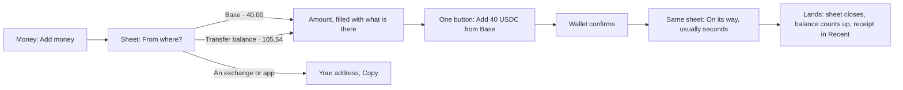
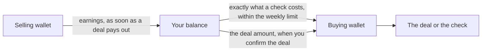

# 51 · Top up in one tap

Track T5 (money), roadmap item T5.2 (one balance that heals itself). Proposed 5 Nov 2026 from the owner's notes; drawings approved the same day. Built 5 Nov 2026, not deployed: Show amounts in, the Balance and Agents switch, receipts from Recent, the Add money sheet and the Transfer balance moves. Agent top up and withdraw keep their existing sheet; topping an agent up straight from another network comes later. Third round approved the same day with all four decisions as recommended; its first slice is built, not deployed: one balance with Where it is, and the Agents tab as the weekly limit and what the agent spent. The agent drawing what a check needs, and leftover money moving back on its own, come in the second slice after a live Arc Testnet run.

## What is wrong today

- **Adding money feels like using a bridge.** Add money leaves Money for `/bridge`, a full page with a title, a list of networks, a form and a history button. It reads like a crypto tool, not like topping up an account.
- **The Transfer balance can't be filled or used from Money.** Money shows the row (105.54 USDC on the owner's account) with an info tip and nothing else. The only way to deposit into it is the old Gateway rail, which you reach with `?rail=gateway`, and nothing links there any more. The only way to spend from it is when a send or withdrawal happens to route through it.
- **An email account can't top up from a wallet it owns.** Its Add screen shows only the deposit address, even when the person has USDC sitting in a browser wallet.

## The idea in one line

Add money opens a sheet over Money: pick where the money is, the amount fills in, press one button. The sheet becomes the progress, closes itself when the money lands, and the balance counts up. Nobody leaves Money and nothing says "bridge".

## The flow

**From where?** shows one row for each place the person really has money, with the amount, read in parallel when the sheet opens:

| Row | Shown to | What happens | How fast |
|---|---|---|---|
| Transfer balance | web3 wallets that have one | spent to the Arc wallet, one signature in the browser | seconds |
| Each network where the connected wallet holds USDC (Base, Ethereum, Arbitrum, Solana …) | any account with a browser wallet connected, email accounts included | CCTP Fast to the person's Arc address, which is the route already built | about 8 to 20 seconds |
| An exchange or another app | everyone | the deposit address for any network, with Copy | when it arrives |
| Card | everyone, shown as soon | nothing to press | |

- **The richest row goes first and is already selected,** so the usual top-up is: Add money, then the button.
- **No wallet connected:** the rows above it read "Connect a wallet to see what you hold", and the exchange row stays.
- **The network name is the only chain word.** No CCTP, Gateway, bridge, mint or burn anywhere on the sheet.

## The Transfer balance gets its own two actions

The row on Money gains two quiet buttons:

- **Move to balance:** the same sheet, opened on the Transfer balance row with the whole amount filled in. One signature, and it lands in seconds.
- **Add to it:** the same sheet in "keep it where it is" mode. Pick a network and an amount, and the USDC is deposited into the Transfer balance on that network (App Kit `unifiedBalance.deposit`, which is already in `features/gateway/lib.ts`). The money stays in the person's own wallet's Gateway balance. Karwan never holds it.

Its spend side is already wired: Send and Withdraw use the Transfer balance when the Arc balance is short (views 22 and 50).

## What it costs, stated plainly

From Circle's docs, read 5 Nov 2026 (logged in `docs/arc-circle-checks.md`):

- **A Gateway deposit is spendable only after the source network finalises it.** That's about 0.5 seconds on Arc, around 8 seconds on Avalanche and Polygon, and **13 to 19 minutes on Base, Ethereum, Arbitrum and Optimism.** So "Add to it" from Base says "Ready to spend in about 15 minutes", and the row shows that amount as on its way until then.
- **CCTP Fast from Base or Ethereum lands on Arc in about 8 to 20 seconds.** So for "I want money in my balance now", the plain top-up is faster than going through the Transfer balance.
- **The Transfer balance pays off later:** once a deposit has finalised, every spend from it is instant, to any network, in any amount up to the total.

That's why the default top-up brings money straight to Arc, and filling the Transfer balance is the deliberate "keep it on my network" choice.

## Who holds what

Nothing changes from view 23 (owner's decision, 23 Oct 2026):

- The Transfer balance belongs to the person's own web3 wallet, and only that wallet's signature spends it.
- Email and passkey accounts don't get a Transfer balance. They do get every wallet row, because a CCTP top-up only needs their Arc address as the recipient.

## Motion

- The sheet rises over Money, and Money stays visible and dimmed behind it.
- Choosing a row slides the amount in from the side, and Back slides it out.
- After the wallet confirms, the button turns into the progress line in place. It never jumps to a new screen.
- When the money lands, the sheet closes and the hero balance counts up to the new figure, using the existing `AnimatedNumber`.
- With reduced motion, the steps cross-fade and the balance changes without counting.

## The assistant does the same

"Add 40 from Base" or "Move my Transfer balance to my balance" in the website assistant or Telegram answers with the same card on the page's own route (view 31). A web wallet signature can't happen in Telegram, so there the card opens the sheet on the website, already set to that row and amount. The deposit address is answered directly in any channel.

## What stays the same

Every App Kit, CCTP and Gateway call, the money-out guard, the receipts, the transfer records and the history. `/bridge` stays reachable for deep links and payment links, and opens the same sheet's content as a page.

## Owner's additions, 5 Nov 2026

Drawn in Figma (file "Karwan app redesign", page "Premium · Send, request, pay", sections "Top up · view 51" and "Money · agents, currency, receipt"). The owner approved the top-up frames and asked for these:

- **Real network logos.** Every network row shows its own logo (Base, Ethereum, Arbitrum, Avalanche, Solana, Polygon, OP Mainnet, Arc), taken from `@web3icons/core` 4.0.58. Rows that aren't networks (Transfer balance, an exchange, card, agents, your balance) get a plain line icon.
- **Balance and Agents behind one switch.** The top of Money has a two-way switch. **Balance** shows what's in your account, with Add money, Send and Withdraw. **Agents** shows what your agents hold, with Top up and Withdraw, and lists each agent. Both use the same sheet as Add money:
  - **Top up:** To (buying or selling agent), From (your balance, which arrives instantly, your Transfer balance, or a network in your wallet), the amount, then one button.
  - **Withdraw:** From (an agent), To (your balance, instantly, or a wallet on another network), the amount, then one button.
- **Show amounts in moves to Settings.** It's no longer on Money. The setting lists USDC (as it's held), then NGN, USD, EUR, GBP, CNY, and one currency for each language we support: INR for Hindi, AED for Arabic, KES for Swahili, XOF for French-speaking West Africa. Each one shows its live rate. With a local currency chosen, Money leads with that figure and shows the USDC amount under it, and Recent shows both. Money always stays in USDC, and only how the numbers read changes. Testnet gets this first.
- **No "Proof on Arc" section on Money.** It confused people. The receipt keeps the reference, which is enough to look a payment up.
- **Every Recent row opens its receipt.** The receipt shows who it was from or to, the amount in both currencies, the status, the time and the reference, with Download image as the one green button and Share next to it.

Second round, same day:

- **Many networks on a phone:** the wallet's networks are cards in a row you can swipe. The next card peeks in from the edge, a short "Swipe for more networks" line and dots show there's more, and the richest network comes first. Transfer balance, an exchange and card stay as rows under it.
- **Many networks on a computer:** Add money is a dialog. The chosen network sits in one row with a small **Change** dropdown that lists every network with its amount, and an empty network is shown greyed out. You type the amount (there's no keypad), and the other ways are links at the bottom.
- **Explanations go into tooltips.** Lines like "Your money stays in USDC…" or "It stays on its network…" sit behind an info icon next to the title, not as text on the screen.
- **Agent spending is accounted for.** The Agents tab lists what each agent spent and on what (a record check, finding sellers, a top-up), and each line opens its receipt like any other.
- **Desktop and both themes.** Every screen is drawn for a phone and a computer, in dark and light, from the same colour variables.

## Third round: one balance, 5 Nov 2026

Proposed after the owner's note: agent money is only needed when a deal or a record check asks for it, not as a place to keep money. Money showed three totals (your balance, what the agents hold, the Transfer balance), and people asked which one was theirs.

**What people see**

- **Your balance, one figure.** Everything they own that is free to spend: the sign-in wallet, anything still sitting in the buying and selling wallets, and a wallet account's Transfer balance. Each is read on its own first (view 52), then added. A tap on the figure opens **Where it is**, the same parts as lines.
- **Held in your deals, one quiet line under it.** Not counted, because it can't be spent until the deal ends.
- **No agent balance anywhere.** The Agents tab becomes what the agent may spend and what it spent:
  - "Your agent can spend up to 1 USDC a week on checks", with **Change**.
  - Spent this week, then each spend (a record check, finding sellers, research) opening its receipt.
- **Agent Top up and Withdraw go away.** Nothing needs filling.

**How money reaches the agent**

| Moment | Email or passkey account | Wallet account |
|---|---|---|
| A record check or research | Karwan moves the exact cost from the sign-in wallet to the buying wallet, within the weekly limit, as agent top-ups already work | The buying wallet takes the exact cost with `transferFrom`, from an approval the person signed once, capped at the weekly limit |
| Locking a deal | The deal amount moves in the same confirmation that locks it | The same confirmation, signed in their wallet |
| A deal pays the seller | Earnings move from the selling wallet to the balance straight away | The same |
| Money already in an agent wallet today | Counted in the balance at once, then moved back to the sign-in wallet | The same |

- **The limit is the person's.** Raising it is confirmed outside the agent's reach (view 52): a tap in the app for an email account, a new approval signed in their own wallet for a wallet account.
- **No money moves without the person** (unchanged): every deal is still confirmed by them. The weekly limit covers only checks and research.
- **On the test network** Circle's spending limits aren't available, so the limit is Karwan's check in code plus, for wallet accounts, the approval cap.

**The assistant** answers "how much do I have" with the one figure and Where it is, and "what did my agent spend" with the weekly limit and the spends. Changing the limit is a card.

**Until the second slice** the With your agent line in Where it is keeps two moves, Move to your wallet and Add, so an agent is never left unable to pay for a check.

**Decisions for the owner (third round), approved 5 Nov 2026 as recommended**

1. **Count agent money and the Transfer balance in the one figure.** Recommended: yes, with Where it is one tap away. Alternative: count only the sign-in wallet and list the rest.
2. **The default weekly limit for checks.** Recommended: 1 USDC (200 record checks at 0.005).
3. **Move leftover agent money back on its own.** Recommended: yes, and selling earnings land in the balance as soon as a deal pays out.
4. **Keep the Balance and Agents switch.** Recommended: yes, with Agents showing the limit and the spending, so people still have one place to see what their agent did.

Live rates need a source. A rates provider is picked in the spec, and checked the same way as Circle (docs, a read-only call, logged before code). Until a rate is fresh, the screen shows USDC rather than an old figure.

## Decisions for the owner

1. **Default route for a top-up from Base, Ethereum or Arbitrum.** Recommended: straight to Arc (seconds), with Add to Transfer balance as the separate action. The alternative is to send every top-up into the Transfer balance, which makes most top-ups wait about 15 minutes.
2. **Email accounts topping up from a browser wallet.** Recommended: yes, shown as the wallet rows above.
3. **Where Withdraw goes.** Recommended: the same sheet the other way round (to which network, to which address, amount, one button) in the next batch, after the top-up ships.

## Checks before code (rule 14)

- `@circle-fin/app-kit` 1.15.2 `unifiedBalance.deposit` and `spend` from a browser wallet on Arc Testnet, a read-only estimate first.
- The Gateway `POST /v1/balances` pending field, so the row can show money on its way, not only confirmed money.
- A live testnet run: top up 1 USDC from Base Sepolia to Arc with CCTP Fast, deposit 1 USDC into the Transfer balance from Avalanche Fuji, then move it to the Arc balance.
