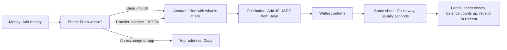

# 51 · Top up in one tap

Track T5 (money), roadmap item T5.2 (one balance that heals itself). Proposed 5 Nov 2026 from the owner's notes. Nothing is built yet.

## What is wrong today

- **Adding money feels like using a bridge.** Add money leaves Money for `/bridge`, a full page with a title, a list of networks, a form and a history button. It reads like a crypto tool, not like topping up an account.
- **The Transfer balance can't be filled or used from Money.** Money shows the row (105.54 USDC on the owner's account) with an info tip and nothing else. The only way to deposit into it is the old Gateway rail, which you reach with `?rail=gateway`, and nothing links there any more. The only way to spend from it is when a send or withdrawal happens to route through it.
- **An email account can't top up from a wallet it owns.** Its Add screen shows only the deposit address, even when the person has USDC sitting in a browser wallet.

## The idea in one line

Add money opens a sheet over Money: pick where the money is, the amount fills in, press one button. The sheet becomes the progress, closes itself when the money lands, and the balance counts up. Nobody leaves Money and nothing says "bridge".

## The flow

**From where?** shows one row for each place the person really has money, with the amount, read in parallel when the sheet opens:

| Row | Shown to | What happens | How fast |
|---|---|---|---|
| Transfer balance | web3 wallets that have one | spent to the Arc wallet, one signature in the browser | seconds |
| Each network where the connected wallet holds USDC (Base, Ethereum, Arbitrum, Solana …) | any account with a browser wallet connected, email accounts included | CCTP Fast to the person's Arc address, which is the route already built | about 8 to 20 seconds |
| An exchange or another app | everyone | the deposit address for any network, with Copy | when it arrives |
| Card | everyone, shown as soon | nothing to press | |

- **The richest row goes first and is already selected,** so the usual top-up is: Add money, then the button.
- **No wallet connected:** the rows above it read "Connect a wallet to see what you hold", and the exchange row stays.
- **The network name is the only chain word.** No CCTP, Gateway, bridge, mint or burn anywhere on the sheet.

## The Transfer balance gets its own two actions

The row on Money gains two quiet buttons:

- **Move to balance:** the same sheet, opened on the Transfer balance row with the whole amount filled in. One signature, and it lands in seconds.
- **Add to it:** the same sheet in "keep it where it is" mode. Pick a network and an amount, and the USDC is deposited into the Transfer balance on that network (App Kit `unifiedBalance.deposit`, which is already in `features/gateway/lib.ts`). The money stays in the person's own wallet's Gateway balance. Karwan never holds it.

Its spend side is already wired: Send and Withdraw use the Transfer balance when the Arc balance is short (views 22 and 50).

## What it costs, stated plainly

From Circle's docs, read 5 Nov 2026 (logged in `docs/arc-circle-checks.md`):

- **A Gateway deposit is spendable only after the source network finalises it.** That's about 0.5 seconds on Arc, around 8 seconds on Avalanche and Polygon, and **13 to 19 minutes on Base, Ethereum, Arbitrum and Optimism.** So "Add to it" from Base says "Ready to spend in about 15 minutes", and the row shows that amount as on its way until then.
- **CCTP Fast from Base or Ethereum lands on Arc in about 8 to 20 seconds.** So for "I want money in my balance now", the plain top-up is faster than going through the Transfer balance.
- **The Transfer balance pays off later:** once a deposit has finalised, every spend from it is instant, to any network, in any amount up to the total.

That's why the default top-up brings money straight to Arc, and filling the Transfer balance is the deliberate "keep it on my network" choice.

## Who holds what

Nothing changes from view 23 (owner's decision, 23 Oct 2026):

- The Transfer balance belongs to the person's own web3 wallet, and only that wallet's signature spends it.
- Email and passkey accounts don't get a Transfer balance. They do get every wallet row, because a CCTP top-up only needs their Arc address as the recipient.

## Motion

- The sheet rises over Money, and Money stays visible and dimmed behind it.
- Choosing a row slides the amount in from the side, and Back slides it out.
- After the wallet confirms, the button turns into the progress line in place. It never jumps to a new screen.
- When the money lands, the sheet closes and the hero balance counts up to the new figure, using the existing `AnimatedNumber`.
- With reduced motion, the steps cross-fade and the balance changes without counting.

## The assistant does the same

"Add 40 from Base" or "Move my Transfer balance to my balance" in the website assistant or Telegram answers with the same card on the page's own route (view 31). A web wallet signature can't happen in Telegram, so there the card opens the sheet on the website, already set to that row and amount. The deposit address is answered directly in any channel.

## What stays the same

Every App Kit, CCTP and Gateway call, the money-out guard, the receipts, the transfer records and the history. `/bridge` stays reachable for deep links and payment links, and opens the same sheet's content as a page.

## Decisions for the owner

1. **Default route for a top-up from Base, Ethereum or Arbitrum.** Recommended: straight to Arc (seconds), with Add to Transfer balance as the separate action. The alternative is to send every top-up into the Transfer balance, which makes most top-ups wait about 15 minutes.
2. **Email accounts topping up from a browser wallet.** Recommended: yes, shown as the wallet rows above.
3. **Where Withdraw goes.** Recommended: the same sheet the other way round (to which network, to which address, amount, one button) in the next batch, after the top-up ships.

## Checks before code (rule 14)

- `@circle-fin/app-kit` 1.15.2 `unifiedBalance.deposit` and `spend` from a browser wallet on Arc Testnet, a read-only estimate first.
- The Gateway `POST /v1/balances` pending field, so the row can show money on its way, not only confirmed money.
- A live testnet run: top up 1 USDC from Base Sepolia to Arc with CCTP Fast, deposit 1 USDC into the Transfer balance from Avalanche Fuji, then move it to the Arc balance.
