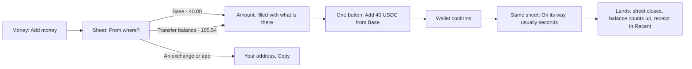
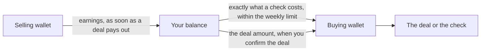
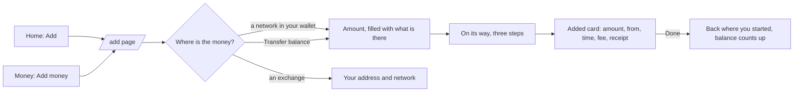
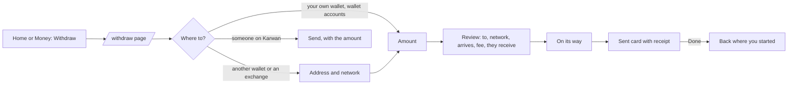

# 51 · Top up in one tap

Track T5 (money), roadmap item T5.2 (one balance that heals itself). Proposed 5 Nov 2026 from the owner's notes; drawings approved the same day. Built 5 Nov 2026, not deployed: Show amounts in, the Balance and Agents switch, receipts from Recent, the Add money sheet and the Transfer balance moves. Agent top up and withdraw keep their existing sheet; topping an agent up straight from another network comes later. Third round approved the same day with all four decisions as recommended; its first slice is built, not deployed: one balance with Where it is, and the Agents tab as the weekly limit and what the agent spent. The agent drawing what a check needs, and leftover money moving back on its own, come in the second slice after a live Arc Testnet run.

## What is wrong today

- **Adding money feels like using a bridge.** Add money leaves Money for `/bridge`, a full page with a title, a list of networks, a form and a history button. It reads like a crypto tool, not like topping up an account.
- **The Transfer balance can't be filled or used from Money.** Money shows the row (105.54 USDC on the owner's account) with an info tip and nothing else. The only way to deposit into it is the old Gateway rail, which you reach with `?rail=gateway`, and nothing links there any more. The only way to spend from it is when a send or withdrawal happens to route through it.
- **An email account can't top up from a wallet it owns.** Its Add screen shows only the deposit address, even when the person has USDC sitting in a browser wallet.

## The idea in one line

Add money opens a sheet over Money: pick where the money is, the amount fills in, press one button. The sheet becomes the progress, closes itself when the money lands, and the balance counts up. Nobody leaves Money and nothing says "bridge".

## The flow

**From where?** shows one row for each place the person really has money, with the amount, read in parallel when the sheet opens:

| Row | Shown to | What happens | How fast |
|---|---|---|---|
| Transfer balance | web3 wallets that have one | spent to the Arc wallet, one signature in the browser | seconds |
| Each network where the connected wallet holds USDC (Base, Ethereum, Arbitrum, Solana …) | any account with a browser wallet connected, email accounts included | CCTP Fast to the person's Arc address, which is the route already built | about 8 to 20 seconds |
| An exchange or another app | everyone | the deposit address for any network, with Copy | when it arrives |
| Card | everyone, shown as soon | nothing to press | |

- **The richest row goes first and is already selected,** so the usual top-up is: Add money, then the button.
- **No wallet connected:** the rows above it read "Connect a wallet to see what you hold", and the exchange row stays.
- **The network name is the only chain word.** No CCTP, Gateway, bridge, mint or burn anywhere on the sheet.

## The Transfer balance gets its own two actions

The row on Money gains two quiet buttons:

- **Move to balance:** the same sheet, opened on the Transfer balance row with the whole amount filled in. One signature, and it lands in seconds.
- **Add to it:** the same sheet in "keep it where it is" mode. Pick a network and an amount, and the USDC is deposited into the Transfer balance on that network (App Kit `unifiedBalance.deposit`, which is already in `features/gateway/lib.ts`). The money stays in the person's own wallet's Gateway balance. Karwan never holds it.

Its spend side is already wired: Send and Withdraw use the Transfer balance when the Arc balance is short (views 22 and 50).

## What it costs, stated plainly

From Circle's docs, read 5 Nov 2026 (logged in `docs/arc-circle-checks.md`):

- **A Gateway deposit is spendable only after the source network finalises it.** That's about 0.5 seconds on Arc, around 8 seconds on Avalanche and Polygon, and **13 to 19 minutes on Base, Ethereum, Arbitrum and Optimism.** So "Add to it" from Base says "Ready to spend in about 15 minutes", and the row shows that amount as on its way until then.
- **CCTP Fast from Base or Ethereum lands on Arc in about 8 to 20 seconds.** So for "I want money in my balance now", the plain top-up is faster than going through the Transfer balance.
- **The Transfer balance pays off later:** once a deposit has finalised, every spend from it is instant, to any network, in any amount up to the total.

That's why the default top-up brings money straight to Arc, and filling the Transfer balance is the deliberate "keep it on my network" choice.

## Who holds what

Nothing changes from view 23 (owner's decision, 23 Oct 2026):

- The Transfer balance belongs to the person's own web3 wallet, and only that wallet's signature spends it.
- Email and passkey accounts don't get a Transfer balance. They do get every wallet row, because a CCTP top-up only needs their Arc address as the recipient.

## Motion

- The sheet rises over Money, and Money stays visible and dimmed behind it.
- Choosing a row slides the amount in from the side, and Back slides it out.
- After the wallet confirms, the button turns into the progress line in place. It never jumps to a new screen.
- When the money lands, the sheet closes and the hero balance counts up to the new figure, using the existing `AnimatedNumber`.
- With reduced motion, the steps cross-fade and the balance changes without counting.

## The assistant does the same

"Add 40 from Base" or "Move my Transfer balance to my balance" in the website assistant or Telegram answers with the same card on the page's own route (view 31). A web wallet signature can't happen in Telegram, so there the card opens the sheet on the website, already set to that row and amount. The deposit address is answered directly in any channel.

## What stays the same

Every App Kit, CCTP and Gateway call, the money-out guard, the receipts, the transfer records and the history. `/bridge` stays reachable for deep links and payment links, and opens the same sheet's content as a page.

## Owner's additions, 5 Nov 2026

Drawn in Figma (file "Karwan app redesign", page "Premium · Send, request, pay", sections "Top up · view 51" and "Money · agents, currency, receipt"). The owner approved the top-up frames and asked for these:

- **Real network logos.** Every network row shows its own logo (Base, Ethereum, Arbitrum, Avalanche, Solana, Polygon, OP Mainnet, Arc), taken from `@web3icons/core` 4.0.58. Rows that aren't networks (Transfer balance, an exchange, card, agents, your balance) get a plain line icon.
- **Balance and Agents behind one switch.** The top of Money has a two-way switch. **Balance** shows what's in your account, with Add money, Send and Withdraw. **Agents** shows what your agents hold, with Top up and Withdraw, and lists each agent. Both use the same sheet as Add money:
  - **Top up:** To (buying or selling agent), From (your balance, which arrives instantly, your Transfer balance, or a network in your wallet), the amount, then one button.
  - **Withdraw:** From (an agent), To (your balance, instantly, or a wallet on another network), the amount, then one button.
- **Show amounts in moves to Settings.** It's no longer on Money. The setting lists USDC (as it's held), then NGN, USD, EUR, GBP, CNY, and one currency for each language we support: INR for Hindi, AED for Arabic, KES for Swahili, XOF for French-speaking West Africa. Each one shows its live rate. With a local currency chosen, Money leads with that figure and shows the USDC amount under it, and Recent shows both. Money always stays in USDC, and only how the numbers read changes. Testnet gets this first.
- **No "Proof on Arc" section on Money.** It confused people. The receipt keeps the reference, which is enough to look a payment up.
- **Every Recent row opens its receipt.** The receipt shows who it was from or to, the amount in both currencies, the status, the time and the reference, with Download image as the one green button and Share next to it.

Second round, same day:

- **Many networks on a phone:** the wallet's networks are cards in a row you can swipe. The next card peeks in from the edge, a short "Swipe for more networks" line and dots show there's more, and the richest network comes first. Transfer balance, an exchange and card stay as rows under it.
- **Many networks on a computer:** Add money is a dialog. The chosen network sits in one row with a small **Change** dropdown that lists every network with its amount, and an empty network is shown greyed out. You type the amount (there's no keypad), and the other ways are links at the bottom.
- **Explanations go into tooltips.** Lines like "Your money stays in USDC…" or "It stays on its network…" sit behind an info icon next to the title, not as text on the screen.
- **Agent spending is accounted for.** The Agents tab lists what each agent spent and on what (a record check, finding sellers, a top-up), and each line opens its receipt like any other.
- **Desktop and both themes.** Every screen is drawn for a phone and a computer, in dark and light, from the same colour variables.

## Third round: one balance, 5 Nov 2026

Proposed after the owner's note: agent money is only needed when a deal or a record check asks for it, not as a place to keep money. Money showed three totals (your balance, what the agents hold, the Transfer balance), and people asked which one was theirs.

**What people see**

- **Your balance, one figure.** Everything they own that is free to spend: the sign-in wallet, anything still sitting in the buying and selling wallets, and a wallet account's Transfer balance. Each is read on its own first (view 52), then added. A tap on the figure opens **Where it is**, the same parts as lines.
- **Held in your deals, one quiet line under it.** Not counted, because it can't be spent until the deal ends.
- **No agent balance anywhere.** The Agents tab becomes what the agent may spend and what it spent:
  - "Your agent can spend up to 1 USDC a week on checks", with **Change**.
  - Spent this week, then each spend (a record check, finding sellers, research) opening its receipt.
- **Agent Top up and Withdraw go away.** Nothing needs filling.

**How money reaches the agent**

| Moment | Email or passkey account | Wallet account |
|---|---|---|
| A record check or research | Karwan moves the exact cost from the sign-in wallet to the buying wallet, within the weekly limit, as agent top-ups already work | The buying wallet takes the exact cost with `transferFrom`, from an approval the person signed once, capped at the weekly limit |
| Locking a deal | The deal amount moves in the same confirmation that locks it | The same confirmation, signed in their wallet |
| A deal pays the seller | Earnings move from the selling wallet to the balance straight away | The same |
| Money already in an agent wallet today | Counted in the balance at once, then moved back to the sign-in wallet | The same |

- **The limit is the person's.** Raising it is confirmed outside the agent's reach (view 52): a tap in the app for an email account, a new approval signed in their own wallet for a wallet account.
- **No money moves without the person** (unchanged): every deal is still confirmed by them. The weekly limit covers only checks and research.
- **On the test network** Circle's spending limits aren't available, so the limit is Karwan's check in code plus, for wallet accounts, the approval cap.

**The assistant** answers "how much do I have" with the one figure and Where it is, and "what did my agent spend" with the weekly limit and the spends. Changing the limit is a card.

**Until the second slice** the With your agent line in Where it is keeps two moves, Move to your wallet and Add, so an agent is never left unable to pay for a check.

**Decisions for the owner (third round), approved 5 Nov 2026 as recommended**

1. **Count agent money and the Transfer balance in the one figure.** Recommended: yes, with Where it is one tap away. Alternative: count only the sign-in wallet and list the rest.
2. **The default weekly limit for checks.** Recommended: 1 USDC (200 record checks at 0.005).
3. **Move leftover agent money back on its own.** Recommended: yes, and selling earnings land in the balance as soon as a deal pays out.
4. **Keep the Balance and Agents switch.** Recommended: yes, with Agents showing the limit and the spending, so people still have one place to see what their agent did.

Live rates need a source. A rates provider is picked in the spec, and checked the same way as Circle (docs, a read-only call, logged before code). Until a rate is fresh, the screen shows USDC rather than an old figure.

## Fourth round: one Add money, one Withdraw, a page each, 5 Nov 2026

Proposed after the owner tested a deposit from Arbitrum on testnet and walked Home, Money and Withdraw.

**What is wrong on testnet today**

- **Two ways to add money.** Home's Add opens the old `/bridge` chooser ("How do you want to add money?": free test USDC, an app or exchange, card soon). Money's Add money opens the new sheet. Same word, two screens.
- **The confirmation doesn't stay.** When the money lands the sheet closes itself, so a deposit from Arbitrum flashes past with no card to read.
- **Desktop doesn't match the drawing.** The drawing (Desktop 16) is a centred window with the network, the amount and the button on one screen and a close button. The build shows a panel on the right with no close button, in two steps.
- **Withdraw is still the old form.** A bare amount field, a radio list, a pasted address and a Continue button, in a different style from Add money.
- **Withdraw says a different figure.** Money shows 1,542.59 and Withdraw says 837.90 available, because Withdraw counts only the sign-in wallet.

**The idea in one line**

Add money and Withdraw are each one page, the same on Home and Money and on a phone and a computer, built from the same parts as the drawing: where, how much, one button, progress on the page, and a card that stays until you press Done.

**Add money page**

- **Phone:** a page with Back. "From your wallet" shows the networks as cards that swipe, exactly as Top up 2, then the Transfer balance row, then "Other ways" (an exchange, card soon). Picking one opens the amount on the same page with the keypad (Top up 3).
- **Computer:** a centred column 560 wide. The richest network sits in one row with Change, the amount and the button sit under it, and "Other ways" are links at the foot (Desktop 16 as a page).
- **On its way:** three steps on the page, as Top up 4: confirmed in your wallet, moving to your balance, in your balance. You can leave; the bell tells you when it lands.
- **Added card that stays:** a tick, "40.00 USDC added from Arbitrum", then From, To (your balance), Took (18 seconds), Network fee (paid in your wallet) and View receipt. **Done** goes back to where you came from, and the balance counts up there. **Add more** starts again.
- **Email accounts:** the same page. With no wallet connected the first row is "Connect a wallet" with the exchange address under Other ways. No Transfer balance row.
- **Wallet accounts:** the networks where the connected wallet holds USDC, the Transfer balance row, then Other ways.
- **On testnet** "Get free test USDC" stays, as a link under Other ways.

**Withdraw page**

- **Where to, first:** rows with an icon, a name and one line, like Add money:
  - **Your wallet** (wallet accounts only): the connected address, short. One tap, then pick the network.
  - **Another wallet or an exchange:** paste the address, pick the network. A saved address shows as a row you can tap.
  - **Someone on Karwan:** search by tag, then Send with the amount.
  - **A bank account** and **A card**: shown, Coming soon, never pickable.
- **Then how much:** the amount hero with the keypad on a phone and 25%, 50%, Max. Under it, "837.90 USDC ready to withdraw". When part of the balance sits elsewhere: "704.69 is in your Transfer balance or with your agent", with **Bring it here**, which opens Where it is.
- **Then the review** (the existing review sheet): To, Network, Arrives, Network fee, They receive, one button.
- **On its way, then a Sent card that stays**, with the receipt and Done.
- **Email accounts:** no Your wallet row. Karwan signs, so there's no wallet step.

**Both themes, phone and computer**, drawn from the same colour variables, in Figma next to the third round: section "Money · Add and Withdraw pages (view 51, fourth round)", Dark and Light. Phone Add 1 to 5, Withdraw 1 to 6, Desktop 24 to 26.

**When the build is checked**, each frame is compared with the running page at the same size before it counts as built, so the build and the drawing can't drift apart again.

**The tab bar, owner's note the same day**

- **New icons, one family.** One 24 px set, 1.75 stroke, rounded ends: a house, a shop front, a shield with a tick for protected deals, three bars for Finance.
- **Profile is the person's photo**, a 24 px circle, with initials when there is none.
- **The green fits the shape.** Recommended (A): the tab you are on fills its own icon in green, and the label turns bright and bold; the photo gets a thin green ring. Alternative (B): a small pill that hugs the icon, 44 by 28, instead of today's wide one.

**The Agents tab, laid out like Balance**

- **Same order as Balance:** the label, the big figure ("1.00 USDC a week"), then one green button in the spot Add money takes on Balance. Here it's **Change limit**, the only action.
- **This week in one card,** like Held in your deals: "Spent this week 0.205 of 1.00", a thin bar, then "0.795 left" and what it paid for.
- **What your agent spent lists spends only.** Money that arrived in an agent wallet shows on Balance in Recent, not here.
- **When the limit can't load,** the tab says so with Try again, never a blank figure. On testnet today the figure is blank because `/api/money/agent-limit` answers 404: the new page went live before the server that feeds it.

Drawn in Figma, section "Tab bar and Agents tab (view 51, fourth round)", Dark and Light: both tab bar options with each tab on, Money 20 (Agents), Money 21 (limit didn't load), Money 22 (Balance with the new tab bar).

**Owner's picks, 5 Nov 2026:** tab bar option A (the green fills the icon). The guarantee button says **Add**, not "Add to it".

## Fifth round: one Money page, a tidy Profile, 5 Nov 2026

The owner's note: everything about money folds into one page, Money, and Profile stops repeating it.

**What is wrong today.** Profile lists Balance (837.90, the sign-in wallet only), With your agents (704.68) and Deal guarantee (500) as three rows, while Money shows one total (1,542.59). The Deal guarantee has its own page at `/guarantee`. Money things live in three places and show three different numbers.

**Money is the one page that handles money**

- **One switch at the top: Balance, Agent, Deal guarantee.** Each part has the same layout: a label with an info tip, the big figure, the green button with the other actions beside it, one card, then its own list.
  - **Balance:** "Your balance" 5,890.33 USDC, Where it is. **Add money**, Send, Withdraw. Held in your deals. Recent.
  - **Agent:** "With your agent" 1,763.50 USDC, with the line "Part of your balance. Spends up to 1.00 USDC a week on checks." Actions: **Top up**, Withdraw, Change limit. This week, with its bar. What your agent spent. The owner asked for Top up and Withdraw here on 5 Nov. That replaces the third round's "no agent balance": agent money shows on its own tab and still counts in Your balance.
  - **Agent Top up and Withdraw are pages like Add money.** Top up draws from your balance. Withdraw moves the money to your wallet in seconds; a deal the agent already started keeps what it needs.
  - **Deal guarantee:** 500.00 USDC in place, not counted in your balance. **Add**, Withdraw. Earns, Holding for deals, Ready to withdraw. Earnings on your guarantee.
- **The info tips say what each part is**, in one or two lines:
  - Your balance: "Money you can spend now: your wallet, your Transfer balance and anything still with your agent."
  - Your agent can spend: "What your agent may spend each week on record checks and finding sellers. Deals always wait for your OK."
  - Deal guarantee: "Money you set aside to protect your buyers. It earns while it sits. A deal can hold part of it until the deal ends. It isn't counted in your balance."
- **Guarantee Add and Withdraw are pages like Add money,** with the amount, keypad and one button:
  - Add draws from your balance.
  - Withdraw shows the date it can be collected (the contract's waiting period, read live). Once collected, it comes back to your balance.
- **`/guarantee` opens Money on Deal guarantee.** Earlier deals and Legacy contracts stay reachable from the guarantee list.

**Profile, one list with no repeats**

- **Top:** photo, name, @tag, Edit.
- **Two rows that lead somewhere:**
  - **Your record**, with its one-line summary.
  - **Money**, with the one figure, "Balance, agent, guarantee". This replaces the three money rows.
- **Trading:** Buying, Selling, Your agent, and the assistant switch (moved here from the top).
- **Account:** Contact, Wallets, Business profile, Passkey, Account recovery.
- **Preferences:** Language, Theme, Show amounts in, More settings.
- **Then:** Help and how it works. Sign out stays as it is today: a full-width outlined button, with "Terms · Privacy notice" under it.
- **Gone from Profile:**
  - **Activity and receipts:** Money's lists open every receipt, and All activity sits under them.
  - **The workspace switcher, when you have only one workspace:** it only repeated your name.

**Market pages with Previous and Next.** Market is a board of buy and sell ads. Under the ads: Previous, "Page 2 of 6", Next. Previous is dimmed on page 1 and Next on the last page. The page number stays in the address, so Back returns to the same page. This replaces "Show more". Market's files are open in another session (view 53), so this lands after it.

Drawn in Figma, section "One Money page and a tidy Profile (view 51, fifth round)", Dark and Light: Money 30 to 37, Profile 1, and the Market pagination.

**Decisions for the owner (fourth round)**

1. **Money's Add money opens the page too.** Recommended: yes, so there is one Add money everywhere and the side panel goes away. Alternative: Home opens the page and Money keeps a sheet.
2. **What Withdraw counts.** Recommended: only what is ready, with Bring it here for the rest, so nothing moves without the person seeing it. Alternative: gather the Transfer balance and agent money on its own before sending, which adds a step that can fail.
3. **Old routes.** Recommended: `/bridge?direction=in` and `?direction=out` open the new pages, so old links and the assistant's links keep working.
4. **How the tab you are on shows.** Recommended: A, the green fills the icon itself. Alternative: B, a small pill that hugs the icon.

## Decisions for the owner

1. **Default route for a top-up from Base, Ethereum or Arbitrum.** Recommended: straight to Arc (seconds), with Add to Transfer balance as the separate action. The alternative is to send every top-up into the Transfer balance, which makes most top-ups wait about 15 minutes.
2. **Email accounts topping up from a browser wallet.** Recommended: yes, shown as the wallet rows above.
3. **Where Withdraw goes.** Recommended: the same sheet the other way round (to which network, to which address, amount, one button) in the next batch, after the top-up ships.

## Checks before code (rule 14)

- `@circle-fin/app-kit` 1.15.2 `unifiedBalance.deposit` and `spend` from a browser wallet on Arc Testnet, a read-only estimate first.
- The Gateway `POST /v1/balances` pending field, so the row can show money on its way, not only confirmed money.
- A live testnet run: top up 1 USDC from Base Sepolia to Arc with CCTP Fast, deposit 1 USDC into the Transfer balance from Avalanche Fuji, then move it to the Arc balance.
