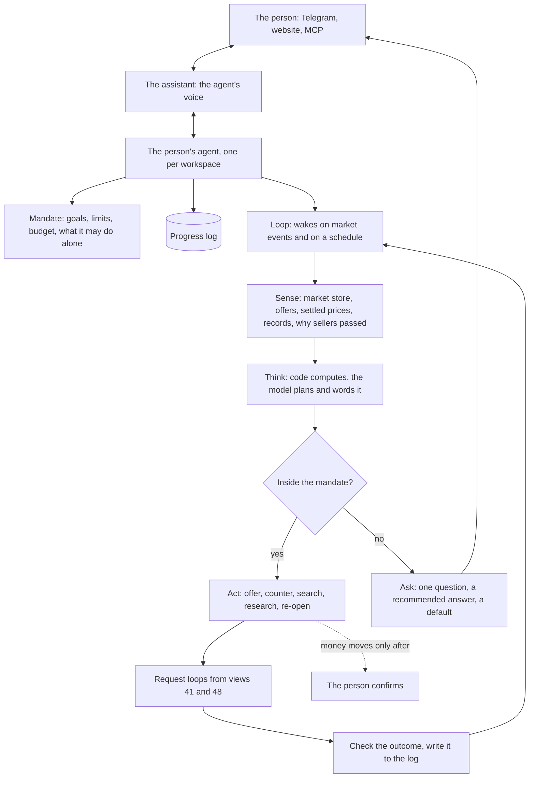
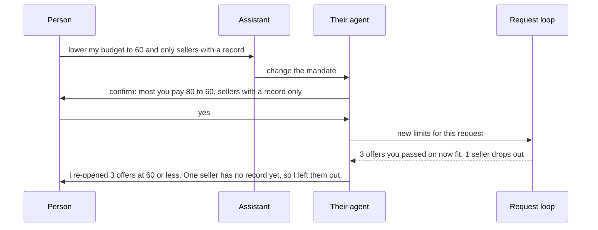
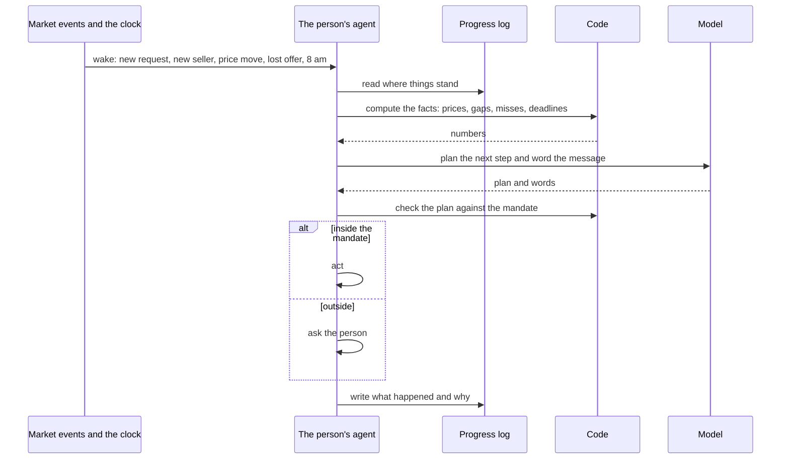
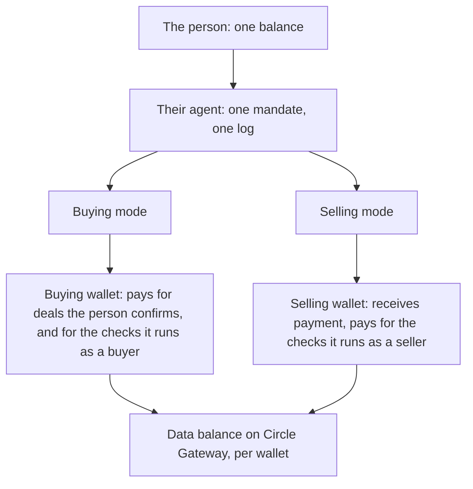

# 52 · An agent that works for you

T1 (find and agree), continuing roadmap item T1.8, with T6 (channels) for the brief and the questions and T5 (money) for the wallet limits. It builds on [view 41](41-agents-that-always-answer.md) (agents that always answer), [view 45](45-your-agent.md) (your agent, set up on one page) and [view 48](48-one-agent-per-person.md) (one agent per person). Raised by the owner on 5 Nov 2026 after an audit of how the agents work today: "Karwan agents is the different point. If it can not make the difference, then we have no unique point for the product." Approved by the owner the same day, with every decision as recommended.

## What is hard today

Read from the code and a read-only check of testnet over the 30 days to 5 Nov 2026.

The agents are fast. Most requests that drew an offer drew it within a minute, and 13 of the 25 requests agents worked ended in a match the person approved. What they don't do is work for the person over time.

- **Nobody holds the person's goal.** Each request runs its own script. Nothing wakes up to ask how this person is doing, or what to tell them.
- **What the agent knows never reaches the person.** The agents already work out a fair price for a request, the price range of settled deals in a category, and why every seller passed. None of it becomes a message.
- **Questions die.** Of 16 questions the agents asked people in the month, 13 expired unanswered. Each open question was sent again up to 9 times with the same words.
- **The flow runs one way.** Once a request is posted, the person can't say "lower my budget", "only sellers with a record" or "wait until Monday" and see the plan change.
- **Small models do the work people see.** Relevance, counter reasons, delivery checks and briefs run on fast, small models. They are right for filters, not for advice someone acts on.
- **Some counts are wrong.** An unlinked seller's agent still offers, but the event is recorded as a pass, so about a fifth of all "passes" didn't happen.
- **Failures are silent.** Paid research that fails is logged, not told.

## What others learned

- Long-running agents need a durable log and a harness outside the model, so a restart loses nothing and each step is checked ([Anthropic](https://www.anthropic.com/research/effective-harnesses-for-long-running-agents), [Anthropic](https://www.anthropic.com/research/managed-agents)).
- A model running a real shop priced badly and gave in to haggling until it had more structure and oversight (Anthropic and Andon Labs, Project Vend).
- Payments and other actions that can't be undone go to the person; the agent escalates after repeated failure (OpenAI's agent guide).
- People value agents that come to them: a short daily brief (ChatGPT Pulse), and an agent that remembers, works in the background and reports back (xAI's Grok Bot).
- Buyer agents in a test market took the first good-enough offer and were talked into paying scammers; supervised autonomy worked (Microsoft, Magentic Marketplace).
- Agent wallets get spending caps set by a person through a code the agent never sees; agents that could read the approval code raised their own caps (Circle Agent Stack; Cornell Tech and Yale, Oct 2026).

## The idea

Every person has one agent that works their trade all the time. It holds what they want and what it may do alone, watches the market on their behalf, tells them what it sees in plain words with one thing to do about it, does what they allowed, asks with a recommendation when it needs them, and changes course the moment they answer. Code sets every number. The model plans and explains. Money never moves without the person.

The request loops from views 41 and 48 stay as they are: each request is its own durable task, so many deals run at once and one failing never stalls the others. The person's agent sits above them. It sets their limits, reads what they did, and talks to the person.

## The mandate

What the agent works toward and what it may do alone, as one object the person can read in one screen or one message. It joins what is spread today across the setup answers, the ways to deal, the buying limits, Agree for me and the data budget.

| Part | Example |
|---|---|
| Goals | "Find me a logo designer this week." "Sell 20 bags of rice this month." "Tell me when tomatoes drop below 30 a crate." |
| Limits | Most I pay 80 USDC. My lowest price 25 a bag. Deliver within 5 days. |
| Alone | Make offers. Agree for me inside 70. Ask me above that. |
| Budget | Data and research up to 0.25 USDC a week. |
| Quiet | No messages after 9 pm. Brief at 8 am. |

1. **Code enforces it at every step.** The model never decides whether a step is inside the mandate.
2. **Every change is confirmed.** A change that raises what the agent may spend or agree to is confirmed through a channel the agent cannot read or answer for: a tap in the app, a reply in the person's own Telegram chat, or a passkey.
3. **A change re-plans the work.** The agent says what changes as a result, and does it.

## The loop

1. **It wakes for a reason.** A market event that touches the person's goals, a deadline coming close, a question unanswered, or the morning brief. It does not run in a busy loop.
2. **It reads before it acts.** The progress log says what it already told the person, what it tried and what came of it, so it never repeats itself.
3. **One step at a time, written down.** Each step is written before it runs and marked done after, the same way view 48 keeps request notes, so a restart resumes where it stopped.

## Coaching

The agent tells the person what it sees, with one thing to do about it. The facts come from Karwan's own data, computed by code. The model writes the sentence and picks the suggestion from the actions the code allows.

| The agent says | Computed from | The one action |
|---|---|---|
| "This is a test network. Budgets near recent prices land deals faster." | The network, the person's budget, recent prices in the category | Use 45 USDC |
| "You missed 13 requests this week because your price was above what the buyers offered." | Why the person's agent passed, grouped over the week | Lower to 35, or keep your price |
| "Settled deals for developers ran 40 to 65 USDC this month. Your budget is 25." | Price ranges from settled deals | Raise to 40, or wait |
| "4 developers rated 4.5 and up charge less than the offer you are about to accept." | Offers and records in the market, ranked by fit, then record | Show them |
| "Your request has had no offer for a day. Sellers in this kind of work usually need 7 days." | The request, deadlines in settled deals | Allow 7 days |

1. **Every number comes from code**, and every figure from the web is labelled as from the web and never decides alone (view 48, rule 5).
2. **At most three insights a day** per person, ranked by how much they would change the outcome. Never the same insight twice in a week unless something changed.
3. **The person's own facts only.** Another person's price is shown as a range, never by name, until they make an offer (view 41, decision 8).

## Questions that land

1. **One question, one recommended answer, one line of why.** "A buyer offers 22 for your 25 bags. Recent deals ran 21 to 24. I'd accept. Accept or counter at 24?"
2. **What happens if there is no answer**, said up front and kept: "If I don't hear from you by 6 pm I'll counter at 24."
3. **One channel**, the one the person last used. One reminder with new words and the deadline. No third message.
4. **The answer visibly changes the work**, and the agent says what it did.

## The right model for each job

| Job | Test network | Mainnet | Why |
|---|---|---|---|
| Brief, coaching, planning a goal, explaining a counter, the delivery check | Fast model (Haiku class) | The strongest model available (Opus class) | Judgement people act on. A few calls a day per person |
| Relevance, tags, yes or no checks | Fast model | Fast model | Once per seller per request, thousands of times a day |
| Every price, limit, ranking and decision about money | Code | Code | Predictable, testable, never talked out of a number |

**The strongest model runs on mainnet only** (owner, 5 Nov 2026). On the test network nobody pays real money for data, so Karwan keeps inference small there: every agent runs on the fast model, and the code that computes every number is the same on both networks. On mainnet the larger model is paid for by what Karwan earns from the data agents buy over x402: record checks at 0.005 USDC, passports and research. The cost of the larger model per person per day is kept below what an active agent's data reads bring in, and a daily cap per person holds it there.

If the model fails, the work falls to the next one in line and the message says nothing is lost. If every model fails, the agent works on code alone and says so once.

## One agent, two wallets

Everybody gets one agent per workspace (view 48, decision 7). It buys and sells as two modes, with one mandate, one memory and one progress log. Behind it sit two wallets, so what it spends buying and what it earns selling never mix, and the person still sees one balance.

1. **One agent, never two.** The person talks to one agent in every channel. "My buying agent" and "my selling agent" are two modes of it, not two brains.
2. **Two wallets behind it.** The buying wallet funds deals and the buyer's record checks; the selling wallet receives payment and pays the seller's record checks. Each keeps its own small data balance for paid reads (view 48).
3. **The mandate covers both.** Limits are set per mode ("most I pay", "my lowest price"), and the data budget is one number for the agent.
4. **The selling mode never offers on what the buying mode posted** (unchanged).

## Money and limits

1. **No money moves without the person** (unchanged): paying, locking money and releasing it always take their confirmation.
2. **Two walls on what an agent can spend.** Karwan checks the mandate in code before every payment the agent makes, such as record checks and research. On mainnet, each agent wallet also carries Circle's spending limits (per payment, daily, weekly, monthly), set by the person with a code the agent never sees.
3. **On the test network**, where Circle's limits are not available, Karwan's own check is the only wall, and the agent says so when the person sets a budget.

## Briefs and reports

| When | What | Where |
|---|---|---|
| Each morning, at the person's hour | What moved for them, the top insights, open questions, one suggestion | Telegram, else the website |
| As it happens | An offer worth seeing, a deal ready to confirm, a question with a deadline | The channel they last used |
| Weekly | What the agent did: deals landed, money saved against first offers, time from need to deal, advice taken, what it spent | Telegram and the website |

## The parts

| Part | Job | Where it lives |
|---|---|---|
| Mandate | One readable object: goals, limits, what it may do alone, budget, quiet hours; changed only with the person's confirmation | `backend/src/agents/mandate.ts` (new), joining `agents/limits.ts`, `agents/agentRecord.ts` and the setup answers |
| The person's agent | Wakes, reads the log, plans, checks the mandate, acts or asks | `backend/src/agents/personAgent.ts` (new, view 48 step 6) |
| Progress log | What the agent told the person, tried and learned, per person | Postgres, beside the request notes of view 48 |
| Insights | The coaching facts, computed in code | `backend/src/intelligence/insights.ts` (new), reading the market store and why agents passed |
| Questions | One channel, one reminder, a stated default | `backend/src/agents/agentQuestion.ts` |
| Reporter | Morning brief, live notes, weekly report | `backend/src/agents/reporter.ts` (new), on the in-app, email and Telegram rails |
| Models | The strongest model for judgement, a fast one for filters | `backend/src/llm/client.ts` |
| Tools | `show_my_mandate`, `change_my_mandate`, `whats_my_agent_seeing`, `why_no_deal` | `backend/src/assistant/agent.ts`, the guide and the canon |

## Rules this view adds

1. Every person has one agent that holds their mandate; every request loop reads its limits from it.
2. Code computes every number a person reads from their agent; the model writes the words.
3. Every message from the agent ends with one action the person can take.
4. A question states its recommended answer and what happens without a reply, and is reminded once.
5. A change that widens what the agent may do is confirmed through a channel the agent cannot answer for.
6. An event says what happened: a seller whose agent offered is never counted as a pass.
7. A failure that changes what the person gets is told to them once, in plain words.
8. Nothing waits on a model. Every step the agent takes has a path in code that completes it, and every sentence it sends has a template; a model may only improve the words, with a time limit, and on any failure the template goes out (owner, 5 Nov 2026).

## What fails where

| Failure | What the person sees |
|---|---|
| The strongest model fails | The same brief, from the fast model; nothing else changes |
| Every model fails | Code-only facts and actions, with one line saying the agent's words are short today |
| The market store is stale | Insights that need it are held, never shown from old data |
| The person doesn't answer | The stated default happens, and the agent says so |
| A mandate change isn't confirmed | Nothing changes; the agent says it is still working on the old limits |
| Karwan restarts | The agent resumes from its log; nothing is said or done twice |

## Order of work

| Step | What | Depends on |
|---|---|---|
| 0 | Correct the counts (an offering agent is not a pass), one reminder per question, research failures told | none |
| 1 | Insights v1: the five in the coaching table, in the weekly report and on request | step 0 |
| 2 | Questions that land: one channel, a stated default, one reminder, measured | none |
| 3 | The mandate as one object, read and changed in conversation; a change re-plans open requests | steps 1 and 2 |
| 4 | The person's agent and progress log; the morning brief | view 48 steps 6 and 7, step 3 |
| 5 | The strongest model for brief, coaching, planning and the delivery check, on mainnet only, with the daily cap | step 4, mainnet |
| 6 | The weekly report with deals landed, money saved and advice taken | step 4 |
| 7 | Circle spending limits on every agent wallet on mainnet, set by the person | mainnet |

## Decided by the owner, 5 Nov 2026

1. **Which model for judgement.** The strongest model on mainnet only, paid for by what Karwan earns from x402 data reads; the fast model everywhere on the test network; code for every number. The daily cost cap per person on mainnet starts at what an active agent's data reads bring in a day.
2. **Where the brief goes.** Telegram first, then the website; email only for people who use neither.
3. **How many insights a day.** At most three, ranked by how much they would change the outcome.
4. **What happens without an answer.** The agent states a default with every question and keeps it; for a price below the person's floor the default is a polite no.
5. **Step 0 first.** The counts are corrected before any insight is shown.
6. **One agent per person, on two wallets.** Buying and selling are two modes of one agent; a buying wallet and a selling wallet sit behind it.
