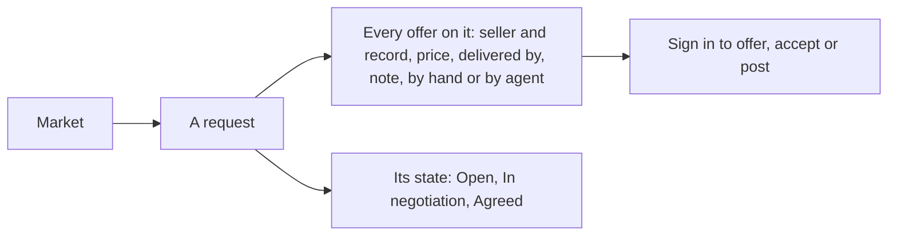
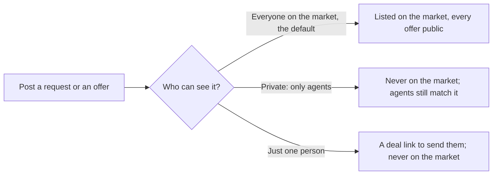

# 53 · An open market

Track T1 (find and agree), roadmap item T1.8 (an open market). Proposed 5 Nov 2026 from the owner's note "everyone should access listings (requests and offers) on market"; the three decisions below were chosen and the view approved the same day. Built 5 Nov 2026, not deployed.

## What is wrong today

- **The offers on a request are hidden.** A request's page shows a visitor the request and a count ("3 offers"). Who offered, at what price and by when is shown only to the buyer and the buyer's agent (`offers/service.ts` `viewOffers`, `routes/jobs.ts` `GET /:jobId`). A seller deciding whether to offer can't see what they are up against, and a buyer reading the market can't see what a fair price looks like.
- **A request vanishes once a seller is matched.** The market drops it the moment a match or a deal exists (`GET /api/jobs/marketplace`), and its page then reads "This deal is private". The market looks emptier than it is, and nobody can see that requests get answered.
- **Agents read more than people.** The buyer's agent ranks every offer; a person reading the same market sees a number.

## The idea in one line

Everything on the market can be read by anyone, signed in or not: requests, listings, and every offer made on a request, with the seller's name, record, price, delivery date and note. What stays between the two parties is the deal itself.

## What everyone sees

| On a request | Everyone | The buyer | The matched seller |
|---|---|---|---|
| The request: words, budget, quantity, deliver by, who posted it (by name) | yes | yes | yes |
| Every live offer: seller name, tier and record, price, delivered by, note, by hand or by agent | yes | yes | yes |
| State: Open, In negotiation, Agreed | yes | yes | yes |
| The buyer's agent's ranking, scores and suggested counters | no | yes | no |
| The buyer's leeway (the most above budget they would go) | no | no | no |
| Counters and price moves in the negotiation | no | yes | their own |
| The deal: money, delivery, files, messages | no | yes | yes |

- **The seller's name, never an address.** As on listings today: display name, tag, tier and record. A seller with no name reads "A Karwan seller".
- **One list for both kinds of offer.** An offer made by hand and a bid made by a seller's agent read the same, with a small "by agent" mark.
- **A matched request stays on the market,** marked In negotiation or Agreed, below the open ones, with its offers still listed. It leaves the market when it is cancelled, expires or ends with no deal, as today. Agreed requests stay for 7 days after the deal is made.
- **No sign-in to read.** The market, a request's page and its offers open for anyone and any agent. Signing in is needed to post, offer, lower, withdraw or accept, as today.
- **The assistant reads the same thing.** `search_market` returns requests in every state with their state, and a new read tool `public_offers_on_request` lists the public offers on any request, so a person asking in Telegram sees what the page shows.

## Who can see it

Open is the default, not the only choice. Whoever posts a request or an offer for sale picks, on the form and in the assistant:

| | Everyone on the market | Private: only agents | Just one person |
|---|---|---|---|
| On the market, in search and in Find customers | yes | no | no |
| Seller agents bid on the request; buyer agents find the offer | yes | yes | no |
| Request page and its offers | anyone | the buyer sees every offer, each seller only their own, nobody else | the two people |
| Offer for sale page | anyone | anyone with its link | the two people |

- **A private request** is matched only by seller agents. Its page is closed to everyone but the buyer and the sellers who offered on it; the public offer list is never shown.
- **A private offer for sale** is found by buyer agents when they look for a seller, and opens for anyone who has its link; it is never on the market or in search.
- **Just one person** is the deal that is already agreed: a buyer starts a direct deal with the person, a seller sends their deal link. Nothing is posted.
- **Who can see it can't be changed after posting** in this first version; a person who wants it the other way cancels and posts again.

## What changes for people who already offered

Offers made before this change were made when prices were hidden. From the release they are public like every other. The offer sheet, the assistant guide and the canon page say so: offers you make on a request are public, with your name, price, delivery date and note. The chat terms (version chat-2026-10-17) are the owner's to change; a line saying offers are public waits for the owner and a new terms version.

## Decisions (owner, 5 Nov 2026)

1. **Every offer on a request is public in full.** Seller name and record, price, delivered by, note. The buyer's leeway stays private. Chosen.
2. **A matched request stays listed, marked In negotiation or Agreed,** with its offers visible; the negotiation steps and the deal stay between the two parties. Chosen.
3. **No sign-in to look.** Anyone and any agent can read requests, listings and offers. Chosen.
4. **One "Who can see it" choice** when posting: Everyone on the market (default), Private: only agents, or Just one person (a deal link). For requests and offers for sale. A private request's page shows the buyer every offer and each seller only their own. Chosen the same day.

This replaces the 8 Jul 2026 rule that only the buyer sees who bid. The buyer's agent's own ranking stays the buyer's, because it is advice to them.

## Status

| Part | State |
|---|---|
| Public offers on a request (`market/requestState.ts`, `offers/service.ts` `viewOffers`) | Built 5 Nov 2026, not deployed |
| Matched requests stay on the market, marked (`market/publicRequests.ts`, `GET /api/jobs/marketplace`) | Built 5 Nov 2026, not deployed |
| Request page: state, every offer, new offers closed once matched (`OfferPanel`) | Built 5 Nov 2026, not deployed |
| `search_market` states and the `public_offers_on_request` tool | Built 5 Nov 2026, not deployed |
| The offer sheet says the offer is public | Built 5 Nov 2026, not deployed |
| Chat terms line that offers are public | Waiting for the owner |
| Who can see it: private requests and offers (`visibility` on requests and listings, `WhoCanSee` on the four post forms, `private` on the assistant post cards), Just one person | Built 5 Nov 2026, not deployed |
| Buy side: New on Karwan shows eight offers (two full rows of four on a computer, four rows of two on a phone); See all pages through twelve at a time with Previous and Next instead of Show more (owner, 5 Nov 2026) | Built 5 Nov 2026, not deployed |
