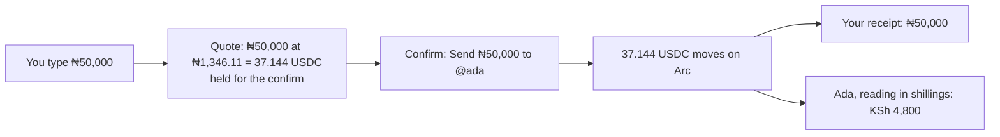

# 55 · Money in your own currency

Track T5 (money), roadmap item T5.2 (money-path re-architecture), and T2 (protected deals) for how a deal's price is agreed. Proposed 5 Nov 2026 from the owner's note: "everything can run in currencies with USDC underneath but UI sees the currency equivalent. The mix up in between will cause serious confusion. All txns and deals can be in local currencies." It follows [view 54](54-a-guide-as-you-sign-up.md), where every figure already reads in the chosen currency, and finishes what that view left half done: amounts are still typed in USDC.

## How it works today

- **Reading** is in your currency (view 54). The one block balance per page also shows the USDC under it.
- **Typing** is in USDC everywhere. About thirty screens take an amount. Six use `AmountHero`, the big field on Send, Withdraw, Add money, pay links and the deal guarantee: "0 USDC" with "≈ ₦…" under it. About 26 more have inline fields, on deal, offer, request, listing, contest, work and financier forms and on agent limits, and all carry a USDC suffix.
- **Confirming** shows one "Moves 20.00 USDC" row on the withdraw, order and release cards.
- **The server** stores every amount in USDC and knows nothing of the currency the person reads in. The assistant's tools take USDC.
- **Rates** come from CoinGecko, every 60 seconds, with open.er-api as the daily fallback. A rate older than 15 minutes counts as none, and then everything reads in USDC. The rate is a reference for reading: nobody trades at it.

So a naira user reads ₦26,922, types 20, and confirms "Moves 20.00 USDC". That mix of currencies is the confusion.

## The idea in one line

You type, agree and read in your own currency. USDC is what moves underneath, and you never see it, except on the one screen where another wallet has to send USDC.

## What changes for a person

**Typing.** Every amount field takes your currency: "₦ 50,000", with no USDC beside it and no "≈" line. With USDC chosen, or no fresh rate, the field reads USDC exactly as today. Max fills your whole balance, shown in your currency.

**Confirming.** The confirm card says what you typed: "Send ₦50,000 to @ada". The Moves USDC row goes. The figure on the card is held for the life of the card, so the rate cannot move under your thumb. If the card stays open more than 2 minutes, it asks you to look again.

**Deals.** You set the price of a request, an offer, a direct deal or a listing in your currency. The deal remembers the price as agreed, "₦100,000", and anyone reading in naira sees that figure for the whole life of the deal, even after the rate moves. Someone reading in another currency sees it converted at today's rate. What sits in escrow is the USDC worked out when the price was agreed.

**Balances and history.** These read at today's rate, as they do now. Your own receipt keeps the figure you typed. On the deal's or receipt's Proof, behind a tap, a "Settled 37.144 USDC" row records what moved on chain.

**The one place USDC stays.** Paying in from another network ("send exactly 37.144 USDC" from another wallet) and the bridge screens show USDC, because the other wallet sends USDC and nothing else. The developer docs and Karwan-wide public totals also keep it.

## How it works underneath

- **One quote.** A new `GET /api/rates/quote?currency=NGN&amount=50000` returns the USDC, the rate used and when it expires (2 minutes). The confirm sends the quote's id. The server checks it is unexpired and moves exactly its USDC. Every channel does the same (Telegram, the website assistant), so "send ₦50,000 to @ada" works in chat too.
- **USDC is still the truth.** Every stored amount stays in USDC, so nothing about contracts, escrow, ledgers or reconciliation changes. Records gain an optional `quote { currency, amount, rate, at }` beside the USDC: on a movement, on a deal's agreed price, on an offer's price and on a request's budget.
- **Rounding.** A typed local amount converts to USDC rounded down to 6 places, the token's precision. The person's figure is kept as typed, so a receipt never reads "₦49,999.98".
- **No rate, no local typing.** If the rate is older than 15 minutes, fields fall back to USDC and say nothing. A quote is never made from a stale rate.
- **Assistant.** Money tools take `amount` and an optional `currency` (default: the person's). They answer in the person's currency.

## Decisions for the owner

1. **A deal's agreed price stays fixed in the currency it was agreed in.** Recommended. The other choice is to recompute it every day at the live rate, but then "₦100,000" becomes "₦98,700" a week later, which reads as a broken promise.
2. **Who carries the rate risk between agreement and funding?** The USDC is fixed when the price is agreed, so the seller is paid what both sides agreed. If the rate has moved more than 2% by the time the buyer funds, the funding card says what that USDC is worth today ("Agreed at ₦100,000. At today's rate that is ₦102,300.") and the buyer confirms with that in front of them. (Ruling while building: the first draft said the USDC is fixed at funding, which would change the seller's amount after they agreed and contradicts the "Now ₦102,300" card in the same line.)
3. **Terms change.** The terms' Currency line says Karwan applies no exchange rate and that amounts entered are in USDC. With this view, amounts are entered in your currency and Karwan converts them to USDC at a published reference rate (CoinGecko). It is still not an exchange: no naira moves, and no fee is taken on the rate. The terms, FAQ and assistant guide change in the same batch. A legal read before mainnet is recommended.
4. **Proof keeps one USDC row.** Recommended, because a record has to say what actually moved. It sits behind Proof, never on the main receipt.

## What this view does not do

It does not add naira in or out (roadmap T5.4, a licensed partner). It does not change contracts, escrow or settlement. It does not let two people agree in two different currencies at once: a deal has one agreed currency, the creator's.

## As built

Built 5 Nov 2026, not deployed. Front end and back end deploy together.

- **Quote.** `GET /api/money/quote` (`backend/src/rates/quote.ts`) returns the USDC for a typed figure, rounded down to the micro, signed with the session secret and good for 2 minutes. A move or a price carries the token; `localFromQuote` keeps `{ currency, amount, rate, at }` only when the token is good and moves exactly its USDC, otherwise the record stays plain USDC.
- **Kept on the record.** Sends and withdrawals on Arc (`/api/bridge/record`, `/api/cashout/arc-send`) keep `local` on the money movement, and the sender's own ledger row returns it, so Activity, Recent and the receipt read the figure typed. Direct deals keep `agreedLocal` on create, edit and counter. Offers for sale keep `askingLocal`. Request budgets, offers made on requests, contest prizes, hourly rates, agent limits and price ranges are typed in the person's currency and stored in USDC; they read at today's rate.
- **Fields.** `useAmountInput` and `AmountHero` for the big amounts (Send, Withdraw, the agent sheet, pay links, the deal guarantee); `MoneyInput` for every inline field, which keeps each form in USDC underneath. `oneCurrency.test.ts` fails the build when a money field is a plain decimal input.
- **Confirms.** Send shows the figure typed; the release and order confirms lose their USDC rows; the funding card reads in your currency and shows the 2% line from decision 2.
- **Assistant.** Every tool that takes `amountUsdc` also takes `currency`; the figure is converted at today's rate before the tool runs, on the website and in Telegram alike. Since 6 Nov 2026 every turn also reads the account's currency and today's rate, so the assistant speaks and asks in that currency on its own ("How much do you want to request?", never "How much USDC") and passes the figure with its currency; with no fresh rate it says so and uses USDC. A move made from chat does not keep the typed figure on its record yet.
- **Hourly and monthly work (7 Nov 2026).** The rate labels no longer say USDC, and the rate, the paid and returned lines, the market's "Up to" line and every Pay button on the work pages read in the account's currency. `MoneyInput` sets its side padding inline: the global `.form-input` padding outranked the utility class, so the ₦ sign sat on top of the figure in every inline money field.
- **Setup questions (7 Nov 2026).** About you asked "Your usual price" with USDC examples and refused an answer in naira. Now the examples and the agent's read-back are in the currency the country set at sign-up, with round figures (₦30,000 to ₦60,000), and the server reads the answer in it: a ₦ or naira sign, "30k" or a bare figure is naira, then USDC at today's rate (`backend/src/agents/briefMoney.ts`, `agentBriefParse.ts`). USDC or dollars written out are still read as USDC. With USDC chosen, or no fresh rate, everything stays in USDC. Telegram's interview reads answers through the same route.
- **Proof.** The receipt has a Network proof fold with one Settled line in USDC.
- **Terms.** The Currency paragraph changed in all five languages and in `docs/terms-and-conditions.md`.

Rulings while building:

- A withdrawal to an outside wallet keeps its one Moves line in USDC, because that wallet receives USDC and shows it. Add money stays in USDC with the bridge, for the same reason.
- `MatchBanner.tsx` still has a USDC field: another session is changing that file. It is listed in `oneCurrency.test.ts` to move to `MoneyInput` when that work lands.

## Not done

- The assistant's own moves do not keep the typed figure on the record.
- Telegram's setup interview still writes its price examples in USDC ("20 to 40 USDC"); answers in naira are read, but the example is not said in naira yet.
- The notification for watched prices ("settle around {to} USDC (was {from})") still prints the old price as a bare number.

## Build order, once approved

1. Server: the quote endpoint, the optional `quote` on movements, deals, offers and requests, and the assistant tools taking a currency.
2. `AmountHero` and one shared inline `MoneyInput`, used by every amount field. A test fails the build if any field still prints a USDC suffix outside the network screens.
3. Confirm cards: the typed figure, quote held, Moves rows removed.
4. Deals: the agreed price shown fixed, and the funding check from decision 2.
5. Terms, FAQ, guide, canon, and this view's As built section.
