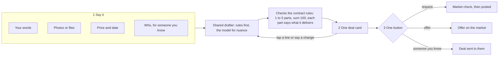

# 56 · Say it, and the deal is drafted

T1 (find and agree), serving T1.2 (choose the kind of deal) with T2 (protected deals) and T6 (one assistant everywhere). It builds on [view 30](30-negotiation-in-the-assistant.md) (the negotiation in the assistant), [view 48](48-one-agent-per-person.md) (one agent per person), [view 28](28-photos-on-listings.md) (photos on offers) and [view 55](55-money-in-your-own-currency.md) (money in your own currency). Raised by the owner on 6 Nov 2026: "a brief and your deal is prepared", "deal with who you already know should be simple, just state the agreements and terms and the deal is created", "the UI flow should always be simple and lead to one targeted end."

Status: Approved 6 Nov 2026 ("simplify deal postings"), building after the next-move nudge.

## What is hard today

- **Three forms, three shapes.** A request, an offer for sale and a deal with someone you know are three different forms (981, 610 and 1,030 lines). Each asks its own questions in its own order, so a person learns three flows to do one thing: agree work or goods for money.
- **The person builds the contract by hand.** Pay in parts, the milestone list, how much each part is, the review window, the accept window, trade type, Incoterms, payment terms, sourcing sector and region, price tolerance, "proven sellers only" and seller stake are all fields today. Most people do not know what half of them mean, and the defaults are right for nearly everyone.
- **The chat already does it better.** In the assistant, a person says "I need a logo by Friday, 150 dollars" and gets one card to confirm. The web form asks for the same thing in twelve controls. The assistant and the dashboard should be the same flow, and the dashboard is the one that drifted.
- **A request is posted before the market is checked.** The agent can search the offers already on Karwan in seconds, but the form posts first and searches after.

## The idea

Every way of starting a deal is the same three moves, on the web, in the assistant, on Telegram and over MCP:

1. **Say it.** One box in your own words, an attach button for photos or files, the price, and by when. For someone you know, one more box: who.
2. **Check the draft.** Karwan turns your words into one deal card the contract understands: what is delivered, the parts it is paid in and what each part delivers, the price in your currency, the date, and where it goes (the market, or the person you named). Tap any line to change it, or say the change ("make it one payment").
3. **Post or send.** One button. The end is always the same: a request on the market, an offer on the market, or a deal sent to a person.

Nothing else is asked. The settings that were fields become your agent's defaults, set once in Account, and the draft reads anything special you say ("FOB Lagos", "pay half up front") into the card.

## The screen

One screen for all three, with the words changing by side.

| | Buying | Selling | With someone you know |
|---|---|---|---|
| Title | What do you need? | What do you sell? | What did you agree? |
| Box | "A logo for my bakery, three ideas first, then final files" | "Ankara fabric, 6 yards a bundle, delivered in Lagos" | Who: email, Karwan tag, Paytag or wallet. Then the agreement in words. |
| Attach | Reference photos or files | Up to four photos (view 28) | Photos or files both sides see |
| Money | Most you will pay | Your price | The agreed price |
| Date | Needed by (chips and a date) | Ready in | Delivered by, or no date |
| Button | Prepare my request | Prepare my offer | Prepare the deal |

The money field is `MoneyInput` in the person's currency (view 55). Money and dates stay as fields because a wrong reading there costs real money; everything else is words.

The deal card then shows, in this order: the brief as a title, each part with what it delivers and its share ("1. Three logo ideas · 30%", "2. Final files · 70%"), the price in the person's currency, the date, where it goes ("On the market" or "To Ada"), and one protection line ("Held safely until you approve each part"). The button reads **Post request**, **Post offer** or **Send to Ada**. "Who can see it" is one line on the card, on the market by default, never a section.

## How the draft is made

One shared drafter on the backend, used by the web, every assistant tool and every channel, so a deal drafted in Telegram and on the web come out the same.

1. **Rules first.** Quantity is read by the existing rules (`llm/quantity.ts`), goods or service from the words and the photo, Incoterms and payment terms only when the person names them, the date from the server clock (never the model). Small or single-thing work gets one payment.
2. **The model for nuance.** When the words describe stages ("sketches first, then final files", "half on delivery"), the model proposes the parts and what each delivers, as structured output.
3. **The contract rules decide.** Every draft passes the same checks the routes already enforce: 1 to 5 parts, shares summing to 100, each part with a plain "what it delivers" the delivery check can read, a price above zero, a date in the future. A draft that fails is repaired or falls back.
4. **It never blocks.** If the model is slow, down or wrong, the draft is one part whose delivery is the brief, which is today's default. The person can always post.

The drafter never sets a price, never picks a seller, and never posts. It only fills the card; the person's tap is what posts or sends.

## Requests check the market first

When a request is prepared, the agent searches the offers already on Karwan (the existing market search) while the card is drawn. If offers fit, the card carries one line: "3 offers already fit. See them", with the best one named. The person can open them or post anyway. If nothing fits, nothing is shown and the request posts as today, with the agent finding sellers after.

## What leaves the forms

| Today a field | Becomes |
|---|---|
| Pay in parts, milestone list, shares | Drafted from the words; tap a part to change it |
| Review window, accept window | Agent defaults (today's: 24 hours to accept, the route's review rule), changeable in Account |
| Trade type, goods way | Read from the words and photos |
| Incoterms, payment terms, sourcing sector and region, their company | Read only when the person says them; otherwise not set |
| Price tolerance, proven sellers only, seller stake | Agent defaults in Account, not asked per post |
| Who can see it | One line on the card, on the market by default |
| Agree for me | Agent default, one line on the card when on |
| Documents | The one attach button |

No rule a deal is held to changes. The contracts, the delivery check and the funding steps receive the same fields they do today; only who fills them changes.

## The assistant and channels

The assistant's `propose_post_request`, `propose_post_offer` and `start_protected_deal` call the same drafter, so their cards gain the same parts and attach. The web screen calls one new endpoint that returns the draft card; posting still goes through today's routes, so nothing about funding, matching or the contracts moves. A channel only translates the three moves.

## What fails where

| Failure | What the person sees |
|---|---|
| The model is down or slow (over 4 seconds) | A one-part draft at once; "Split into parts" stays available on the card |
| The model proposes six parts or shares that do not add up | Repaired to the contract rules before the card is drawn; never shown broken |
| The words read as selling on the buying screen | One line on the card: "This reads like something you sell. Post it as an offer?" (replaces the warning box) |
| The person named is not on Karwan | Today's rule: the deal goes by email and waits for them |
| A photo is too large | Resized on the device, as offers do today |
| The market search fails | No line; the request posts as today |

## Decisions for the owner

1. **One screen shape for all three**, entered from Buy, Sell and "Someone I know". Recommended.
2. **Settings move to agent defaults in Account** (stake, proven sellers only, tolerance, review and accept windows). Recommended. The person can still say them in words for one deal.
3. **The agent drafts the parts**, and the person changes them by tapping or saying. Recommended.
4. **Requests check the market before posting**, shown as one line, never a page in between. Recommended.
5. **Money and date stay as fields**, everything else is words. Recommended.

## Out of scope

Hourly and recurring deals (T1.2 later), changing a deal after it is sent (today's edit and counter flow stays), the mobile app, and any change to the contracts.

## Status

| Part | State |
|---|---|
| This view | Approved 6 Nov 2026 |
| Shared drafter and its endpoint | Built |
| One screen for request, offer and direct deal | Built: each drafts its parts on Review; Pay in parts shows only once there are parts |
| Attach on requests and direct deals | Built: one Attach button for up to 4 photos or PDFs (a PDF up to 4 MB, 6 MB together), read by their bytes; a request's are seen by whoever can read the request, a deal's by the two sides only. A photo or PDF sent to the assistant with words about a request or a deal (website or chat) is held an hour; the next request or deal card shows Attached and posts it |
| Market check before posting | Built: Review on the request form and the assistant's post request name the open offers asking no more than the budget whose title words the request says, up to three, best first; the person's own, private and example offers never count |
| Assistant tools on the drafter | Built: post request and post offer cards carry the drafted parts; a direct deal splits by the stages its words name when no split was given (rules only) |
