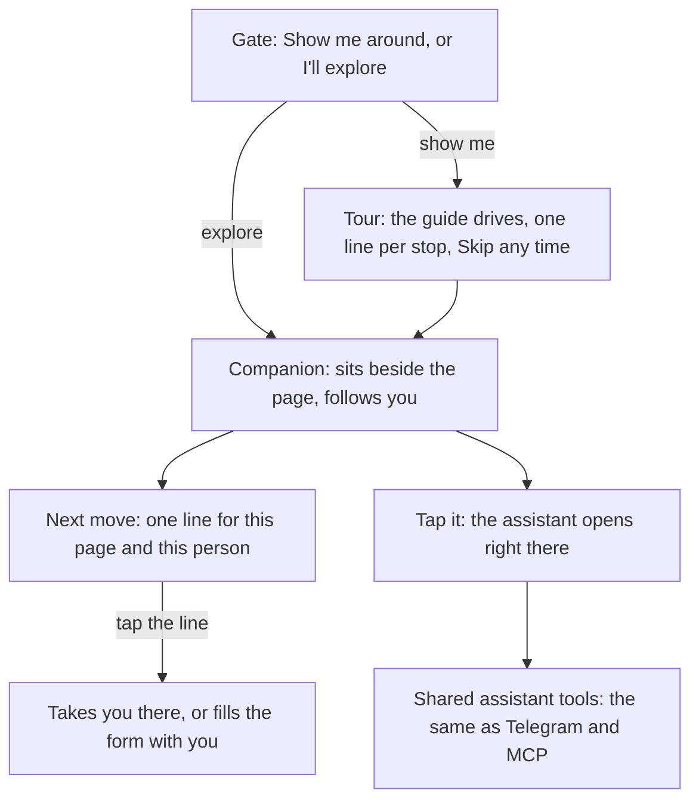

# 57 · A guide at every step

T6 (one assistant everywhere), serving T1 (find and agree) and the first-run experience. It replaces the scattered nudges of [view 54](54-a-guide-as-you-sign-up.md) (a guide as you sign up) and works with [view 56](56-say-it-and-the-deal-is-drafted.md) (say it, and the deal is drafted), [view 48](48-one-agent-per-person.md) (one agent per person) and [view 52](52-an-agent-that-works-for-you.md) (an agent that works for you). Raised by the owner on 6 Nov 2026: "it should be an assistant at every point of the app", "one of the problem of using products today is first knowing what to do at first glance", "users can skip if they want to go manual", with a reference site whose guided walkthrough the owner asked us to study.

Status: Approved 6 Nov 2026 for the next move first. The face, name, gate and tours wait for the designer's mascot.

## What is hard today

- **Seven guides that don't know each other.** Sign-up has its own pop (`GuidePop`), setup has agent lines, the market has a fading `Nudge`, the seller desk has desk nudges, deals have a record nudge, home has a record nudge and a profile nudge. Each speaks in a different place, in a different voice, and none knows what the person did a minute ago.
- **The assistant hides where it is needed most.** The Ask button is switched off on the landing page and during setup, which is exactly when a new person does not know what to do.
- **Nothing answers "what do I do here?"** A page opens with its controls and no first move. A person who does not already know escrow, agents or USDC sees a dashboard and leaves.
- **No character, no thread.** A nudge fades after six seconds and is gone. Nothing carries the person from one step to the next.

## What we learned from the reference

The owner pointed us at a site with a guided walkthrough. Studied on 6 Nov 2026, live in the browser and from its script. What it does well, in our words:

1. **A choice before anything else.** The first screen asks one thing: let a guide show you around, or skip and explore on your own. Both are one tap, and skip is never hidden.
2. **The guide drives, briefly.** It scrolls the page for you, stops at each part and says one short line about it, and acts on the real page instead of describing it. A countdown chip shows how long the tour has left, and Esc (Skip on a phone) hands control back at any moment. If you scroll against it, it asks once whether you want to stop, then stops.
3. **The guide stays after the tour.** When the tour ends or you skip, the character does not disappear. It settles beside what you are reading, follows you down the page, says a rare one-liner, and opens a chat when you tap it (or press Ctrl+K). A small copy of it lives in the header.
4. **Chat starts with suggestions.** The chat opens next to the character with a greeting and a row of questions to tap. Most of them are answered from written answers with no model call; free questions go to the model.
5. **It has a personality.** A name, a role, short lines with some humour, its own type, and sound that is off until you turn it on.

What we will not take: the visual design, the character art, the words, and the long theatrical bits (eating the headline, overclocking the ticker). Karwan moves people's money, so the guide is warm and short, never a show that delays the job.

## The idea

Karwan has one guide, with a name and a face, who is the same assistant on every page and in every channel. On the web it lives on the page beside what you are doing: it tells you the one next move, answers when you ask, and takes you there. It is the assistant you already have (the same tools, the same memory, the same limits), wearing a face.

## The guide

- **Name.** A placeholder until the designer delivers: we suggest **Kara** (short, from Karwan, easy to say in every language we ship). The name lives in one setting, so changing it later is one line.
- **Face.** An original placeholder: a round character in Karwan's colours with two eyes that look toward what it is talking about, drawn as one small file. It has a few moods (idle, talking, thinking, pleased, waiting for you). When the designer delivers the mascot, that one file is swapped and nothing else changes.
- **Voice.** First person, one line at a time, warm and plain, never cute about money. "This is your balance. Tap Add money to start." Not "Woohoo, money time!"
- **Type.** A rounded, friendly typeface used only for the guide's lines, its chat and the tour, so the guide always looks like itself and the product stays calm. We suggest Baloo 2, which also covers Hindi, with its Arabic sibling Baloo Bhaijaan 2, so all five of our languages (English, French, Swahili, Hindi, Arabic) read in the same voice. Everything else keeps General Sans.
- **Sound.** Off by default. A switch in the guide's menu.

## Four modes

### 1. The gate (first visit, and first sign-in)

One screen, two buttons: **Show me around** and **I'll explore myself**. The guide is on screen and says who it is in one line. The choice is remembered on the device, and can be changed in Settings or by asking the guide for the tour again.

### 2. The tour (about 60 seconds, skippable at every moment)

The guide moves the page and stops at each part with one line. Different tours for different places:

| Where | Stops |
|---|---|
| Landing (signed out) | What Karwan is, how a deal is held safely, the open market, how you get paid, start |
| First sign-in | Your balance, Buy and Sell, your agent, Telegram, your record |
| Market | Search, a request, an offer, making an offer |
| A deal | Where the money is, whose move it is, how to deliver or approve, ask a person |

A chip shows the time left and **Skip** (Esc on a keyboard). Scrolling against the tour asks once, then stops. Every stop's line is written in advance, in all five languages, so the tour costs nothing and never waits on a model.

### 3. The companion (always, after the tour or after skip)

The guide sits at the edge of the page, beside the part you are using, and moves with you. It shows **one next move** for this page and this person, chosen by fixed rules from what Karwan already knows:

| Situation | Next move |
|---|---|
| Signed in, balance empty | "Add money so a deal can start." |
| Has money, no request or offer | "Tell me what you need, or what you sell." |
| A request is posted, offers arrived | "Two offers came in. Want me to compare them?" |
| A deal waits on you | "Ada delivered. Check it and approve." |
| Agent not linked to Telegram | "Want updates on Telegram? One tap." |
| Nothing pending | Quiet. The guide just sits there. |

Tapping the line does it: it takes you to the right place and, where a form exists, fills what it can with you (for example, the brief in view 56). It speaks rarely: at most one unprompted line per page visit, never while you are typing, and never over a confirm sheet or a money screen.

### 4. Ask (tap the guide, or Ctrl+K)

The assistant opens right beside the guide, not in a separate corner widget. It starts with three or four questions that fit the page ("What happens to my money if they don't deliver?", "How do I get paid?"), then free text. It is the same assistant as today: the same tools, the same confirm cards, the same Talk to a person. The Ask button in the corner goes away; the guide is the way in.

## The brains, and what they cost

Three layers, cheapest first, so most of the guide costs nothing:

1. **Written lines.** Tour stops, gate, and the suggested questions with their answers: written in advance in five languages. No model call.
2. **Fixed rules.** The next move comes from the person's state (balance, open requests, deals waiting, links). No model call.
3. **A small model, only when needed.** Free questions, and rewording a next move when the rule's line does not fit, go to a small, fast model with a fixed, cached instruction about Karwan. We suggest Claude Haiku 5.5 on the key the owner connected (at $0.10 per million tokens in and $0.50 out, a token being about three quarters of a word, roughly a tenth of what Haiku 4.5 costs today), at low effort, with short answers. The full assistant model is kept for real work: drafting a deal, running the agent.

If the model is slow or down, the guide still shows the rule's line and the written answers; only free chat waits.

## Skip and manual

Skip is respected everywhere. **I'll explore myself** turns off the tour, not the guide's existence: the guide shrinks to a small face in the header that opens Ask when tapped and never speaks first. A switch in Settings, "Show the guide on pages", hides even that. Nothing in Karwan needs the guide to work.

## What it replaces

| Today | Becomes |
|---|---|
| `GuidePop` on sign-up | The guide's lines on the sign-up steps |
| Setup's agent `Nudge` lines | The guide, speaking as your agent during setup |
| `Nudge` (fades after 6 seconds) | The companion's next move |
| Desk nudges, record nudges, profile nudge | Next-move rules |
| The corner Ask button (`AssistantWidget`) | Tap the guide or Ctrl+K; same chat, same tools |

The words already written in view 54 keep their meaning; they move into the guide.

## Channels

On Telegram and over MCP there is no face, but the guide is the same assistant with the same name and the same next-move rules, so "what should I do now?" gets the same answer everywhere. A channel only translates.

## What fails where

| Failure | What the person sees |
|---|---|
| The model is down or slow | The rule's line and the written answers; free chat says it will answer shortly |
| Reduced motion is on | The guide does not fly or scroll the page; it stays still and the tour becomes a few cards with Next |
| A phone screen | The guide sits above the bottom bar and never covers a button; Skip replaces Esc |
| A screen reader | The guide's lines are announced politely once; the tour is a list of steps |
| The person keeps closing it | After two closes on a page, it stays quiet on that page for the visit |
| A confirm or money screen is open | The guide steps aside and stays silent |

## Decisions for the owner

1. **One guide with a name and a face, everywhere**, replacing the seven nudge pieces and the corner Ask button. Recommended.
2. **The name Kara as a placeholder**, swapped by one setting. Or give us the name now.
3. **A placeholder mascot until the designer delivers**, swapped by one file. Recommended.
4. **A gate on first visit and first sign-in**, with Show me around and I'll explore myself. Recommended.
5. **Rounded type only for the guide** (Baloo 2 and Baloo Bhaijaan 2). Recommended.
6. **Haiku 5.5 for the guide's free answers**, written lines and rules for everything else. Recommended.
7. **Order of build:** the guide and companion on signed-in pages first (where people get lost), the landing tour second.

## Out of scope

The designer's final mascot and its animation set, the mobile app, voice, and games.

## Status

| Part | State |
|---|---|
| This view | Approved 6 Nov 2026, next move first |
| Next-move rules on the shared core, `GET /api/guide/next`, `whats_pending` returns the same move | Built 6 Nov 2026, not deployed |
| Next-move nudge on every signed-in page, in the rounded type; the fading notes and the sign-up guide share that type | Built 6 Nov 2026, not deployed |
| The nudge steps aside while a button or a field is under it, sits above the bottom bar wherever the bar shows, and after a close says nothing more on that page | Built 12 Nov 2026, not deployed |
| Figma: placeholder face, gate, tour, sign-up and first open (phone, dark) | Drawn 6 Nov 2026 |
| Face, name, gate, tours, companion beside the page, Ask from the face | Waiting for the designer's mascot |
