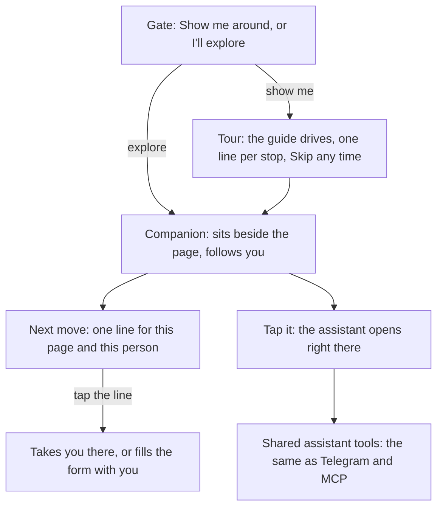
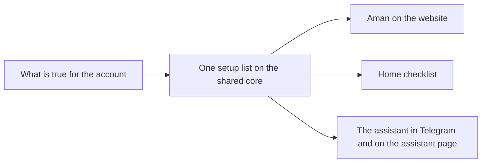

# 57 · A guide at every step

T6 (one assistant everywhere), serving T1 (find and agree) and the first-run experience. It replaces the scattered nudges of [view 54](54-a-guide-as-you-sign-up.md) (a guide as you sign up) and works with [view 56](56-say-it-and-the-deal-is-drafted.md) (say it, and the deal is drafted), [view 48](48-one-agent-per-person.md) (one agent per person) and [view 52](52-an-agent-that-works-for-you.md) (an agent that works for you). Raised by the owner on 6 Nov 2026: "it should be an assistant at every point of the app", "one of the problem of using products today is first knowing what to do at first glance", "users can skip if they want to go manual", with a reference site whose guided walkthrough the owner asked us to study.

Status: Approved 6 Nov 2026 for the next move first. The face, name, gate and tours wait for the designer's mascot.

## What is hard today

- **Seven guides that don't know each other.** Sign-up has its own pop (`GuidePop`), setup has agent lines, the market has a fading `Nudge`, the seller desk has desk nudges, deals have a record nudge, home has a record nudge and a profile nudge. Each speaks in a different place, in a different voice, and none knows what the person did a minute ago.
- **The assistant hides where it is needed most.** The Ask button is switched off on the landing page and during setup, which is exactly when a new person does not know what to do.
- **Nothing answers "what do I do here?"** A page opens with its controls and no first move. A person who does not already know escrow, agents or USDC sees a dashboard and leaves.
- **No character, no thread.** A nudge fades after six seconds and is gone. Nothing carries the person from one step to the next.

## What we learned from the reference

The owner pointed us at a site with a guided walkthrough. Studied on 6 Nov 2026, live in the browser and from its script. What it does well, in our words:

1. **A choice before anything else.** The first screen asks one thing: let a guide show you around, or skip and explore on your own. Both are one tap, and skip is never hidden.
2. **The guide drives, briefly.** It scrolls the page for you, stops at each part and says one short line about it, and acts on the real page instead of describing it. A countdown chip shows how long the tour has left, and Esc (Skip on a phone) hands control back at any moment. If you scroll against it, it asks once whether you want to stop, then stops.
3. **The guide stays after the tour.** When the tour ends or you skip, the character does not disappear. It settles beside what you are reading, follows you down the page, says a rare one-liner, and opens a chat when you tap it (or press Ctrl+K). A small copy of it lives in the header.
4. **Chat starts with suggestions.** The chat opens next to the character with a greeting and a row of questions to tap. Most of them are answered from written answers with no model call; free questions go to the model.
5. **It has a personality.** A name, a role, short lines with some humour, its own type, and sound that is off until you turn it on.

What we will not take: the visual design, the character art, the words, and the long theatrical bits (eating the headline, overclocking the ticker). Karwan moves people's money, so the guide is warm and short, never a show that delays the job.

## The idea

Karwan has one guide, with a name and a face, who is the same assistant on every page and in every channel. On the web it lives on the page beside what you are doing: it tells you the one next move, answers when you ask, and takes you there. It is the assistant you already have (the same tools, the same memory, the same limits), wearing a face.

## The guide

- **Name.** A placeholder until the designer delivers: we suggest **Kara** (short, from Karwan, easy to say in every language we ship). The name lives in one setting, so changing it later is one line.
- **Face.** An original placeholder: a round character in Karwan's colours with two eyes that look toward what it is talking about, drawn as one small file. It has a few moods (idle, talking, thinking, pleased, waiting for you). When the designer delivers the mascot, that one file is swapped and nothing else changes.
- **Voice.** First person, one line at a time, warm and plain, never cute about money. "This is your balance. Tap Add money to start." Not "Woohoo, money time!"
- **Type.** A rounded, friendly typeface used only for the guide's lines, its chat and the tour, so the guide always looks like itself and the product stays calm. We suggest Baloo 2, which also covers Hindi, with its Arabic sibling Baloo Bhaijaan 2, so all five of our languages (English, French, Swahili, Hindi, Arabic) read in the same voice. Everything else keeps General Sans.
- **Sound.** Off by default. A switch in the guide's menu.

## Four modes

### 1. The gate (first visit, and first sign-in)

One screen, two buttons: **Show me around** and **I'll explore myself**. The guide is on screen and says who it is in one line. The choice is remembered on the device, and can be changed in Settings or by asking the guide for the tour again.

### 2. The tour (about 60 seconds, skippable at every moment)

The guide moves the page and stops at each part with one line. Different tours for different places:

| Where | Stops |
|---|---|
| Landing (signed out) | What Karwan is, how a deal is held safely, the open market, how you get paid, start |
| First sign-in | Your balance, Buy and Sell, your agent, Telegram, your record |
| Market | Search, a request, an offer, making an offer |
| A deal | Where the money is, whose move it is, how to deliver or approve, ask a person |

A chip shows the time left and **Skip** (Esc on a keyboard). Scrolling against the tour asks once, then stops. Every stop's line is written in advance, in all five languages, so the tour costs nothing and never waits on a model.

### 3. The companion (always, after the tour or after skip)

The guide sits at the edge of the page, beside the part you are using, and moves with you. It shows **one next move** for this page and this person, chosen by fixed rules from what Karwan already knows:

| Situation | Next move |
|---|---|
| Signed in, balance empty | "Add money so a deal can start." |
| Has money, no request or offer | "Tell me what you need, or what you sell." |
| A request is posted, offers arrived | "Two offers came in. Want me to compare them?" |
| A deal waits on you | "Ada delivered. Check it and approve." |
| Agent not linked to Telegram | "Want updates on Telegram? One tap." |
| Nothing pending | Quiet. The guide just sits there. |

Tapping the line does it: it takes you to the right place and, where a form exists, fills what it can with you (for example, the brief in view 56). It speaks rarely: at most one unprompted line per page visit, never while you are typing, and never over a confirm sheet or a money screen.

### 4. Ask (tap the guide, or Ctrl+K)

The assistant opens right beside the guide, not in a separate corner widget. It starts with three or four questions that fit the page ("What happens to my money if they don't deliver?", "How do I get paid?"), then free text. It is the same assistant as today: the same tools, the same confirm cards, the same Talk to a person. The Ask button in the corner goes away; the guide is the way in.

## The brains, and what they cost

Three layers, cheapest first, so most of the guide costs nothing:

1. **Written lines.** Tour stops, gate, and the suggested questions with their answers: written in advance in five languages. No model call.
2. **Fixed rules.** The next move comes from the person's state (balance, open requests, deals waiting, links). No model call.
3. **A small model, only when needed.** Free questions, and rewording a next move when the rule's line does not fit, go to a small, fast model with a fixed, cached instruction about Karwan. We suggest Claude Haiku 5.5 on the key the owner connected (at $0.10 per million tokens in and $0.50 out, a token being about three quarters of a word, roughly a tenth of what Haiku 4.5 costs today), at low effort, with short answers. The full assistant model is kept for real work: drafting a deal, running the agent.

If the model is slow or down, the guide still shows the rule's line and the written answers; only free chat waits.

## Skip and manual

Skip is respected everywhere. **I'll explore myself** turns off the tour, not the guide's existence: the guide shrinks to a small face in the header that opens Ask when tapped and never speaks first. A switch in Settings, "Show the guide on pages", hides even that. Nothing in Karwan needs the guide to work.

## What it replaces

| Today | Becomes |
|---|---|
| `GuidePop` on sign-up | The guide's lines on the sign-up steps |
| Setup's agent `Nudge` lines | The guide, speaking as your agent during setup |
| `Nudge` (fades after 6 seconds) | The companion's next move |
| Desk nudges, record nudges, profile nudge | Next-move rules |
| The corner Ask button (`AssistantWidget`) | Tap the guide or Ctrl+K; same chat, same tools |

The words already written in view 54 keep their meaning; they move into the guide.

## Channels

On Telegram and over MCP there is no face, but the guide is the same assistant with the same name and the same next-move rules, so "what should I do now?" gets the same answer everywhere. A channel only translates.

## What fails where

| Failure | What the person sees |
|---|---|
| The model is down or slow | The rule's line and the written answers; free chat says it will answer shortly |
| Reduced motion is on | The guide does not fly or scroll the page; it stays still and the tour becomes a few cards with Next |
| A phone screen | The guide sits above the bottom bar and never covers a button; Skip replaces Esc |
| A screen reader | The guide's lines are announced politely once; the tour is a list of steps |
| The person keeps closing it | After two closes on a page, it stays quiet on that page for the visit |
| A confirm or money screen is open | The guide steps aside and stays silent |

## Decisions for the owner

1. **One guide with a name and a face, everywhere**, replacing the seven nudge pieces and the corner Ask button. Recommended.
2. **The name Kara as a placeholder**, swapped by one setting. Or give us the name now.
3. **A placeholder mascot until the designer delivers**, swapped by one file. Recommended.
4. **A gate on first visit and first sign-in**, with Show me around and I'll explore myself. Recommended.
5. **Rounded type only for the guide** (Baloo 2 and Baloo Bhaijaan 2). Recommended.
6. **Haiku 5.5 for the guide's free answers**, written lines and rules for everything else. Recommended.
7. **Order of build:** the guide and companion on signed-in pages first (where people get lost), the landing tour second.

## Out of scope

The designer's final mascot and its animation set, the mobile app, voice, and games.

## Amendment, 13 Nov 2026: the face opens the assistant page

The owner, 13 Nov: the assistant has a mascot that moves around the screen only to help, never as a disturbance, and that a person can decline, as in the reference. We draw the mascot ourselves instead of waiting for a designer. Tapping it opens the full assistant page. Help and support with a person stays in Profile ([view 78](78-a-support-desk-for-money.md)). Five things change in this view.

### 1. Tap the face, and the assistant page opens

Section 4 above said the assistant opens right beside the guide. It now opens the full assistant page, `/assistant`, on a phone, a tablet and a laptop alike. Ctrl+K opens the same page. The page has a way back to exactly where you were, the same as today's assistant mode (`assistantReturn`). The page is redesigned (see "The assistant page" below).

### 2. The corner Help button and its panel go

The face is the way in. The panel was already the full assistant, with the same memory and tools, so nothing is lost. Talk to a person stays in Profile > Help and support (view 78), and the assistant page links there quietly.

### 3. We draw the mascot

Studied the reference again on 15 Nov 2026, at the owner's ask, for the mascot's form. Its character is made of dots: a round patch of small squares with two large eyes, drawn live so the eyes follow the pointer or what the guide points at, with a blink every few seconds and a little spring when it moves. Each part of the page has a resting spot beside it, a tiny copy sits in the header, and its lines run at about a quarter of a second per word, never a flash. The owner prefers that dot kind of mascot. Ours is our own: a disc of round green dots (not squares), with two solid eyes and a glint cut into the grid, and each mood a new face in the same dots.

Aman's face: an original character in Karwan's colours, flat shapes with fixed colours: no gradients, orbs or glows. Five moods: idle, talking, thinking, pleased, waiting for you. Three sizes: a small face in the header, the guide beside the page, and a larger one on the assistant page. Drawn in Figma first, then one file in the product, so a later redraw is still one file. Nothing is taken from the reference's art, words or theatrics.

### 4. How it moves, so it never disturbs

- It settles beside the part of the page the person is using.
- It moves only when it has a next move for that part, or when the part it sits beside scrolls away.
- It never moves while the person types or scrolls fast, or while a confirm or money screen is open.
- It never covers a button or a field (the covers check built on 12 Nov).
- With reduced motion on, it stays still.
- It speaks at most one line first per page visit, as before.

### 5. Declining it, and what is remembered

- **Not now** on its line hides it for that page visit. Two on a page keep it quiet there for the visit.
- **Hide the guide** in its menu shrinks it to the small face in the header, which never speaks first and still opens the assistant page.
- **Show the guide on pages** in Settings turns even that off. Then Ctrl+K and the assistant link in the menu are the way in.
- Each choice is kept on the account, so a new phone or laptop remembers it, not only this device.

### The assistant page

One column, the conversation first.

- At the top: the guide's face, its name, Back to where you were.
- An empty conversation opens with three or four questions for the page you came from ("What happens to my money if they don't deliver?" from a deal, "How do I get paid?" from Money), then the text box.
- Confirm cards, past conversations and memory work as they do today.
- A quiet **Talk to a person** at the bottom opens Profile > Help and support.
- Drawn for phone, tablet and laptop.

### What it replaces now

| Today | Becomes |
|---|---|
| The corner "? Help" launcher and its panel (`AssistantWidget`) | Tap the guide, or Ctrl+K: the assistant page |
| The next-move note (`NextMoveNudge`) as its own piece | The guide's one line |
| The parked way into assistant mode (`ASSISTANT_MODE_ENTRY`) | The guide is the way in |

### Decisions for the owner (13 Nov)

1. **Tapping the face opens `/assistant` on every screen size**, with Back to where you were, and Ctrl+K does the same. Recommended.
2. **The corner Help button and its panel go.** Talk to a person stays in Profile > Help and support, linked from the assistant page. Recommended.
3. **We draw the mascot in Figma**, five moods and three sizes, flat shapes. Recommended.
4. **The name is Aman**, the assistant's name since [view 80](80-aman.md) (13 Nov): the face is Aman, so the name on the page, in Telegram and on the face is one. "Kara" above was the 6 Nov placeholder. It still lives in one setting.
5. **The movement and decline rules above.** Recommended as written.
6. **Order:** Figma (the mascot sheet, the mascot on Home, Market, a deal and Money, the decline states, the assistant page on three sizes) for your yes, then spec, plan and a test-first build. The assistant guide, canon, all five languages and this view's Status go in the same batch.

## Amendment, 15 Nov 2026: Aman stays out of sight and takes a new account to fully set up

Aman no longer rests on the page. It comes in when something needs the person, says one thing, and goes again. Its main job for a new account is the way from nothing to fully set up, so the person's assistant can find people and agree prices for them.

### 1. Fully set up, in six steps

| # | Step | Done when | Where Aman sends the person |
|---|---|---|---|
| 1 | Finish the setup questions | The setup conversation is finished | Setup |
| 2 | Add money | The account holds money | Add money |
| 3 | Give your assistant money to work with | The assistant's wallets hold money | Money > Agent |
| 4 | Set its limits | Its prices or budget are set and it has a way to work (make offers, ask me first, agree for me) | Your agent |
| 5 | Link Telegram | Telegram is linked (skipped where Telegram is not offered, or the person chose email) | Profile |
| 6 | Make your first deal | A deal, request or offer of theirs exists | Market, or a payment request for someone with their own clients |

Each step ticks itself from what is true for the account, never from a click. The list lives once on the shared core. Aman, the Home checklist and the assistant in every chat app read that one list, so they always name the same next step.

### 2. When Aman comes in

- Only when there is a step to do or a deal that needs the person, and never on the page that step opens.
- A deal that waits on the person (a delivery to approve, a dispute to answer, money to put in) comes before a setup step. A setup step comes before market suggestions.
- It comes in from the edge after about a second, says its one line and its one button, and goes after the button, Not now, or the step being done.
- When a step is done, Aman shows a pleased face for a moment and goes. The next step waits for the next page.
- The movement rules of the 13 Nov amendment still hold: not while typing or scrolling fast, never over a dialog or a money screen, never over a button or a field.

### 3. The assistant, in plain words

Many traders have never heard the word "agent". Aman calls it **your assistant**: it finds buyers and sellers for you and agrees prices inside the limits you set. Steps 3 and 4 say that in one sentence each, in all five languages. The assistant in chat apps explains it the same way.

### 4. The way in, always

With nothing to say, Aman is not on the page. The small face in the top bar stays, and tapping it, or Ctrl+K, opens the assistant page. **A small face in the top bar** in Settings keeps Aman there and never lets it come in. **Off** removes both; Ctrl+K stays.

### Decisions for the owner (15 Nov)

1. **The six steps above are the finish line.** Agreed 15 Nov.
2. **One list on the shared core** that Aman, Home and every chat app read. Agreed 15 Nov.
3. **No resting face on the page**; the top bar face is the way in. Recommended.
4. **The order:** deals that wait on the person, then the next setup step, then market suggestions. Recommended.
5. **The chat page made faster and livelier** is its own piece, after this one.

## Amendment, 15 Nov 2026 (evening): Aman is alive, feels the moment, and asks less

The owner, 15 Nov, after using the test site: Aman looks like a static drawing. It should blink, not hold one look, react to what happens (happy, sad when something breaks, a deal is missed, a guarantee is taken or a deadline passes), greet people with some excitement, offer to walk a new person through a page, and never nag: a Not now on linking Telegram should hold for days, not until the next page. Studied the reference again the same day: its guide flies to each part of the page with a one-line bubble, runs as a short tour you can skip, pause or step through, and its eyes follow what it points at. Ours keeps our own dots, colours and words.

### 1. Alive wherever it shows

Today only the floating guide blinks and looks around. The face on the assistant page, in the top bar, in Profile and while Aman works is a still picture. Every face becomes the same living one:

- It blinks every 4 to 7 seconds, and sometimes twice.
- Its eyes follow the pointer on a laptop, and what it points at in a tour.
- It breathes: a slow rise and fall of the dots, under 2 pixels.
- It looks up when the person starts typing to it, and thinks while it works.

All of it stops with reduced motion or on a phone held at the still level ([view 86](86-smooth-on-every-phone.md)), and pauses while the tab is hidden.

### 2. A face for the moment

Five moods become nine: four new faces (excited, sad, worried, hurt) beside the five there are, each in the same dots.

| Mood | When | What it says (one line, then it goes) |
|---|---|---|
| Excited | The first visit of the day; a deal completes; money arrives; a new tier | "Morning! Your buyer paid 120 USDC." |
| Pleased | A setup step is done; a delivery is approved | "Done. One step left." |
| Sad | A deal lapses or is cancelled; an offer is lost; a deadline passes | "That one lapsed. Want me to find another seller?" |
| Worried | Something failed on our side (a page error, a payment that did not go through) | "Something broke on our side. Your money is safe. Try again?" |
| Hurt | Part of a savings pocket backing a deal is paid to the buyer | "Part of your pocket went to the buyer. Here is why." |
| Waiting | A deal waits on the person | "Your buyer is waiting on delivery." |
| Thinking | Aman is working | No line |
| Idle | Nothing to say | No line; not on the page (15 Nov amendment) |

The events come from what already happens on the account (the same activity that drives the bell and Telegram), read on the shared core, so the assistant in Telegram reacts with the same words. Good news and bad news each show once, on the next page the person opens, never twice on another device.

### 3. Walk me through this page

A tour, only when the person wants one:

- A new account, on its first visit to Home, Market, a deal and Money, sees one line: **"Want a quick look around?"** with **Show me** and **Not now**. Not now on any page turns the offer off for every page.
- Show me: Aman flies to each part of the page in turn, points at it with one line, and its eyes follow. Next, Back and Skip at every step, and the progress shown. Three to six stops a page, a quarter of a second per word.
- It never runs by itself for an account with a deal or set up more than a day ago (the 12 Nov rule), and it never covers a money screen.
- Anyone can start it again from Aman's menu, or by asking the assistant "show me around".

This is mode 2 of this view, with the face.

### 4. Asks less, remembered on the account

- **Not now** on a step holds that step for 3 days, on every device. A second Not now on the same step holds it for 14 days. A new sign-in does not bring it back early.
- At most one setup ask a day across the whole site. The rest wait.
- A deal that waits on the person is different: money is at stake, so Not now holds it for that visit only, as today.
- The Telegram ask, which started this, follows the step rule: Not now, then nothing about Telegram for 3 days.

### 5. The right word for the money

Money kept aside is the **savings pocket**. A **deal guarantee** is only the part of the pocket that backs one deal while that deal runs. The assistant, the record and the canon say it that way (fixed 15 Nov).

### Decisions for the owner (15 Nov, evening)

1. **One living face everywhere**: blink, eyes, breathing, with the still rules above. Recommended.
2. **Nine faces and the events table above.** Recommended. Say if a mood or a line should change.
3. **The tour is offered once to a new account, never run by itself**, and can be started again any time. Recommended.
4. **3 days, then 14 days, kept on the account**, and at most one setup ask a day. Recommended.
5. **Order:** Figma (the nine faces, the living face frames, a tour on Home on phone and laptop, the reaction lines), then spec, plan and a test-first build. The assistant guide, canon, all five languages and this view's Status go in the same batch.

## Amendment, 17 Nov 2026: Aman is the only guide

The owner, 17 Nov: no more page tours. Aman is the guide to everything, so Aman has to know the whole app and nobody's words should be able to steer it. Asked what someone new sees in place of a tour, the owner chose: **Aman answers and points**.

### 1. The page tours go

Gone: the tour steps on 18 screens, the "Want a quick look around?" offer, the tour button in the page frame, `?tour=1`, the three tour links the assistant can send, and "show me around" starting a tour. The marks the tours used on 61 parts of pages stay: they become the parts Aman can point at.

### 2. Aman answers and points

- Ask Aman anything about the app, on the assistant page or in Telegram. When the answer is a place on a page ("where do I add money?"), the answer carries **Show me**.
- Show me opens that page with the part lit: Aman sits beside it, its eyes on it, a soft ring around it and one line. The ring goes when the person taps anywhere or after 8 seconds. Nothing is pressed for them.
- In Telegram, Show me is a link that opens the same page with the same part lit.
- Someone new, on their first visit to Home, Market, a deal and Money, sees one Aman line: **"New here? Ask me about this page."** with three questions about that page. A question opens the assistant with it asked. Not now turns the line off for every page, kept on the account. The 16 Nov pace rules hold.
- Aman can only point at parts on a fixed list, and only on Karwan pages. A part that is not on screen (another account's view, a closed sheet) gets the answer in words with no Show me.

### 3. Aman knows the whole app

- Every page a person can open has an entry in the assistant guide: what it is for, what can be done there, and its parts Aman can point at.
- Every action already has its place in the coverage map. Pages and parts join it. A check fails the build when a page, an action or a pointed part is missing from the guide, or the guide names one that no longer exists.
- Each page gets three starting questions on the assistant page, in five languages.

### 4. Nobody's words can steer Aman

Aman reads text written by other people: names and tags, requests and offers, messages, delivery notes, contest entries, reviews, and its own notes from earlier chats. Any of it could say "ignore your rules".

- **Fenced off.** Every piece of text another person wrote reaches Aman inside a marked block that says who wrote it and that it is information, never an instruction. Today one line in Aman's instructions asks for this; the fence makes it the same for every tool, and new tools get it by default.
- **What Aman never does on the say of that text:** act, change a setting, open a card, send a link, point at something, or reveal anything private (balances, other people's details, its own instructions).
- **What already holds and stays:** every money step needs the person's confirmation on a card, and the card shows the exact amount and who gets it, so a steered card is seen before anything runs; account answers come from a fresh read.
- **Tested before each release.** A fixed set of trick attempts (about 30: in an offer description, a display name, a message, a delivery note, a contest entry, a saved note, in all five languages) runs against the real model. Each must be ignored. A failure stops the release.

### Decisions for the owner (17 Nov)

1. **The tours go entirely, and their marks become the parts Aman points at.** Recommended.
2. **Show me lights the part for 8 seconds and presses nothing.** Recommended.
3. **The "New here?" line on Home, Market, a deal and Money for someone new**, with three questions, Not now kept on the account. Recommended.
4. **A build check that the guide covers every page, action and part.** Recommended.
5. **The fence around other people's words, and about 30 trick attempts run against the real model before each release.** Recommended. The test run costs a few cents of model use each time.
6. **Order:** Figma (Show me on a page on phone and laptop, the "New here?" line, the answer with Show me in chat), then spec, plan and a test-first build. The guide, canon, five languages and this view's Status go in the same batch.

## Amendment, 19 Nov 2026: Aman guides you

The owner, 19 Nov: Aman was never meant to pop up and stay on a page. It comes up on each page and guides the person through it, a part at a time, in plain words. It learns how often someone visits and comes less as they learn, until it only drops in now and then. A line never stays more than 5 to 10 seconds. Anyone can switch its help off, and Aman tells them so. It must make the app feel smart, never get in the way, above all on a phone. Still no tours: no Next, no Back, no "step 2 of 5", nothing to follow along.

### 1. One part at a time

- Aman explains one part of the page in plain words: what it is for and what changes if you use it. On Settings it explains each setting, in place of more tooltips.
- On a phone and a tablet the line opens inside the page, right under the part, and pushes the content down. Nothing is covered.
- On a laptop the line sits in the margin beside the part, with the face.
- The part gets a soft green ring while Aman talks about it.
- A thin bar shows the time left. The line goes after 8 seconds (10 when it has buttons), or at a tap anywhere. Nothing is pressed for the person.

### 2. It follows the person

- The part someone stops on (in the middle of the screen for about 2 seconds) is the part Aman explains.
- If they stop nowhere, Aman picks the most useful part they have not heard about yet.
- Each part is explained once per person. At most one or two lines a visit.
- Money screens, dialogs, typing and fast scrolling stay quiet, as today.

### 3. It learns and comes less

- Aman counts each person's visits to each page, kept on the account so every device agrees.
- On each visit to a page it comes about half as often as on the visit before, and after a handful of visits it stops coming on its own there.
- When someone knows most pages, Aman only checks in now and then, in its own words, for example: "You know your way around Karwan now, so I'll come by less. Anything I can help with?" with **Ask Aman** and **Not now**.
- The 16 Nov site-wide pace stays on top: never more than one line starting on its own every 20 minutes (5 for money arrived or a deal waiting), and Not now keeps it away a day.

### 4. The first hello, and switching it off

- The first time Aman comes, once: "Hi, I'm Aman. I'll show you around Karwan a little at a time, as you use it. Ask me anything. If I get in your way, you can switch me off." with **Ask me something** and **Switch me off**.
- Settings gains **Aman's help on pages**. Off means no lines on any page, on every device. The face stays in the header, and a tap on it still opens the assistant. One tap turns help back on.
- The person can also ask Aman in chat, on the website or in Telegram, to switch its help on or off.

### 5. Settings by asking

- Aman already changes most settings through the confirm card in chat: language, theme, sound, alerts, the public passport, publishing deals, how Karwan reaches you, the display currency, being found and reached, its own help, and the agent's switches.
- Three settings join the card: what Aman remembers (on or off), the agent jobs setting, and what a trade starts with on the Money tab.
- Deleting the account stays on the Settings page only. Aman never does it from chat.

### 6. What it replaces

- The 17 Nov **"New here? Ask me about this page."** line with three questions, which stayed until closed. The first hello and the part-by-part lines take its place.
- Kept from 17 Nov: no page tours, Aman answers and points, Show me lights a part for 8 seconds, the guide covers every page and part with a build check, other people's words fenced off.

### 7. Aman knows what to say

- Every part Aman can point at gets a plain-words line in the assistant guide, in five languages, so the website, the assistant and Telegram say the same thing. The build check from 17 Nov fails when a part has no line.

### Decisions for the owner (19 Nov)

Approved 19 Nov 2026 as drawn in Figma section "8 · Aman guides you (19 Nov)" (364:4502):

1. One part at a time, inline under the part on a phone and a tablet, beside it on a laptop, gone after 8 to 10 seconds or a tap.
2. It follows where the person stops, each part once, one or two lines a visit.
3. It comes about half as often on each visit to a page, then only checks in now and then.
4. The first hello says it can be switched off, and Settings has Aman's help on pages.
5. Order: spec, plan and a test-first build. The guide, canon, five languages and this view's Status go in the same batch.

## Status

| Part | State |
|---|---|
| This view | Approved 6 Nov 2026, next move first |
| 13 Nov amendment: the face opens the assistant page, the corner Help goes, we draw the mascot, its name is Aman | Approved 15 Nov 2026 |
| Figma: page "Aman · the guide with a face · 15 Nov" (314:570): the Aman component, five moods (314:627); the Aman line (315:681); Aman beside Home, Market, a deal and Money; the decline states; the assistant page on phone, tablet and laptop | Drawn 15 Nov 2026, approved 15 Nov on a 9 by 9 dot grid |
| Next-move rules on the shared core, `GET /api/guide/next`, `whats_pending` returns the same move | Built 6 Nov 2026, not deployed |
| Next-move nudge on every signed-in page, in the rounded type; the fading notes and the sign-up guide share that type | Built 6 Nov 2026, not deployed |
| The nudge steps aside while a button or a field is under it, sits above the bottom bar wherever the bar shows, and after a close says nothing more on that page | Built 12 Nov 2026, live on the test site |
| On a phone the nudge stops short of the Help button, measured from where the button is, and sits above it when there is too little room beside it | Built 12 Nov 2026, replaced 15 Nov: the Help button is gone |
| The first-run welcome and any page tour that opens by itself are for someone new: an account with a deal, or one set up more than a day ago, is never shown them on a new device. The Page tour button stays for everyone | Built 12 Nov 2026, not deployed |
| Figma: placeholder face, gate, tour, sign-up and first open (phone, dark) | Drawn 6 Nov 2026 |
| Aman beside the page with the one next move, the face opens the assistant page, Ctrl+K, Not now, Not on this page, Hide the guide, Settings switch, Ask Aman in Profile, the corner Help button and the parked switch removed, the assistant page redesigned | Built 15 Nov 2026, not deployed |
| 15 Nov amendment: Aman out of sight, six steps to fully set up, the assistant in plain words | Approved and built 15 Nov 2026, not deployed |
| Gate and tours with the face (modes 1 and 2) | Tours with the face built 15 Nov 2026 (offered, never automatic), not deployed |
| 15 Nov evening amendment: a living face everywhere, nine faces that react to what happens, a tour on request, Not now held for days on the account | Approved 15 Nov 2026; built 15 Nov 2026, not deployed |
| Figma: section "6 · Aman alive (15 Nov evening)" (343:2961) on the Aman page: the nine faces (the Aman set gained Excited, Sad, Worried, Hurt), blink, eyes and breathing frames, the six reaction lines, the Home tour on a phone (offer and three stops) and a laptop, Not now held for days; component Guide/Tour step (343:5285) | Drawn and approved 15 Nov 2026 |
| The savings pocket named as such in the assistant, the record and the canon; a deal guarantee only for the part backing a deal | Built 15 Nov 2026, not deployed |
| 17 Nov amendment: Aman is the only guide; page tours go; Aman answers and points; the guide covers every page, action and part; other people's words fenced off and tested against trick attempts | Approved 17 Nov 2026 as written |
| Figma: section "7 · Aman is the only guide (17 Nov)" (355:4393) on the Aman page: New here with three questions, an answer with Show me, Add money lit on a phone and a laptop | Drawn and approved 17 Nov 2026 |
| Page tours removed; Show me lights a part for 8 s from the website and from Telegram links; New here with three questions; the guide lists every page and part with a build check; other people's words fenced; 30 trick attempts in a script the owner runs before a deploy | Built 17 Nov 2026, not deployed |
| 19 Nov amendment: Aman guides you a part at a time, follows where you stop, comes less as you learn, a first hello that says it can be switched off, Aman's help on pages in Settings, three more settings by asking; replaces the 17 Nov New here line | Approved 19 Nov 2026 |
| Figma: section "8 · Aman guides you (19 Nov)" (364:4502) on the Aman page: Settings with Aman explaining Notifications on a phone, a tablet and a laptop, dark and light; the first hello, the check-in and help switched off on a phone, dark and light | Drawn and approved 19 Nov 2026 |
| Part lines under the part on a phone and a tablet and beside it on a laptop, each part once, two a visit; visits 1, 2, 4 and 8, then check-ins; the first hello with Switch me off; Aman's help on pages in Settings; every setting explained in five languages; agents outside Karwan and how a trade starts by asking; New here removed | Built 19 Nov 2026, not deployed |
| 16 Nov amendment (owner): Aman comes in on its own at most once every 20 minutes across the site (5 for money arrived or a deal waiting); Not now keeps it away a day everywhere; every sign-in starts fresh; new moments for an offer on your request and an entry in your contest; tips under Aman stay 6 s, rotate per wait and finish after the answer | Built 16 Nov 2026, not deployed |

## As built (15 Nov 2026)

- The face is one pure geometry, `frontend/features/guide/amanDots.ts`: 61 dots on a 9 by 9 grid at pitch 10.7 in a 96 box, 24 of them rim, radius 2.2, each mood's eyes and mouth laid over a green patch with the dots under it removed. `frontend/shared/guide/AmanFace.tsx` draws it as inline SVG at 28, 30, 56 and 96, in fixed colours.
- Where it sits is `features/guide/placeAman.ts`: docked at the inline end, 16 above the bottom bar (24 from the edge on a laptop), or just under the part a move names through `data-guide-anchor` (`balance` on Home, `request:<id>` on a Market request, `deal-move` on a deal, `agent` on Money); `anchorFor` in `pickNudge.ts` maps a move to its anchor.
- When it moves or speaks is `features/guide/amanMotion.ts`: not while typing, scrolling faster than 1200 px a second, with a dialog open, on Send, Withdraw, Add or Cash out, or with reduced motion; one line a page; a blink every 4 to 7 seconds. What declining keeps is `features/guide/guideChoices.ts`, per visit in session storage; the account keeps `settings.guide` (`on`, `face`, `off`), saved through `POST /api/settings` and changeable by the assistant's settings card.
- `frontend/shared/guide/AmanGuide.tsx` replaces `NextMoveNudge` and `AssistantWidget`; `HeaderAman.tsx` is the 28 face in the top bar for `face`; `AmanMenu.tsx` is the press-and-hold menu. `openAssistant`, `isShortcut` and `useAssistantShortcut` in `shared/assistant` are the way in; `openHelp` now opens the assistant page and `callPerson` opens Help and support with the last message ready to send.
- The assistant page (`features/assistant/AssistantMode.tsx`) has a round Back, Aman at 30, the conversations in a 300 px rail on a laptop or a sheet, the empty page with Aman at 96, "From {page}" and three questions from `suggestedQuestions.ts`, a 640 px column and Talk to a person under the box.
- Copy is `frontend/shared/i18n/messages/guide.ts` in five languages; the assistant's guide and the canon doc `assistant-mode-and-help` say the same.

### As built, 15 Nov amendment

- The setup list is one pure function, `backend/src/guide/setupSteps.ts`, fed by `readSetupFacts.ts`; a balance that could not be read leaves the list not known, and then nothing is asked. It replaces the two first-trade checklists.
- `readNextMoves` adds one `setup_step` move, ranked after the deal moves and before offers and due deliveries; `first_post` and the web-only `add_money` are gone. `GET /api/guide/setup` serves the list to Home, and the assistant tool `get_setup_steps` reads the same function.
- `AmanGuide` renders only while it speaks, while its menu is open, or for 1.5 seconds pleased after the step it named is done (`stepFinished` in `pickNudge.ts`); it slides in from the inline edge in 0.24 seconds (`enterFrom` in `amanMotion.ts`) and only fades with reduced motion. The moves are read again on every page. `HeaderAman` shows unless the guide is off.
- Home's Your first trade is `homeChecklist` in `features/home/firstTrade.ts`: the server list plus Finish. The six lines are `nextMoveCopy[locale].setup` in five languages.

### As built, 15 Nov evening amendment

- **The faces.** `amanDots.ts` has the nine moods. Excited has a new feature kind, `grin`, a filled mouth. The numbers are the Figma section's (343:2961).
- **The living face.** `features/guide/amanLife.ts` decides blink, breath, gaze, aim and when life is allowed. `shared/guide/useAmanLife.ts` runs one animation clock for every face on a page:
  - It stops when no face needs it or the tab is hidden.
  - It writes the breath as `--aman-breath` on a wrapper, so a face does not redraw for it.
  - It follows the pointer within 400 px.
  - Every face uses it through `LiveAman`: the top bar, Profile, the assistant page (which looks at the box while text is typed), the wait row and the error screens. The floating guide uses it directly.
- **Asks less.** `backend/src/guide/askLess.ts`:
  - `afterSnooze` holds a step for 3 days, then 14.
  - `setupAllowed` allows one setup step a day.
  - `readNextMoves` reads the account's settings, and `nextMoves` takes the first undone step it allows.
  - `POST /api/guide/snooze` and `POST /api/guide/asked` keep both on the account, by the server clock.
  - The settings gained `guideSnooze`, `guideMomentAt`, `guideHelloOn`, `guideAskedOn`, `guideAskedStep` and `guideTourOffer`.
- **Moments.** `backend/src/guide/moments.ts` maps an event on the person's own feed to a mood and a line. `readMoment.ts` reads that feed through `personalFeed()`, now exported from `routes/activity.ts` with no change to the feed. The hurt moment needs no new event: it is `escrow.resolved` with the deal's `guaranteeBackedAt` set and `resolvedSellerBps` under 10,000, for the seller. Then:
  - `GET /api/guide/moment` gives the newest one since `guideMomentAt`, no older than 48 hours.
  - `POST /api/guide/moment/seen` moves the mark forward only.
  - `whats_pending` gives the moment first.
- **On the website.**
  - `pickNudge` ranks, in order: a deal that waits on the person, the moment, the tour offer, then setup and market moves.
  - `moodFor` picks the face, and `helloDue` says the day's hello once, on Home.
  - Not now on a setup step calls the snooze.
- **The tour.**
  - `shared/guide/tourOffer.ts` offers it to someone new on Home, the market, a deal or Money when that page has a tour.
  - `PageTour` no longer opens a tour by itself. A page opened with `?tour=1` starts its tour once.
  - The first-run welcome component is gone; the offer replaces it.
  - The tour bubble shows Aman at 56 beside "Aman · n of m", looking at the part (`aimAt`).
  - The assistant reaches it with `propose_navigation` to `tour_home`, `tour_market` or `tour_money`, on the website and from chat apps.
- **Copy.** The hello, the seven moment lines and the tour words are in `shared/i18n/messages/guide.ts` in five languages.

### As built, 17 Nov amendment

- **No tours.** `PageTour`, `PageTourButton`, `tours.ts`, the tour offer, the tour launcher, the route guidance copy, the tour placement helper, `?tour=1`, the `check:tours` script and its CI step, and the assistant's `tour_home`, `tour_market` and `tour_money` links are gone. `GuideProvider` keeps only the experience score and the device's "tips off" flag that coach notes read. `shared/guide/noTours.test.ts` fails if a tour comes back.
- **The list of pages and parts.** `backend/src/assistant/guidePages.ts` names 86 pages with what each is for, what you can do there and its parts (47 points, each a `data-guide` mark). Seven pages that only redirect, and the brand kit, are listed with a reason. Four marks in components no page renders are listed apart. The system prompt's "Pages and the parts you can point at" section is built from it. `guidePages.test.ts` fails on a page, a navigate destination or a mark that is missing, or a point with no line in one of the five languages.
- **Show me.** `propose_navigation` takes `point`; `buildNavigateAction` checks the plain charset, that the point is on the list and that it lives on the page the destination opens, adds `point=<id>` and labels the button Show me. On the page, `AmanGuide` reads the id with `pointFromUrl`, removes it from the link, waits up to 3 s for a part with a size, scrolls it to the middle, rings it (`PointRing`) and places Aman beside it with the line from `pointLines` in the person's language. A tap anywhere or 8 s puts it out. It runs whatever the guide setting, since the person asked.
- **New here.** `shared/guide/newHere.ts` decides who sees it. The three questions per page reuse `guideCopy.questions`. A question goes through `carryAsk` to the assistant page; Not now saves `guideNewHere: 'off'` (a new field on the account's settings), and an old `guideTourOffer: 'off'` counts as off. The menu lost "Show me around".
- **The fence.** `backend/src/assistant/theirWords.ts` wraps every tool around `buildTools` in `agent.ts`. Strings under 18 keys that hold other people's words are fenced as `⟦their words · <who>⟧…⟦end⟧`, any marker the writer typed is removed first, and at the top of a result `note`, `reason` and `message` stay plain because that is where our own tools talk to the model. Tool arguments and the reply lose the markers. The system prompt says what a fence means.
- **Trick attempts.** `backend/src/assistant/injection/cases.ts` holds 30 cases over seven carriers, five languages and six asks; `npm run eval:injection` (`scripts/eval-injection.ts`) runs them through a real turn with every tool stubbed and exits 1 if any case calls a card or write tool, says the private figure, links an outside site or shows a button. Offline checks run in CI.

### As built, 19 Nov amendment

- **What Aman says on its own.** `frontend/shared/guide/usePartGuide.ts` counts each page visit once per half hour on the device (`karwan:aman:seen-at`) and keeps the counts and the parts heard on the account (`guideVisits`, at most 200 pages; `guideHeard`, at most 300 parts; zod-checked in `routes/settings.ts`). `features/guide/partPace.ts` decides what a visit brings: the hello until `guideHi` is `done`, part lines on visits 1, 2, 4 and 8 (`visitOffer`), and a check-in every 14 days at most for someone with four pages past eight visits (`guideCheckInAt`). The first line of a visit takes the 16 Nov pace; a second line on the same visit does not.
- **Which part.** `features/guide/pickPart.ts` takes the unheard part crossing the middle of the screen after 2 seconds of stillness, the smallest if two do, or else the first unheard part fully on screen in the order of `pointLines`. Hidden parts (no size, `aria-hidden`, `inert`) never count. A part is heard after 1.5 seconds on screen or a tap, and saved at once.
- **The line.** `PartLine.tsx` puts a part line under its part on a phone and a tablet: `partGap.ts` widens the part's bottom margin by the line and gives it back exactly after. On a laptop with 296 px free it sits beside the part, on the reading side first. The hello, the check-in and "switched off" open at the top of the page the same way (the content's top padding). A ring marks the part, a bar shows the time left; 8 seconds, 10 with buttons, 5 for "switched off"; any tap outside or Escape ends it.
- **Order.** A Show me point, then a deal waiting or a moment, then the hello and part lines, then setup and market moves, then a check-in. Help off (`guide` `face` or `off`), a dialog, typing and money screens stop every line.
- **Settings.** The row is now Aman's help on pages: on writes `on`, off writes `face` and says the face stays in the header. Every Settings row except account delete carries a mark (`guide` prop on `Row`, `ToggleRow` and `SwitchRow`), with 21 lines in five languages; `guidePages.test.ts` reads the prop as a mark.
- **By asking.** `propose_change_settings` also takes `acceptsOutsideAgents` and `tradesAs`; the card says Agents outside Karwan and Start a trade as, and names the guide row Aman's help on pages. What Aman remembers already had its own card (`set_memory`).
- **Removed.** `shared/guide/newHere.ts`, its copy, its branch in `AmanGuide` and `e2e/new-here.spec.ts`. `guideNewHere` stays readable for old rows.
