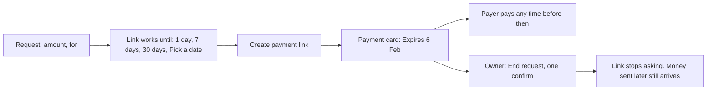
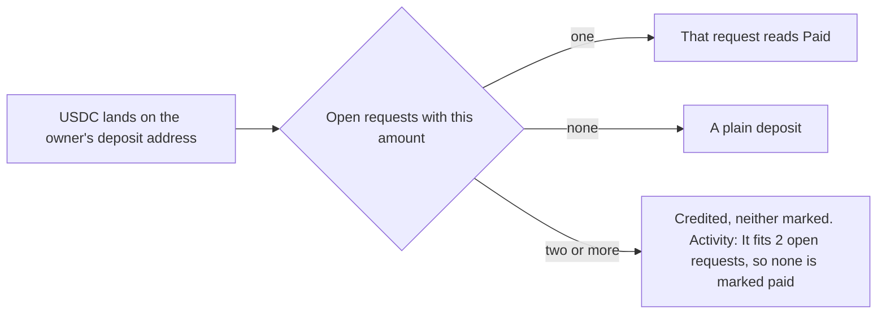

# 58 · A request that lasts as long as you need

Track T5 (money). Asked by the owner 6 Nov 2026 ("for people you already know, our payment request should help you collect payment easily from anywhere around the world; instead of a default 7 days, you could set the expiry date"). The 90-day limit was approved the same day, and so was putting audit item M-03 (a deposit that fits two open requests) in the same batch. Built 6 Nov 2026, not deployed.

## What was wrong

- **Every link died after a week.** `/request` always asked for 7 days, and the backend refused anything longer. Someone billing a client monthly, or waiting on a buyer abroad, had to make a new link each week.
- **The assistant made 7-day links too,** whatever the person said.
- **A link could only be ended through the assistant.** The page had no way to stop one.
- **A deposit that fit two requests disappeared from both.** USDC sent to someone's own deposit address is matched to an open request by amount. With two open requests for the same amount, Karwan rightly marked neither, but nothing told the person. The money was credited and the requests stayed open, with no line explaining why.

## The flow

- **Link works until** sits under the amount and the note. 7 days is picked. Each choice shows the date it ends on, and Pick a date opens the calendar from tomorrow up to 90 days ahead. A date means the end of that day where the person is.
- **The assistant takes it in words:** "until 6 Feb" becomes `expiresOn`, "for 30 days" becomes `expiresInDays`, and saying nothing gives 7 days. The backend holds every path to the same 90 days.
- **End request** is on the owner's own view of an open link. The confirm sheet says what changes: the link stops asking for payment, and money sent to its addresses afterwards still reaches the owner, because those addresses keep forwarding (`late` receipts, built in October).

## A deposit that fits two requests

Money sent through a link's own page or own addresses never takes this path: it is tied to its request by the transaction or by the address. Only a transfer to the owner's general deposit address is matched by amount, and a longer life makes two open requests for the same amount more likely. So the guess stays off, and history now says why.

## Where it lives

| Part | File |
|---|---|
| Limits, the 7-day default, words to minutes, the tie count | `backend/src/money/depositRequests.ts` (`MAX_REQUEST_TTL_MINUTES`, `DEFAULT_LINK_TTL_MINUTES`, `linkTtlMinutes`, `pickDepositRequest`) |
| Route limit | `backend/src/routes/deposit.ts` |
| The assistant tool | `create_payment_link` in `backend/src/assistant/agent.ts` |
| The activity line | `backend/src/circle/depositWatcher.ts` (`depositFitsRequests`) |
| The choice and the calendar | `frontend/features/payLink/linkExpiry.ts`, `LinkExpiryChips.tsx`, `CreatePayLink.tsx` |
| End request | `frontend/features/payLink/PayRequestView.tsx` |

## Not in this batch

- A non-USDC token sent to a deposit or link address (audit M-04) is still logged and not shown. It is the other half of plan item 5 and comes next.
- Changing the end date of a link that already exists. End it and make a new one.
